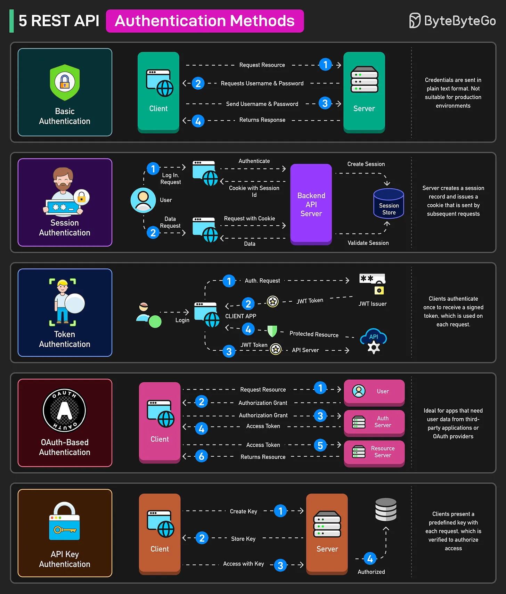

# 198 - 5 phương thức Authentication cho REST API

- Nguồn: ByteByteGo Big Archive System Design 2025
- Trang PDF: 403-404
- Ảnh minh họa: `../assets/198/figure-01.png`

## Hình minh họa

## Dịch sát

1. Basic Authentication: Client đưa username và password đã Base64-encode vào mọi request header. Cách này đơn giản nhưng insecure vì credential được truyền ở dạng plaintext. Hữu ích cho quick prototype hoặc internal service trên network an toàn.

2. Session Authentication: Sau khi login, server tạo một session record và phát hành cookie. Các request tiếp theo gửi cookie đó để server validate user state. Được dùng trong traditional web-apps.

3. Token Authentication: Client authenticate một lần để nhận signed token, rồi trình token trong mỗi request cho stateless authentication. Được dùng trong single-page application và modern API cần authentication scalable, stateless.

4. OAuth-Based Authentication: Client lấy access token thông qua authorization grant từ OAuth provider, rồi dùng token đó để gọi resource server thay mặt user. Được dùng trong các trường hợp third-party integration hoặc app cần delegated access tới user data.

5. API Key Authentication: Client trình một predefined key, thường trong header hoặc query string, với mỗi request. Server verify key để authorize access. Được dùng trong service-to-service hoặc machine-to-machine API nơi simple credential check là đủ.

## Dịch nội dung trong hình

- `Basic Authentication`: client request resource, server yêu cầu username/password, client gửi username/password, server trả response; credential gửi dạng plain text nên không phù hợp production nếu không có HTTPS và bảo vệ bổ sung.
- `Session Authentication`: user login, backend API server authenticate, tạo session trong `Session Store`, gửi cookie có session id; request sau gửi cookie để validate session và trả data.
- `Token Authentication`: client login, gửi auth request tới `JWT Issuer`, nhận JWT token, gửi token tới API server để truy cập protected resource.
- `OAuth-Based Authentication`: client request resource, nhận authorization grant từ user/auth server, đổi lấy access token, dùng access token gọi resource server và nhận resource.
- `API Key Authentication`: server tạo key, client store key, client access bằng key, server verify và authorize.

## Tóm tắt & giải thích dễ hiểu

Authentication API có nhiều mức độ. Basic đơn giản nhưng yếu. Session phù hợp web app truyền thống. Token/JWT phù hợp SPA/mobile/API stateless. OAuth/OIDC phù hợp delegated access và social login. API key phù hợp machine-to-machine nhưng không nên dùng thay user authentication chi tiết.

## Ví dụ thực tế - không nằm trong tài liệu gốc

Dashboard web nội bộ có thể dùng session cookie với CSRF protection. Mobile app có thể dùng access token ngắn hạn và refresh token. Một partner gọi API billing của bạn có thể dùng API key hoặc OAuth client credentials tùy yêu cầu security.

## Ghi chú kỹ thuật - không nằm trong tài liệu gốc

Basic Authentication truyền credential dạng Base64, không phải encryption. Nếu bắt buộc dùng, phải đi qua HTTPS và thường chỉ nên dùng cho môi trường kiểm soát chặt.

## Thuật ngữ chính

- `Authentication`: xác thực danh tính.
- `Authorization`: phân quyền truy cập.
- `Basic Auth`: gửi username/password trong header.
- `Session`: state đăng nhập lưu phía server.
- `JWT`: signed token chứa claim.
- `OAuth2`: framework delegated authorization.
- `OpenID Connect`: identity layer trên OAuth2.
- `API Key`: khóa định danh client/service.

