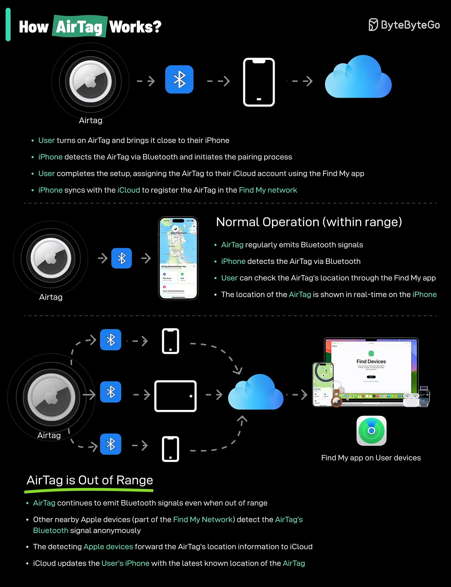

# 199 - AirTags hoạt động như thế nào?

- Nguồn: ByteByteGo Big Archive System Design 2025
- Trang PDF: 405-406
- Ảnh minh họa: `../assets/199/figure-01.png`

## Hình minh họa

## Dịch sát

AirTags hoạt động bằng cách tận dụng kết hợp Bluetooth technology và mạng lưới Apple devices rất lớn để giúp bạn tìm đồ bị mất.
Đây là breakdown về cách chúng hoạt động:

1. Bluetooth Signal: Mỗi AirTag phát ra một secure Bluetooth signal có thể được các Apple device gần đó như iPhone, iPad, v.v. trong Find My network phát hiện.

2. Find My Network: Khi một AirTag nằm trong phạm vi của một Apple device thuộc Find My network, device đó relay anonymous và secure thông tin location của AirTag lên iCloud.

3. Location Tracking: Sau đó bạn có thể dùng Find My app trên Apple device của mình để xem approximate location của AirTag trên map.

Limitations:
Lưu ý rằng AirTags phụ thuộc vào Bluetooth technology và sự hiện diện của Apple devices trong Find My network. Nếu AirTag của bạn ở khu vực có ít Apple device, location của nó có thể không được cập nhật thường xuyên hoặc chính xác.

## Dịch nội dung trong hình

- Setup: user bật AirTag và đưa gần iPhone; iPhone phát hiện AirTag qua Bluetooth và bắt đầu pairing; user hoàn tất setup, gán AirTag vào iCloud account bằng Find My app; iPhone sync với iCloud để đăng ký AirTag vào Find My network.
- `Normal Operation (within range)`: AirTag thường xuyên phát Bluetooth signal; iPhone phát hiện AirTag qua Bluetooth; user kiểm tra location qua Find My app; location hiển thị gần real-time trên iPhone.
- `AirTag is Out of Range`: AirTag tiếp tục phát Bluetooth signal dù ngoài range; Apple device gần đó thuộc Find My Network phát hiện signal một cách anonymous; device phát hiện chuyển location information của AirTag lên iCloud; iCloud cập nhật iPhone của user với latest known location.
- `Find My app on User devices`: user xem vị trí qua các device Apple của mình.

## Tóm tắt & giải thích dễ hiểu

AirTag không tự có GPS/cellular để gửi vị trí liên tục. Nó phát Bluetooth beacon, còn các Apple device xung quanh đóng vai trò relay ẩn danh lên iCloud. Vì vậy độ chính xác và tần suất cập nhật phụ thuộc vào mật độ iPhone/iPad/Mac gần AirTag.

## Ví dụ thực tế - không nằm trong tài liệu gốc

Nếu bạn để quên balo ở quán cà phê đông người dùng iPhone, AirTag có khả năng cập nhật vị trí nhanh. Nếu balo ở khu vực hẻo lánh không có Apple device gần đó, Find My có thể chỉ hiển thị vị trí cuối cùng đã biết.

## Thuật ngữ chính

- `AirTag`: thiết bị tracking đồ vật của Apple.
- `Bluetooth`: kết nối không dây tầm ngắn.
- `Find My network`: mạng lưới Apple devices hỗ trợ tìm thiết bị/đồ vật.
- `iCloud`: dịch vụ cloud của Apple.
- `Pairing`: quá trình ghép nối thiết bị.
- `Beacon`: tín hiệu định kỳ phát ra để được phát hiện.
- `Approximate location`: vị trí ước lượng.

## Câu hỏi ôn tập + trả lời + thinking học tập + liên hệ

> Đây là phần học tập thêm ở cuối file. Câu hỏi ưu tiên lấy từ tài liệu gốc và được trả lời trực tiếp; nếu bài không có câu hỏi riêng thì dùng tiêu đề/nội dung chính để tạo câu hỏi tự kiểm tra.

### Câu hỏi 1

**Nguồn câu hỏi:** Suy ra từ tiêu đề/nội dung chính vì bài gốc không có câu hỏi riêng.

**Câu hỏi:** How do AirTags work?

**Trả lời:** Luồng tốt nhất là lần theo input tới output: request/dữ liệu đi vào đâu, qua thành phần nào, state đổi ở đâu và kết quả trả ra thế nào. Với `AirTags hoạt động như thế nào?`, ý chính là: AirTag không tự có GPS/cellular để gửi vị trí liên tục. Nó phát Bluetooth beacon, còn các Apple device xung quanh đóng vai trò relay ẩn danh lên iCloud. Vì vậy độ chính xác và tần suất cập nhật phụ thuộc vào mật độ iPhone/iPad/Mac gần AirTag.

**Thinking học tập + liên hệ:** Luồng trong `AirTags hoạt động như thế nào?` nên được vẽ từ input tới output, kèm owner của từng bước và failure mode ở mỗi boundary. Lens chính là quality, latency, cost/token, privacy, cập nhật tri thức và rủi ro hallucination. Khi build AI app, hãy nối model với pipeline thật: data vào đâu, context lấy từ đâu, output được kiểm thế nào và chi phí tăng theo traffic ra sao. Khi ghi chú lại, hãy giải thích được các keyword: `AirTag`, `Bluetooth`, `Find My network`, `iCloud`, `Pairing`.
