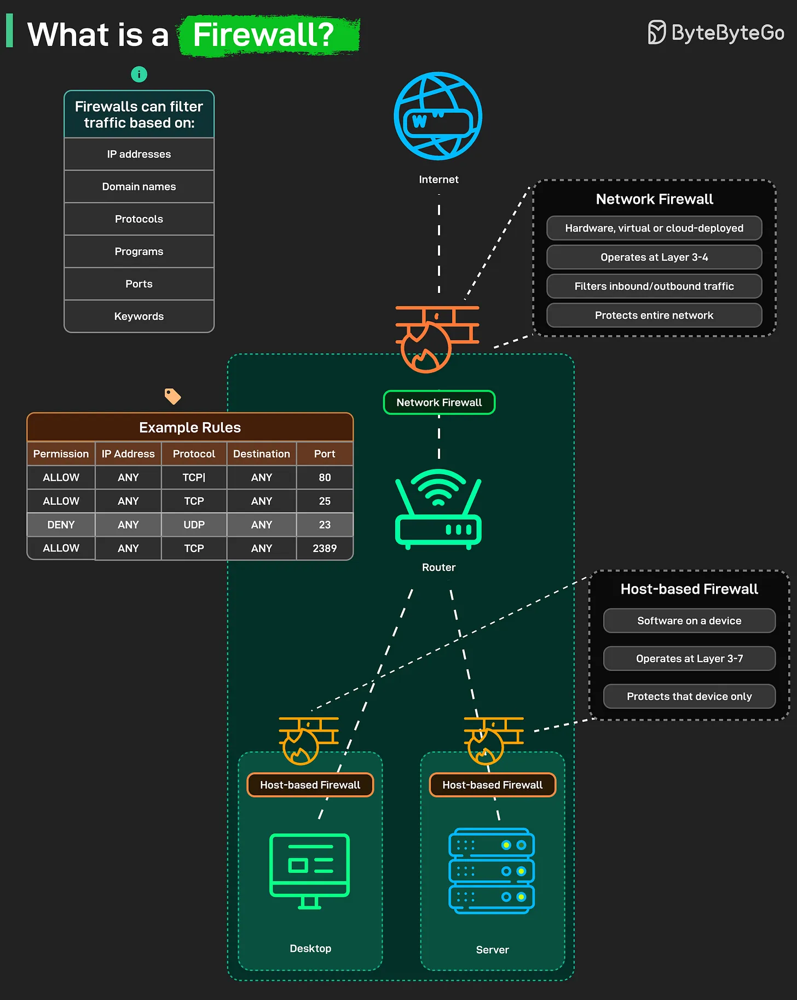

# 200 - Firewall là gì?

- Nguồn: ByteByteGo Big Archive System Design 2025
- Trang PDF: 407-408
- Ảnh minh họa: `../assets/200/figure-01.png`

## Hình minh họa

## Dịch sát

Mỗi lần bạn kết nối Internet, firewall âm thầm quyết định cái gì được vào và cái gì phải ở ngoài. Firewall là tuyến phòng thủ đầu tiên của network. Nó filter traffic dựa trên rule bạn định nghĩa, theo IP address, protocol, port, program, hoặc thậm chí keyword. Mọi packet cố gắng đi vào hoặc đi ra khỏi network đều đi qua checkpoint này.

Có hai loại chính:

1. Network Firewall: Nằm ở network edge giữa infrastructure của bạn và Internet. Có thể là physical hardware, virtualized software, hoặc cloud-deployed service. Hoạt động ở Layer 3-4 của OSI model. Filter traffic dựa trên IP address, protocol và port trước khi traffic tới internal network.

   Nó bảo vệ toàn bộ network cùng lúc. Đây là tuyến phòng thủ đầu tiên. Internet traffic chạm network firewall trước khi tới router, trước khi đụng bất kỳ internal system nào.

2. Host-based Firewall: Chạy dưới dạng software trên từng device riêng lẻ, như laptop hoặc server. Nó hoạt động ở Layer 3-7, inspect packet sâu hơn và chỉ bảo vệ device cụ thể đó.

   Desktop của bạn có host firewall riêng. Server của bạn cũng có. Mỗi cái được cấu hình độc lập. Đây là lớp phòng thủ cuối cùng trong trường hợp thứ gì đó lọt qua network firewall.

   Cùng nhau, chúng tạo thành một layered shield, chặn unwanted traffic bên ngoài trong khi vẫn cho legitimate communication đi qua tự do.

## Dịch nội dung trong hình

- Firewall có thể filter traffic dựa trên `IP addresses`, `Domain names`, `Protocols`, `Programs`, `Ports`, `Keywords`.
- `Network Firewall`: có thể là hardware, virtual hoặc cloud-deployed; hoạt động ở Layer 3-4; filter inbound/outbound traffic; bảo vệ toàn bộ network.
- `Host-based Firewall`: software trên từng device; hoạt động ở Layer 3-7; chỉ bảo vệ device đó.
- `Example Rules`: ví dụ allow TCP port `80`, allow TCP port `25`, deny UDP port `23`, allow TCP port `2389`.
- Flow: Internet -> network firewall -> router -> các host như desktop/server, mỗi host có host-based firewall riêng.

## Tóm tắt & giải thích dễ hiểu

Firewall là lớp kiểm soát traffic. Network firewall bảo vệ cả mạng ở biên, thường dựa trên IP/port/protocol. Host firewall bảo vệ từng máy riêng, có thể inspect sâu hơn theo app/process. Dùng cả hai tạo defense-in-depth: nếu một lớp fail, lớp sau vẫn còn.

## Ví dụ thực tế - không nằm trong tài liệu gốc

Một server database production có thể bị network firewall chặn toàn bộ Internet, chỉ allow traffic từ application subnet vào port `5432`. Đồng thời host firewall trên máy database chỉ allow process/port cần thiết, giảm rủi ro nếu route hoặc security group bị cấu hình sai.

## Thuật ngữ chính

- `Firewall`: hệ thống lọc traffic theo rule.
- `Inbound/outbound traffic`: traffic đi vào/đi ra.
- `Layer 3-4`: lớp network/transport như IP, TCP, UDP, port.
- `Layer 7`: lớp application như HTTP.
- `Defense-in-depth`: phòng thủ nhiều lớp.
- `Packet`: đơn vị dữ liệu truyền qua network.
- `Allow/Deny rule`: rule cho phép/chặn traffic.

