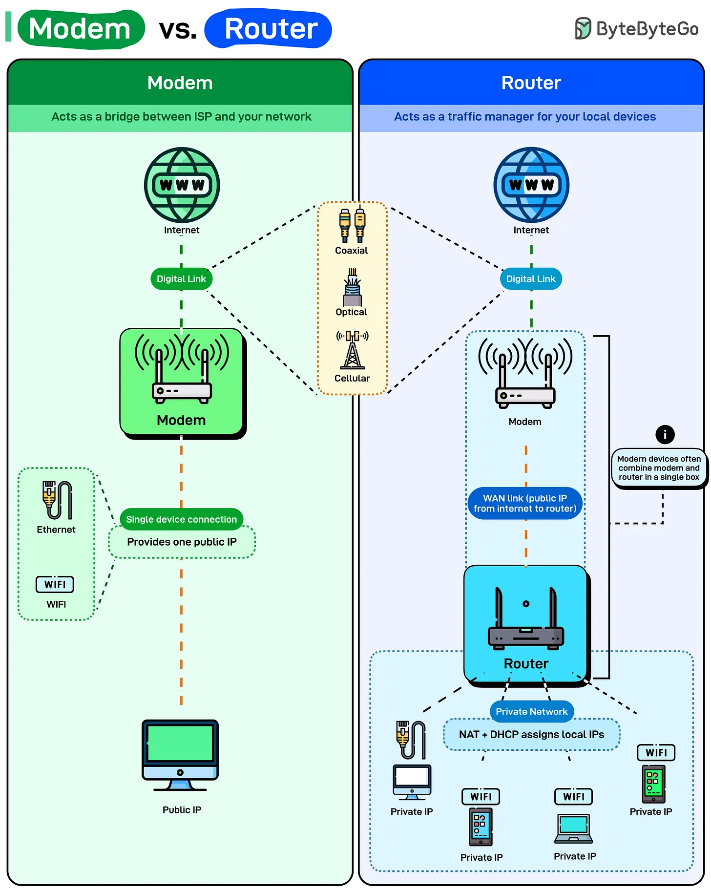

# 201 - Modem vs Router

- Nguồn: ByteByteGo Big Archive System Design 2025
- Trang PDF: 409-410
- Ảnh minh họa: `../assets/201/figure-01.png`

## Hình minh họa

## Dịch sát

Phần lớn mọi người nghĩ WiFi router cung cấp Internet cho họ. Không phải vậy. Router của bạn chỉ quản lý traffic bên trong nhà. Kết nối Internet thật sự đến từ modem.

Đây là điều mỗi thiết bị thật sự làm:

- Modem: Modem kết nối bạn tới Internet Service Provider (ISP). Nó translate signal giữa network của ISP và home network của bạn. Tùy service type, digital link có thể dùng coaxial cable, fiber optic hoặc cellular connection. Modem chuyển các signal đó thành data mà device của bạn hiểu được.

  Nó cung cấp một public IP address, nghĩa là một connection tới Internet. Nếu bạn cắm một device duy nhất trực tiếp vào modem qua Ethernet, device đó có Internet access với public IP.

- Router: Router tạo private network bên trong nhà bạn. Nó lấy public IP duy nhất từ modem và chia sẻ qua nhiều device bằng Network Address Translation (NAT). Mọi device trên network của bạn nhận private IP address, thường kiểu `192.168.1.x`. Router theo dõi device nào đã request data gì và route response về đúng device.

  DHCP tự động gán các private IP đó. Điện thoại của bạn kết nối Wi-Fi, router cấp cho nó một IP address, và ngay lập tức nó có thể nói chuyện với Internet thông qua router.

Thiết bị hiện đại thường kết hợp cả hai chức năng, một modem-router combo, nhưng hiểu sự khác biệt giúp ích khi troubleshooting tốc độ chậm hoặc network drop.

## Dịch nội dung trong hình

- `Modem`: hoạt động như bridge giữa ISP và network của bạn; Internet -> digital link -> modem; kết nối có thể qua `Coaxial`, `Optical`, `Cellular`; single device connection qua Ethernet/Wi-Fi; cung cấp một `public IP`.
- `Router`: hoạt động như traffic manager cho local devices; nhận WAN link/public IP từ modem; tạo `Private Network`; `NAT + DHCP assigns local IPs`; nhiều device qua Ethernet/Wi-Fi nhận `private IP`.
- Hình ghi chú: modern devices thường combine modem và router trong một box duy nhất.

## Tóm tắt & giải thích dễ hiểu

Modem kết nối nhà bạn với ISP. Router chia sẻ kết nối đó cho nhiều thiết bị nội bộ. Modem xử lý “đường ra Internet”, router xử lý “mạng trong nhà”: Wi-Fi, NAT, DHCP, route response về đúng device.

## Ví dụ thực tế - không nằm trong tài liệu gốc

Nếu tất cả thiết bị trong nhà vẫn kết nối Wi-Fi nhưng không vào Internet, modem/ISP có thể có vấn đề. Nếu chỉ một laptop không nhận IP hoặc không thấy mạng nội bộ, router/DHCP/Wi-Fi có thể là nơi cần kiểm tra.

## Thuật ngữ chính

- `Modem`: thiết bị kết nối tới ISP.
- `Router`: thiết bị quản lý traffic local network.
- `ISP`: Internet Service Provider.
- `Public IP`: IP public trên Internet.
- `Private IP`: IP nội bộ như `192.168.x.x`.
- `NAT`: Network Address Translation.
- `DHCP`: tự động cấp IP cho device.
- `WAN/LAN`: mạng diện rộng/mạng cục bộ.

## Câu hỏi ôn tập + trả lời + thinking học tập + liên hệ

> Đây là phần học tập thêm ở cuối file. Câu hỏi ưu tiên lấy từ tài liệu gốc và được trả lời trực tiếp; nếu bài không có câu hỏi riêng thì dùng tiêu đề/nội dung chính để tạo câu hỏi tự kiểm tra.

### Câu hỏi 1

**Nguồn câu hỏi:** Suy ra từ tiêu đề/nội dung chính vì bài gốc không có câu hỏi riêng.

**Câu hỏi:** Sau khi đọc bài “Modem vs. Router”, ý chính cần trả lời và áp dụng vào system design là gì?

**Trả lời:** Trọng tâm cần đem vào thực tế là: Modem kết nối nhà bạn với ISP. Router chia sẻ kết nối đó cho nhiều thiết bị nội bộ. Modem xử lý “đường ra Internet”, router xử lý “mạng trong nhà”: Wi-Fi, NAT, DHCP, route response về đúng device. Khi áp dụng vào hệ thống thật, hãy kiểm thêm DNS, transport, TLS, HTTP, proxy/CDN, application timeout và observability theo từng layer.

**Thinking học tập + liên hệ:** Ôn tập `Modem vs Router` bằng cách biến khái niệm thành quyết định thiết kế cụ thể: chọn gì, bỏ gì, đo gì và ai chịu trách nhiệm. Lens chính là DNS, transport, TLS, HTTP, proxy/CDN, application timeout và observability theo từng layer. Khi debug production, hãy tách latency theo DNS lookup, TCP connect, TLS handshake, TTFB và download để không đoán mò. Khi ghi chú lại, hãy giải thích được các keyword: `Modem`, `Router`, `ISP`, `Public IP`, `Private IP`.
