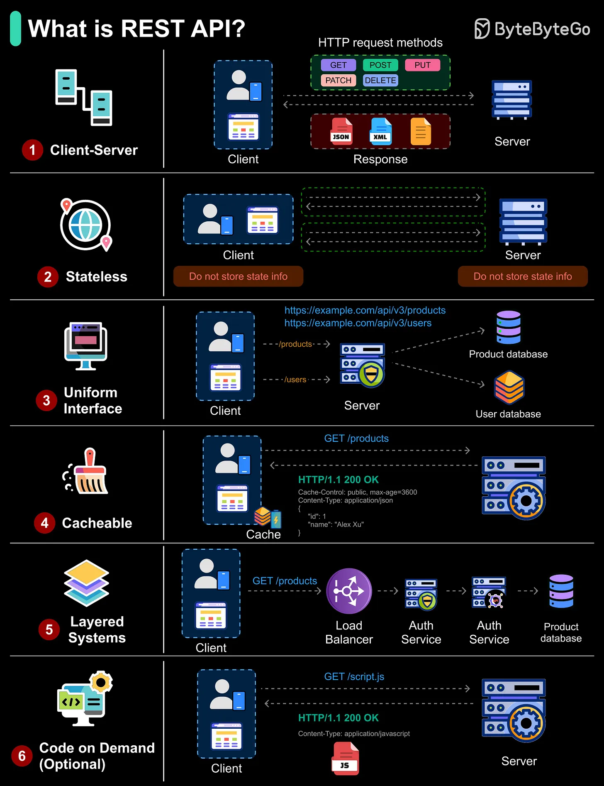

# 202 - REST API là gì?

- Nguồn: ByteByteGo Big Archive System Design 2025
- Trang PDF: 411-412
- Ảnh minh họa: `../assets/202/figure-01.png`

## Hình minh họa

## Dịch sát

REST (Representational State Transfer) là một architectural style để xây API dùng HTTP cho communication. Để được xem là RESTful, một API nên tuân theo sáu constraint chính:

- Client-Server: Tách user interface khỏi data storage và processing. Điều này cho phép mỗi phía phát triển độc lập.

- Stateless: Mỗi request chứa tất cả thông tin cần để xử lý; server không lưu session state giữa các request.

- Uniform Interface: Resource naming và format nhất quán trên toàn API, ví dụ `/products`, `/users`.

- Cacheable: Response chỉ rõ liệu nó có thể cache được hay không, ví dụ `Cache-Control`, để cải thiện performance.

- Layered System: Request có thể đi qua nhiều layer như load balancer, auth service, v.v. trước khi tới API server, nhưng với client nó trông như một endpoint duy nhất.

- Code on Demand (Optional): Server có thể gửi executable code như JavaScript tới client để mở rộng functionality.

## Dịch nội dung trong hình

- `Client-Server`: client gửi HTTP request method như `GET`, `POST`, `PUT`, `PATCH`, `DELETE`; server trả response dạng `JSON`, `XML` hoặc format khác.
- `Stateless`: client và server không lưu state info giữa các request; mỗi request tự mang đủ context.
- `Uniform Interface`: URL resource nhất quán như `https://example.com/api/v3/products`, `https://example.com/api/v3/users`; route `/products`, `/users` tới product/user database.
- `Cacheable`: response `HTTP/1.1 200 OK` có header như `Cache-Control: public, max-age=3600`, `Content-Type: application/json` để cache.
- `Layered Systems`: request `GET /products` có thể đi qua `Load Balancer`, `Auth Service`, service layer rồi tới product database.
- `Code on Demand (Optional)`: client request `GET /script.js`, server trả `application/javascript` để client chạy code.

## Tóm tắt & giải thích dễ hiểu

REST là phong cách thiết kế API dựa trên resource và HTTP. API RESTful nên có URL resource rõ, method đúng nghĩa, stateless request, response cacheable khi phù hợp, và có thể đặt nhiều layer hạ tầng ở giữa mà client không cần biết.

## Ví dụ thực tế - không nằm trong tài liệu gốc

Một REST API cho sản phẩm có thể dùng `GET /products` để list, `GET /products/123` để xem chi tiết, `POST /products` để tạo, `PUT /products/123` để cập nhật toàn phần và `DELETE /products/123` để xóa. Mỗi request gửi kèm token nếu cần auth vì server không giữ session state REST.

## Thuật ngữ chính

- `REST`: Representational State Transfer.
- `RESTful`: API tuân theo các constraint của REST.
- `Resource`: thực thể như product/user/order.
- `HTTP method`: GET, POST, PUT, PATCH, DELETE.
- `Stateless`: server không giữ session state giữa request.
- `Cache-Control`: header kiểm soát cache.
- `Layered system`: kiến trúc nhiều lớp trung gian.

## Câu hỏi ôn tập + trả lời + thinking học tập + liên hệ

> Đây là phần học tập thêm ở cuối file. Câu hỏi ưu tiên lấy từ tài liệu gốc và được trả lời trực tiếp; nếu bài không có câu hỏi riêng thì dùng tiêu đề/nội dung chính để tạo câu hỏi tự kiểm tra.

### Câu hỏi 1

**Nguồn câu hỏi:** Suy ra từ tiêu đề/nội dung chính vì bài gốc không có câu hỏi riêng.

**Câu hỏi:** What is a REST API?

**Trả lời:** Sau bài này, phần đáng nhớ nhất là: REST là phong cách thiết kế API dựa trên resource và HTTP. API RESTful nên có URL resource rõ, method đúng nghĩa, stateless request, response cacheable khi phù hợp, và có thể đặt nhiều layer hạ tầng ở giữa mà client không cần biết. Khi áp dụng vào hệ thống thật, hãy kiểm thêm actor, trust boundary, dữ liệu nhạy cảm, lifetime của token/key, quyền truy cập và cơ chế revoke.

**Thinking học tập + liên hệ:** Ôn tập `REST API là gì?` bằng cách biến khái niệm thành quyết định thiết kế cụ thể: chọn gì, bỏ gì, đo gì và ai chịu trách nhiệm. Lens chính là actor, trust boundary, dữ liệu nhạy cảm, lifetime của token/key, quyền truy cập và cơ chế revoke. Khi làm API thật, một endpoint chạy được chưa đủ; phải kiểm thêm abuse, audit log, error leakage, rate limit và quyền ở service chứa dữ liệu. Khi ghi chú lại, hãy giải thích được các keyword: `REST`, `RESTful`, `Resource`, `HTTP method`, `Stateless`.
