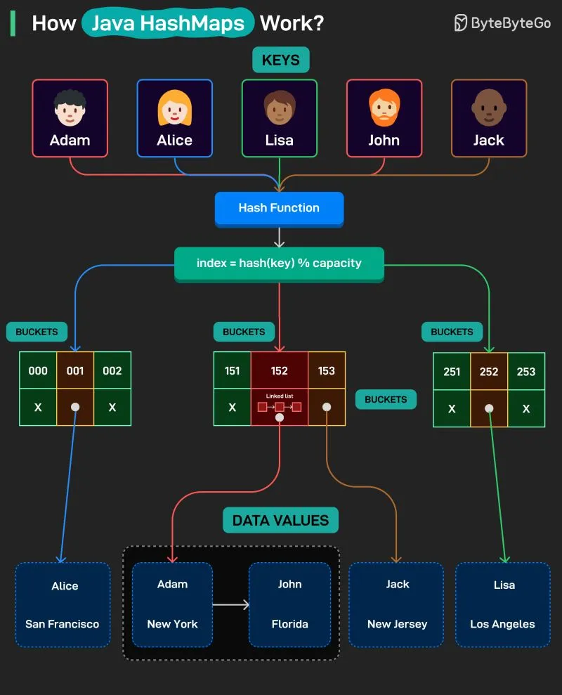

# 203 - Java HashMap hoạt động như thế nào?

- Nguồn: ByteByteGo Big Archive System Design 2025
- Trang PDF: 413-414
- Ảnh minh họa: `../assets/203/figure-01.png`

## Hình minh họa

## Dịch sát

HashMap là một data structure lưu key-value pairs, cho phép lookup, insertion và deletion nhanh. Nó dùng hash function để map mỗi key tới một bucket index, giúp truy cập hiệu quả.

Cách nó hoạt động như sau:

1. Key được đưa vào HashMap.

2. Hash function chuyển mỗi key thành một number trỏ tới bucket index, bucket index đó trỏ tới data value.

3. Khi hai key map tới cùng một bucket index, collision xảy ra.

4. Collision được xử lý bằng cách link các entry lại với nhau thành một chain trong cùng bucket. Việc này dùng linked list hoặc thậm chí tree trong một số trường hợp.

5. Cuối cùng, value được retrieve nhanh bằng cách hash key và lookup bucket đúng.

## Dịch nội dung trong hình

- `Keys`: ví dụ `Adam`, `Alice`, `Lisa`, `John`, `Jack`.
- Key đi qua `Hash Function`, sau đó tính `index = hash(key) % capacity`.
- Kết quả index trỏ tới các `Buckets`, ví dụ bucket `001`, `152`, `153`, `252`.
- `Data Values`: `Alice - San Francisco`, `Adam - New York`, `John - Florida`, `Jack - New Jersey`, `Lisa - Los Angeles`.
- Collision: `Adam` và `John` cùng rơi vào bucket `152`, nên bucket này dùng linked list để nối nhiều entry.

## Tóm tắt & giải thích dễ hiểu

HashMap nhanh vì nó không tìm tuần tự toàn bộ list. Nó hash key để nhảy gần như trực tiếp tới bucket cần tìm. Nếu hash phân bố tốt, lookup gần O(1). Nếu nhiều collision trong cùng bucket, lookup chậm hơn vì phải duyệt chain hoặc tree trong bucket đó.

## Ví dụ thực tế - không nằm trong tài liệu gốc

Trong backend Java, bạn có thể dùng `HashMap<String, User>` để cache user theo `userId`. Khi gọi `map.get("u123")`, Java hash chuỗi `u123`, tìm bucket tương ứng, rồi so sánh key để trả đúng `User`.

## Ghi chú kỹ thuật - không nằm trong tài liệu gốc

Trong Java hiện đại, khi collision chain trong một bucket đủ dài và capacity đủ lớn, HashMap có thể treeify bucket thành red-black tree để cải thiện worst-case lookup.

## Thuật ngữ chính

- `HashMap`: cấu trúc dữ liệu key-value dựa trên hashing.
- `Key-value pair`: cặp khóa và giá trị.
- `Hash function`: hàm biến key thành hash number.
- `Bucket`: ô lưu entry theo index.
- `Collision`: nhiều key rơi vào cùng bucket.
- `Linked list`: danh sách liên kết dùng để chain entry.
- `Treeify`: chuyển bucket chain thành tree khi collision nhiều.

## Câu hỏi ôn tập + trả lời + thinking học tập + liên hệ

> Đây là phần học tập thêm ở cuối file. Câu hỏi ưu tiên lấy từ tài liệu gốc và được trả lời trực tiếp; nếu bài không có câu hỏi riêng thì dùng tiêu đề/nội dung chính để tạo câu hỏi tự kiểm tra.

### Câu hỏi 1

**Nguồn câu hỏi:** Suy ra từ tiêu đề/nội dung chính vì bài gốc không có câu hỏi riêng.

**Câu hỏi:** How Java HashMaps Work?

**Trả lời:** Nên trả lời theo flow end-to-end: request/dữ liệu đi vào đâu, qua thành phần nào, state đổi ở đâu và kết quả trả ra thế nào. Với `Java HashMap hoạt động như thế nào?`, ý chính là: HashMap nhanh vì nó không tìm tuần tự toàn bộ list. Nó hash key để nhảy gần như trực tiếp tới bucket cần tìm. Nếu hash phân bố tốt, lookup gần O(1). Nếu nhiều collision trong cùng bucket, lookup chậm hơn vì phải duyệt chain hoặc tree trong bucket đó.

**Thinking học tập + liên hệ:** Luồng trong `Java HashMap hoạt động như thế nào?` nên được vẽ từ input tới output, kèm owner của từng bước và failure mode ở mỗi boundary. Lens chính là loại dữ liệu, kích thước input, latency mục tiêu, memory budget và sai số/lỗi có thể chấp nhận. Trong project thật, thuật toán thường ẩn sau search, cache, ranking, routing, queue hoặc storage; hiểu nó giúp dự đoán bottleneck trước khi hệ thống lớn lên. Khi ghi chú lại, hãy giải thích được các keyword: `HashMap`, `Key-value pair`, `Hash function`, `Bucket`, `Collision`.
