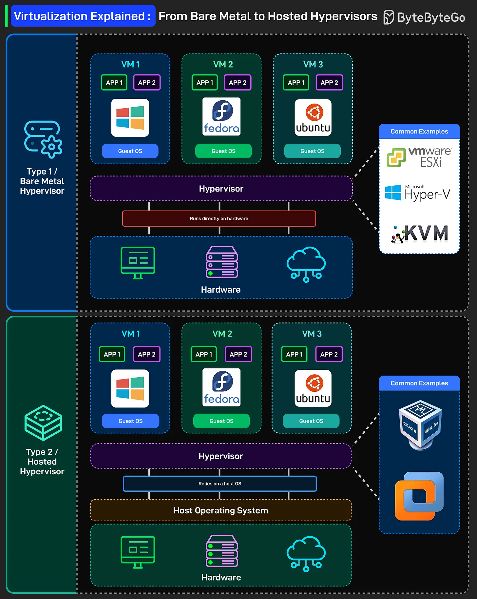

# 204 - Giải thích Virtualization: từ Bare Metal tới Hosted Hypervisor

- Nguồn: ByteByteGo Big Archive System Design 2025
- Trang PDF: 415-416
- Ảnh minh họa: `../assets/204/figure-01.png`

## Hình minh họa

## Dịch sát

Trước container và serverless, đã có virtualization, nền tảng của modern cloud computing. Đây là breakdown đơn giản về cách virtualization hoạt động, từ bare metal tới hosted hypervisors:

- Type 1 / Bare Metal Hypervisor: Hypervisor chạy trực tiếp trên hardware. Không có operating system bên dưới nó. Hypervisor chính là operating system layer. VMware ESXi, Microsoft Hyper-V và KVM đều là Type 1 hypervisor. Chúng boot trên physical server và quản lý VM với direct hardware access.

  Mỗi VM có full operating system riêng. Windows, Fedora, Ubuntu. Isolation hoàn chỉnh giữa các VM. Một VM crash? Các VM khác vẫn chạy.

  Đây là thứ chạy trong data center và cloud provider. Khi bạn spin up một EC2 instance trên AWS, nó chạy trên Type 1 virtualization. Hiện AWS dùng custom Nitro hypervisor của họ, nhưng concept giống nhau.

- Type 2 / Hosted Hypervisor: Hypervisor chạy như một application trên host operating system. Bạn đang chạy Windows hoặc macOS, rồi install VirtualBox hoặc VMware Workstation lên trên nó.

  Guest VM vẫn có full operating system, nhưng bây giờ có thêm một layer. VM của bạn nói chuyện với hypervisor, hypervisor nói chuyện với host OS, host OS nói chuyện với hardware.

  Overhead nhiều hơn, performance thấp hơn một chút, nhưng tiện hơn nhiều cho development và testing. Đây là thứ bạn dùng trên laptop. Chạy một Linux VM trên MacBook? Đó là Type 2.

## Dịch nội dung trong hình

- `Type 1 / Bare Metal Hypervisor`: VM1/VM2/VM3 chạy app và guest OS riêng như Windows/Fedora/Ubuntu; bên dưới là `Hypervisor`; hypervisor `runs directly on hardware`; ví dụ phổ biến: `VMware ESXi`, `Microsoft Hyper-V`, `KVM`.
- `Type 2 / Hosted Hypervisor`: VM1/VM2/VM3 cũng có guest OS riêng; `Hypervisor` phụ thuộc vào `Host Operating System`; host OS nói chuyện với hardware. Ví dụ phổ biến: `Oracle VirtualBox`, `VMware Workstation/Fusion`.

## Tóm tắt & giải thích dễ hiểu

Type 1 hypervisor chạy trực tiếp trên phần cứng nên hiệu năng và isolation tốt, phù hợp data center/cloud. Type 2 hypervisor chạy trên OS có sẵn nên tiện cho developer laptop, demo, lab và testing, nhưng thêm overhead. Cả hai đều cho phép nhiều VM chạy trên cùng hardware.

## Ví dụ thực tế - không nằm trong tài liệu gốc

AWS EC2, VMware vSphere hoặc KVM cluster trong data center dùng mô hình Type 1. Một developer chạy Ubuntu bằng VirtualBox trên macOS để test script Linux đang dùng mô hình Type 2.

## Thuật ngữ chính

- `Hypervisor`: lớp tạo và quản lý virtual machine.
- `Type 1 hypervisor`: hypervisor chạy trực tiếp trên hardware.
- `Type 2 hypervisor`: hypervisor chạy trên host OS.
- `Bare metal`: phần cứng trực tiếp, không có host OS trung gian.
- `Hosted hypervisor`: hypervisor chạy như app trên OS.
- `VM`: virtual machine.
- `Guest OS`: OS bên trong VM.
- `Host OS`: OS bên dưới Type 2 hypervisor.

## Câu hỏi ôn tập + trả lời + thinking học tập + liên hệ

> Đây là phần học tập thêm ở cuối file. Câu hỏi ưu tiên lấy từ tài liệu gốc và được trả lời trực tiếp; nếu bài không có câu hỏi riêng thì dùng tiêu đề/nội dung chính để tạo câu hỏi tự kiểm tra.

### Câu hỏi 1

**Nguồn câu hỏi:** Suy ra từ tiêu đề/nội dung chính vì bài gốc không có câu hỏi riêng.

**Câu hỏi:** Sau khi đọc bài “Virtualization Explained: From Bare Metal to Hosted Hypervisors”, ý chính cần trả lời và áp dụng vào system design là gì?

**Trả lời:** Sau bài này, phần đáng nhớ nhất là: Type 1 hypervisor chạy trực tiếp trên phần cứng nên hiệu năng và isolation tốt, phù hợp data center/cloud. Type 2 hypervisor chạy trên OS có sẵn nên tiện cho developer laptop, demo, lab và testing, nhưng thêm overhead. Cả hai đều cho phép nhiều VM chạy trên cùng hardware. Khi áp dụng vào hệ thống thật, hãy kiểm thêm độ phức tạp vận hành, rollback, cost, kỹ năng team, observability và blast radius khi hỏng.

**Thinking học tập + liên hệ:** Khi học `Giải thích Virtualization: từ Bare Metal tới Hosted Hypervisor`, hãy thử viết một checklist áp dụng vào project: input, output, owner, rủi ro và metric kiểm chứng. Lens chính là độ phức tạp vận hành, rollback, cost, kỹ năng team, observability và blast radius khi hỏng. Khi đưa lên production, hãy map từng thành phần vào deploy, rollback, monitoring, alerting, secret, cost và ownership rõ ràng. Khi ghi chú lại, hãy giải thích được các keyword: `Hypervisor`, `Type 1 hypervisor`, `Type 2 hypervisor`, `Bare metal`, `Hosted hypervisor`.
