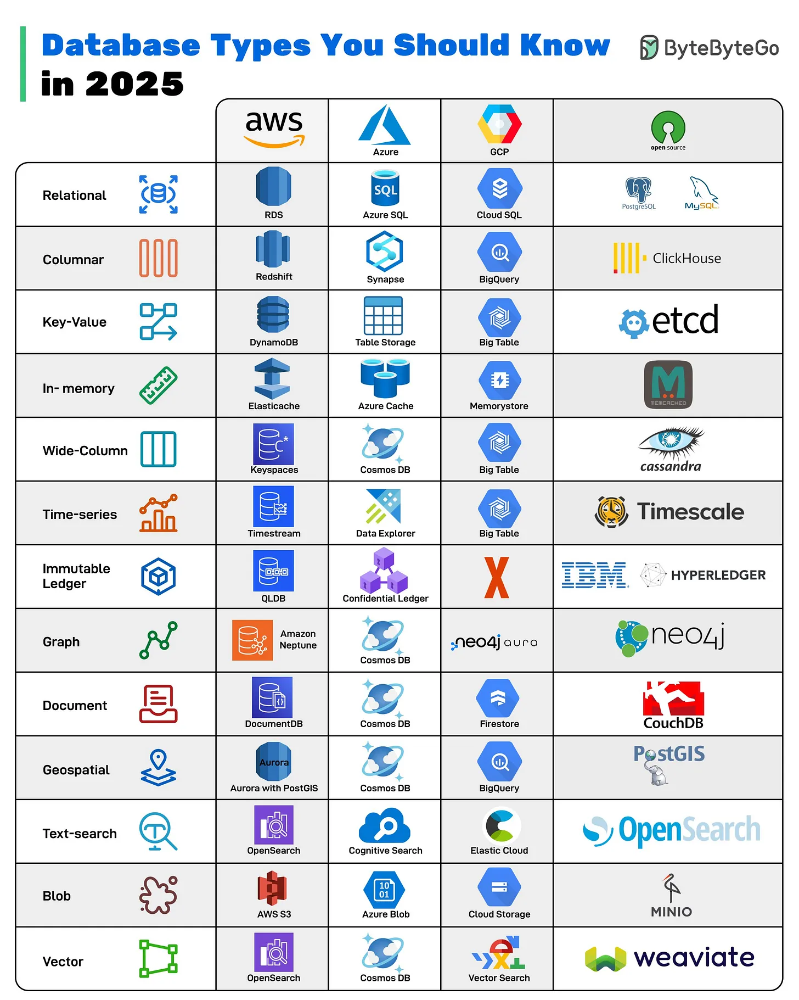

# 205 - Các loại database bạn nên biết trong năm 2025

- Nguồn: ByteByteGo Big Archive System Design 2025
- Trang PDF: 417-418
- Ảnh minh họa: `../assets/205/figure-01.png`

## Hình minh họa

## Dịch sát

Không còn chuyện một database phù hợp cho mọi thứ. Modern application dựa vào nhiều loại database, từ real-time analytics tới vector search cho AI. Biết nên dùng loại nào có thể quyết định performance của system thành công hay thất bại.

- Relational: Database truyền thống dạng row-and-column, rất tốt cho structured data và transaction.

- Columnar: Tối ưu cho analytics, lưu data theo column để aggregate nhanh.

- Key-Value: Lưu data dưới dạng cặp key-value đơn giản, cho phép lookup nhanh.

- In-memory: Lưu data trong RAM để lookup với ultra-low latency, lý tưởng cho caching hoặc session management.

- Wide-Column: Xử lý lượng lớn semi-structured data trên distributed nodes.

- Time-series: Chuyên cho metrics, logs và sensor data với time là dimension chính.

- Immutable Ledger: Đảm bảo transaction log chống sửa đổi và có thể verify bằng cryptography.

- Graph: Model các relationship phức tạp, hoàn hảo cho social network và fraud detection.

- Document: Lưu trữ linh hoạt kiểu JSON-like, rất tốt cho modern app có schema thay đổi.

- Geospatial: Quản lý location-aware data như map, route và spatial query.

- Text-search: Full-text indexing và search với ranking, filter và analytics.

- Blob: Lưu object unstructured như image, video và file.

- Vector: Vận hành AI/ML app bằng similarity search trên embeddings.

## Dịch nội dung trong hình

| Type | AWS | Azure | GCP | Open source / ví dụ |
| --- | --- | --- | --- | --- |
| `Relational` | `RDS` | `Azure SQL` | `Cloud SQL` | `PostgreSQL`, `MySQL` |
| `Columnar` | `Redshift` | `Synapse` | `BigQuery` | `ClickHouse` |
| `Key-Value` | `DynamoDB` | `Table Storage` | `BigTable` | `etcd` |
| `In-memory` | `ElastiCache` | `Azure Cache` | `Memorystore` | `Memcached` |
| `Wide-Column` | `Keyspaces` | `Cosmos DB` | `BigTable` | `Cassandra` |
| `Time-series` | `Timestream` | `Data Explorer` | `BigTable` | `Timescale` |
| `Immutable Ledger` | `QLDB` | `Confidential Ledger` | không nêu service | `IBM`, `Hyperledger` |
| `Graph` | `Amazon Neptune` | `Cosmos DB` | `neo4j aura` | `Neo4j` |
| `Document` | `DocumentDB` | `Cosmos DB` | `Firestore` | `CouchDB` |
| `Geospatial` | `Aurora with PostGIS` | `Cosmos DB` | `BigQuery` | `PostGIS` |
| `Text-search` | `OpenSearch` | `Cognitive Search` | `Elastic Cloud` | `OpenSearch` |
| `Blob` | `AWS S3` | `Azure Blob` | `Cloud Storage` | `MinIO` |
| `Vector` | `OpenSearch` | `Cosmos DB` | `Vector Search` | `Weaviate` |

## Tóm tắt & giải thích dễ hiểu

Database nên chọn theo access pattern. Transaction cần relational. Analytics lớn cần columnar. Cache/session cần in-memory. Event theo thời gian cần time-series. Quan hệ phức tạp cần graph. Search text cần search engine. AI retrieval cần vector database. Một hệ thống production thường dùng nhiều loại database cùng lúc.

## Ví dụ thực tế - không nằm trong tài liệu gốc

Một app thương mại điện tử có thể dùng PostgreSQL cho order transaction, Redis cho session/cart cache, Elasticsearch/OpenSearch cho search sản phẩm, S3 cho ảnh sản phẩm, BigQuery/Redshift cho analytics, và vector DB cho tìm kiếm sản phẩm bằng ngôn ngữ tự nhiên.

## Thuật ngữ chính

- `Relational database`: database bảng hàng/cột có schema rõ.
- `Columnar database`: lưu theo cột để aggregate nhanh.
- `Key-value store`: lưu theo key và value.
- `Time-series database`: tối ưu dữ liệu theo thời gian.
- `Graph database`: lưu node/edge và relationship.
- `Document database`: lưu document JSON-like.
- `Blob storage`: lưu object/file lớn.
- `Vector database`: lưu embedding và similarity search.

