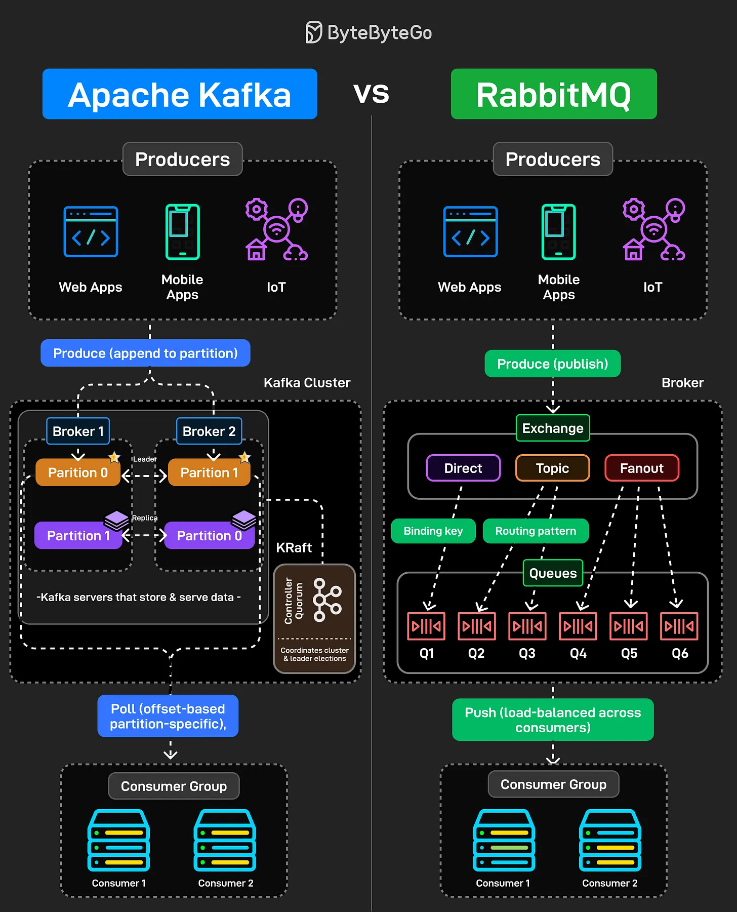

# 206 - Apache Kafka vs RabbitMQ

- Nguồn: ByteByteGo Big Archive System Design 2025
- Trang PDF: 419-420
- Ảnh minh họa: `../assets/206/figure-01.png`

## Hình minh họa

## Dịch sát

Kafka và RabbitMQ đều xử lý message, nhưng chúng giải quyết các vấn đề cơ bản khác nhau. Hiểu sự khác biệt rất quan trọng khi thiết kế distributed system.

Kafka là một distributed log. Producer append message vào partition. Các message đó tồn tại dựa trên retention policy, không phải vì ai đó đã consume chúng hay chưa. Consumer pull message theo tốc độ riêng bằng offset. Bạn có thể rewind, replay, reprocess mọi thứ. Nó được thiết kế cho high-throughput event streaming nơi nhiều consumer cần cùng data một cách độc lập.

RabbitMQ là một message broker. Producer publish message tới exchange. Các exchange route tới queue dựa trên binding key và pattern như direct, topic, fanout. Message được push tới consumer và bị xóa sau khi được acknowledged. Nó được xây cho task distribution và traditional messaging workflow.

Sai lầm phổ biến là dùng Kafka như một queue hoặc RabbitMQ như một event log. Chúng là các tool khác nhau, được xây cho các use case khác nhau.

## Dịch nội dung trong hình

- `Apache Kafka`: producer như web app, mobile app, IoT produce message bằng cách append vào partition. Kafka cluster gồm broker, partition leader/replica, KRaft controller quorum để coordinate cluster và leader election. Consumer group pull message theo offset và partition cụ thể.
- `RabbitMQ`: producer publish message tới broker/exchange. Exchange route theo `Direct`, `Topic`, `Fanout`, dùng binding key và routing pattern để đưa message vào queue `Q1-Q6`. RabbitMQ push message tới consumer group và load-balance qua consumer.

## Tóm tắt & giải thích dễ hiểu

Kafka phù hợp cho event stream, replay, audit log, CDC và nhiều consumer độc lập đọc cùng dữ liệu. RabbitMQ phù hợp cho job queue, task dispatch, routing linh hoạt và workflow cần acknowledgement/xóa message sau xử lý. Chọn sai sẽ làm hệ thống khó vận hành.

## Ví dụ thực tế - không nằm trong tài liệu gốc

User clickstream nên dùng Kafka vì data cần được nhiều team đọc lại: analytics, fraud, recommendation. Background job gửi email xác nhận đơn hàng có thể dùng RabbitMQ vì message chỉ cần một worker xử lý xong rồi ack.

## Thuật ngữ chính

- `Distributed log`: log phân tán lưu event theo thứ tự trong partition.
- `Partition`: phân vùng topic/log trong Kafka.
- `Offset`: vị trí đọc của consumer trong partition.
- `Retention policy`: chính sách giữ message theo thời gian/kích thước.
- `Exchange`: thành phần RabbitMQ nhận và route message.
- `Queue`: hàng đợi message cho consumer xử lý.
- `Ack`: acknowledgment báo message xử lý xong.
- `Consumer group`: nhóm consumer cùng xử lý workload.

