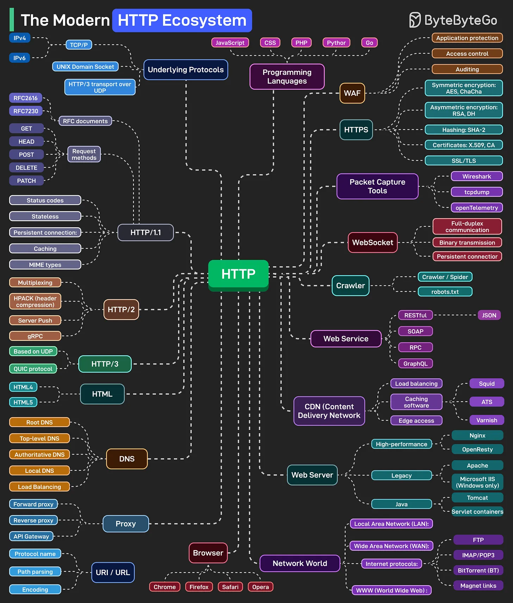

# 207 - Mindmap HTTP

- Nguồn: ByteByteGo Big Archive System Design 2025
- Trang PDF: 421-422
- Ảnh minh họa: `../assets/207/figure-01.png`

## Hình minh họa

## Dịch sát

HTTP đã tiến hóa từ HTTP/1.1 tới HTTP/2, và giờ là HTTP/3, dùng QUIC protocol trên UDP để cải thiện performance. Ngày nay, nó là xương sống của gần như mọi thứ trên Internet, từ browser và API tới streaming, cloud và AI system.

Ở nền tảng, chúng ta có underlying protocols. TCP/IP cho IPv4 và IPv6 traffic. Unix domain sockets cho local communication. HTTP/3 chạy trên UDP thay vì TCP. Những thứ này xử lý data transport thật sự trước khi HTTP tham gia.

Security bao quanh mọi thứ. HTTPS không còn là optional. WebSockets vận hành real-time connection. Web server quản lý workload. CDN phân phối content toàn cầu. DNS resolve mọi thứ thành IP. Proxy như forward, reverse và API gateway route, filter và secure traffic ở giữa.

Web service trao đổi data ở các format khác nhau, REST với JSON, SOAP cho enterprise system, RPC cho direct call, và GraphQL cho flexible query. Crawler và bot index web, được hướng dẫn bởi file robots.txt đặt boundary.

Network world kết nối mọi thứ. LAN, WAN và các protocol như FTP cho file transfer, IMAP/POP3 cho email, và BitTorrent cho peer-to-peer communication. Về observability, packet capture tool như Wireshark, tcpdump và OpenTelemetry cho phép developer nhìn bên dưới để hiểu performance, latency và behavior trên toàn stack.

## Dịch nội dung trong hình

- `Underlying Protocols`: `TCP/IP` cho IPv4/IPv6, `UNIX Domain Socket`, `HTTP/3 transport over UDP`.
- `HTTP/1.1`: RFC documents, request methods `GET`, `HEAD`, `POST`, `DELETE`, `PATCH`, status codes, stateless, persistent connection, caching, MIME types.
- `HTTP/2`: multiplexing, HPACK header compression, server push, gRPC.
- `HTTP/3`: based on UDP, QUIC protocol.
- `DNS`: root DNS, top-level DNS, authoritative DNS, local DNS, load balancing.
- `Proxy`: forward proxy, reverse proxy, API Gateway.
- `URI/URL`: protocol name, path parsing, encoding.
- `HTTPS`: symmetric encryption như AES/ChaCha, asymmetric encryption như RSA/DH, hashing SHA-2, certificate X.509/CA, SSL/TLS.
- `WAF`: application protection, access control, auditing.
- `WebSocket`: full-duplex communication, binary transmission, persistent connection.
- `Web Service`: RESTful/JSON, SOAP, RPC, GraphQL.
- `CDN`: load balancing, caching software như Squid/ATS/Varnish, edge access.
- `Web Server`: Nginx/OpenResty, Apache, Microsoft IIS, Tomcat/servlet containers.
- `Packet Capture Tools`: Wireshark, tcpdump, OpenTelemetry.
- `Network World`: LAN, WAN, FTP, IMAP/POP3, BitTorrent, WWW.

## Tóm tắt & giải thích dễ hiểu

HTTP không đứng một mình. Nó nằm trên transport, gắn với DNS, TLS, proxy, CDN, web server, browser, API style, observability và nhiều protocol mạng khác. Khi debug web/API production, cần nhìn cả hệ sinh thái: DNS có đúng không, TLS có lỗi không, proxy/CDN có cache/routing sai không, server có trả status/header đúng không.

## Ví dụ thực tế - không nằm trong tài liệu gốc

Một request `https://api.example.com/users` có thể đi qua DNS, TCP/TLS hoặc QUIC, CDN/WAF, reverse proxy, API Gateway, backend web service, rồi được quan sát bằng logs, tracing hoặc packet capture khi có lỗi latency.

## Thuật ngữ chính

- `HTTP`: protocol web request/response.
- `HTTP/2`: HTTP có multiplexing trên TCP.
- `HTTP/3`: HTTP chạy trên QUIC/UDP.
- `HTTPS`: HTTP được bảo vệ bởi TLS.
- `CDN`: phân phối content từ edge.
- `WAF`: Web Application Firewall.
- `WebSocket`: connection full-duplex realtime.
- `OpenTelemetry`: chuẩn instrumentation/observability.

## Câu hỏi ôn tập + trả lời + thinking học tập + liên hệ

> Đây là phần học tập thêm ở cuối file. Câu hỏi ưu tiên lấy từ tài liệu gốc và được trả lời trực tiếp; nếu bài không có câu hỏi riêng thì dùng tiêu đề/nội dung chính để tạo câu hỏi tự kiểm tra.

### Câu hỏi 1

**Nguồn câu hỏi:** Suy ra từ tiêu đề/nội dung chính vì bài gốc không có câu hỏi riêng.

**Câu hỏi:** Sau khi đọc bài “The HTTP Mindmap”, ý chính cần trả lời và áp dụng vào system design là gì?

**Trả lời:** Bài này muốn người đọc nắm: HTTP không đứng một mình. Nó nằm trên transport, gắn với DNS, TLS, proxy, CDN, web server, browser, API style, observability và nhiều protocol mạng khác. Khi debug web/API production, cần nhìn cả hệ sinh thái: DNS có đúng không, TLS có lỗi không, proxy/CDN có cache/routing sai không, server có trả status/header đúng không. Khi áp dụng vào hệ thống thật, hãy kiểm thêm DNS, transport, TLS, HTTP, proxy/CDN, application timeout và observability theo từng layer.

**Thinking học tập + liên hệ:** Khi học `Mindmap HTTP`, hãy thử viết một checklist áp dụng vào project: input, output, owner, rủi ro và metric kiểm chứng. Lens chính là DNS, transport, TLS, HTTP, proxy/CDN, application timeout và observability theo từng layer. Khi debug production, hãy tách latency theo DNS lookup, TCP connect, TLS handshake, TTFB và download để không đoán mò. Khi ghi chú lại, hãy giải thích được các keyword: `HTTP`, `HTTP/2`, `HTTP/3`, `HTTPS`, `CDN`.
