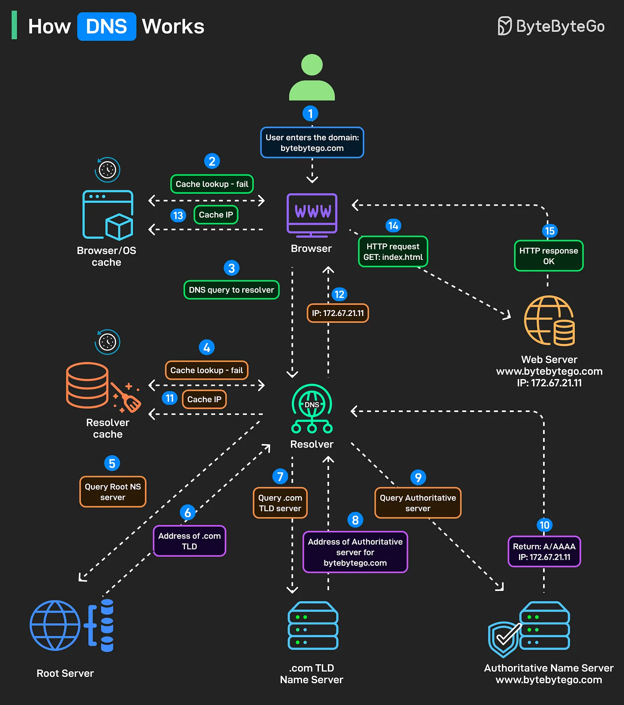

# 208 - DNS hoạt động như thế nào?

- Nguồn: ByteByteGo Big Archive System Design 2025
- Trang PDF: 423-424
- Ảnh minh họa: `../assets/208/figure-01.png`

## Hình minh họa

## Dịch sát

Bạn gõ một domain name và nhấn enter, nhưng điều thật sự xảy ra trước khi webpage load phức tạp hơn phần lớn mọi người nghĩ. DNS là danh bạ điện thoại của Internet, và mỗi request bạn tạo kích hoạt một chuỗi lookup qua nhiều server.

Step 1: Ai đó gõ `bytebytego.com` vào browser và nhấn enter.

Step 2: Trước khi làm bất cứ điều gì, browser tìm IP address đã cache. Operating system cache cũng được kiểm tra.

Step 3: Cache miss kích hoạt DNS query. Browser gửi query tới DNS resolver đã cấu hình, thường do ISP cung cấp hoặc service như Google DNS/Cloudflare.

Step 4: Resolver kiểm tra cache của chính nó.

Step 5-6: Nếu resolver không có answer trong cache, nó hỏi root servers: “Tôi có thể tìm `.com` ở đâu?” Với `bytebytego.com`, root server trả về address của `.com` TLD name server.

Step 7-8: Resolver query `.com` TLD server. TLD server trả về authoritative server address.

Step 9-10: Server này có A/AAAA record thật sự map domain tới IP address. Resolver cuối cùng nhận được answer: `172.67.21.11` cho `bytebytego.com`.

Step 11-12: IP được cache ở resolver level cho future lookup, và trả về browser.

Step 13-14: Browser lưu IP này cho lần dùng sau, và dùng IP để tạo HTTP request thật sự.

Step 15: Web server trả requested content.

Tất cả diễn ra trong milliseconds, trước khi page đầu tiên của bạn bắt đầu load.

## Dịch nội dung trong hình

- User nhập domain `bytebytego.com`; browser kiểm tra `Browser/OS cache`. Nếu cache lookup fail, browser gửi DNS query tới `Resolver`.
- Resolver kiểm tra `Resolver cache`. Nếu cache miss, resolver hỏi `Root Server` để lấy address của `.com TLD`.
- Resolver hỏi `.com TLD Name Server` để lấy `Address of Authoritative server for bytebytego.com`.
- Resolver hỏi `Authoritative Name Server`, nhận `A/AAAA IP: 172.67.21.11`.
- Resolver cache IP và trả IP cho browser; browser cache IP rồi gửi `HTTP request GET: index.html` tới web server; web server trả `HTTP response OK`.

## Tóm tắt & giải thích dễ hiểu

DNS lookup là quá trình phân giải domain sang IP qua nhiều lớp cache và server phân cấp: browser/OS cache -> resolver cache -> root -> TLD -> authoritative. Cache giúp hầu hết request không phải đi hết chuỗi này mỗi lần.

## Ví dụ thực tế - không nằm trong tài liệu gốc

Nếu bạn đổi DNS record của `api.example.com`, user có thể vẫn thấy IP cũ cho tới khi TTL hết hạn ở resolver/browser cache. Khi debug, dùng `dig api.example.com`, `dig @8.8.8.8 api.example.com` hoặc kiểm tra authoritative DNS để biết cache nào đang trả kết quả.

## Thuật ngữ chính

- `DNS`: Domain Name System.
- `Resolver`: server trung gian thực hiện lookup thay client.
- `Root server`: lớp gốc của DNS hierarchy.
- `TLD`: Top-Level Domain như `.com`, `.org`.
- `Authoritative name server`: server giữ record chính thức của domain.
- `A/AAAA record`: record map domain sang IPv4/IPv6.
- `TTL`: thời gian DNS record được cache.
- `Cache miss`: không tìm thấy dữ liệu trong cache.

## Câu hỏi ôn tập + trả lời + thinking học tập + liên hệ

> Đây là phần học tập thêm ở cuối file. Câu hỏi ưu tiên lấy từ tài liệu gốc và được trả lời trực tiếp; nếu bài không có câu hỏi riêng thì dùng tiêu đề/nội dung chính để tạo câu hỏi tự kiểm tra.

### Câu hỏi 1

**Nguồn câu hỏi:** Suy ra từ tiêu đề/nội dung chính vì bài gốc không có câu hỏi riêng.

**Câu hỏi:** DNS hoạt động như thế nào?

**Trả lời:** Nên trả lời theo flow end-to-end: request/dữ liệu đi vào đâu, qua thành phần nào, state đổi ở đâu và kết quả trả ra thế nào. Với `DNS hoạt động như thế nào?`, ý chính là: DNS lookup là quá trình phân giải domain sang IP qua nhiều lớp cache và server phân cấp: browser/OS cache -> resolver cache -> root -> TLD -> authoritative. Cache giúp hầu hết request không phải đi hết chuỗi này mỗi lần.

**Thinking học tập + liên hệ:** Luồng trong `DNS hoạt động như thế nào?` nên được vẽ từ input tới output, kèm owner của từng bước và failure mode ở mỗi boundary. Lens chính là DNS, transport, TLS, HTTP, proxy/CDN, application timeout và observability theo từng layer. Khi debug production, hãy tách latency theo DNS lookup, TCP connect, TLS handshake, TTFB và download để không đoán mò. Khi ghi chú lại, hãy giải thích được các keyword: `DNS`, `Resolver`, `Root server`, `TLD`, `Authoritative name server`.
