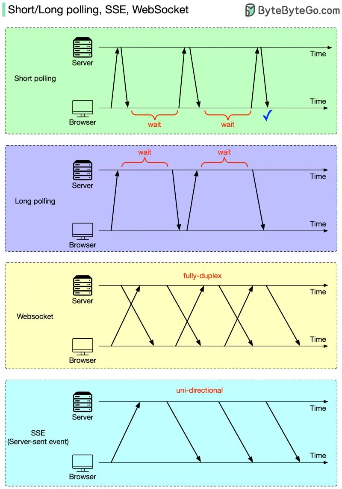

# 209 - Web server có thể cung cấp real-time updates không?

- Nguồn: ByteByteGo Big Archive System Design 2025
- Trang PDF: 425-426
- Ảnh minh họa: `../assets/209/figure-01.png`

## Hình minh họa

## Dịch sát

HTTP server không thể tự động khởi tạo connection tới browser. Do đó, web browser là bên initiator. Vậy chúng ta nên làm gì tiếp để nhận real-time update từ HTTP server?

Cả web browser và HTTP server đều có thể chịu trách nhiệm cho task này.

- Web browser làm phần nặng: short polling hoặc long polling. Với short polling, browser sẽ retry cho tới khi nhận được latest data. Với long polling, HTTP server không trả result cho tới khi có new data đến.

- HTTP server và web browser phối hợp: WebSocket hoặc SSE (server-sent event). Trong cả hai trường hợp, HTTP server có thể gửi trực tiếp latest data tới browser sau khi connection được established. Khác biệt là SSE là uni-directional, nên browser không thể gửi request mới tới server qua cùng kênh đó, trong khi WebSocket là fully-duplex, nên browser có thể tiếp tục gửi request mới.

## Dịch nội dung trong hình

- `Short polling`: browser gửi request định kỳ; nếu chưa có data thì phải wait rồi hỏi lại, tạo nhiều request lặp.
- `Long polling`: browser gửi request, server giữ request mở và chỉ trả khi có data mới; sau đó browser mở request mới.
- `WebSocket`: sau khi upgrade connection, server và browser giao tiếp `fully-duplex`, hai chiều theo thời gian thực.
- `SSE (Server-sent event)`: server gửi event tới browser theo kênh `uni-directional`, phù hợp update một chiều.

## Tóm tắt & giải thích dễ hiểu

Muốn realtime trên web có nhiều mức. Short polling dễ làm nhưng tốn request. Long polling giảm request nhưng vẫn là workaround. SSE tốt cho server -> client stream như notification/feed. WebSocket tốt cho hai chiều như chat, game, collaboration.

## Ví dụ thực tế - không nằm trong tài liệu gốc

Dashboard stock price có thể dùng SSE vì server chỉ đẩy giá mới xuống client. Chat app nên dùng WebSocket vì user cần vừa gửi vừa nhận message realtime. Một admin page đơn giản có thể dùng short polling mỗi 10 giây nếu realtime không quá nghiêm ngặt.

## Thuật ngữ chính

- `Polling`: client hỏi server lặp lại theo chu kỳ.
- `Short polling`: hỏi nhanh, trả ngay dù chưa có data.
- `Long polling`: giữ request mở cho tới khi có data.
- `SSE`: Server-Sent Events, stream một chiều từ server tới browser.
- `WebSocket`: connection full-duplex realtime.
- `Full-duplex`: hai chiều đồng thời.
- `Uni-directional`: một chiều.

