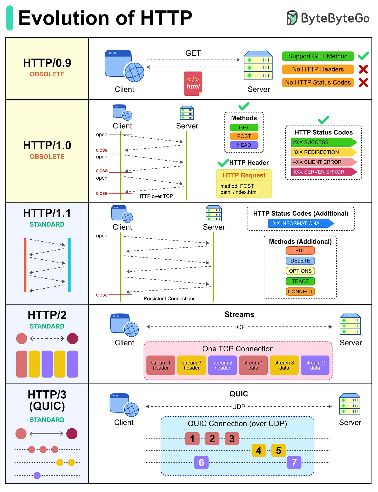

# 210 - Sự tiến hóa của HTTP

- Nguồn: ByteByteGo Big Archive System Design 2025
- Trang PDF: 427-428
- Ảnh minh họa: `../assets/210/figure-01.png`

## Hình minh họa

## Dịch sát

Hypertext Transfer Protocol (HTTP) đã tiến hóa qua nhiều năm để đáp ứng nhu cầu của modern application, từ delivery text đơn giản tới trải nghiệm high-performance, real-time.

Đây là cách HTTP đã tiến triển:

- HTTP/0.9: Được xây để fetch simple HTML document bằng một GET request.

- HTTP/1.0: Thêm headers và status codes để hỗ trợ interaction phong phú hơn, nhưng mỗi request vẫn cần một connection mới.

- HTTP/1.1: Giới thiệu persistent connections và nhiều method hơn, làm web nhanh hơn và hiệu quả hơn cho browsing hằng ngày.

- HTTP/2: Giải quyết performance bottleneck bằng multiplexing, cho phép nhiều request chia sẻ một connection.

- HTTP/3 (QUIC): Chuyển sang UDP với QUIC để giảm latency và cải thiện reliability, đặc biệt cho mobile và real-time app.

## Dịch nội dung trong hình

- `HTTP/0.9`: obsolete; chỉ support `GET`; không có HTTP headers; không có HTTP status codes.
- `HTTP/1.0`: obsolete; chạy HTTP over TCP; mỗi request mở/đóng connection; thêm methods như `GET`, `POST`, `HEAD`, HTTP header và status code `2xx`, `3xx`, `4xx`, `5xx`.
- `HTTP/1.1`: standard; persistent connections; thêm status code `1xx`; thêm method như `PUT`, `DELETE`, `OPTIONS`, `TRACE`, `CONNECT`.
- `HTTP/2`: standard; nhiều stream đi trên một TCP connection, có stream header/data xen kẽ.
- `HTTP/3 (QUIC)`: standard; QUIC connection over UDP, nhiều stream độc lập giúp giảm blocking và latency.

## Tóm tắt & giải thích dễ hiểu

HTTP tiến hóa chủ yếu để giảm overhead connection và tăng performance. HTTP/1.0 mở connection mới liên tục. HTTP/1.1 giữ connection lâu hơn. HTTP/2 multiplex nhiều stream trên một TCP connection. HTTP/3 chuyển sang QUIC/UDP để cải thiện latency và tránh một số head-of-line blocking.

## Ví dụ thực tế - không nằm trong tài liệu gốc

Một trang web có 100 asset nhỏ sẽ chậm nếu mỗi asset phải mở TCP connection riêng như HTTP/1.0. HTTP/2/HTTP/3 giúp tải nhiều asset hiệu quả hơn trên ít connection hoặc nhiều stream độc lập.

## Thuật ngữ chính

- `HTTP/0.9`: phiên bản HTTP rất sớm, chỉ GET HTML.
- `HTTP/1.1`: phiên bản phổ biến với persistent connection.
- `HTTP/2`: multiplexing trên TCP.
- `HTTP/3`: HTTP trên QUIC/UDP.
- `Header`: metadata của request/response.
- `Status code`: mã trạng thái như 200, 404, 500.
- `Multiplexing`: nhiều stream trên một connection.

## Câu hỏi ôn tập + trả lời + thinking học tập + liên hệ

> Đây là phần học tập thêm ở cuối file. Câu hỏi ưu tiên lấy từ tài liệu gốc và được trả lời trực tiếp; nếu bài không có câu hỏi riêng thì dùng tiêu đề/nội dung chính để tạo câu hỏi tự kiểm tra.

### Câu hỏi 1

**Nguồn câu hỏi:** Suy ra từ tiêu đề/nội dung chính vì bài gốc không có câu hỏi riêng.

**Câu hỏi:** Sau khi đọc bài “Evolution of HTTP”, ý chính cần trả lời và áp dụng vào system design là gì?

**Trả lời:** Sau bài này, phần đáng nhớ nhất là: HTTP tiến hóa chủ yếu để giảm overhead connection và tăng performance. HTTP/1.0 mở connection mới liên tục. HTTP/1.1 giữ connection lâu hơn. HTTP/2 multiplex nhiều stream trên một TCP connection. HTTP/3 chuyển sang QUIC/UDP để cải thiện latency và tránh một số head-of-line blocking. Khi áp dụng vào hệ thống thật, hãy kiểm thêm DNS, transport, TLS, HTTP, proxy/CDN, application timeout và observability theo từng layer.

**Thinking học tập + liên hệ:** Liên hệ `Sự tiến hóa của HTTP` bằng một scenario thật sẽ giúp thấy trade-off rõ hơn so với chỉ đọc định nghĩa. Lens chính là DNS, transport, TLS, HTTP, proxy/CDN, application timeout và observability theo từng layer. Khi debug production, hãy tách latency theo DNS lookup, TCP connect, TLS handshake, TTFB và download để không đoán mò. Khi ghi chú lại, hãy giải thích được các keyword: `HTTP/0.9`, `HTTP/1.1`, `HTTP/2`, `HTTP/3`, `Header`.
