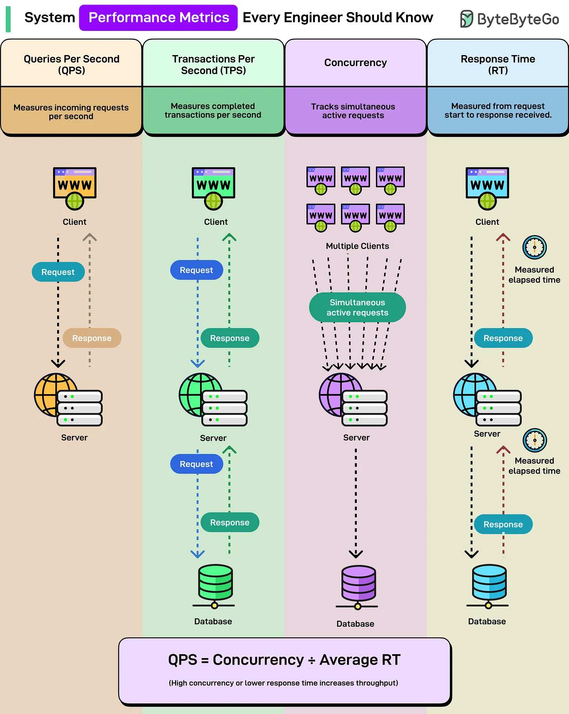

# 211 - Các metric hiệu năng hệ thống mọi engineer nên biết

- Nguồn: ByteByteGo Big Archive System Design 2025
- Trang PDF: 429-430
- Ảnh minh họa: `../assets/211/figure-01.png`

## Hình minh họa

## Dịch sát

API của bạn chậm. Nhưng chậm chính xác là bao nhiêu? Bạn cần con số. Các metric thật cho bạn biết điều gì thật sự hỏng và nên sửa ở đâu.

Đây là bốn core metrics mọi engineer nên biết khi phân tích system performance:

- Queries Per Second (QPS): Số incoming request mà system xử lý mỗi giây. Server nhận 1.000 request trong một giây? Đó là 1.000 QPS. Nghe có vẻ đơn giản cho tới khi bạn nhận ra phần lớn system không thể duy trì peak QPS lâu mà không bắt đầu hỏng.

- Transactions Per Second (TPS): Số completed transaction mà system xử lý mỗi giây. Một transaction gồm full round trip, tức request đi ra, chạm database, rồi quay về với response. TPS nói về actual work completed, không chỉ request nhận vào. Đây là thứ business quan tâm.

- Concurrency: Số simultaneous active request mà system đang xử lý tại một thời điểm. Bạn có thể có 100 request mỗi giây, nhưng nếu mỗi request mất 5 giây để complete, thực tế bạn đang xử lý 500 concurrent request cùng lúc. High concurrency nghĩa là bạn cần nhiều resource hơn, connection pooling tốt hơn và thread management thông minh hơn.

- Response Time (RT): Thời gian trôi qua từ lúc request bắt đầu tới khi response được nhận. Được đo ở cả client level và server level. Một quan hệ đơn giản nối tất cả lại với nhau: `QPS = Concurrency / Average Response Time`. Concurrency cao hơn hoặc response time thấp hơn nghĩa là throughput cao hơn.

## Dịch nội dung trong hình

- `Queries Per Second (QPS)`: đo incoming requests mỗi giây.
- `Transactions Per Second (TPS)`: đo completed transactions mỗi giây.
- `Concurrency`: track simultaneous active requests từ nhiều client.
- `Response Time (RT)`: đo elapsed time từ request start tới khi response received.
- Công thức trong hình: `QPS = Concurrency ÷ Average RT`; high concurrency hoặc lower response time làm tăng throughput.

## Tóm tắt & giải thích dễ hiểu

QPS đo request vào, TPS đo công việc hoàn tất, concurrency đo số request đang xử lý cùng lúc, RT đo độ trễ từng request. Các metric này liên quan trực tiếp: nếu RT tăng mà QPS giữ nguyên, concurrency cũng tăng, kéo theo nhu cầu connection/thread/memory cao hơn.

## Ví dụ thực tế - không nằm trong tài liệu gốc

Nếu API có 200 QPS và average RT là 500ms, concurrency xấp xỉ 100 request đang xử lý. Nếu database chậm làm RT tăng lên 2s, cùng 200 QPS sẽ cần khoảng 400 concurrent request, dễ làm connection pool cạn.

## Thuật ngữ chính

- `QPS`: queries/requests per second.
- `TPS`: transactions per second.
- `Concurrency`: số request active đồng thời.
- `Response Time`: thời gian phản hồi.
- `Throughput`: lượng xử lý thành công mỗi giây.
- `Peak QPS`: QPS đỉnh trong một khoảng ngắn.
- `Connection pool`: pool kết nối tới DB/service.

