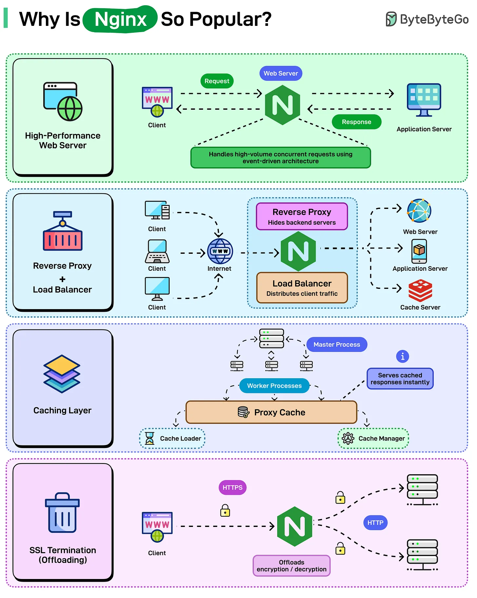

# 212 - Vì sao Nginx phổ biến như vậy?

- Nguồn: ByteByteGo Big Archive System Design 2025
- Trang PDF: 431-432
- Ảnh minh họa: `../assets/212/figure-01.png`

## Hình minh họa

## Dịch sát

Apache thống trị web server trong 20 năm, rồi Nginx xuất hiện và thay đổi mọi thứ. Bây giờ Nginx vận hành một số site lớn nhất trên Internet, gồm Netflix, Airbnb, Dropbox và WordPress.com. Không phải vì nó mới hơn hay thời thượng hơn, mà vì nó giải quyết các vấn đề Apache không thể xử lý hiệu quả.

Đây là những điều làm Nginx phổ biến:

- High-Performance Web Server

- Reverse Proxy & Load Balancer

- Caching Layer

- SSL Termination (Offloading)

## Dịch nội dung trong hình

- `High-Performance Web Server`: Nginx xử lý high-volume concurrent requests bằng event-driven architecture; client gửi request qua Nginx tới application server và nhận response.
- `Reverse Proxy + Load Balancer`: Nginx ẩn backend server, phân phối client traffic tới web server, application server hoặc cache server.
- `Caching Layer`: Nginx có `Proxy Cache`, `Cache Loader`, `Cache Manager`, master process và worker processes; có thể serve cached response ngay lập tức.
- `SSL Termination (Offloading)`: client kết nối HTTPS tới Nginx; Nginx offload encryption/decryption rồi có thể gọi backend bằng HTTP/HTTPS tùy cấu hình.

## Tóm tắt & giải thích dễ hiểu

Nginx phổ biến vì nó làm tốt nhiều vai trò ở edge/backend gateway: web server nhanh, reverse proxy, load balancer, cache và TLS termination. Kiến trúc event-driven giúp Nginx xử lý nhiều concurrent connection hiệu quả, đặc biệt với static file, proxy và gateway workloads.

## Ví dụ thực tế - không nằm trong tài liệu gốc

Một deployment Laravel/Node.js có thể đặt Nginx phía trước app server. Nginx serve static asset, terminate TLS, gzip/brotli response, cache endpoint đọc nhiều và proxy request động vào PHP-FPM/Node service.

## Thuật ngữ chính

- `Nginx`: high-performance web server/reverse proxy.
- `Event-driven architecture`: kiến trúc xử lý nhiều connection bằng event loop.
- `Reverse proxy`: proxy đứng trước backend.
- `Load balancer`: phân phối tải qua nhiều backend.
- `Proxy cache`: cache response tại proxy.
- `SSL/TLS termination`: xử lý mã hóa HTTPS tại proxy.
- `Worker process`: process xử lý request trong Nginx.

## Câu hỏi ôn tập + trả lời + thinking học tập + liên hệ

> Đây là phần học tập thêm ở cuối file. Câu hỏi ưu tiên lấy từ tài liệu gốc và được trả lời trực tiếp; nếu bài không có câu hỏi riêng thì dùng tiêu đề/nội dung chính để tạo câu hỏi tự kiểm tra.

### Câu hỏi 1

**Nguồn câu hỏi:** Suy ra từ tiêu đề/nội dung chính vì bài gốc không có câu hỏi riêng.

**Câu hỏi:** Why Is Nginx So Popular?

**Trả lời:** Nếu rút thành checklist thiết kế thì ý chính là: Nginx phổ biến vì nó làm tốt nhiều vai trò ở edge/backend gateway: web server nhanh, reverse proxy, load balancer, cache và TLS termination. Kiến trúc event-driven giúp Nginx xử lý nhiều concurrent connection hiệu quả, đặc biệt với static file, proxy và gateway workloads. Khi áp dụng vào hệ thống thật, hãy kiểm thêm độ phức tạp vận hành, rollback, cost, kỹ năng team, observability và blast radius khi hỏng.

**Thinking học tập + liên hệ:** Ôn tập `Vì sao Nginx phổ biến như vậy?` bằng cách biến khái niệm thành quyết định thiết kế cụ thể: chọn gì, bỏ gì, đo gì và ai chịu trách nhiệm. Lens chính là độ phức tạp vận hành, rollback, cost, kỹ năng team, observability và blast radius khi hỏng. Khi đưa lên production, hãy map từng thành phần vào deploy, rollback, monitoring, alerting, secret, cost và ownership rõ ràng. Khi ghi chú lại, hãy giải thích được các keyword: `Nginx`, `Event-driven architecture`, `Reverse proxy`, `Load balancer`, `Proxy cache`.
