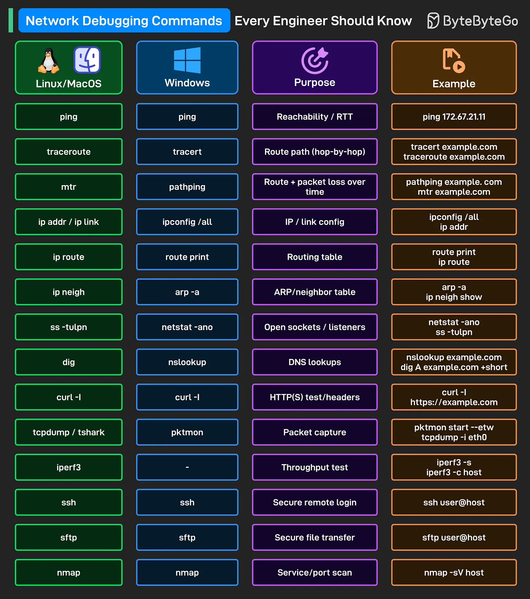

# 213 - Các lệnh debug network mọi engineer nên biết

- Nguồn: ByteByteGo Big Archive System Design 2025
- Trang PDF: 433-434
- Ảnh minh họa: `../assets/213/figure-01.png`

## Hình minh họa

## Dịch sát

Khi ai đó nói “Đó là vấn đề network”, các command này giúp bạn tìm lỗi nhanh.

- `ping`: Kiểm tra destination có response không và báo round-trip time cho basic reachability.

- `traceroute` / `tracert`: Hiển thị từng hop trên path để bạn thấy packet chậm hoặc dừng ở đâu.

- `mtr` / `pathping`: Đo latency và loss theo từng hop liên tục để bắt lỗi intermittent.

- `ip addr`, `ip link` / `ipconfig /all`: In local IP, MAC và interface status để verify network identity của máy.

- `ip route`: Hiển thị routing table để xác nhận gateway và next hop system sẽ dùng.

- `ip neigh`: Hiển thị IP-to-MAC entries để phát hiện duplicate hoặc stale ARP record trên LAN.

- `ss -tulpn`: Liệt kê listening sockets và PID để xác nhận service thật sự bind vào port mong đợi.

- `dig`: Resolve DNS records để verify IP chính xác mà client sẽ connect.

- `curl -I`: Chỉ fetch HTTP(S) headers để kiểm tra status code, redirect và cache settings.

- `tcpdump` / `tshark`: Capture packet để inspect traffic thật và validate cái gì được gửi/nhận.

- `iperf3`: Đo end-to-end throughput giữa hai host để tách bandwidth limit khỏi app issue.

- `ssh`: Mở secure shell trên remote machine để chạy check và apply fix trực tiếp.

- `sftp`: Transfer file an toàn để kéo log hoặc push artifact trong incident.

- `nmap`: Scan open port và probe version để xác nhận service nào đang expose và responding.

## Dịch nội dung trong hình

| Linux/MacOS | Windows | Purpose | Example |
| --- | --- | --- | --- |
| `ping` | `ping` | Reachability / RTT | `ping 172.67.21.11` |
| `traceroute` | `tracert` | Route path hop-by-hop | `tracert example.com`, `traceroute example.com` |
| `mtr` | `pathping` | Route + packet loss theo thời gian | `pathping example.com`, `mtr example.com` |
| `ip addr / ip link` | `ipconfig /all` | IP / link config | `ipconfig /all`, `ip addr` |
| `ip route` | `route print` | Routing table | `route print`, `ip route` |
| `ip neigh` | `arp -a` | ARP/neighbor table | `arp -a`, `ip neigh show` |
| `ss -tulpn` | `netstat -ano` | Open sockets / listeners | `netstat -ano`, `ss -tulpn` |
| `dig` | `nslookup` | DNS lookups | `nslookup example.com`, `dig A example.com +short` |
| `curl -I` | `curl -I` | HTTP(S) headers test | `curl -I https://example.com` |
| `tcpdump / tshark` | `pktmon` | Packet capture | `pktmon start --etw`, `tcpdump -i eth0` |
| `iperf3` | không nêu | Throughput test | `iperf3 -s`, `iperf3 -c host` |
| `ssh` | `ssh` | Secure remote login | `ssh user@host` |
| `sftp` | `sftp` | Secure file transfer | `sftp user@host` |
| `nmap` | `nmap` | Service/port scan | `nmap -sV host` |

## Tóm tắt & giải thích dễ hiểu

Debug network nên đi theo lớp: reachability (`ping`), route (`traceroute/mtr`), local config (`ip addr`, `ip route`), DNS (`dig`), port/listener (`ss`, `nmap`), HTTP header (`curl -I`), packet capture (`tcpdump`), throughput (`iperf3`). Như vậy bạn tránh đoán mò “network issue” chung chung.

## Ví dụ thực tế - không nằm trong tài liệu gốc

Nếu API không truy cập được, bạn có thể chạy: `dig api.example.com`, `ping <ip>`, `traceroute <ip>`, `curl -I https://api.example.com`, `ss -tulpn` trên server, rồi `tcpdump` nếu cần xem packet có tới máy không.

## Thuật ngữ chính

- `RTT`: round-trip time.
- `Hop`: router/node trung gian trên route.
- `ARP`: map IP sang MAC trong LAN.
- `Socket`: endpoint network của process.
- `DNS lookup`: truy vấn phân giải domain.
- `Packet capture`: bắt gói tin thật.
- `Throughput`: băng thông thực đo được.

## Câu hỏi ôn tập + trả lời + thinking học tập + liên hệ

> Đây là phần học tập thêm ở cuối file. Câu hỏi ưu tiên lấy từ tài liệu gốc và được trả lời trực tiếp; nếu bài không có câu hỏi riêng thì dùng tiêu đề/nội dung chính để tạo câu hỏi tự kiểm tra.

### Câu hỏi 1

**Nguồn câu hỏi:** Suy ra từ tiêu đề/nội dung chính vì bài gốc không có câu hỏi riêng.

**Câu hỏi:** Sau khi đọc bài “Network Debugging Commands Every Engineer Should Know”, ý chính cần trả lời và áp dụng vào system design là gì?

**Trả lời:** Sau bài này, phần đáng nhớ nhất là: Debug network nên đi theo lớp: reachability (`ping`), route (`traceroute/mtr`), local config (`ip addr`, `ip route`), DNS (`dig`), port/listener (`ss`, `nmap`), HTTP header (`curl -I`), packet capture (`tcpdump`), throughput (`iperf3`). Như vậy bạn tránh đoán mò “network issue” chung chung. Khi áp dụng vào hệ thống thật, hãy kiểm thêm DNS, transport, TLS, HTTP, proxy/CDN, application timeout và observability theo từng layer.

**Thinking học tập + liên hệ:** Khi học `Các lệnh debug network mọi engineer nên biết`, hãy thử viết một checklist áp dụng vào project: input, output, owner, rủi ro và metric kiểm chứng. Lens chính là DNS, transport, TLS, HTTP, proxy/CDN, application timeout và observability theo từng layer. Khi debug production, hãy tách latency theo DNS lookup, TCP connect, TLS handshake, TTFB và download để không đoán mò. Khi ghi chú lại, hãy giải thích được các keyword: `RTT`, `Hop`, `ARP`, `Socket`, `DNS lookup`.
