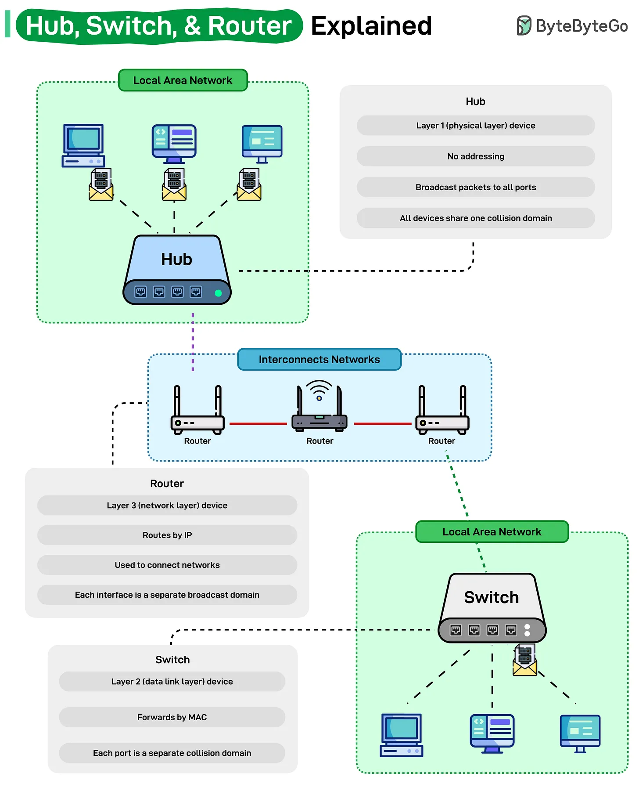

# 214 - Giải thích Hub, Switch và Router

- Nguồn: ByteByteGo Big Archive System Design 2025
- Trang PDF: 435-436
- Ảnh minh họa: `../assets/214/figure-01.png`

## Hình minh họa

## Dịch sát

Mọi home và office network đều dựa vào ba thiết bị này: hub, switch và router, nhưng vai trò của chúng thường bị nhầm lẫn.

- Hub hoạt động ở Layer 1 (Physical Layer). Nó là thiết bị đơn giản nhất trong ba loại, không hiểu address hoặc data type. Khi một packet đến, nó chỉ broadcast packet tới mọi device được kết nối, tạo ra một collision domain lớn. Điều đó nghĩa là tất cả device cạnh tranh cùng một bandwidth, làm hub kém hiệu quả trong modern network.

- Switch hoạt động ở Layer 2 (Data Link Layer). Nó học MAC address và forward frame chỉ tới destination device đúng. Mỗi port trên switch hoạt động như một collision domain riêng, cải thiện efficiency và tăng tốc communication trong LAN.

- Router hoạt động ở Layer 3 (Network Layer). Nó route packet dựa trên IP address và kết nối các network khác nhau với nhau, ví dụ home network của bạn với Internet. Mỗi router interface tạo thành một broadcast domain riêng, giữ local traffic và external traffic tách biệt.

Hiểu cách ba layer này hoạt động cùng nhau là nền tảng của mọi modern network, từ Wi-Fi gia đình tới global Internet backbone.

## Dịch nội dung trong hình

- `Hub`: thiết bị Layer 1 physical layer; không có addressing; broadcast packet tới tất cả port; tất cả device chia sẻ một collision domain.
- `Switch`: thiết bị Layer 2 data link layer; forward theo MAC; mỗi port là một collision domain riêng.
- `Router`: thiết bị Layer 3 network layer; route theo IP; dùng để kết nối nhiều network; mỗi interface là một broadcast domain riêng.
- Sơ đồ: hub kết nối device trong local area network; router interconnects networks; switch kết nối device trong LAN hiệu quả hơn hub.

## Tóm tắt & giải thích dễ hiểu

Hub chỉ phát lại tín hiệu cho mọi port nên lãng phí và dễ collision. Switch thông minh hơn vì học MAC và gửi frame đúng port. Router kết nối các network khác nhau và quyết định đường đi bằng IP. Trong mạng hiện đại, hub hầu như không còn được dùng cho production.

## Ví dụ thực tế - không nằm trong tài liệu gốc

Trong văn phòng, máy tính nên cắm vào switch để giao tiếp LAN hiệu quả. Switch đó uplink tới router/firewall để đi Internet hoặc sang subnet khác. Nếu thay switch bằng hub, mọi máy sẽ nghe traffic của nhau và bandwidth bị chia sẻ kém hiệu quả.

## Thuật ngữ chính

- `Hub`: thiết bị Layer 1 broadcast mọi traffic.
- `Switch`: thiết bị Layer 2 forward theo MAC.
- `Router`: thiết bị Layer 3 route theo IP.
- `MAC address`: địa chỉ phần cứng ở data link layer.
- `IP address`: địa chỉ network layer.
- `Collision domain`: vùng mà packet có thể va chạm khi truyền.
- `Broadcast domain`: vùng nhận broadcast frame/packet.

## Câu hỏi ôn tập + trả lời + thinking học tập + liên hệ

> Đây là phần học tập thêm ở cuối file. Câu hỏi ưu tiên lấy từ tài liệu gốc và được trả lời trực tiếp; nếu bài không có câu hỏi riêng thì dùng tiêu đề/nội dung chính để tạo câu hỏi tự kiểm tra.

### Câu hỏi 1

**Nguồn câu hỏi:** Suy ra từ tiêu đề/nội dung chính vì bài gốc không có câu hỏi riêng.

**Câu hỏi:** Sau khi đọc bài “Hub, Switch, & Router Explained”, ý chính cần trả lời và áp dụng vào system design là gì?

**Trả lời:** Trọng tâm cần đem vào thực tế là: Hub chỉ phát lại tín hiệu cho mọi port nên lãng phí và dễ collision. Switch thông minh hơn vì học MAC và gửi frame đúng port. Router kết nối các network khác nhau và quyết định đường đi bằng IP. Trong mạng hiện đại, hub hầu như không còn được dùng cho production. Khi áp dụng vào hệ thống thật, hãy kiểm thêm DNS, transport, TLS, HTTP, proxy/CDN, application timeout và observability theo từng layer.

**Thinking học tập + liên hệ:** Khi học `Giải thích Hub, Switch và Router`, hãy thử viết một checklist áp dụng vào project: input, output, owner, rủi ro và metric kiểm chứng. Lens chính là DNS, transport, TLS, HTTP, proxy/CDN, application timeout và observability theo từng layer. Khi debug production, hãy tách latency theo DNS lookup, TCP connect, TLS handshake, TTFB và download để không đoán mò. Khi ghi chú lại, hãy giải thích được các keyword: `Hub`, `Switch`, `Router`, `MAC address`, `IP address`.
