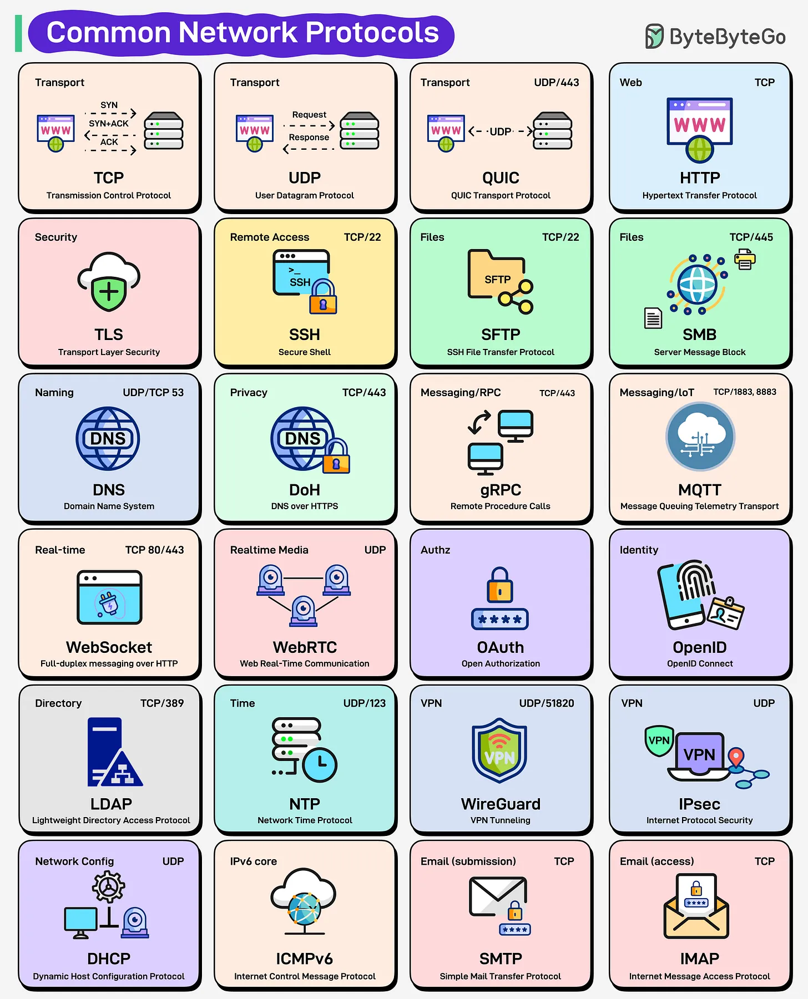

# 215 - Các network protocol phổ biến mọi engineer nên biết

- Nguồn: ByteByteGo Big Archive System Design 2025
- Trang PDF: 437-438
- Ảnh minh họa: `../assets/215/figure-01.png`

## Hình minh họa

## Dịch sát

Bạn từng tự hỏi điều gì thật sự xảy ra khi bấm “Send” trong email hoặc tham gia video call chưa? Mọi click, message và API call trên Internet đều dựa vào network protocols. Chúng định nghĩa data di chuyển thế nào, ai có thể nói chuyện, và mọi thứ diễn ra an toàn ra sao.

Ở nền tảng là transport protocols: TCP đảm bảo reliable delivery, UDP ưu tiên speed, và QUIC kết hợp cả hai thế giới trên UDP.

Trên đó, HTTP vận hành web, TLS bảo vệ nó, và DNS dịch name thành address.

Cần remote access? Đó là SSH. File transfer? SFTP hoặc SMB.

Real-time chat và media? WebSocket, WebRTC và MQTT giữ data chảy live.

Với identity và access, OAuth và OpenID xử lý authorization và authentication.

Ở backend, DHCP, NTP, ICMPv6 và LDAP âm thầm giữ mọi thứ synchronized, addressed và discoverable.

Từ email đơn giản như SMTP, IMAP tới VPN mã hóa như WireGuard, IPsec, các protocol này tạo thành ngôn ngữ vô hình giữ Internet kết nối và an toàn.

## Dịch nội dung trong hình

- `Transport`: `TCP` - Transmission Control Protocol; `UDP` - User Datagram Protocol; `QUIC` - QUIC Transport Protocol, thường dùng UDP/443.
- `Web`: `HTTP` chạy trên TCP.
- `Security`: `TLS` - Transport Layer Security.
- `Remote Access`: `SSH` dùng TCP/22.
- `Files`: `SFTP` dùng TCP/22, `SMB` dùng TCP/445.
- `Naming`: `DNS` dùng UDP/TCP 53; `DoH` là DNS over HTTPS dùng TCP/443.
- `Messaging/RPC`: `gRPC` dùng TCP/443.
- `Messaging/IoT`: `MQTT` dùng TCP/1883 và 8883.
- `Real-time`: `WebSocket` dùng TCP 80/443; `WebRTC` dùng UDP.
- `Authz/Identity`: `OAuth`, `OpenID Connect`.
- `Directory`: `LDAP` dùng TCP/389.
- `Time`: `NTP` dùng UDP/123.
- `VPN`: `WireGuard` dùng UDP/51820; `IPsec` dùng UDP.
- `Network Config`: `DHCP` dùng UDP.
- `IPv6 core`: `ICMPv6`.
- `Email`: `SMTP` cho submission, `IMAP` cho access.

## Tóm tắt & giải thích dễ hiểu

Protocol là contract để hệ thống giao tiếp. Có protocol cho transport, web, bảo mật, DNS, file, remote shell, realtime, identity, directory, time sync, VPN và email. Khi hiểu protocol và port phổ biến, bạn debug firewall, latency, connection failure và authentication flow nhanh hơn.

## Ví dụ thực tế - không nằm trong tài liệu gốc

Nếu video call hoạt động kém nhưng web browsing bình thường, vấn đề có thể nằm ở UDP/WebRTC bị firewall/NAT chặn. Nếu login domain chậm, cần kiểm tra DNS, LDAP/OIDC, TLS và NTP vì token/certificate phụ thuộc thời gian chính xác.

## Thuật ngữ chính

- `Protocol`: quy tắc giao tiếp giữa hệ thống.
- `TCP/UDP/QUIC`: protocol transport.
- `TLS`: mã hóa và xác thực connection.
- `DNS/DoH`: phân giải tên miền.
- `SSH/SFTP/SMB`: remote access và file transfer.
- `WebSocket/WebRTC/MQTT`: realtime communication.
- `OAuth/OpenID`: authorization và identity.
- `WireGuard/IPsec`: VPN.

