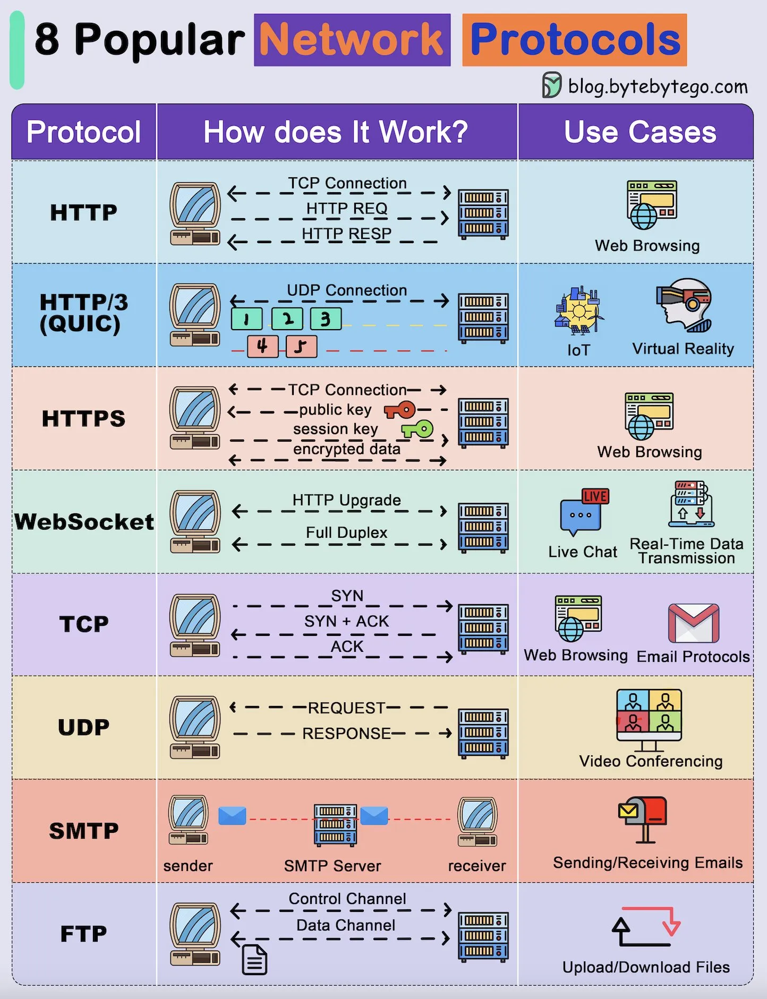

# 216 - 8 network protocol phổ biến

- Nguồn: ByteByteGo Big Archive System Design 2025
- Trang PDF: 439-440
- Ảnh minh họa: `../assets/216/figure-01.png`

## Hình minh họa

## Dịch sát

Network protocol là chìa khóa để transfer data giữa hai system trong một network.

1. FTP (File Transfer Protocol)
   Dùng channel điều khiển và channel dữ liệu riêng để upload/download file giữa client và server.

2. TCP (Transmission Control Protocol)
   Thiết lập reliable connection bằng 3-way handshake (SYN, SYN+ACK, ACK) để delivery data chính xác.

3. UDP (User Datagram Protocol)
   Gửi packet nhẹ, connectionless như request và response với latency tối thiểu. Lý tưởng cho transmission nhanh.

4. HTTP (HyperText Transfer Protocol)
   Dùng TCP để request và receive web resources như HTML, image thông qua HTTP request và response.

5. HTTP/3 (QUIC)
   Được xây trên UDP, cho phép connection nhanh và reliable hơn bằng cách multiplex data stream và giảm latency.

6. HTTPS (Secure HTTP)
   Bảo vệ HTTP bằng encryption dùng public key và session key trên TCP connection, nhờ đó bảo vệ web data.

7. SMTP (Simple Mail Transfer Protocol)
   Transfer email từ sender tới recipient thông qua SMTP server. Nó thường được dùng cho email delivery.

8. WebSocket
   Upgrade HTTP connection thành full-duplex channel cho real-time, bidirectional communication như live chat.

## Dịch nội dung trong hình

- `HTTP`: TCP connection, HTTP request, HTTP response; use case là web browsing.
- `HTTP/3 (QUIC)`: UDP connection với nhiều stream; use case IoT và virtual reality.
- `HTTPS`: TCP connection, public key, session key, encrypted data; use case web browsing an toàn.
- `WebSocket`: HTTP upgrade, full duplex; use case live chat và real-time data transmission.
- `TCP`: handshake `SYN`, `SYN + ACK`, `ACK`; use case web browsing và email protocols.
- `UDP`: request/response nhẹ; use case video conferencing.
- `SMTP`: sender -> SMTP server -> receiver; use case sending/receiving emails.
- `FTP`: control channel và data channel; use case upload/download files.

## Tóm tắt & giải thích dễ hiểu

TCP ưu tiên đúng và đủ; UDP ưu tiên nhanh và nhẹ; QUIC/HTTP3 cố gắng lấy điểm mạnh của cả hai. HTTP/HTTPS phục vụ web, WebSocket phục vụ realtime hai chiều, SMTP phục vụ email, FTP phục vụ file transfer. Khi thiết kế system, chọn protocol theo yêu cầu reliability, latency, security và traffic pattern.

## Ví dụ thực tế - không nằm trong tài liệu gốc

Một chat app có thể dùng HTTPS cho login/API và WebSocket cho message realtime. Một video call dùng UDP/WebRTC để giảm latency. Một hệ thống gửi email dùng SMTP để chuyển thư tới mail server.

## Thuật ngữ chính

- `FTP`: File Transfer Protocol.
- `TCP`: Transmission Control Protocol.
- `UDP`: User Datagram Protocol.
- `HTTP`: HyperText Transfer Protocol.
- `HTTP/3`: HTTP chạy trên QUIC.
- `HTTPS`: HTTP bảo mật bằng TLS.
- `SMTP`: Simple Mail Transfer Protocol.
- `WebSocket`: protocol realtime full-duplex.

