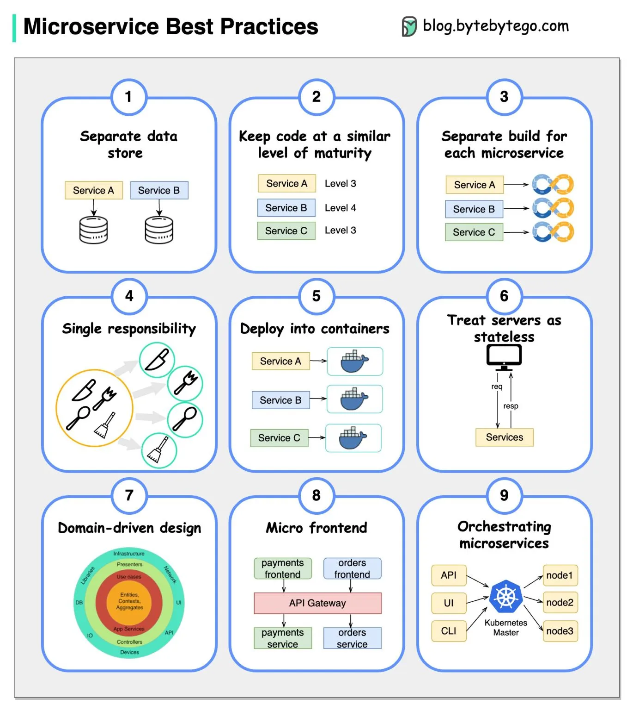

# 217 - Một hình đáng giá ngàn lời: 9 best practice khi phát triển microservices

- Nguồn: ByteByteGo Big Archive System Design 2025
- Trang PDF: 441-442
- Ảnh minh họa: `../assets/217/figure-01.png`

## Hình minh họa

## Dịch sát

Khi phát triển microservices, chúng ta cần tuân theo các best practice sau:

1. Dùng data storage riêng cho từng microservice.

2. Giữ code ở mức maturity tương tự.

3. Build riêng cho từng microservice.

4. Gán cho mỗi microservice một single responsibility.

5. Deploy vào container.

6. Thiết kế stateless services.

7. Áp dụng domain-driven design.

8. Thiết kế micro frontend.

9. Orchestrating microservices.

## Dịch nội dung trong hình

- `Separate data store`: Service A và Service B có data store riêng.
- `Keep code at a similar level of maturity`: các service nên ở level maturity tương tự để tránh service quá cũ/quá mới gây lệch chuẩn vận hành.
- `Separate build for each microservice`: mỗi service có pipeline build riêng.
- `Single responsibility`: mỗi service phụ trách một capability rõ ràng.
- `Deploy into containers`: Service A/B/C được đóng gói container riêng.
- `Treat servers as stateless`: server xử lý request/response không giữ state cục bộ lâu dài.
- `Domain-driven design`: thiết kế quanh domain, entity, context, aggregate, use case, app service và boundary.
- `Micro frontend`: frontend theo domain như payments frontend, orders frontend; đi qua API Gateway tới payments service, orders service.
- `Orchestrating microservices`: API/UI/CLI tương tác với Kubernetes master để điều phối node và workload.

## Tóm tắt & giải thích dễ hiểu

Microservices không chỉ là “tách service nhỏ”. Mỗi service cần ownership dữ liệu, build/deploy độc lập, trách nhiệm rõ, stateless, containerized và được orchestration tốt. DDD giúp tách service theo business boundary, còn micro frontend giúp frontend không trở thành monolith khi backend đã tách nhỏ.

## Ví dụ thực tế - không nằm trong tài liệu gốc

Trong e-commerce, `Order Service` không nên ghi trực tiếp database của `Payment Service`. Mỗi service có database riêng, publish event qua message broker, deploy bằng container riêng trên Kubernetes, và frontend checkout có thể tách phần order/payment theo micro frontend.

## Thuật ngữ chính

- `Microservice`: service nhỏ, deploy độc lập, có trách nhiệm rõ.
- `Data ownership`: service sở hữu dữ liệu của chính nó.
- `Stateless service`: service không phụ thuộc state cục bộ giữa request.
- `Container`: gói chạy app độc lập môi trường.
- `DDD`: Domain-Driven Design.
- `Micro frontend`: tách frontend theo domain/team.
- `Orchestration`: điều phối container/service bằng Kubernetes hoặc nền tảng tương tự.
- `API Gateway`: cổng vào route request tới service phù hợp.

