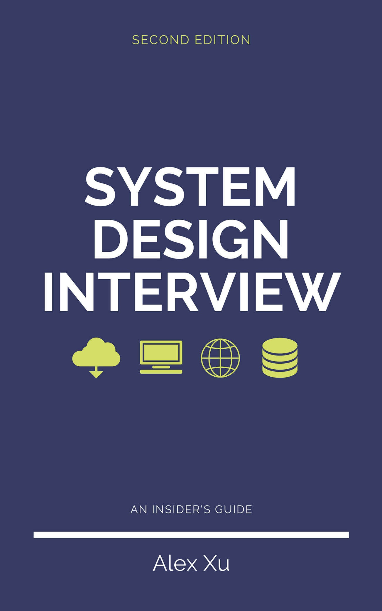

# Book Information and Foreword

[Tiếng Việt](../vi/00-loi-mo-dau.md) · [Mục lục / Contents](../README.md)

- Source: System Design Interview: An Insider's Guide, Alex Xu
- PDF pages: 001-004

> Original English text extracted from the supplied PDF, not translated back from Vietnamese. Figures are grouped after the text of their PDF page. PDF line wrapping, tables and formulas may require viewing the accompanying original figures.

## Original English Text

<!-- trang-pdf:001 -->

<!-- /trang-pdf:001 -->

<!-- trang-pdf:002 -->

System Design Interview: An Insider’s Guide
All rights reserved. This book or any portion thereof may not be reproduced or used in any
manner whatsoever without the express written permission of the publisher except for the use
of brief quotations in a book review.
About the author:
Alex Xu is an experienced software engineer and entrepreneur. Previously, he worked at
Twitter, Apple, Zynga and Oracle. He received his M.S. from Carnegie Mellon University.
He has a passion for designing and implementing complex systems.
Please subscribe to our email list if you want to be notified when new chapters are available:
https://bit.ly/3dtIcsE
For more information, contact systemdesigninsider@gmail.com
Editor: Paul Solomon

<!-- /trang-pdf:002 -->

<!-- trang-pdf:003 -->

Table of Contents
System Design Interview: An Insider’s Guide
FORWARD
CHAPTER 1: SCALE FROM ZERO TO MILLIONS OF USERS
CHAPTER 2: BACK-OF-THE-ENVELOPE ESTIMATION
CHAPTER 3: A FRAMEWORK FOR SYSTEM DESIGN INTERVIEWS
CHAPTER 4: DESIGN A RATE LIMITER
CHAPTER 5: DESIGN CONSISTENT HASHING
CHAPTER 6: DESIGN A KEY-VALUE STORE
CHAPTER 7: DESIGN A UNIQUE ID GENERATOR IN DISTRIBUTED SYSTEMS
CHAPTER 8: DESIGN A URL SHORTENER
CHAPTER 9: DESIGN A WEB CRAWLER
CHAPTER 10: DESIGN A NOTIFICATION SYSTEM
CHAPTER 11: DESIGN A NEWS FEED SYSTEM
CHAPTER 12: DESIGN A CHAT SYSTEM
CHAPTER 13: DESIGN A SEARCH AUTOCOMPLETE SYSTEM
CHAPTER 14: DESIGN YOUTUBE
CHAPTER 15: DESIGN GOOGLE DRIVE
CHAPTER 16: THE LEARNING CONTINUES
AFTERWORD

<!-- /trang-pdf:003 -->

<!-- trang-pdf:004 -->

FORWARD
We are delighted that you have decided to join us in learning the system design interviews.
System design interview questions are the most difficult to tackle among all the technical
interviews. The questions require the interviewees to design an architecture for a software
system, which could be a news feed, Google search, chat system, etc. These questions are
intimidating, and there is no certain pattern to follow. The questions are usually very big
scoped and vague. The processes are open-ended and unclear without a standard or correct
answer.
Companies widely adopt system design interviews because the communication and problem-
solving skills tested in these interviews are similar to those required by a software engineer’s
daily work. An interviewee is evaluated based on how she analyzes a vague problem and how
she solves the problem step by step. The abilities tested also involve how she explains the
idea, discusses with others, and evaluates and optimizes the system. In English, using “she”
flows better than “he or she” or jumping between the two. To make reading easier, we use the
feminine pronoun throughout this book. No disrespect is intended for male engineers.
The system design questions are open-ended. Just like in the real world, there are many
differences and variations in the system. The desired outcome is to come up with an
architecture to achieve system design goals. The discussions could go in different ways
depending on the interviewer. Some interviewers may choose high-level architecture to cover
all aspects; whereas some might choose one or more areas to focus on. Typically, system
requirements, constraints and bottlenecks should be well understood to shape the direction of
both the interviewer and interviewee.
The objective of this book is to provide a reliable strategy to approach the system design
questions. The right strategy and knowledge are vital to the success of an interview.
This book provides solid knowledge in building a scalable system. The more knowledge
gained from reading this book, the better you are equipped in solving the system design
questions.
This book also provides a step by step framework on how to tackle a system design question.
It provides many examples to illustrate the systematic approach with detailed steps that you
can follow. With constant practice, you will be well-equipped to tackle system design
interview questions.

<!-- /trang-pdf:004 -->

---

[Contents](../README.md) · [Tiếng Việt](../vi/00-loi-mo-dau.md) · [Next →](chuong-01-mo-rong-tu-con-so-khong-den-hang-trieu-nguoi-dung.md)
