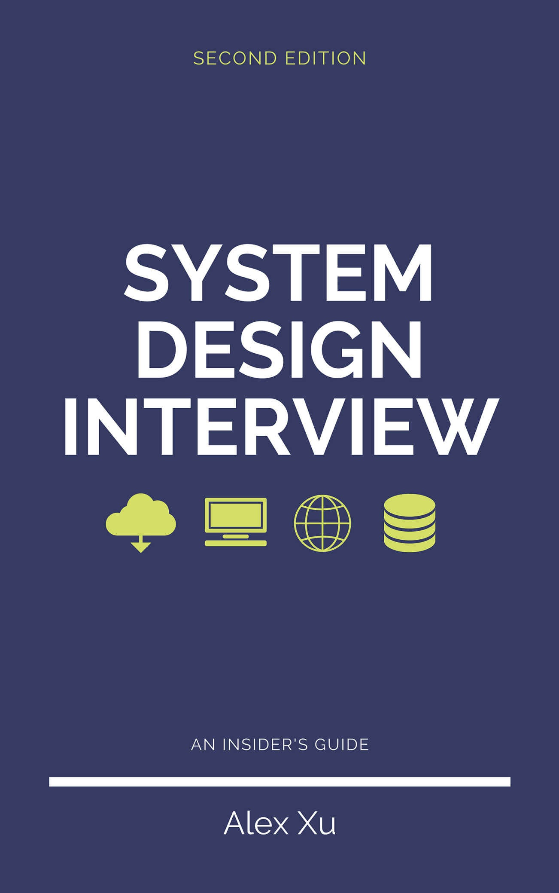

# Thông tin sách và lời nói đầu

*System Design Interview: An Insider's Guide - Alex Xu.*

Nguồn: PDF do người dùng cung cấp, trang PDF 1-4. Bản dịch tiếng Việt phục vụ việc học; hình gốc được giữ nguyên.

<!-- trang-pdf:001 -->

<!-- trang-pdf:002 -->

## Thông tin bản quyền và tác giả

**System Design Interview: An Insider's Guide**

Mọi quyền được bảo lưu. Không được sao chép hoặc sử dụng cuốn sách này hay bất kỳ phần nào của sách dưới bất kỳ hình thức nào nếu chưa có sự cho phép rõ ràng bằng văn bản của nhà xuất bản, ngoại trừ việc trích dẫn những đoạn ngắn trong bài đánh giá sách.

**Về tác giả:**

Alex Xu là kỹ sư phần mềm và doanh nhân giàu kinh nghiệm. Trước đây, ông từng làm việc tại Twitter, Apple, Zynga và Oracle. Ông nhận bằng thạc sĩ khoa học tại Đại học Carnegie Mellon. Ông đam mê thiết kế và triển khai các hệ thống phức tạp.

Hãy đăng ký danh sách email nếu bạn muốn được thông báo khi có chương mới: <https://bit.ly/3dtIcsE>.

Để biết thêm thông tin, liên hệ: systemdesigninsider@gmail.com.

Biên tập: Paul Solomon.

<!-- trang-pdf:003 -->

## Mục lục

- [Lời nói đầu](#lời-nói-đầu)
- [Chương 1: Mở rộng từ con số không đến hàng triệu người dùng](chuong-01.md)
- [Chương 2: Ước tính sơ bộ](chuong-02.md)
- [Chương 3: Khung tiếp cận phỏng vấn thiết kế hệ thống](chuong-03.md)
- [Chương 4: Thiết kế bộ giới hạn tốc độ](chuong-04.md)
- [Chương 5: Thiết kế băm nhất quán](chuong-05.md)
- [Chương 6: Thiết kế kho lưu trữ khóa-giá trị](chuong-06.md)
- [Chương 7: Thiết kế bộ sinh ID duy nhất trong hệ thống phân tán](chuong-07.md)
- [Chương 8: Thiết kế dịch vụ rút gọn URL](chuong-08.md)
- [Chương 9: Thiết kế trình thu thập dữ liệu web](chuong-09.md)
- [Chương 10: Thiết kế hệ thống thông báo](chuong-10.md)
- [Chương 11: Thiết kế hệ thống bảng tin](chuong-11.md)
- [Chương 12: Thiết kế hệ thống trò chuyện](chuong-12.md)
- [Chương 13: Thiết kế hệ thống tự động hoàn thành tìm kiếm](chuong-13.md)
- [Chương 14: Thiết kế YouTube](chuong-14.md)
- [Chương 15: Thiết kế Google Drive](chuong-15.md)
- [Chương 16: Tiếp tục học hỏi](chuong-16.md)
- [Lời kết](17-loi-ket.md)

<!-- trang-pdf:004 -->

## Lời nói đầu

Chúng tôi rất vui vì bạn đã quyết định cùng chúng tôi tìm hiểu về phỏng vấn thiết kế hệ thống. Trong các cuộc phỏng vấn kỹ thuật, câu hỏi thiết kế hệ thống thuộc nhóm khó giải quyết nhất. Chúng yêu cầu ứng viên thiết kế kiến trúc cho một hệ thống phần mềm, chẳng hạn như bảng tin, Google Search hoặc hệ thống trò chuyện. Những câu hỏi này dễ khiến người ta e ngại và không có một khuôn mẫu chắc chắn để làm theo. Phạm vi câu hỏi thường rất rộng và mơ hồ. Quá trình giải quyết mang tính mở, chưa được xác định rõ và không có một đáp án chuẩn hay duy nhất đúng.

Các công ty sử dụng rộng rãi phỏng vấn thiết kế hệ thống vì những kỹ năng giao tiếp và giải quyết vấn đề được kiểm tra trong buổi phỏng vấn tương tự những kỹ năng cần có trong công việc hằng ngày của kỹ sư phần mềm. Ứng viên được đánh giá qua cách phân tích một vấn đề mơ hồ và từng bước giải quyết vấn đề đó. Những năng lực được kiểm tra còn bao gồm cách giải thích ý tưởng, trao đổi với người khác, đánh giá và tối ưu hệ thống. Trong tiếng Anh, dùng đại từ “she” giúp câu văn tự nhiên hơn so với “he or she” hoặc luân phiên giữa hai đại từ. Để sách dễ đọc hơn, chúng tôi dùng đại từ chỉ nữ xuyên suốt cuốn sách. Điều này không nhằm thể hiện sự thiếu tôn trọng đối với các kỹ sư nam.

Các câu hỏi thiết kế hệ thống có tính mở. Cũng như trong thực tế, hệ thống có thể có nhiều khác biệt và biến thể. Kết quả mong muốn là đưa ra một kiến trúc đáp ứng các mục tiêu thiết kế hệ thống. Tùy người phỏng vấn, cuộc thảo luận có thể đi theo những hướng khác nhau. Một số người chọn thảo luận kiến trúc tổng thể để bao quát mọi khía cạnh; những người khác có thể chọn một hoặc vài lĩnh vực để đào sâu. Thông thường, cả người phỏng vấn lẫn ứng viên cần hiểu rõ yêu cầu, ràng buộc và các điểm nghẽn của hệ thống để định hướng cuộc trao đổi.

Mục tiêu của cuốn sách là cung cấp một chiến lược đáng tin cậy để tiếp cận các câu hỏi thiết kế hệ thống. Chiến lược và kiến thức phù hợp có vai trò thiết yếu đối với thành công trong buổi phỏng vấn.

Cuốn sách cung cấp nền tảng kiến thức vững chắc để xây dựng hệ thống có khả năng mở rộng. Càng thu nhận được nhiều kiến thức khi đọc sách, bạn càng có sự chuẩn bị tốt hơn để giải quyết các câu hỏi thiết kế hệ thống.

Cuốn sách cũng cung cấp một khung tiếp cận từng bước để xử lý câu hỏi thiết kế hệ thống. Nhiều ví dụ minh họa cách tiếp cận có hệ thống, kèm các bước chi tiết mà bạn có thể làm theo. Khi luyện tập đều đặn, bạn sẽ có sự chuẩn bị tốt để giải quyết các câu hỏi phỏng vấn thiết kế hệ thống.

[Mục lục bản dịch](../README.md) · [Chương 1 →](chuong-01.md)
