# Chương 1: Mở rộng từ con số không đến hàng triệu người dùng

Tên chương gốc: **Scale From Zero to Millions of Users**. Trang PDF: **005–033**.

<!-- trang-pdf:005 -->

Thiết kế một hệ thống hỗ trợ hàng triệu người dùng là việc đầy thách thức, một hành trình đòi hỏi liên tục tinh chỉnh và cải tiến không ngừng. Trong chương này, chúng ta xây dựng một hệ thống hỗ trợ một người dùng, rồi từng bước mở rộng để phục vụ hàng triệu người dùng. Sau khi đọc chương này, bạn sẽ nắm vững một số kỹ thuật giúp giải quyết các câu hỏi phỏng vấn thiết kế hệ thống.

<!-- trang-pdf:006 -->

## Thiết lập với một máy chủ

Hành trình nghìn dặm bắt đầu từ một bước chân; xây dựng một hệ thống phức tạp cũng vậy. Để bắt đầu đơn giản, mọi thứ đều chạy trên một máy chủ. Hình 1-1 minh họa cấu hình một máy chủ, nơi ứng dụng web, cơ sở dữ liệu, bộ nhớ đệm và các thành phần khác cùng chạy trên một máy.

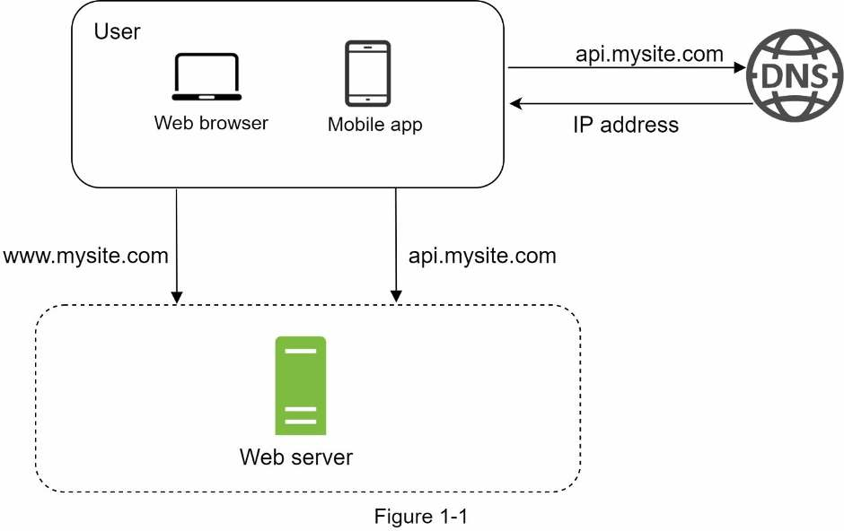

Để hiểu cấu hình này, chúng ta nên tìm hiểu luồng yêu cầu và nguồn lưu lượng truy cập. Trước tiên, hãy xem luồng yêu cầu trong Hình 1-2.

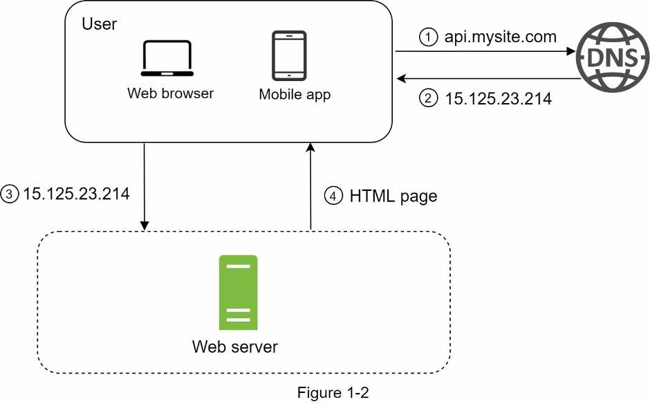

<!-- trang-pdf:007 -->

1. Người dùng truy cập website thông qua tên miền, chẳng hạn `api.mysite.com`. Thông thường, hệ thống tên miền (Domain Name System — DNS) là dịch vụ trả phí do bên thứ ba cung cấp, không được lưu trú trên các máy chủ của chúng ta.
2. Địa chỉ giao thức Internet (Internet Protocol — IP) được trả về trình duyệt hoặc ứng dụng di động. Trong ví dụ này, địa chỉ IP được trả về là `15.125.23.214`.
3. Khi đã có địa chỉ IP, các yêu cầu giao thức truyền tải siêu văn bản (Hypertext Transfer Protocol — HTTP) [1] được gửi trực tiếp đến máy chủ web.
4. Máy chủ web trả về trang HTML hoặc phản hồi JSON để hiển thị.

Tiếp theo, hãy xem nguồn lưu lượng truy cập. Lưu lượng đến máy chủ web xuất phát từ hai nguồn: ứng dụng web và ứng dụng di động.

- **Ứng dụng web:** kết hợp các ngôn ngữ phía máy chủ như Java, Python, v.v. để xử lý logic nghiệp vụ, lưu trữ và các công việc khác, với các ngôn ngữ phía máy khách như HTML và JavaScript để trình bày giao diện.
- **Ứng dụng di động:** HTTP là giao thức giao tiếp giữa ứng dụng di động và máy chủ web. JavaScript Object Notation (JSON) là định dạng phản hồi API thường dùng để truyền dữ liệu nhờ tính đơn giản. Dưới đây là một ví dụ phản hồi API ở định dạng JSON:

`GET /users/12` — Lấy đối tượng người dùng có `id = 12`.

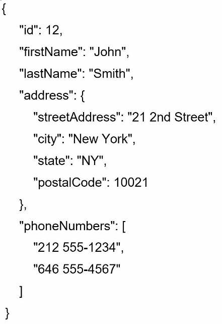

<!-- trang-pdf:008 -->

## Cơ sở dữ liệu

Khi số lượng người dùng tăng, một máy chủ không còn đủ. Chúng ta cần nhiều máy chủ: một máy xử lý lưu lượng web/di động, máy còn lại dành cho cơ sở dữ liệu (Hình 1-3). Việc tách máy chủ xử lý lưu lượng web/di động, tức tầng web (web tier), khỏi máy chủ cơ sở dữ liệu, tức tầng dữ liệu (data tier), cho phép mở rộng chúng độc lập.

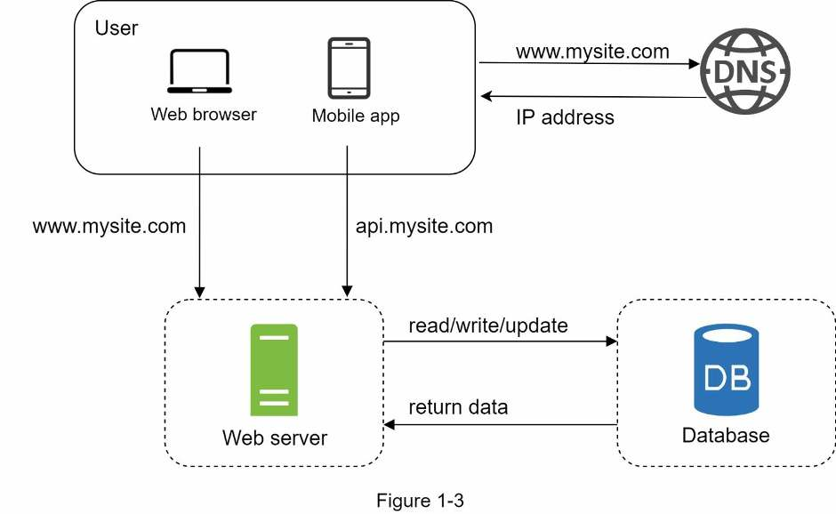

### Nên dùng cơ sở dữ liệu nào?

Bạn có thể chọn cơ sở dữ liệu quan hệ truyền thống hoặc cơ sở dữ liệu phi quan hệ. Hãy xem sự khác nhau giữa chúng.

Cơ sở dữ liệu quan hệ còn được gọi là hệ quản trị cơ sở dữ liệu quan hệ (relational database management system — RDBMS) hoặc cơ sở dữ liệu SQL. Các lựa chọn phổ biến nhất gồm MySQL, Oracle database, PostgreSQL, v.v. Cơ sở dữ liệu quan hệ biểu diễn và lưu trữ dữ liệu dưới dạng bảng và hàng. Bạn có thể dùng SQL để thực hiện phép nối (join) giữa các bảng cơ sở dữ liệu khác nhau.

Cơ sở dữ liệu phi quan hệ còn được gọi là cơ sở dữ liệu NoSQL. Các lựa chọn phổ biến gồm CouchDB, Neo4j, Cassandra, HBase, Amazon DynamoDB, v.v. [2]. Chúng được chia thành bốn nhóm: kho khóa–giá trị (key-value store), kho đồ thị (graph store), kho cột (column store) và kho tài liệu (document store). Nhìn chung, cơ sở dữ liệu phi quan hệ không hỗ trợ phép nối.

Với phần lớn lập trình viên, cơ sở dữ liệu quan hệ là lựa chọn tốt nhất vì đã tồn tại hơn 40 năm và có lịch sử hoạt động tốt. Tuy nhiên, nếu chúng không phù hợp với trường hợp sử dụng cụ thể, điều quan trọng là tìm hiểu thêm các lựa chọn ngoài cơ sở dữ liệu quan hệ. Cơ sở dữ liệu phi quan hệ có thể phù hợp nếu:

- Ứng dụng đòi hỏi độ trễ cực thấp.
- Dữ liệu không có cấu trúc, hoặc bạn không có dữ liệu mang tính quan hệ.
- Bạn chỉ cần tuần tự hóa và giải tuần tự hóa dữ liệu như JSON, XML, YAML, v.v.
- Bạn cần lưu trữ một lượng dữ liệu khổng lồ.

<!-- trang-pdf:009 -->

## Mở rộng theo chiều dọc và chiều ngang

Mở rộng theo chiều dọc (vertical scaling), còn gọi là “scale up”, là quá trình tăng năng lực như CPU, RAM, v.v. cho máy chủ. Mở rộng theo chiều ngang (horizontal scaling), còn gọi là “scale-out”, cho phép mở rộng bằng cách bổ sung máy chủ vào tập tài nguyên.

Khi lưu lượng thấp, mở rộng theo chiều dọc là lựa chọn rất tốt; ưu điểm chính của nó là sự đơn giản. Tiếc là cách này có những giới hạn đáng kể.

- Mở rộng theo chiều dọc có giới hạn cứng. Không thể bổ sung CPU và bộ nhớ vô hạn cho một máy chủ.
- Mở rộng theo chiều dọc không có khả năng chuyển đổi dự phòng (failover) và tính dự phòng (redundancy). Nếu máy chủ ngừng hoạt động, website/ứng dụng cũng ngừng hoạt động hoàn toàn.

Do các giới hạn đó, mở rộng theo chiều ngang được ưu tiên hơn đối với ứng dụng quy mô lớn.

Trong thiết kế trước, người dùng kết nối trực tiếp với máy chủ web. Nếu máy chủ web ngừng hoạt động, người dùng không thể truy cập website. Trong tình huống khác, nếu nhiều người dùng đồng thời truy cập và chạm giới hạn tải của máy chủ web, họ thường nhận phản hồi chậm hơn hoặc không kết nối được. Bộ cân bằng tải là kỹ thuật phù hợp nhất để giải quyết các vấn đề này.

<!-- trang-pdf:010 -->

## Bộ cân bằng tải

Bộ cân bằng tải (load balancer) phân phối đều lưu lượng đến giữa các máy chủ web thuộc một nhóm được cân bằng tải. Hình 1-4 cho thấy cách nó hoạt động.

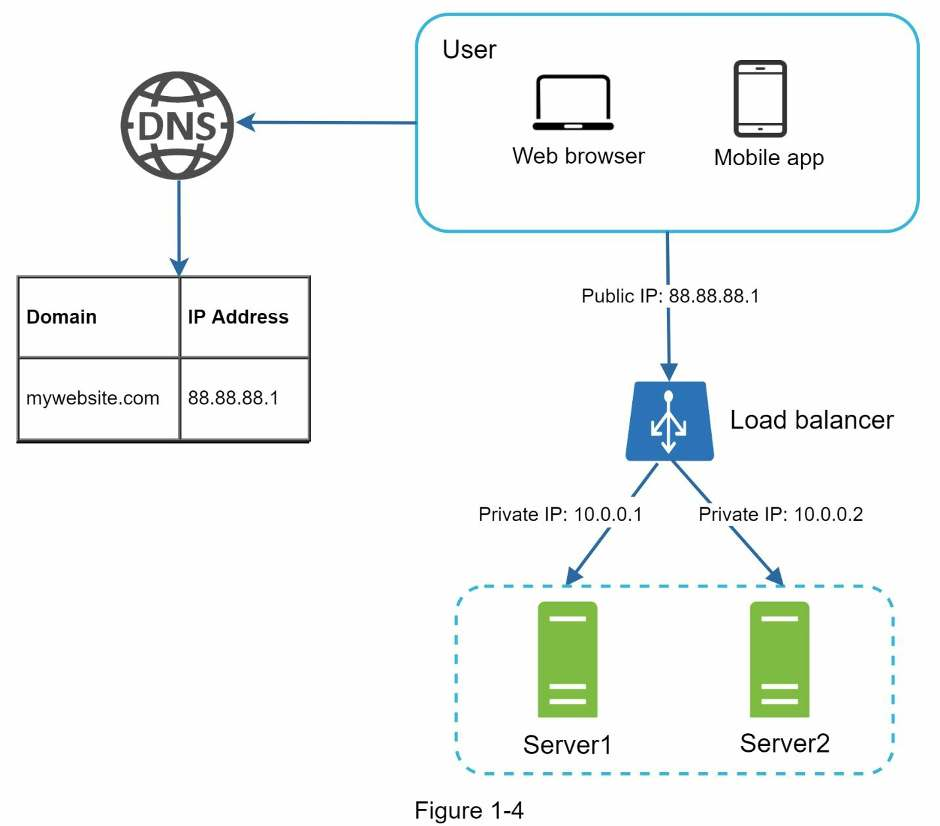

Như Hình 1-4 thể hiện, người dùng kết nối trực tiếp đến IP công khai của bộ cân bằng tải. Với cấu hình này, máy khách không còn truy cập trực tiếp đến các máy chủ web. Để tăng bảo mật, việc giao tiếp giữa các máy chủ dùng IP riêng. IP riêng là địa chỉ chỉ có thể được truy cập giữa các máy chủ trong cùng mạng, không thể truy cập qua Internet. Bộ cân bằng tải giao tiếp với máy chủ web thông qua các IP riêng.

Trong Hình 1-4, sau khi thêm bộ cân bằng tải và máy chủ web thứ hai, chúng ta đã giải quyết vấn đề thiếu khả năng chuyển đổi dự phòng và cải thiện tính sẵn sàng của tầng web. Cụ thể:

- Nếu máy chủ 1 ngừng hoạt động, toàn bộ lưu lượng được định tuyến sang máy chủ 2, giúp website tiếp tục hoạt động. Chúng ta cũng bổ sung một máy chủ web mới hoạt động tốt vào nhóm máy chủ để cân bằng tải.
- Nếu lưu lượng website tăng nhanh và hai máy chủ không đủ xử lý, bộ cân bằng tải có thể xử lý tình huống này thuận lợi. Bạn chỉ cần thêm máy chủ vào nhóm máy chủ web; bộ cân bằng tải tự động bắt đầu gửi yêu cầu đến chúng.

Tầng web giờ đã ổn, vậy tầng dữ liệu thì sao? Thiết kế hiện tại có một cơ sở dữ liệu, <!-- trang-pdf:011 --> nên chưa hỗ trợ chuyển đổi dự phòng và tính dự phòng. Sao chép cơ sở dữ liệu là kỹ thuật phổ biến để giải quyết các vấn đề đó. Hãy cùng tìm hiểu.

<!-- trang-pdf:012 -->

## Sao chép cơ sở dữ liệu

Theo Wikipedia: “Sao chép cơ sở dữ liệu có thể được sử dụng trong nhiều hệ quản trị cơ sở dữ liệu, thường với mối quan hệ master/slave giữa bản gốc (master) và các bản sao (slave)” [3].

Cơ sở dữ liệu chính (master) nhìn chung chỉ hỗ trợ thao tác ghi. Cơ sở dữ liệu phụ (slave) nhận bản sao dữ liệu từ cơ sở dữ liệu chính và chỉ hỗ trợ thao tác đọc. Mọi lệnh sửa dữ liệu như chèn, xóa hoặc cập nhật phải được gửi đến cơ sở dữ liệu chính. Hầu hết ứng dụng có tỷ lệ đọc cao hơn nhiều so với ghi; vì vậy, số cơ sở dữ liệu phụ trong hệ thống thường lớn hơn số cơ sở dữ liệu chính. Hình 1-5 minh họa một cơ sở dữ liệu chính cùng nhiều cơ sở dữ liệu phụ.

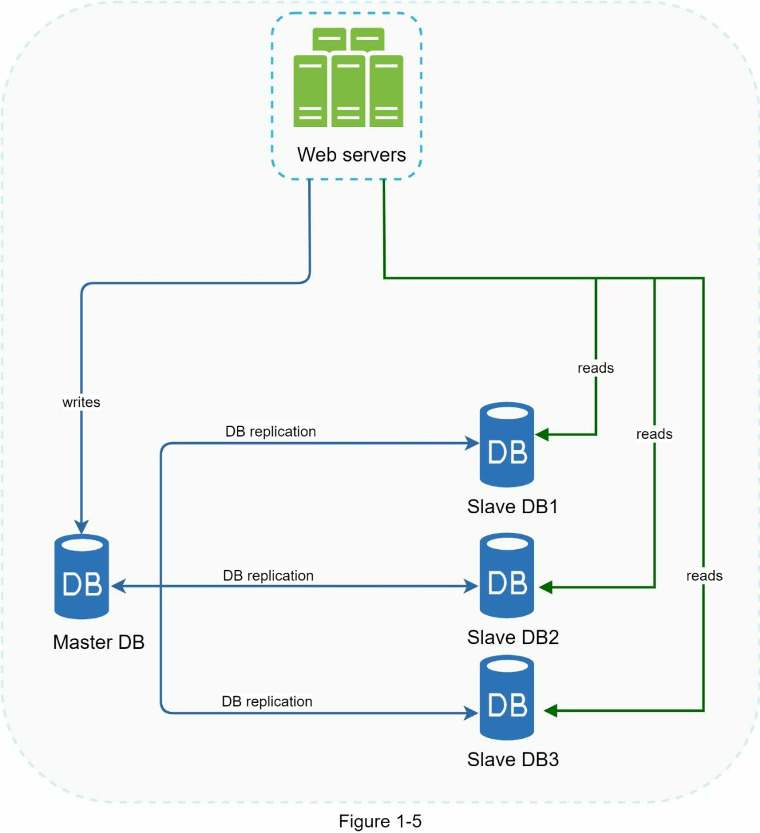

Lợi ích của sao chép cơ sở dữ liệu:

- **Hiệu năng tốt hơn:** trong mô hình master–slave, mọi thao tác ghi và cập nhật diễn ra tại các nút chính, còn thao tác đọc được phân phối đến các nút phụ. Mô hình này cải thiện hiệu năng vì cho phép xử lý nhiều truy vấn song song hơn.
- **Độ tin cậy:** nếu một máy chủ cơ sở dữ liệu bị phá hủy bởi thiên tai như bão hoặc động đất, dữ liệu vẫn được bảo toàn. Bạn không cần lo mất dữ liệu vì dữ liệu được sao chép ở nhiều địa điểm.
- **Tính sẵn sàng cao:** nhờ sao chép dữ liệu giữa các địa điểm khác nhau, website vẫn <!-- trang-pdf:013 --> hoạt động ngay cả khi một cơ sở dữ liệu ngừng hoạt động, vì có thể truy cập dữ liệu được lưu trên máy chủ cơ sở dữ liệu khác.

Trong phần trước, chúng ta đã bàn về cách bộ cân bằng tải giúp cải thiện tính sẵn sàng của hệ thống. Ở đây, câu hỏi tương tự là: chuyện gì xảy ra nếu một cơ sở dữ liệu ngừng hoạt động? Thiết kế kiến trúc trong Hình 1-5 có thể xử lý trường hợp này:

- Nếu chỉ có một cơ sở dữ liệu phụ và nó ngừng hoạt động, các thao tác đọc được tạm thời chuyển đến cơ sở dữ liệu chính. Ngay khi phát hiện vấn đề, một cơ sở dữ liệu phụ mới sẽ thay thế bản cũ. Nếu có nhiều cơ sở dữ liệu phụ, thao tác đọc được chuyển đến các cơ sở dữ liệu phụ còn hoạt động tốt. Một máy chủ cơ sở dữ liệu mới sẽ thay thế máy cũ.
- Nếu cơ sở dữ liệu chính ngừng hoạt động, một cơ sở dữ liệu phụ được nâng lên làm cơ sở dữ liệu chính mới. Mọi thao tác cơ sở dữ liệu tạm thời được thực hiện trên cơ sở dữ liệu chính mới. Một cơ sở dữ liệu phụ mới sẽ lập tức thay thế bản cũ để sao chép dữ liệu. Trong hệ thống production, việc nâng một bản mới lên làm chính phức tạp hơn vì dữ liệu trên bản phụ có thể chưa cập nhật đầy đủ. Dữ liệu thiếu cần được cập nhật bằng các script phục hồi dữ liệu. Dù những phương pháp sao chép khác như nhiều bản chính (multi-master) và sao chép vòng (circular replication) có thể hỗ trợ, chúng phức tạp hơn và nằm ngoài phạm vi cuốn sách. Bạn đọc quan tâm có thể xem tài liệu tham khảo [4] [5].

Hình 1-6 thể hiện thiết kế hệ thống sau khi thêm bộ cân bằng tải và sao chép cơ sở dữ liệu.

<!-- trang-pdf:014 -->

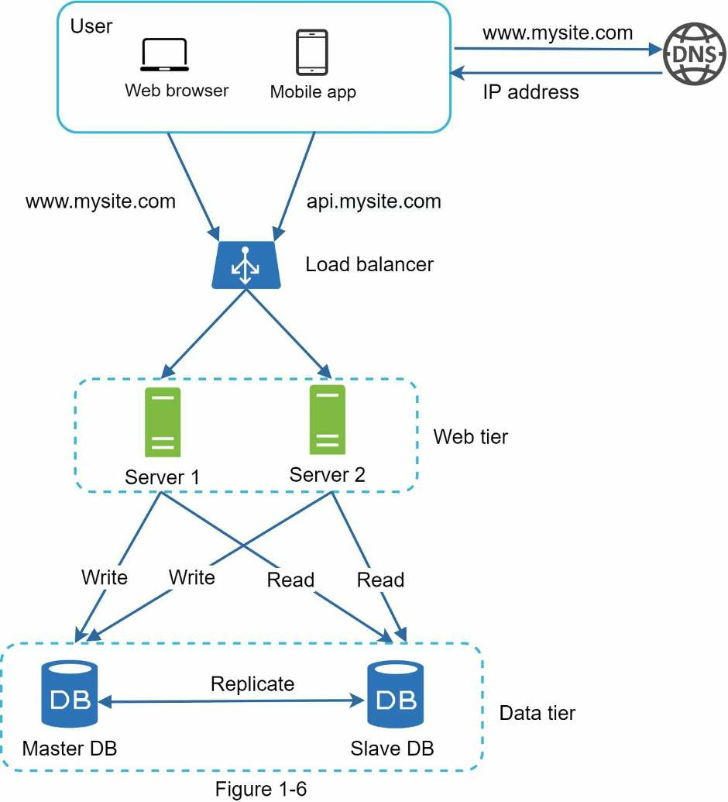

Hãy xem thiết kế này:

- Người dùng nhận địa chỉ IP của bộ cân bằng tải từ DNS.
- Người dùng kết nối đến bộ cân bằng tải bằng địa chỉ IP đó.
- Yêu cầu HTTP được định tuyến đến máy chủ 1 hoặc máy chủ 2.
- Máy chủ web đọc dữ liệu người dùng từ một cơ sở dữ liệu phụ.
- Máy chủ web chuyển mọi thao tác sửa dữ liệu đến cơ sở dữ liệu chính, bao gồm ghi, cập nhật và xóa.

Bây giờ bạn đã hiểu rõ tầng web và tầng dữ liệu, đã đến lúc cải thiện thời gian tải/phản hồi. Có thể làm điều này bằng cách thêm tầng bộ nhớ đệm và chuyển nội dung tĩnh như các file JavaScript/CSS/hình ảnh/video sang mạng phân phối nội dung (content delivery network — CDN).

<!-- trang-pdf:015 -->

## Bộ nhớ đệm

Bộ nhớ đệm (cache) là vùng lưu trữ tạm thời giữ trong bộ nhớ kết quả của các phản hồi tốn nhiều tài nguyên hoặc dữ liệu được truy cập thường xuyên, để phục vụ những yêu cầu tiếp theo nhanh hơn. Như Hình 1-6 minh họa, mỗi khi tải một trang web mới, một hoặc nhiều lệnh gọi cơ sở dữ liệu được thực hiện để lấy dữ liệu. Việc gọi cơ sở dữ liệu liên tục ảnh hưởng lớn đến hiệu năng ứng dụng. Bộ nhớ đệm có thể giảm nhẹ vấn đề này.

### Tầng bộ nhớ đệm

Tầng bộ nhớ đệm là tầng lưu trữ dữ liệu tạm thời, nhanh hơn cơ sở dữ liệu nhiều. Tách riêng tầng này giúp cải thiện hiệu năng hệ thống, giảm khối lượng công việc cho cơ sở dữ liệu và cho phép mở rộng tầng bộ nhớ đệm độc lập. Hình 1-7 minh họa một cách thiết lập máy chủ bộ nhớ đệm:

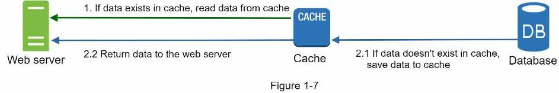

Sau khi nhận yêu cầu, máy chủ web trước tiên kiểm tra xem bộ nhớ đệm có phản hồi cần dùng hay không. Nếu có, nó gửi dữ liệu về máy khách. Nếu không, nó truy vấn cơ sở dữ liệu, lưu phản hồi vào bộ nhớ đệm rồi gửi về máy khách. Chiến lược này được gọi là read-through cache. Có các chiến lược bộ nhớ đệm khác tùy loại dữ liệu, kích thước và cách thức truy cập. Một nghiên cứu trước đây giải thích cách các chiến lược này hoạt động [6].

Tương tác với máy chủ bộ nhớ đệm khá đơn giản vì phần lớn máy chủ cung cấp API cho các ngôn ngữ lập trình thông dụng. Đoạn mã sau minh họa các API Memcached điển hình:

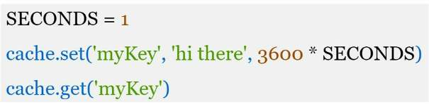

### Những điều cần cân nhắc khi dùng bộ nhớ đệm

Dưới đây là một số điểm cần cân nhắc khi dùng hệ thống bộ nhớ đệm:

- **Quyết định khi nào nên dùng:** cân nhắc bộ nhớ đệm khi dữ liệu được đọc thường xuyên nhưng ít thay đổi. Vì dữ liệu được lưu trong bộ nhớ dễ mất (volatile memory), máy chủ bộ nhớ đệm không phù hợp để lưu dữ liệu bền vững. Ví dụ, nếu máy chủ bộ nhớ đệm khởi động lại, toàn bộ dữ liệu trong bộ nhớ sẽ mất. Vì vậy, dữ liệu quan trọng cần được lưu trong các kho dữ liệu bền vững.
- **Chính sách hết hạn:** nên triển khai chính sách hết hạn. Khi dữ liệu trong bộ nhớ đệm hết hạn, nó bị xóa khỏi bộ nhớ đệm. Nếu không có chính sách này, dữ liệu sẽ được giữ trong bộ nhớ vĩnh viễn. Không nên đặt thời gian hết hạn quá ngắn, vì hệ thống sẽ phải tải lại dữ liệu từ cơ sở dữ liệu quá thường xuyên. Đồng thời, cũng không nên đặt quá dài vì dữ liệu có thể trở nên cũ.
- **Tính nhất quán:** cần giữ kho dữ liệu và bộ nhớ đệm đồng bộ với nhau. Sự không nhất quán có thể xảy ra vì các thao tác sửa dữ liệu trên kho dữ liệu và bộ nhớ đệm không nằm trong cùng một giao dịch. Khi mở rộng trên nhiều khu vực, việc duy trì tính nhất quán giữa <!-- trang-pdf:016 --> kho dữ liệu và bộ nhớ đệm là một thách thức. Để biết thêm chi tiết, hãy xem bài báo “Scaling Memcache at Facebook” do Facebook công bố [7].
- **Giảm tác động của sự cố:** một máy chủ bộ nhớ đệm duy nhất có thể trở thành điểm lỗi đơn (single point of failure — SPOF). Wikipedia định nghĩa: “Điểm lỗi đơn (SPOF) là một bộ phận của hệ thống mà nếu nó gặp lỗi thì toàn bộ hệ thống sẽ ngừng hoạt động” [8]. Vì vậy, nên dùng nhiều máy chủ bộ nhớ đệm ở các trung tâm dữ liệu khác nhau để tránh SPOF. Một cách khác được khuyến nghị là cấp dư bộ nhớ cần thiết một tỷ lệ nhất định, tạo khoảng dự phòng khi mức sử dụng bộ nhớ tăng.

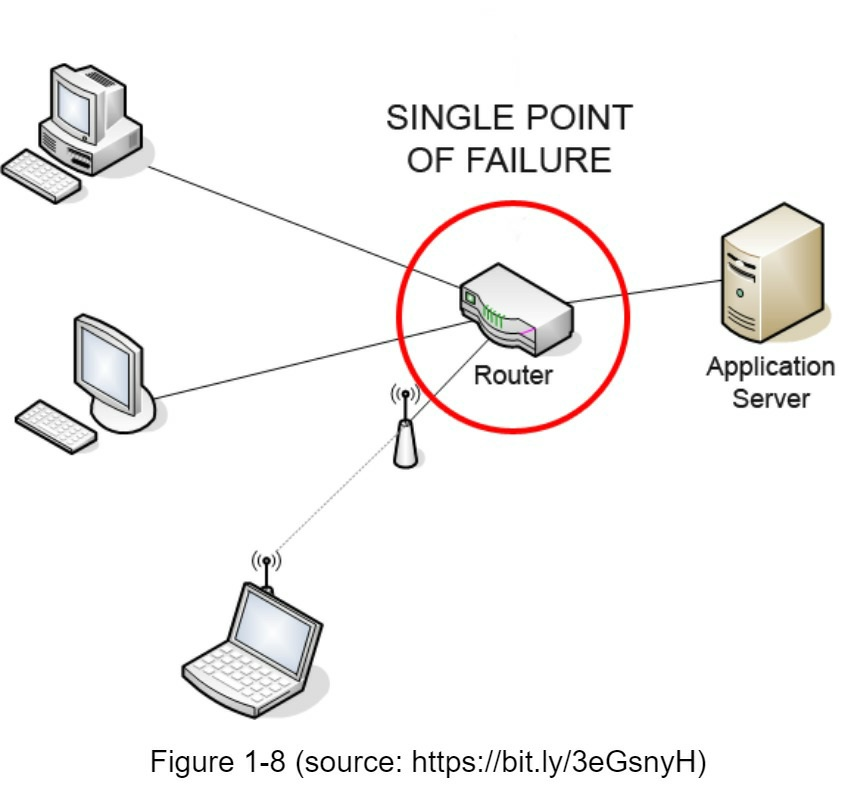

- **Chính sách loại bỏ:** khi bộ nhớ đệm đầy, yêu cầu thêm mục mới có thể khiến các mục hiện có bị loại bỏ. Điều này được gọi là cache eviction. Ít được sử dụng gần đây nhất (Least Recently Used — LRU) là chính sách loại bỏ phổ biến nhất. Những chính sách khác, như ít được sử dụng thường xuyên nhất (Least Frequently Used — LFU) hoặc vào trước ra trước (First In First Out — FIFO), có thể được áp dụng để đáp ứng các trường hợp sử dụng khác nhau.

<!-- trang-pdf:017 -->

## Mạng phân phối nội dung (CDN)

CDN là mạng lưới máy chủ phân bố ở nhiều vị trí địa lý, dùng để phân phối nội dung tĩnh. Các máy chủ CDN lưu đệm nội dung tĩnh như hình ảnh, video, file CSS, JavaScript, v.v.

Lưu đệm nội dung động là khái niệm tương đối mới và nằm ngoài phạm vi cuốn sách. Nó cho phép lưu đệm các trang HTML dựa trên đường dẫn yêu cầu, chuỗi truy vấn, cookie và các header yêu cầu. Bạn có thể xem bài viết trong tài liệu tham khảo [9] để tìm hiểu thêm. Cuốn sách tập trung vào cách dùng CDN để lưu đệm nội dung tĩnh.

Ở mức tổng quan, CDN hoạt động như sau: khi người dùng truy cập website, máy chủ CDN gần họ nhất phân phối nội dung tĩnh. Có thể hình dung rằng người dùng càng xa máy chủ CDN thì website tải càng chậm. Chẳng hạn, nếu máy chủ CDN đặt tại San Francisco, người dùng ở Los Angeles sẽ nhận nội dung nhanh hơn người dùng ở châu Âu. Hình 1-9 là ví dụ rõ ràng về cách CDN cải thiện thời gian tải.

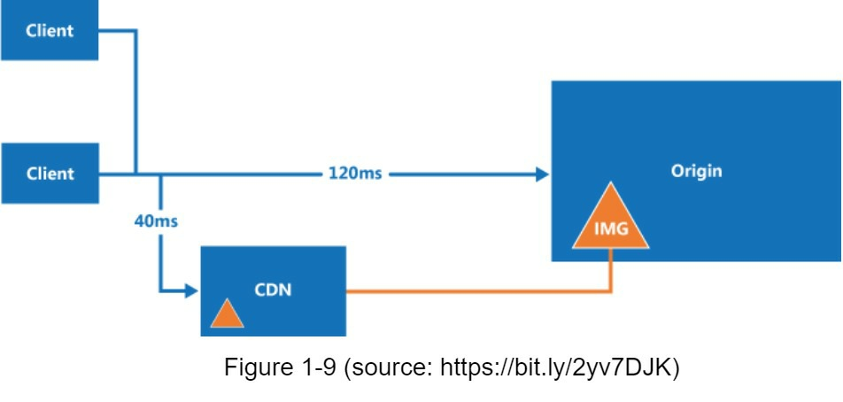

Hình 1-10 minh họa quy trình hoạt động của CDN.

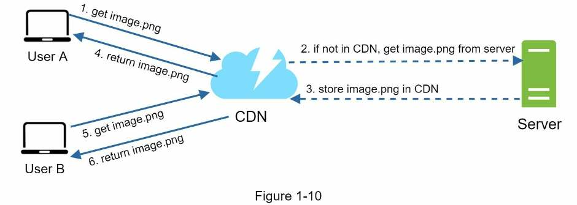

1. Người dùng A muốn lấy `image.png` qua một URL hình ảnh. Tên miền của URL do nhà cung cấp CDN cấp. Hai URL sau minh họa dạng URL hình ảnh trên CDN của Amazon và Akamai:
   - https://mysite.cloudfront.net/logo.jpg
   - https://mysite.akamai.com/image-manager/img/logo.jpg
2. Nếu máy chủ CDN chưa có `image.png` trong bộ nhớ đệm, nó yêu cầu file từ nguồn gốc (origin), có thể là máy chủ web hoặc kho lưu trữ trực tuyến như Amazon S3.
3. Nguồn gốc trả `image.png` về máy chủ CDN, kèm header HTTP Time-to-Live (TTL) tùy chọn, mô tả thời gian hình ảnh được lưu đệm.

<!-- trang-pdf:018 -->

4. CDN lưu đệm hình ảnh và trả nó về người dùng A. Hình ảnh được giữ trong bộ nhớ đệm CDN đến khi TTL hết hạn.
5. Người dùng B gửi yêu cầu lấy cùng hình ảnh đó.
6. Hình ảnh được trả về từ bộ nhớ đệm miễn là TTL chưa hết hạn.

### Những điều cần cân nhắc khi dùng CDN

- **Chi phí:** CDN do các nhà cung cấp bên thứ ba vận hành, và bạn bị tính phí cho dữ liệu truyền vào và ra khỏi CDN. Lưu đệm những tài nguyên ít dùng không đem lại lợi ích đáng kể, nên hãy cân nhắc đưa chúng ra khỏi CDN.
- **Đặt thời gian hết hạn phù hợp:** với nội dung nhạy cảm về thời gian, việc đặt thời gian hết hạn bộ nhớ đệm rất quan trọng. Thời gian này không nên quá dài hoặc quá ngắn. Nếu quá dài, nội dung có thể không còn mới. Nếu quá ngắn, nội dung có thể phải được tải lại nhiều lần từ máy chủ nguồn về CDN.
- **Phương án dự phòng khi CDN lỗi:** cần cân nhắc website/ứng dụng ứng phó thế nào khi CDN gặp sự cố. Nếu CDN tạm thời gián đoạn, máy khách cần phát hiện được vấn đề và yêu cầu tài nguyên từ nguồn gốc.
- **Vô hiệu hóa file:** có thể xóa một file khỏi CDN trước khi nó hết hạn bằng một trong các cách sau:
  - Vô hiệu hóa đối tượng CDN bằng API do nhà cung cấp CDN cung cấp.
  - Dùng phiên bản đối tượng (object versioning) để phục vụ một phiên bản khác. Để đánh phiên bản, có thể thêm một tham số vào URL, chẳng hạn số phiên bản. Ví dụ, thêm phiên bản 2 vào chuỗi truy vấn: `image.png?v=2`.

Hình 1-11 thể hiện thiết kế sau khi thêm CDN và bộ nhớ đệm.

<!-- trang-pdf:019 -->

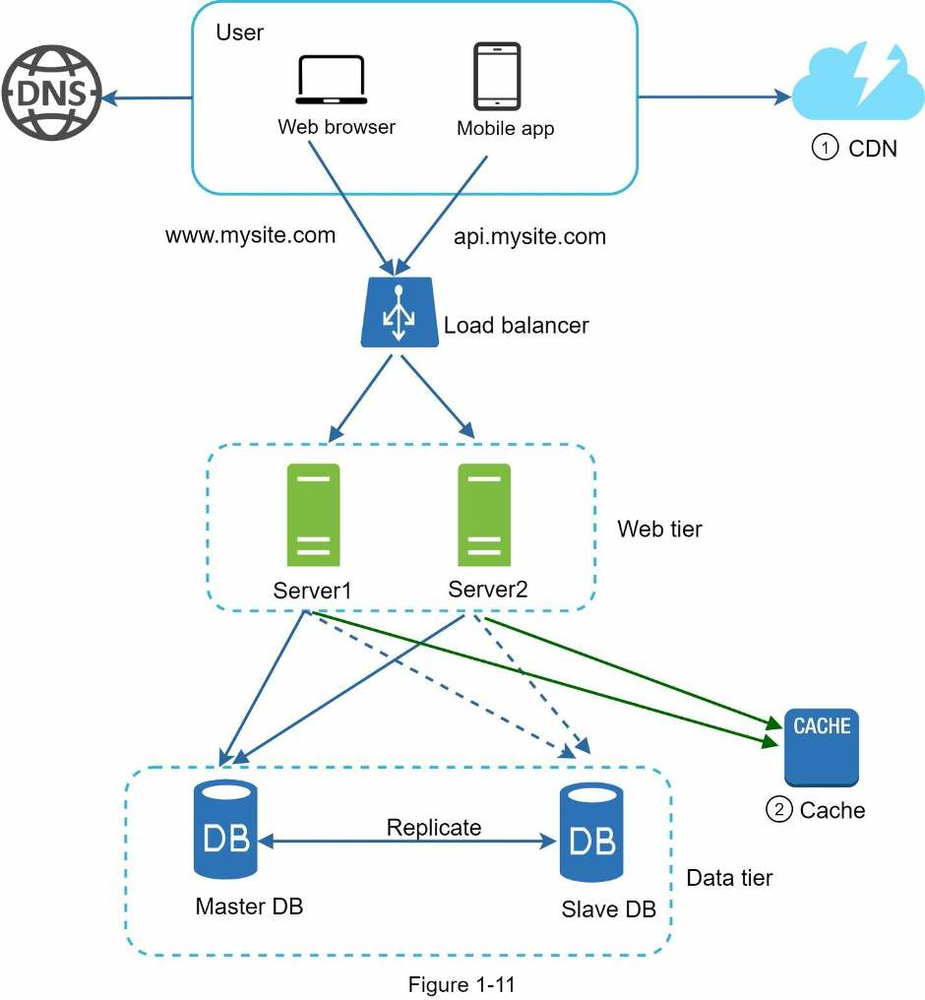

1. Các tài nguyên tĩnh như JS, CSS, hình ảnh, v.v. không còn do máy chủ web phục vụ. Chúng được lấy từ CDN để cải thiện hiệu năng.
2. Tải cơ sở dữ liệu được giảm nhẹ nhờ lưu đệm dữ liệu.

<!-- trang-pdf:020 -->

## Tầng web không lưu trạng thái

Đã đến lúc cân nhắc mở rộng tầng web theo chiều ngang. Để làm vậy, chúng ta cần chuyển trạng thái, chẳng hạn dữ liệu phiên người dùng, ra khỏi tầng web. Một cách làm tốt là lưu dữ liệu phiên trong kho lưu trữ bền vững như cơ sở dữ liệu quan hệ hoặc NoSQL. Mỗi máy chủ web trong cụm đều có thể truy cập dữ liệu trạng thái từ cơ sở dữ liệu. Đây được gọi là tầng web không lưu trạng thái (stateless web tier).

### Kiến trúc có lưu trạng thái

Máy chủ có lưu trạng thái (stateful) và máy chủ không lưu trạng thái (stateless) có một số khác biệt quan trọng. Máy chủ có lưu trạng thái ghi nhớ dữ liệu máy khách, tức trạng thái, từ yêu cầu này sang yêu cầu tiếp theo. Máy chủ không lưu trạng thái không giữ thông tin đó. Hình 1-12 minh họa một kiến trúc có lưu trạng thái.

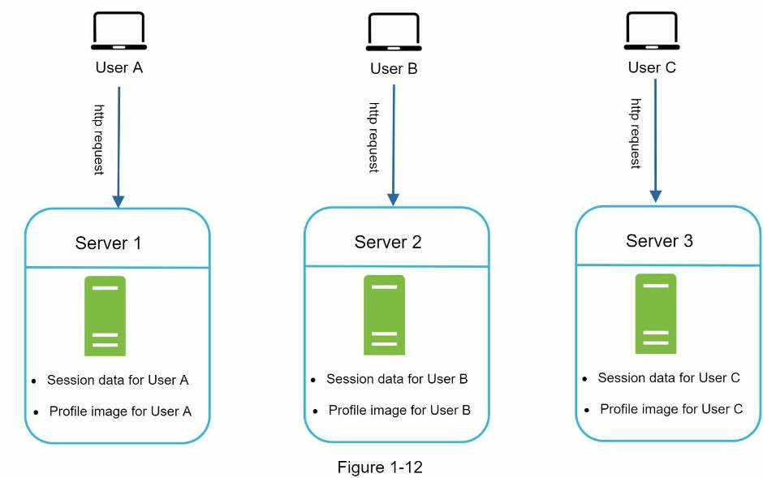

Trong Hình 1-12, dữ liệu phiên và ảnh hồ sơ của người dùng A được lưu ở máy chủ 1. Để xác thực người dùng A, các yêu cầu HTTP phải được định tuyến đến máy chủ 1. Nếu yêu cầu được gửi đến máy chủ khác, chẳng hạn máy chủ 2, việc xác thực sẽ thất bại vì máy chủ 2 không chứa dữ liệu phiên của A. Tương tự, mọi yêu cầu HTTP của người dùng B phải đến máy chủ 2; mọi yêu cầu của người dùng C phải đến máy chủ 3.

Vấn đề là mọi yêu cầu từ cùng một máy khách phải được chuyển đến cùng một máy chủ. Phần lớn bộ cân bằng tải có thể làm điều này bằng sticky session [10], nhưng nó làm tăng chi phí xử lý. Cách này khiến việc thêm hoặc gỡ máy chủ khó khăn hơn nhiều. Xử lý sự cố máy chủ cũng là một thách thức.

### Kiến trúc không lưu trạng thái

Hình 1-13 minh họa kiến trúc không lưu trạng thái.

<!-- trang-pdf:021 -->

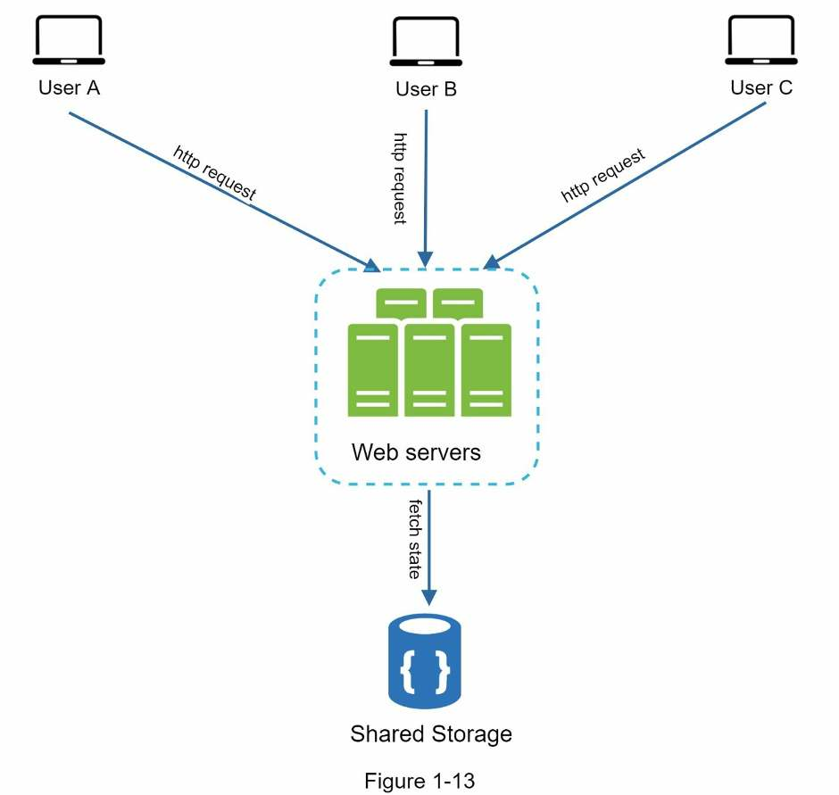

Trong kiến trúc này, yêu cầu HTTP từ người dùng có thể được gửi đến bất kỳ máy chủ web nào; máy chủ đó lấy dữ liệu trạng thái từ một kho dữ liệu dùng chung. Dữ liệu trạng thái được lưu trong kho dùng chung, ở bên ngoài máy chủ web. Hệ thống không lưu trạng thái đơn giản hơn, vững chắc hơn và dễ mở rộng hơn.

Hình 1-14 thể hiện thiết kế cập nhật với tầng web không lưu trạng thái.

<!-- trang-pdf:022 -->

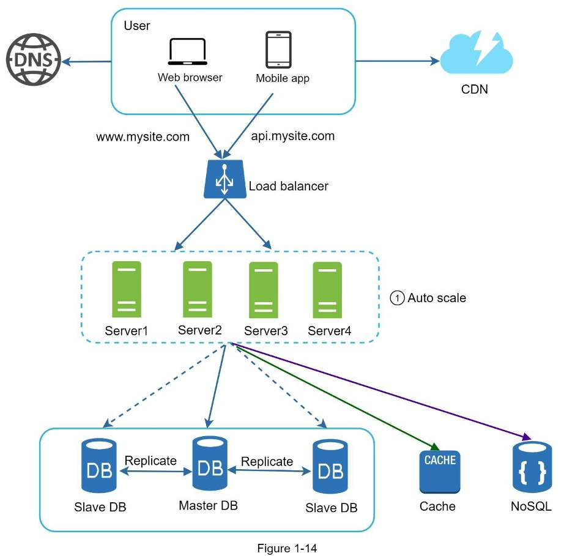

Trong Hình 1-14, chúng ta đưa dữ liệu phiên ra khỏi tầng web và lưu trong kho dữ liệu bền vững. Kho dùng chung có thể là cơ sở dữ liệu quan hệ, Memcached/Redis, NoSQL, v.v. Ở đây chọn NoSQL vì dễ mở rộng. Tự động mở rộng (autoscaling) nghĩa là tự động thêm hoặc gỡ máy chủ web dựa trên tải lưu lượng. Khi dữ liệu trạng thái đã được đưa ra khỏi máy chủ web, việc tự động mở rộng tầng web dễ dàng thực hiện bằng cách thêm hoặc gỡ máy chủ theo tải lưu lượng.

Website tăng trưởng nhanh và thu hút lượng lớn người dùng quốc tế. Để cải thiện tính sẵn sàng và trải nghiệm người dùng trên phạm vi địa lý rộng hơn, hỗ trợ nhiều trung tâm dữ liệu là điều quan trọng.

<!-- trang-pdf:023 -->

## Trung tâm dữ liệu

Hình 1-15 minh họa cấu hình gồm hai trung tâm dữ liệu. Trong điều kiện hoạt động bình thường, người dùng được geoDNS định tuyến, còn gọi là định tuyến theo vị trí địa lý, đến trung tâm dữ liệu gần nhất, với tỷ lệ lưu lượng `x%` tại US-East và `(100 − x)%` tại US-West. geoDNS là dịch vụ DNS cho phép phân giải tên miền thành địa chỉ IP dựa trên vị trí người dùng.

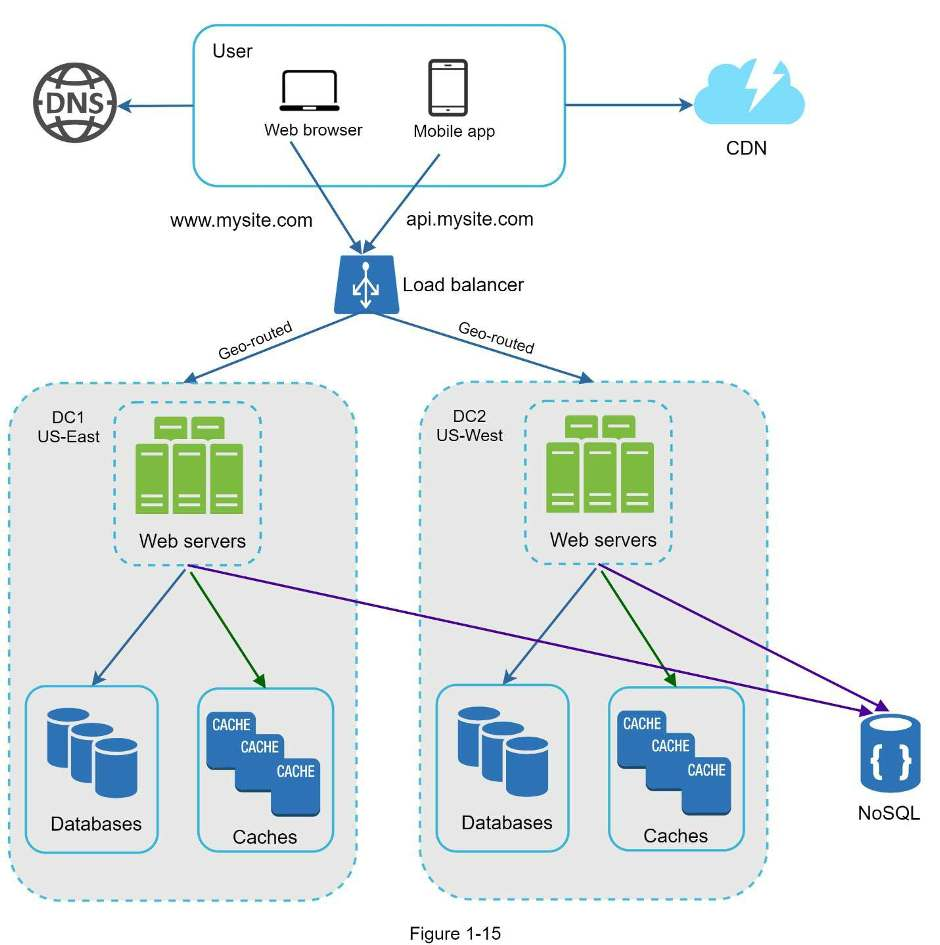

Nếu một trung tâm dữ liệu gặp gián đoạn nghiêm trọng, chúng ta chuyển toàn bộ lưu lượng đến trung tâm dữ liệu còn hoạt động tốt. Trong Hình 1-16, trung tâm dữ liệu 2 (US-West) ngừng hoạt động, và 100% lưu lượng được chuyển đến trung tâm dữ liệu 1 (US-East).

<!-- trang-pdf:024 -->

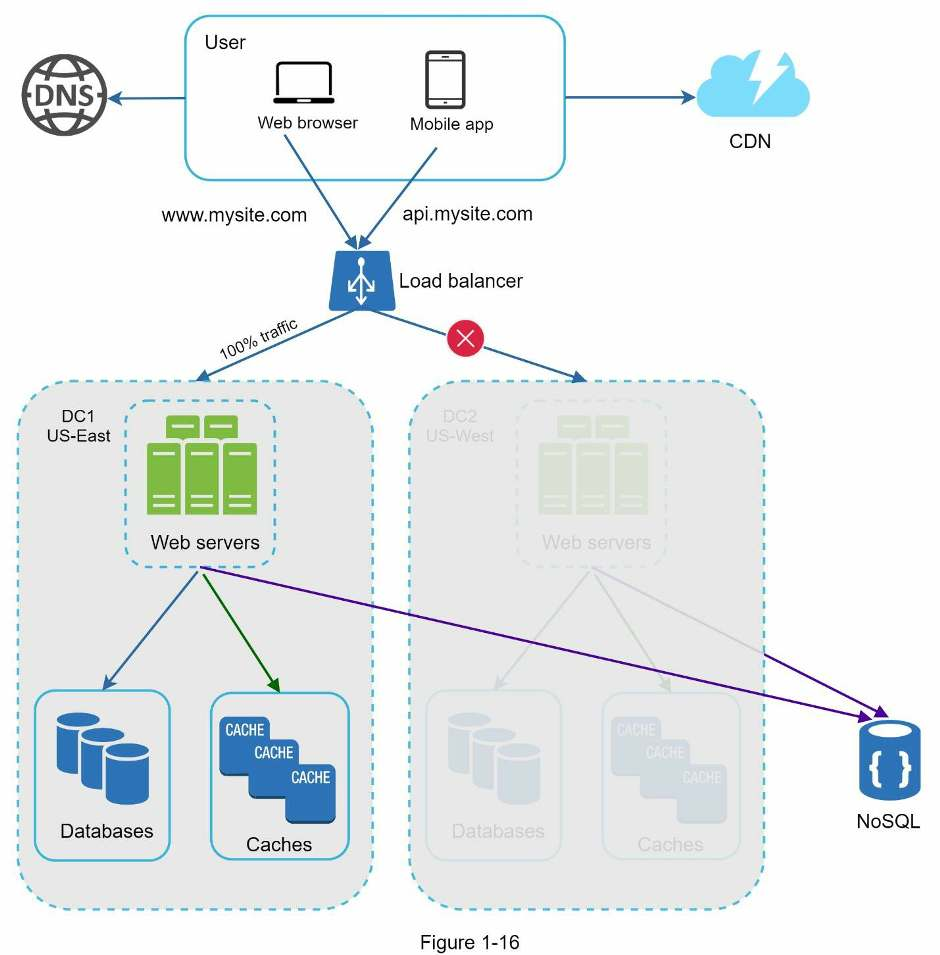

Để thiết lập nhiều trung tâm dữ liệu, phải giải quyết một số thách thức kỹ thuật:

- **Chuyển hướng lưu lượng:** cần công cụ hiệu quả để đưa lưu lượng đến đúng trung tâm dữ liệu. Có thể dùng GeoDNS để chuyển lưu lượng đến trung tâm dữ liệu gần nhất tùy theo vị trí người dùng.
- **Đồng bộ dữ liệu:** người dùng ở những khu vực khác nhau có thể sử dụng các cơ sở dữ liệu hoặc bộ nhớ đệm cục bộ khác nhau. Khi chuyển đổi dự phòng, lưu lượng có thể đến một trung tâm dữ liệu chưa có dữ liệu cần dùng. Chiến lược phổ biến là sao chép dữ liệu giữa nhiều trung tâm dữ liệu. Một nghiên cứu trước đây cho thấy cách Netflix triển khai sao chép bất đồng bộ giữa nhiều trung tâm dữ liệu [11].
- **Kiểm thử và triển khai:** với cấu hình nhiều trung tâm dữ liệu, việc kiểm thử website/ứng dụng ở các địa điểm khác nhau rất quan trọng. Công cụ triển khai tự động là thiết yếu để giữ các dịch vụ nhất quán trên tất cả trung tâm dữ liệu [11].

Để mở rộng hệ thống hơn nữa, cần tách rời các thành phần khác nhau để có thể mở rộng chúng độc lập. Hàng đợi thông điệp là một chiến lược chủ chốt mà nhiều hệ thống phân tán thực tế sử dụng để giải quyết vấn đề này.

<!-- trang-pdf:025 -->

## Hàng đợi thông điệp

Hàng đợi thông điệp (message queue) là thành phần có tính bền vững, được lưu trong bộ nhớ, hỗ trợ giao tiếp bất đồng bộ. Nó đóng vai trò vùng đệm và phân phối các yêu cầu bất đồng bộ. Kiến trúc cơ bản của hàng đợi thông điệp khá đơn giản. Các dịch vụ đầu vào, gọi là bên sản xuất/bên phát hành (producer/publisher), tạo thông điệp rồi đưa vào hàng đợi. Các dịch vụ hoặc máy chủ khác, gọi là bên tiêu thụ/bên đăng ký (consumer/subscriber), kết nối với hàng đợi và thực hiện hành động được thông điệp xác định. Mô hình được thể hiện trong Hình 1-17.

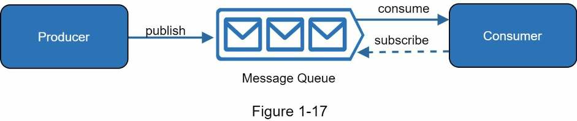

Khả năng tách rời các thành phần khiến hàng đợi thông điệp trở thành kiến trúc được ưa chuộng khi xây dựng ứng dụng có thể mở rộng và đáng tin cậy. Với hàng đợi, producer có thể gửi thông điệp khi consumer chưa sẵn sàng xử lý. Consumer vẫn có thể đọc thông điệp trong hàng đợi ngay cả khi producer không sẵn sàng.

Xét trường hợp sau: ứng dụng hỗ trợ chỉnh sửa ảnh, gồm cắt, làm sắc nét, làm mờ, v.v. Những công việc này cần thời gian để hoàn thành. Trong Hình 1-18, máy chủ web đưa các công việc xử lý ảnh vào hàng đợi thông điệp. Các worker xử lý ảnh lấy công việc từ hàng đợi và thực hiện chỉnh sửa ảnh bất đồng bộ. Producer và consumer có thể mở rộng độc lập. Khi hàng đợi lớn lên, bổ sung worker để giảm thời gian xử lý. Ngược lại, nếu phần lớn thời gian hàng đợi trống, có thể giảm số worker.

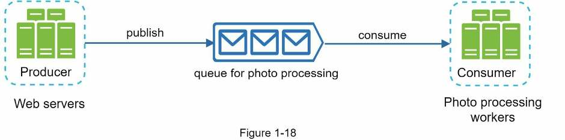

<!-- trang-pdf:026 -->

## Ghi log, số liệu đo lường và tự động hóa

Khi làm việc với website nhỏ chạy trên vài máy chủ, ghi log, số liệu đo lường (metrics) và hỗ trợ tự động hóa là những thực hành tốt nhưng chưa phải điều bắt buộc. Tuy nhiên, khi website đã phát triển để phục vụ một doanh nghiệp lớn, đầu tư vào những công cụ này trở nên thiết yếu.

**Ghi log:** theo dõi log lỗi rất quan trọng vì giúp nhận diện lỗi và vấn đề trong hệ thống. Bạn có thể theo dõi log lỗi ở từng máy chủ, hoặc dùng công cụ tổng hợp vào một dịch vụ tập trung để dễ tìm kiếm và xem.

**Số liệu đo lường:** thu thập nhiều loại số liệu giúp hiểu tình hình kinh doanh và sức khỏe hệ thống. Một số số liệu hữu ích gồm:

- Số liệu ở cấp máy chủ: CPU, bộ nhớ, I/O đĩa, v.v.
- Số liệu tổng hợp: chẳng hạn hiệu năng của toàn bộ tầng cơ sở dữ liệu, tầng bộ nhớ đệm, v.v.
- Số liệu kinh doanh chủ chốt: số người dùng hoạt động hằng ngày, tỷ lệ giữ chân người dùng, doanh thu, v.v.

**Tự động hóa:** khi hệ thống trở nên lớn và phức tạp, cần xây dựng hoặc sử dụng công cụ tự động hóa để cải thiện năng suất. Tích hợp liên tục (continuous integration) là thực hành tốt: mỗi lần đưa mã vào kho đều được kiểm tra tự động, giúp đội ngũ phát hiện vấn đề sớm. Ngoài ra, tự động hóa quy trình build, kiểm thử, triển khai, v.v. có thể cải thiện đáng kể năng suất lập trình viên.

### Thêm hàng đợi thông điệp và các công cụ

Hình 1-19 thể hiện thiết kế cập nhật. Do giới hạn không gian, hình chỉ minh họa một trung tâm dữ liệu.

1. Thiết kế có thêm hàng đợi thông điệp, giúp giảm sự phụ thuộc chặt giữa các thành phần và tăng khả năng chịu lỗi.
2. Bổ sung công cụ ghi log, giám sát, số liệu đo lường và tự động hóa.

<!-- trang-pdf:027 -->

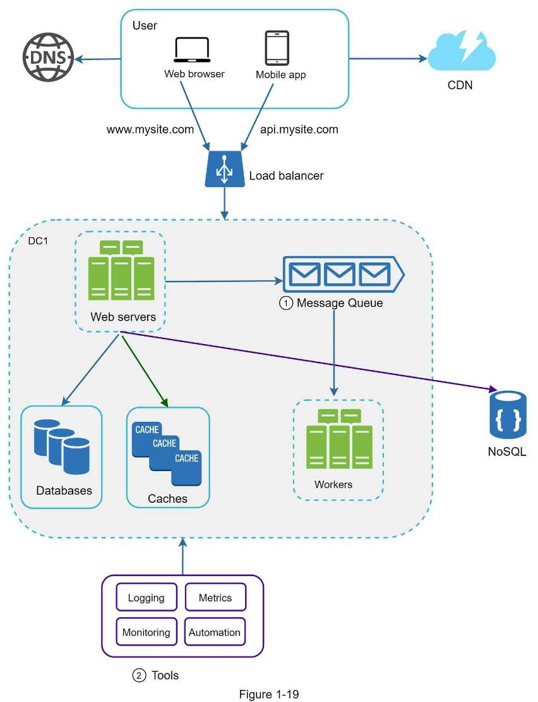

Dữ liệu tăng lên từng ngày khiến cơ sở dữ liệu ngày càng quá tải. Đã đến lúc mở rộng tầng dữ liệu.

<!-- trang-pdf:028 -->

## Mở rộng cơ sở dữ liệu

Có hai hướng chính để mở rộng cơ sở dữ liệu: theo chiều dọc và theo chiều ngang.

### Mở rộng theo chiều dọc

Mở rộng theo chiều dọc, còn gọi là scaling up, là tăng năng lực như CPU, RAM, DISK, v.v. cho máy hiện có. Có những máy chủ cơ sở dữ liệu rất mạnh. Theo Amazon Relational Database Service (RDS) [12], bạn có thể có máy chủ cơ sở dữ liệu với RAM 24 TB. Loại máy chủ mạnh này có thể lưu và xử lý rất nhiều dữ liệu. Ví dụ, năm 2013, stackoverflow.com có hơn 10 triệu khách truy cập duy nhất hằng tháng nhưng chỉ có một cơ sở dữ liệu chính [13]. Tuy nhiên, mở rộng theo chiều dọc có những nhược điểm lớn:

- Có thể tăng CPU, RAM, v.v. cho máy chủ cơ sở dữ liệu, nhưng phần cứng có giới hạn. Nếu số người dùng lớn, một máy chủ là không đủ.
- Rủi ro điểm lỗi đơn cao hơn.
- Tổng chi phí mở rộng theo chiều dọc cao. Máy chủ mạnh đắt hơn nhiều.

### Mở rộng theo chiều ngang

Mở rộng theo chiều ngang, còn gọi là phân mảnh (sharding), là cách bổ sung máy chủ. Hình 1-20 so sánh mở rộng theo chiều dọc và chiều ngang.

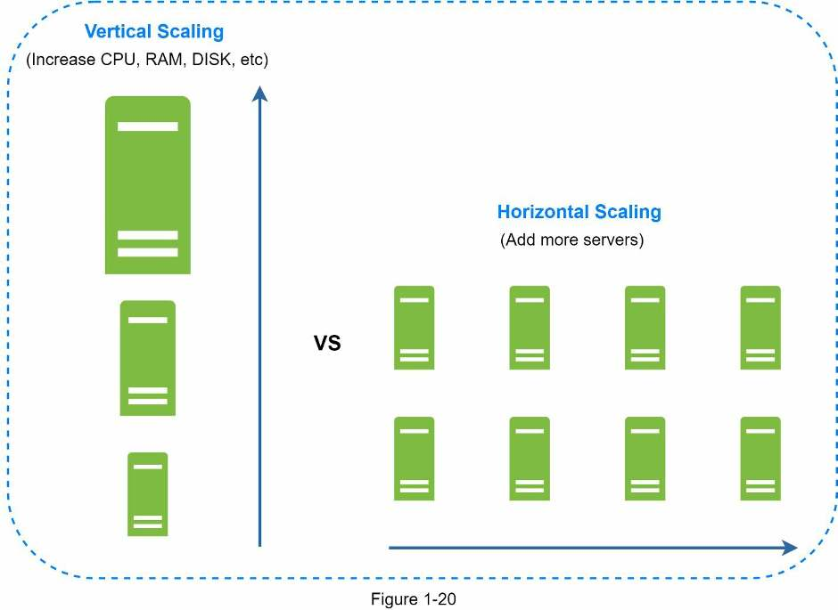

Phân mảnh chia một cơ sở dữ liệu lớn thành những phần nhỏ hơn, dễ quản lý hơn, gọi là shard. Mỗi shard dùng cùng một schema, nhưng dữ liệu thực tế trên mỗi shard là riêng biệt.

Hình 1-21 minh họa cơ sở dữ liệu được phân mảnh. Dữ liệu người dùng được phân bổ đến máy chủ cơ sở dữ liệu dựa trên ID người dùng. Mỗi lần truy cập dữ liệu, một hàm băm được dùng để tìm shard tương ứng. Trong ví dụ, hàm băm là `user_id % 4`. Nếu kết quả <!-- trang-pdf:029 --> bằng 0, shard 0 được dùng để lưu và lấy dữ liệu. Nếu kết quả bằng 1, dùng shard 1. Các shard khác áp dụng cùng logic.

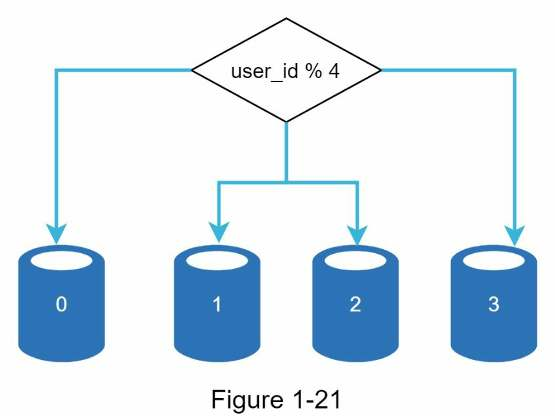

Hình 1-22 thể hiện bảng người dùng trong các cơ sở dữ liệu được phân mảnh.

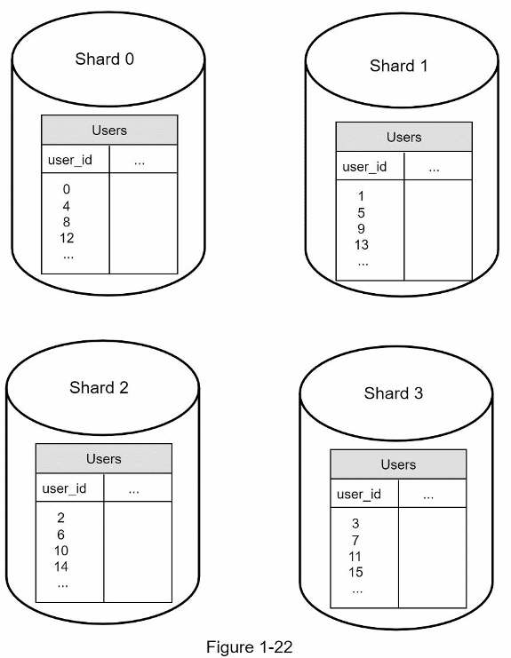

Yếu tố quan trọng nhất khi triển khai chiến lược phân mảnh là chọn khóa phân mảnh (sharding key). Khóa phân mảnh, còn gọi là khóa phân vùng (partition key), gồm một hoặc nhiều cột xác định cách phân phối dữ liệu. Như Hình 1-22 thể hiện, `user_id` là khóa phân mảnh. Khóa này cho phép lấy và sửa dữ liệu hiệu quả bằng cách định tuyến truy vấn đến đúng cơ sở dữ liệu. Khi chọn khóa phân mảnh, một trong những tiêu chí quan trọng nhất <!-- trang-pdf:030 --> là chọn khóa có thể phân phối dữ liệu đồng đều.

Phân mảnh là kỹ thuật rất tốt để mở rộng cơ sở dữ liệu, nhưng còn xa mới là giải pháp hoàn hảo. Nó mang đến sự phức tạp và những thách thức mới:

**Phân mảnh lại dữ liệu:** cần phân mảnh lại khi (1) một shard không thể chứa thêm dữ liệu do tăng trưởng nhanh; hoặc (2) một số shard có thể cạn dung lượng sớm hơn shard khác vì dữ liệu phân phối không đều. Khi shard cạn dung lượng, phải cập nhật hàm phân mảnh và di chuyển dữ liệu. Băm nhất quán (consistent hashing), được trình bày trong Chương 5, là kỹ thuật thường dùng để giải quyết vấn đề này.

**Bài toán người nổi tiếng:** còn gọi là bài toán khóa điểm nóng (hotspot key). Truy cập quá nhiều vào một shard cụ thể có thể khiến máy chủ quá tải. Hãy tưởng tượng dữ liệu của Katy Perry, Justin Bieber và Lady Gaga đều nằm trên cùng một shard. Với ứng dụng mạng xã hội, shard đó sẽ bị ngập trong thao tác đọc. Để giải quyết, có thể cần dành riêng một shard cho mỗi người nổi tiếng. Thậm chí mỗi shard có thể cần được phân vùng tiếp.

**Phép nối và phi chuẩn hóa:** sau khi cơ sở dữ liệu được phân mảnh trên nhiều máy chủ, việc thực hiện phép nối giữa các shard trở nên khó khăn. Một giải pháp thường dùng là phi chuẩn hóa (de-normalize) cơ sở dữ liệu để truy vấn có thể thực hiện trong một bảng duy nhất.

Trong Hình 1-23, chúng ta phân mảnh cơ sở dữ liệu để hỗ trợ lưu lượng dữ liệu tăng nhanh. Đồng thời, một số chức năng phi quan hệ được chuyển sang kho dữ liệu NoSQL để giảm tải cơ sở dữ liệu. Bài viết [14] đề cập nhiều trường hợp sử dụng NoSQL.

<!-- trang-pdf:031 -->

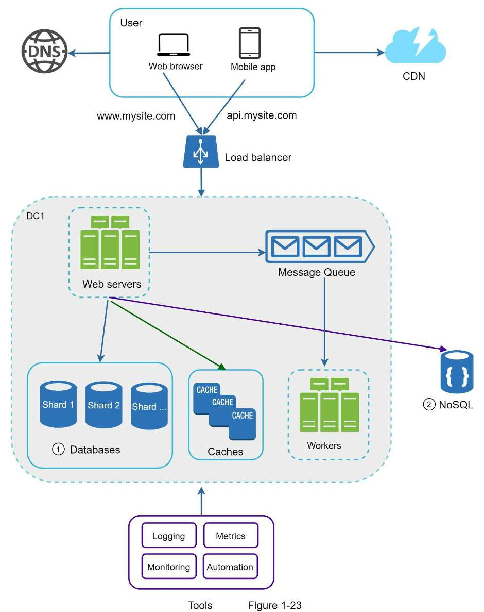

<!-- trang-pdf:032 -->

## Hàng triệu người dùng và xa hơn nữa

Mở rộng hệ thống là quá trình lặp đi lặp lại. Tiếp tục áp dụng những gì đã học trong chương này có thể đưa chúng ta đi xa. Để vượt qua quy mô hàng triệu người dùng, cần tinh chỉnh thêm và có các chiến lược mới. Chẳng hạn, có thể cần tối ưu hệ thống và tách nó thành những dịch vụ nhỏ hơn nữa. Mọi kỹ thuật đã học trong chương này sẽ tạo nền tảng tốt để giải quyết các thách thức mới. Kết thúc chương, chúng ta tóm lược cách mở rộng hệ thống để hỗ trợ hàng triệu người dùng:

- Giữ tầng web không lưu trạng thái.
- Xây dựng tính dự phòng ở mọi tầng.
- Lưu đệm dữ liệu nhiều nhất có thể.
- Hỗ trợ nhiều trung tâm dữ liệu.
- Đưa tài nguyên tĩnh lên CDN.
- Mở rộng tầng dữ liệu bằng phân mảnh.
- Tách các tầng thành các dịch vụ riêng.
- Giám sát hệ thống và sử dụng công cụ tự động hóa.

Chúc mừng bạn đã đi đến đây! Hãy tự thưởng cho mình một lời động viên. Bạn đã làm tốt!

<!-- trang-pdf:033 -->

## Tài liệu tham khảo

[1] Hypertext Transfer Protocol: https://en.wikipedia.org/wiki/Hypertext_Transfer_Protocol

[2] Should you go Beyond Relational Databases?: https://blog.teamtreehouse.com/should-you-go-beyond-relational-databases

[3] Replication: https://en.wikipedia.org/wiki/Replication_(computing)

[4] Multi-master replication: https://en.wikipedia.org/wiki/Multi-master_replication

[5] NDB Cluster Replication: Multi-Master and Circular Replication: https://dev.mysql.com/doc/refman/5.7/en/mysql-cluster-replication-multi-master.html

[6] Caching Strategies and How to Choose the Right One: https://codeahoy.com/2017/08/11/caching-strategies-and-how-to-choose-the-right-one/

[7] R. Nishtala, “Facebook, Scaling Memcache at,” 10th USENIX Symposium on Networked Systems Design and Implementation (NSDI ’13).

[8] Single point of failure: https://en.wikipedia.org/wiki/Single_point_of_failure

[9] Amazon CloudFront Dynamic Content Delivery: https://aws.amazon.com/cloudfront/dynamic-content/

[10] Configure Sticky Sessions for Your Classic Load Balancer: https://docs.aws.amazon.com/elasticloadbalancing/latest/classic/elb-sticky-sessions.html

[11] Active-Active for Multi-Regional Resiliency: https://netflixtechblog.com/active-active-for-multi-regional-resiliency-c47719f6685b

[12] Amazon EC2 High Memory Instances: https://aws.amazon.com/ec2/instance-types/high-memory/

[13] What it takes to run Stack Overflow: http://nickcraver.com/blog/2013/11/22/what-it-takes-to-run-stack-overflow

[14] What The Heck Are You Actually Using NoSQL For: http://highscalability.com/blog/2010/12/6/what-the-heck-are-you-actually-using-nosql-for.html

---

[← Lời nói đầu](00-loi-mo-dau.md) · [Mục lục](../README.md) · [Chương 2 →](chuong-02.md)
