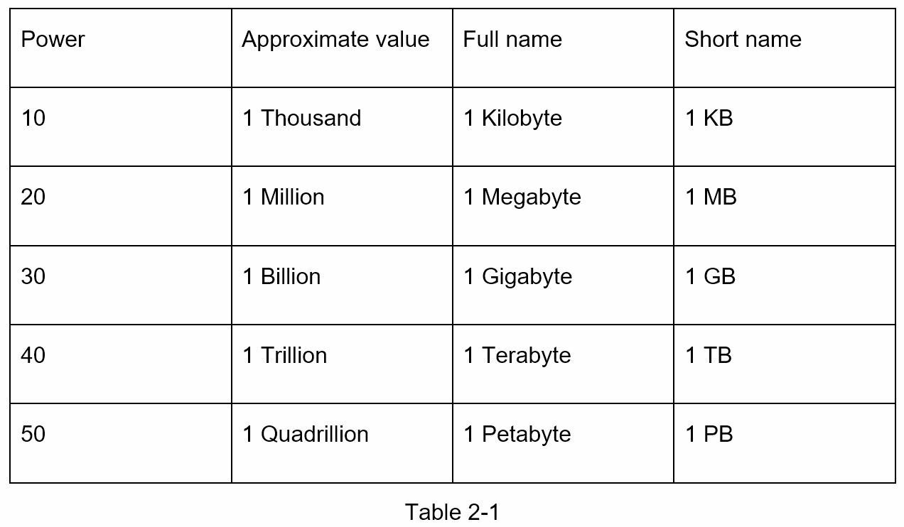
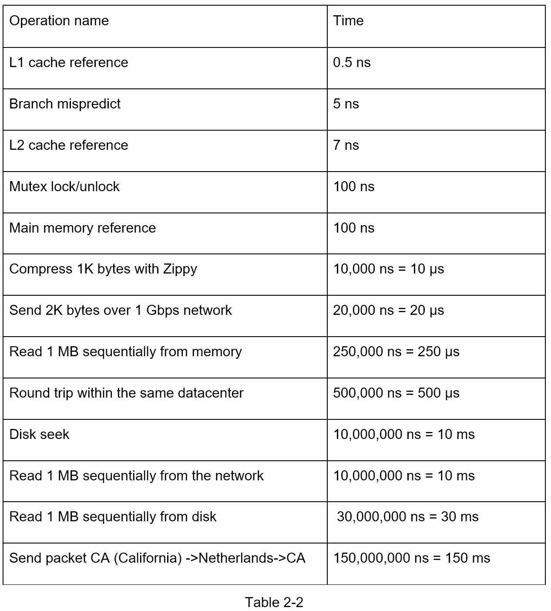
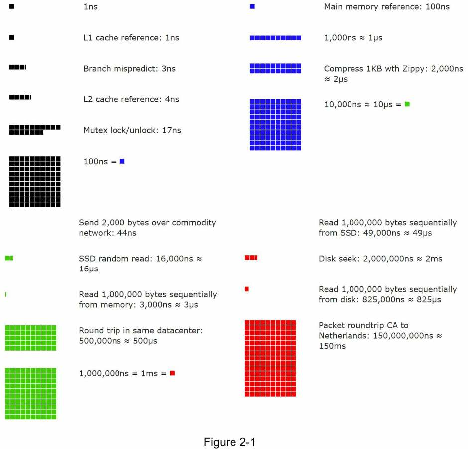
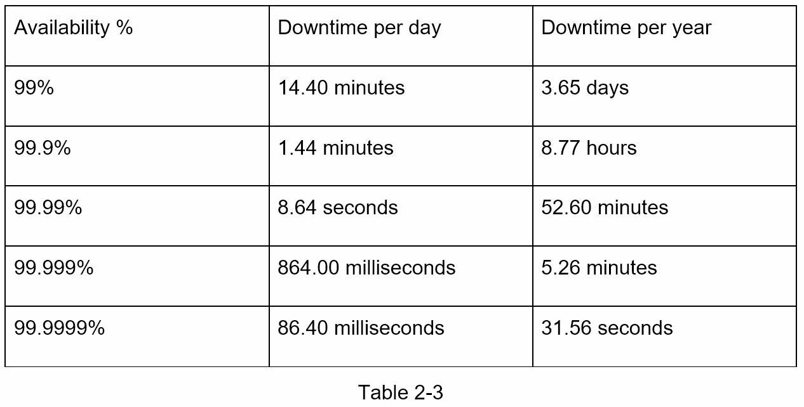

# Chương 2: Ước tính sơ bộ

Tên chương gốc: **Back-of-the-Envelope Estimation**. Trang PDF: **034–041**.

<!-- trang-pdf:034 -->

Trong buổi phỏng vấn thiết kế hệ thống, đôi khi bạn được yêu cầu ước tính dung lượng hoặc yêu cầu hiệu năng bằng cách tính nhẩm sơ bộ (back-of-the-envelope estimation). Theo Jeff Dean, Google Senior Fellow: “Các phép tính sơ bộ là những ước tính được tạo ra bằng cách kết hợp các thí nghiệm tư duy với những con số hiệu năng thông dụng, để có cảm nhận tương đối rõ về những thiết kế có thể đáp ứng yêu cầu của bạn” [1].

Để thực hiện ước tính sơ bộ hiệu quả, bạn cần nắm chắc các kiến thức cơ bản về khả năng mở rộng. Cần hiểu rõ những khái niệm sau: lũy thừa của hai [2], các con số độ trễ mà mọi lập trình viên nên biết và các con số về tính sẵn sàng.

<!-- trang-pdf:035 -->

## Lũy thừa của hai

Dù lượng dữ liệu có thể trở nên khổng lồ khi làm việc với hệ thống phân tán, việc tính toán cuối cùng vẫn quay về những điều cơ bản. Để tính đúng, cần biết các đơn vị dung lượng dữ liệu dựa trên lũy thừa của 2. Một byte là một chuỗi gồm 8 bit. Một ký tự ASCII dùng một byte bộ nhớ, tức 8 bit. Bảng 2-1 dưới đây giải thích các đơn vị dung lượng dữ liệu.



<!-- trang-pdf:036 -->

## Các con số độ trễ mà mọi lập trình viên nên biết

Tiến sĩ Dean của Google đã công bố thời gian của các thao tác máy tính điển hình vào năm 2010 [1]. Một số con số đã cũ khi máy tính trở nên nhanh và mạnh hơn. Tuy nhiên, chúng vẫn giúp chúng ta hình dung thao tác nào nhanh, thao tác nào chậm.



**Chú giải**

```text
ns = nano giây, µs = micro giây, ms = mili giây
1 ns = 10^-9 giây
1 µs = 10^-6 giây = 1.000 ns
1 ms = 10^-3 giây = 1.000 µs = 1.000.000 ns
```

<!-- trang-pdf:037 -->

Một kỹ sư phần mềm Google đã xây dựng công cụ trực quan hóa các con số của tiến sĩ Dean. Công cụ này cũng xét đến yếu tố thời gian. Hình 2-1 thể hiện các con số độ trễ được trực quan hóa tính đến năm 2020; nguồn hình là tài liệu tham khảo [3].



Phân tích các con số trong Hình 2-1, chúng ta rút ra những kết luận sau:

- Bộ nhớ nhanh, còn đĩa thì chậm.
- Tránh thao tác tìm kiếm vị trí trên đĩa (disk seek) nếu có thể.
- Các thuật toán nén đơn giản chạy nhanh.
- Nếu có thể, hãy nén dữ liệu trước khi gửi qua Internet.
- Các trung tâm dữ liệu thường nằm ở những khu vực khác nhau, và truyền dữ liệu giữa chúng cần thời gian.

<!-- trang-pdf:038 -->

## Các con số về tính sẵn sàng

Tính sẵn sàng cao là khả năng hệ thống liên tục hoạt động trong một khoảng thời gian dài như mong muốn. Tính sẵn sàng cao được đo theo phần trăm; 100% nghĩa là dịch vụ không có thời gian ngừng hoạt động. Phần lớn dịch vụ nằm trong khoảng 99% đến 100%.

Thỏa thuận mức dịch vụ (service level agreement — SLA) là thuật ngữ thường dùng với các nhà cung cấp dịch vụ. Đây là thỏa thuận giữa bạn, tức nhà cung cấp, với khách hàng; thỏa thuận chính thức xác định mức thời gian hoạt động mà dịch vụ sẽ cung cấp. Các nhà cung cấp đám mây Amazon [4], Google [5] và Microsoft [6] đặt SLA ở mức 99,9% trở lên. Theo truyền thống, thời gian hoạt động được biểu diễn bằng số chữ số chín. Càng nhiều số chín càng tốt. Như Bảng 2-3 cho thấy, số chữ số chín tương ứng với thời gian ngừng hoạt động dự kiến của hệ thống.



<!-- trang-pdf:039 -->

## Ví dụ: Ước tính QPS và nhu cầu lưu trữ của Twitter

Lưu ý: những con số sau chỉ dùng cho bài tập này, không phải số liệu thực tế của Twitter.

**Giả định:**

- 300 triệu người dùng hoạt động hằng tháng.
- 50% người dùng sử dụng Twitter hằng ngày.
- Trung bình mỗi người dùng đăng 2 tweet mỗi ngày.
- 10% tweet chứa nội dung đa phương tiện.
- Dữ liệu được lưu trong 5 năm.

**Ước tính:**

Ước tính số truy vấn mỗi giây (queries per second — QPS):

- Người dùng hoạt động hằng ngày (daily active users — DAU) = 300 triệu × 50% = 150 triệu.
- QPS đăng tweet = 150 triệu × 2 tweet / 24 giờ / 3.600 giây ≈ 3.500.
- QPS cao điểm = 2 × QPS ≈ 7.000.

Ở đây, chúng ta chỉ ước tính dung lượng lưu trữ nội dung đa phương tiện.

- Kích thước trung bình của một tweet:
  - `tweet_id`: 64 byte.
  - `text`: 140 byte.
  - `media`: 1 MB.
- Dung lượng đa phương tiện: 150 triệu × 2 × 10% × 1 MB = 30 TB mỗi ngày.
- Dung lượng đa phương tiện trong 5 năm: 30 TB × 365 × 5 ≈ 55 PB.

<!-- trang-pdf:040 -->

## Một số lời khuyên

Ước tính sơ bộ chủ yếu là về quá trình thực hiện. Cách giải quyết bài toán quan trọng hơn kết quả thu được. Người phỏng vấn có thể đang kiểm tra kỹ năng giải quyết vấn đề của bạn. Dưới đây là một số lời khuyên:

- **Làm tròn và xấp xỉ:** thực hiện các phép toán phức tạp trong buổi phỏng vấn rất khó. Ví dụ, kết quả của `99987 / 9.1` là bao nhiêu? Không cần dùng thời gian quý giá để giải các phép toán phức tạp; người phỏng vấn không đòi hỏi độ chính xác tuyệt đối. Hãy tận dụng số tròn và phép xấp xỉ. Phép chia trên có thể đơn giản thành `100.000 / 10`.
- **Ghi lại các giả định:** nên ghi các giả định để có thể tham chiếu về sau.
- **Ghi rõ đơn vị:** khi viết “5”, bạn muốn nói 5 KB hay 5 MB? Điều này có thể khiến chính bạn nhầm lẫn. Hãy ghi đơn vị, vì “5 MB” giúp loại bỏ sự mơ hồ.
- **Những ước tính sơ bộ thường được hỏi:** QPS, QPS cao điểm, dung lượng lưu trữ, bộ nhớ đệm, số máy chủ, v.v. Bạn có thể luyện những phép tính này khi chuẩn bị phỏng vấn. Có công luyện tập, sẽ ngày càng thành thạo.

Chúc mừng bạn đã đi đến đây! Hãy tự thưởng cho mình một lời động viên. Bạn đã làm tốt!

<!-- trang-pdf:041 -->

## Tài liệu tham khảo

[1] J. Dean. Google Pro Tip: Use Back-Of-The-Envelope-Calculations To Choose The Best Design: http://highscalability.com/blog/2011/1/26/google-pro-tip-use-back-of-the-envelope-calculations-to-choo.html

[2] System design primer: https://github.com/donnemartin/system-design-primer

[3] Latency Numbers Every Programmer Should Know: https://colin-scott.github.io/personal_website/research/interactive_latency.html

[4] Amazon Compute Service Level Agreement: https://aws.amazon.com/compute/sla/

[5] Compute Engine Service Level Agreement (SLA): https://cloud.google.com/compute/sla

[6] SLA summary for Azure services: https://azure.microsoft.com/en-us/support/legal/sla/summary/

---

[← Chương 1](chuong-01.md) · [Mục lục](../README.md) · [Chương 3 →](chuong-03.md)
