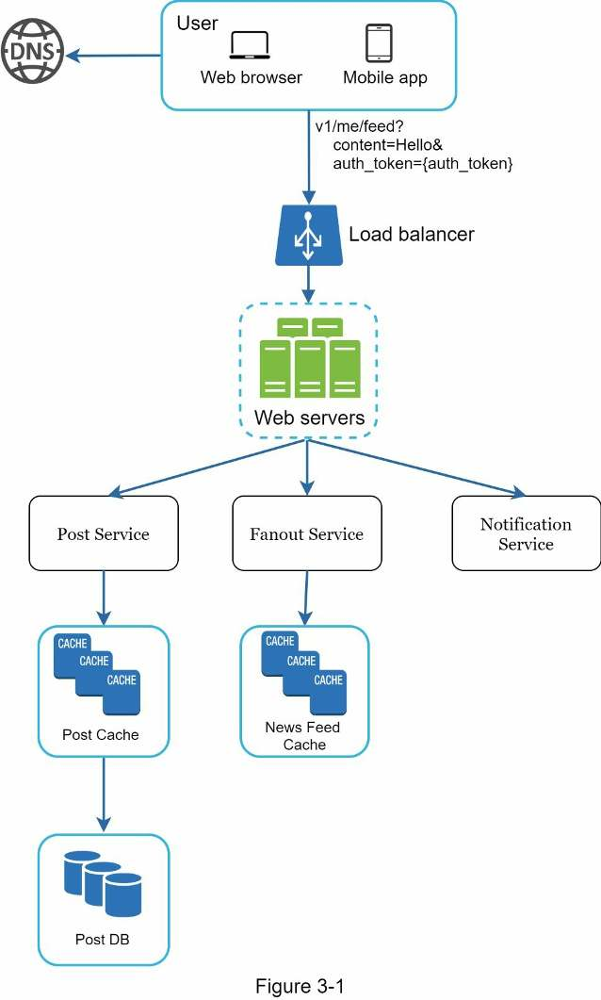
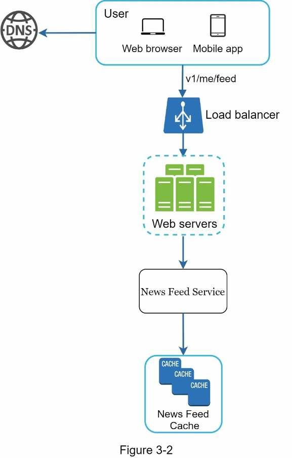
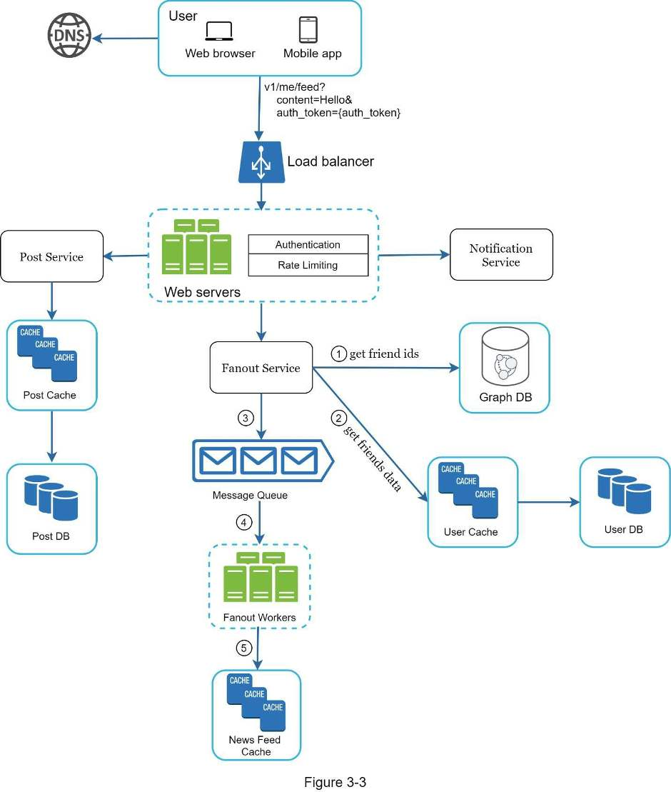
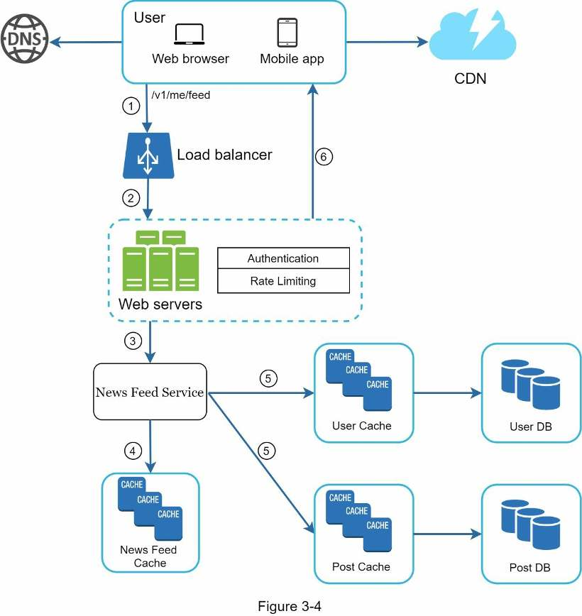

# Chương 3: Khung phương pháp cho phỏng vấn thiết kế hệ thống

Tên chương gốc: **A Framework for System Design Interviews**. Trang PDF: **042–050**.

<!-- trang-pdf:042 -->

Bạn vừa giành được buổi phỏng vấn trực tiếp đáng mơ ước tại công ty mình yêu thích. Điều phối viên tuyển dụng gửi lịch trình trong ngày. Khi đọc danh sách, bạn cảm thấy khá tự tin, cho đến khi mắt dừng lại ở buổi phỏng vấn này: Phỏng vấn thiết kế hệ thống.

Phỏng vấn thiết kế hệ thống thường khiến ứng viên e ngại. Đề bài có thể mơ hồ như “Hãy thiết kế sản phẩm X nổi tiếng”. Câu hỏi không rõ ràng và dường như rộng đến mức vô lý. Cảm giác lo ngại của bạn là điều dễ hiểu. Suy cho cùng, làm sao một người có thể thiết kế trong một giờ một sản phẩm phổ biến mà hàng trăm, thậm chí hàng nghìn kỹ sư đã cùng xây dựng?

Tin tốt là không ai mong đợi bạn làm được điều đó. Thiết kế hệ thống thực tế cực kỳ phức tạp. Chẳng hạn, Google Search trông đơn giản đến mức dễ gây hiểu lầm, nhưng khối lượng công nghệ đứng sau sự đơn giản ấy thật đáng kinh ngạc. Nếu không ai kỳ vọng bạn thiết kế được một hệ thống thực tế trong một giờ, vậy phỏng vấn thiết kế hệ thống có ích gì?

Buổi phỏng vấn mô phỏng cách giải quyết vấn đề trong thực tế: hai đồng nghiệp cùng làm việc với một bài toán chưa rõ ràng và tìm ra giải pháp đáp ứng mục tiêu. Đây là bài toán mở, không có đáp án hoàn hảo. Thiết kế cuối cùng ít quan trọng hơn công sức bạn bỏ vào quá trình thiết kế. Nhờ vậy, bạn có thể thể hiện kỹ năng thiết kế, bảo vệ lựa chọn và tiếp nhận phản hồi một cách xây dựng.

Hãy đổi góc nhìn, xem người phỏng vấn nghĩ gì khi bước vào phòng họp gặp bạn. Mục tiêu chính của cô ấy là đánh giá chính xác năng lực của bạn. Điều cô ấy ít mong muốn nhất là phải đưa ra đánh giá thiếu kết luận vì buổi phỏng vấn không thuận lợi và không thu được đủ tín hiệu. Người phỏng vấn tìm kiếm điều gì trong buổi phỏng vấn thiết kế hệ thống?

Nhiều người nghĩ buổi phỏng vấn chỉ xoay quanh kỹ năng thiết kế kỹ thuật. Thực tế còn nhiều hơn thế. Một buổi phỏng vấn hiệu quả cho thấy rõ khả năng cộng tác, làm việc dưới áp lực và xử lý sự mơ hồ một cách xây dựng. Khả năng đặt câu hỏi tốt cũng rất quan trọng, và nhiều người phỏng vấn chủ động tìm kiếm kỹ năng này.

Người phỏng vấn giỏi cũng tìm các dấu hiệu đáng ngại. Thiết kế quá mức cần thiết (over-engineering) là căn bệnh có thật của nhiều kỹ sư: họ thích sự thuần khiết trong thiết kế và bỏ qua các đánh đổi. Họ thường không nhận thức được chi phí tích lũy của những hệ thống được thiết kế quá mức, và nhiều công ty phải trả giá đắt cho điều đó. Chắc chắn bạn không muốn thể hiện xu hướng này khi phỏng vấn. Những dấu hiệu khác gồm tư duy hẹp, cố chấp, v.v.

Trong chương này, chúng ta sẽ tìm hiểu một số lời khuyên hữu ích và một khung phương pháp đơn giản, hiệu quả để giải quyết bài toán phỏng vấn thiết kế hệ thống.

<!-- trang-pdf:043 -->

## Quy trình 4 bước cho buổi phỏng vấn thiết kế hệ thống hiệu quả

Mỗi buổi phỏng vấn thiết kế hệ thống đều khác nhau. Một buổi phỏng vấn tốt có tính mở, không có một giải pháp phù hợp với mọi tình huống. Tuy vậy, có những bước và nội dung chung cần đề cập trong mọi buổi phỏng vấn.

### Bước 1 — Hiểu bài toán và xác định phạm vi thiết kế

“Tại sao con hổ gầm?”

Một cánh tay giơ lên ở cuối lớp.

“Ừ, Jimmy?”, cô giáo đáp.

“Vì nó ĐÓI ạ.”

“Rất tốt, Jimmy.”

Suốt thời thơ ấu, Jimmy luôn là người đầu tiên trả lời câu hỏi trong lớp. Mỗi khi giáo viên hỏi, luôn có một đứa trẻ thích thử trả lời, bất kể có biết đáp án hay không. Đó là Jimmy.

Jimmy là học sinh xuất sắc. Cậu tự hào vì nhanh chóng biết mọi đáp án. Trong các kỳ thi, cậu thường là người làm xong đầu tiên. Cậu là lựa chọn hàng đầu của giáo viên cho mọi cuộc thi học thuật.

ĐỪNG giống Jimmy.

Trong buổi phỏng vấn thiết kế hệ thống, trả lời nhanh mà chưa suy nghĩ không đem lại điểm cộng. Trả lời khi chưa hiểu kỹ yêu cầu là dấu hiệu rất đáng ngại, vì đây không phải cuộc thi đố kiến thức. Không có một đáp án đúng duy nhất.

Vì vậy, đừng vội đưa ra giải pháp. Hãy chậm lại, suy nghĩ kỹ và đặt câu hỏi để làm rõ yêu cầu cùng giả định. Điều này cực kỳ quan trọng.

Là kỹ sư, chúng ta thích giải bài toán khó và đi thẳng đến thiết kế cuối cùng. Tuy nhiên, cách đó rất dễ dẫn đến việc thiết kế sai hệ thống. Một trong những kỹ năng quan trọng nhất của kỹ sư là đặt đúng câu hỏi, đưa ra giả định phù hợp và thu thập đủ thông tin cần thiết để xây dựng hệ thống. Do đó, đừng ngại đặt câu hỏi.

Khi bạn hỏi, người phỏng vấn sẽ trả lời trực tiếp hoặc yêu cầu bạn tự đưa ra giả định. Nếu rơi vào trường hợp sau, hãy ghi giả định lên bảng hoặc giấy. Bạn có thể cần đến chúng về sau.

Nên hỏi những gì? Hãy đặt câu hỏi để hiểu chính xác yêu cầu. Dưới đây là một số câu giúp bắt đầu:

- Chúng ta sẽ xây dựng những tính năng cụ thể nào?
- Sản phẩm có bao nhiêu người dùng?
- Công ty dự kiến mở rộng nhanh đến mức nào? Quy mô dự kiến sau 3 tháng, 6 tháng và một năm là bao nhiêu?
- Công ty dùng những công nghệ nào? Có thể tận dụng dịch vụ hiện có nào để đơn giản hóa thiết kế?

#### Ví dụ

Nếu được yêu cầu thiết kế hệ thống bảng tin (news feed), hãy đặt các câu hỏi giúp làm rõ yêu cầu. Cuộc trao đổi có thể như sau:

**Ứng viên:** Đây là ứng dụng di động, ứng dụng web hay cả hai?

<!-- trang-pdf:044 -->

**Người phỏng vấn:** Cả hai.

**Ứng viên:** Các tính năng quan trọng nhất của sản phẩm là gì?

**Người phỏng vấn:** Khả năng đăng bài và xem bảng tin của bạn bè.

**Ứng viên:** Bảng tin được sắp xếp theo thời gian mới nhất trước, hay theo một thứ tự riêng? Thứ tự riêng nghĩa là mỗi bài có trọng số khác nhau. Chẳng hạn, bài của bạn thân quan trọng hơn bài từ một nhóm.

**Người phỏng vấn:** Để đơn giản, hãy giả định bảng tin được sắp xếp theo thời gian mới nhất trước.

**Ứng viên:** Một người dùng có thể có bao nhiêu bạn bè?

**Người phỏng vấn:** 5.000.

**Ứng viên:** Lưu lượng truy cập là bao nhiêu?

**Người phỏng vấn:** 10 triệu người dùng hoạt động hằng ngày (DAU).

**Ứng viên:** Bảng tin có thể chứa hình ảnh, video hay chỉ văn bản?

**Người phỏng vấn:** Có thể chứa file đa phương tiện, gồm cả hình ảnh và video.

Trên đây là một số câu hỏi mẫu có thể đặt cho người phỏng vấn. Hiểu yêu cầu và làm rõ những điểm mơ hồ là điều quan trọng.

### Bước 2 — Đề xuất thiết kế tổng quan và đạt sự đồng thuận

Ở bước này, mục tiêu là xây dựng thiết kế tổng quan và thống nhất với người phỏng vấn. Bạn nên cộng tác với họ trong suốt quá trình.

- Đưa ra bản phác thảo thiết kế ban đầu. Hỏi ý kiến phản hồi. Xem người phỏng vấn như đồng đội và cùng làm việc. Nhiều người phỏng vấn giỏi thích trao đổi và tham gia.
- Vẽ sơ đồ khối các thành phần chính trên bảng hoặc giấy. Có thể gồm máy khách di động/web, API, máy chủ web, kho dữ liệu, bộ nhớ đệm, CDN, hàng đợi thông điệp, v.v.
- Tính toán sơ bộ để đánh giá xem bản phác thảo có đáp ứng các ràng buộc quy mô không. Nói ra suy nghĩ của bạn. Trước khi bắt đầu tính, hãy trao đổi xem có cần ước tính sơ bộ hay không.

Nếu có thể, hãy đi qua vài trường hợp sử dụng cụ thể. Điều này giúp định hình thiết kế tổng quan. Những trường hợp sử dụng cũng có thể giúp phát hiện các trường hợp biên chưa được cân nhắc.

Có nên đưa endpoint API và schema cơ sở dữ liệu vào bước này không? Điều đó tùy bài toán. Với bài toán lớn như “Thiết kế công cụ tìm kiếm Google”, đây là mức quá chi tiết. Với bài toán như thiết kế backend cho trò poker nhiều người chơi, đề cập những nội dung này là hợp lý. Hãy trao đổi với người phỏng vấn.

#### Ví dụ

Hãy dùng bài toán “Thiết kế hệ thống bảng tin” để minh họa cách tiếp cận thiết kế tổng quan. Ở đây, bạn chưa cần hiểu hệ thống thực sự hoạt động thế nào. Mọi chi tiết sẽ được giải thích trong Chương 11.

Ở mức tổng quan, thiết kế được chia thành hai luồng: phát hành bài vào bảng tin và xây dựng bảng tin.

- **Phát hành bài vào bảng tin:** khi người dùng đăng bài, dữ liệu tương ứng được ghi vào bộ nhớ đệm/cơ sở dữ liệu, và bài đăng được đưa vào bảng tin của bạn bè.

<!-- trang-pdf:045 -->

- **Xây dựng bảng tin:** bảng tin được tạo bằng cách tập hợp bài đăng của bạn bè theo thời gian mới nhất trước.

Hình 3-1 và Hình 3-2 lần lượt trình bày thiết kế tổng quan của luồng phát hành bài và luồng xây dựng bảng tin.

<!-- trang-pdf:046 -->

### Bước 3 — Đi sâu vào thiết kế

Đến bước này, bạn và người phỏng vấn cần đã đạt được các mục tiêu sau:

- Thống nhất mục tiêu tổng thể và phạm vi tính năng.
- Phác thảo thiết kế tổng quan cho toàn hệ thống.
- Nhận phản hồi của người phỏng vấn về thiết kế tổng quan.
- Có ý tưởng ban đầu về những phần cần tập trung phân tích sâu, dựa trên phản hồi đó.

Bạn cần cùng người phỏng vấn xác định và ưu tiên các thành phần trong kiến trúc. Cần nhấn mạnh rằng mỗi buổi phỏng vấn đều khác nhau. Đôi khi, người phỏng vấn gợi ý rằng họ muốn tập trung vào thiết kế tổng quan. Đôi khi, khi phỏng vấn ứng viên cấp cao, cuộc trao đổi có thể xoay quanh đặc tính hiệu năng của hệ thống, tập trung vào điểm nghẽn và ước tính tài nguyên. Trong phần lớn trường hợp, họ có thể muốn bạn đi sâu vào một số thành phần. Với hệ thống rút gọn URL, thiết kế hàm băm chuyển URL dài thành URL ngắn là chủ đề thú vị. Với hệ thống chat, hai chủ đề đáng tìm hiểu là giảm độ trễ và hỗ trợ trạng thái trực tuyến/ngoại tuyến.

Quản lý thời gian là điều thiết yếu, vì bạn rất dễ sa đà vào những chi tiết nhỏ không thể hiện được năng lực. Bạn phải chuẩn bị những tín hiệu để cho người phỏng vấn thấy khả năng của mình. Cố gắng <!-- trang-pdf:047 --> không đi vào chi tiết không cần thiết. Chẳng hạn, trình bày kỹ thuật toán EdgeRank để xếp hạng bảng tin Facebook không phải lựa chọn tốt trong buổi phỏng vấn thiết kế hệ thống: việc đó chiếm nhiều thời gian quý giá mà không chứng minh được khả năng thiết kế hệ thống có thể mở rộng.

#### Ví dụ

Đến đây, chúng ta đã trao đổi về thiết kế tổng quan của hệ thống bảng tin, và người phỏng vấn hài lòng với đề xuất. Tiếp theo, sẽ tìm hiểu hai trường hợp sử dụng quan trọng nhất:

1. Phát hành bài vào bảng tin.
2. Truy xuất bảng tin.

Hình 3-3 và Hình 3-4 thể hiện thiết kế chi tiết cho hai trường hợp này; chúng sẽ được giải thích kỹ trong Chương 11.

<!-- trang-pdf:048 -->

<!-- trang-pdf:049 -->

### Bước 4 — Tổng kết

Ở bước cuối, người phỏng vấn có thể hỏi thêm hoặc để bạn tự trao đổi những điểm bổ sung. Dưới đây là vài hướng có thể theo:

- Người phỏng vấn có thể muốn bạn xác định điểm nghẽn của hệ thống và thảo luận những cải tiến khả thi. Đừng bao giờ nói thiết kế hoàn hảo, không còn gì để cải thiện. Luôn có điều có thể làm tốt hơn. Đây là cơ hội tốt để thể hiện tư duy phản biện và để lại ấn tượng cuối tích cực.
- Tóm lược thiết kế cho người phỏng vấn có thể hữu ích, đặc biệt nếu bạn đã đề xuất vài giải pháp. Sau một buổi trao đổi dài, nhắc lại giúp họ nhớ rõ hơn.
- Các tình huống lỗi như máy chủ hỏng, mất mạng, v.v. là chủ đề thú vị để thảo luận.
- Những vấn đề vận hành cũng nên được đề cập. Bạn theo dõi số liệu và log lỗi như thế nào? Triển khai hệ thống ra sao?
- Cách xử lý bước tăng trưởng tiếp theo cũng là chủ đề đáng trao đổi. Ví dụ, nếu thiết kế hiện tại hỗ trợ 1 triệu người dùng, cần thay đổi gì để hỗ trợ 10 triệu?
- Đề xuất những tinh chỉnh khác mà bạn sẽ làm nếu có thêm thời gian.

<!-- trang-pdf:050 -->

Để kết thúc, chúng ta tổng hợp danh sách những điều nên và không nên làm.

## Những điều nên làm

- Luôn hỏi để làm rõ. Đừng mặc nhiên cho rằng giả định của mình đúng.
- Hiểu yêu cầu của bài toán.
- Không có đáp án đúng duy nhất hay đáp án tốt nhất. Giải pháp cho startup mới thành lập khác với giải pháp cho công ty đã có hàng triệu người dùng. Hãy chắc rằng bạn hiểu yêu cầu.
- Cho người phỏng vấn biết bạn đang nghĩ gì. Hãy trao đổi với họ.
- Đề xuất nhiều hướng tiếp cận nếu có thể.
- Khi đã thống nhất bản phác thảo với người phỏng vấn, đi vào chi tiết từng thành phần. Thiết kế các thành phần quan trọng nhất trước.
- Trao đổi ý tưởng qua lại. Người phỏng vấn tốt làm việc với bạn như đồng đội.
- Đừng bao giờ bỏ cuộc.

## Những điều không nên làm

- Đừng bước vào buổi phỏng vấn mà chưa chuẩn bị cho các câu hỏi điển hình.
- Đừng vội đưa ra giải pháp khi chưa làm rõ yêu cầu và giả định.
- Đừng quá chi tiết về một thành phần ngay từ đầu. Hãy đưa thiết kế tổng quan trước rồi mới phân tích sâu.
- Nếu bế tắc, đừng ngại xin gợi ý.
- Một lần nữa: hãy giao tiếp. Đừng suy nghĩ trong im lặng.
- Đừng nghĩ buổi phỏng vấn kết thúc ngay khi bạn đưa ra thiết kế. Chỉ kết thúc khi người phỏng vấn nói vậy. Hãy xin phản hồi sớm và thường xuyên.

## Phân bổ thời gian cho từng bước

Câu hỏi phỏng vấn thiết kế hệ thống thường rất rộng; 45 phút hoặc một giờ không đủ để trình bày toàn bộ thiết kế. Quản lý thời gian là điều thiết yếu. Nên dành bao lâu cho mỗi bước? Dưới đây là hướng dẫn rất sơ bộ cho một buổi phỏng vấn 45 phút. Hãy nhớ đây chỉ là ước lượng; phân bổ thực tế phụ thuộc phạm vi bài toán và yêu cầu của người phỏng vấn.

| Bước | Nội dung | Thời gian |
| --- | --- | --- |
| 1 | Hiểu bài toán và xác định phạm vi thiết kế | 3–10 phút |
| 2 | Đề xuất thiết kế tổng quan và đạt sự đồng thuận | 10–15 phút |
| 3 | Đi sâu vào thiết kế | 10–25 phút |
| 4 | Tổng kết | 3–5 phút |

---

[← Chương 2](chuong-02-uoc-tinh-so-bo.md) · [Mục lục](../README.md) · [Chương 4 →](chuong-04-thiet-ke-bo-gioi-han-toc-do.md)
