# Chương 4: Thiết kế bộ giới hạn tốc độ

[English](../original/chuong-04-thiet-ke-bo-gioi-han-toc-do.md) · [Mục lục](../README.md)

Tên chương gốc: **Design a Rate Limiter**. Trang PDF: **051–070**.

<!-- trang-pdf:051 -->

Trong hệ thống mạng, bộ giới hạn tốc độ (rate limiter) được dùng để kiểm soát tốc độ lưu lượng do máy khách hoặc dịch vụ gửi đi. Trong môi trường HTTP, bộ giới hạn tốc độ giới hạn số yêu cầu máy khách được phép gửi trong một khoảng thời gian xác định. Nếu số yêu cầu API vượt ngưỡng đã định, mọi lời gọi vượt mức đều bị chặn. Một vài ví dụ:

- Một người dùng không được đăng quá 2 bài mỗi giây.
- Từ cùng một địa chỉ IP, bạn có thể tạo tối đa 10 tài khoản mỗi ngày.
- Từ cùng một thiết bị, bạn không được nhận thưởng quá 5 lần mỗi tuần.

Trong chương này, bạn được yêu cầu thiết kế một bộ giới hạn tốc độ. Trước khi bắt đầu, hãy xem lợi ích của việc giới hạn tốc độ API:

- **Ngăn cạn kiệt tài nguyên do tấn công từ chối dịch vụ (Denial of Service — DoS) [1]:** gần như mọi API do các công ty công nghệ lớn công bố đều áp dụng một hình thức giới hạn tốc độ. Ví dụ, Twitter giới hạn 300 tweet trong 3 giờ [2]. API Google Docs có giới hạn mặc định là 300 yêu cầu đọc trên mỗi người dùng trong 60 giây [3]. Bằng cách chặn các lời gọi vượt mức, bộ giới hạn tốc độ ngăn những cuộc tấn công DoS dù cố ý hay vô ý.
- **Giảm chi phí:** giới hạn yêu cầu vượt mức đồng nghĩa cần ít máy chủ hơn và có thể cấp nhiều tài nguyên hơn cho các API ưu tiên cao. Giới hạn tốc độ đặc biệt quan trọng với công ty dùng API trả phí của bên thứ ba. Ví dụ, các API bên ngoài như kiểm tra tín dụng, thanh toán, lấy hồ sơ sức khỏe, v.v. tính phí theo từng lời gọi. Giới hạn số lời gọi là điều thiết yếu để giảm chi phí.
- **Ngăn máy chủ quá tải:** để giảm tải máy chủ, bộ giới hạn tốc độ lọc các yêu cầu dư thừa do bot hoặc hành vi sử dụng không phù hợp gây ra.

<!-- trang-pdf:052 -->

## Bước 1 — Hiểu bài toán và xác định phạm vi thiết kế

Có thể giới hạn tốc độ bằng nhiều thuật toán, mỗi thuật toán có ưu và nhược điểm riêng. Cuộc trao đổi giữa người phỏng vấn và ứng viên giúp làm rõ loại bộ giới hạn tốc độ cần xây dựng.

**Ứng viên:** Chúng ta sẽ thiết kế loại bộ giới hạn tốc độ nào? Ở phía máy khách hay giới hạn API ở phía máy chủ?

**Người phỏng vấn:** Câu hỏi hay. Chúng ta tập trung vào bộ giới hạn API phía máy chủ.

**Ứng viên:** Bộ giới hạn điều tiết yêu cầu API dựa trên IP, ID người dùng hay thuộc tính khác?

**Người phỏng vấn:** Nó cần đủ linh hoạt để hỗ trợ các bộ quy tắc điều tiết khác nhau.

**Ứng viên:** Quy mô hệ thống ra sao? Dành cho startup hay công ty lớn có đông người dùng?

**Người phỏng vấn:** Hệ thống phải xử lý được số lượng yêu cầu lớn.

**Ứng viên:** Hệ thống có hoạt động trong môi trường phân tán không?

**Người phỏng vấn:** Có.

**Ứng viên:** Bộ giới hạn là dịch vụ riêng hay được triển khai trong mã ứng dụng?

**Người phỏng vấn:** Bạn tự quyết định điều đó trong thiết kế.

**Ứng viên:** Có cần thông báo cho người dùng bị giới hạn không?

**Người phỏng vấn:** Có.

### Yêu cầu

Tóm lược các yêu cầu của hệ thống:

- Giới hạn chính xác các yêu cầu vượt mức.
- Độ trễ thấp. Bộ giới hạn không được làm chậm thời gian phản hồi HTTP.
- Dùng ít bộ nhớ nhất có thể.
- Giới hạn tốc độ phân tán. Nhiều máy chủ hoặc tiến trình có thể dùng chung bộ giới hạn.
- Xử lý ngoại lệ. Hiển thị ngoại lệ rõ ràng cho người dùng khi yêu cầu bị giới hạn.
- Khả năng chịu lỗi cao. Nếu bộ giới hạn gặp vấn đề, chẳng hạn máy chủ bộ nhớ đệm ngừng hoạt động, toàn hệ thống không bị ảnh hưởng.

<!-- trang-pdf:053 -->

## Bước 2 — Đề xuất thiết kế tổng quan và đạt sự đồng thuận

Hãy giữ mọi thứ đơn giản bằng mô hình giao tiếp máy khách–máy chủ cơ bản.

### Đặt bộ giới hạn tốc độ ở đâu?

Theo trực giác, có thể triển khai bộ giới hạn ở phía máy khách hoặc phía máy chủ.

- **Phía máy khách:** nhìn chung, máy khách không phải nơi đáng tin cậy để thực thi giới hạn tốc độ vì kẻ xấu có thể dễ dàng giả mạo yêu cầu. Hơn nữa, chúng ta có thể không kiểm soát được cách triển khai máy khách.
- **Phía máy chủ:** Hình 4-1 thể hiện một bộ giới hạn được đặt ở phía máy chủ.

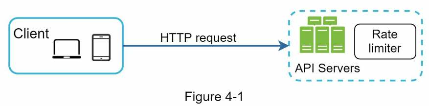

Ngoài hai cách trên còn có phương án khác. Thay vì đặt bộ giới hạn ở các máy chủ API, chúng ta tạo một middleware giới hạn tốc độ để điều tiết yêu cầu đến API như Hình 4-2.

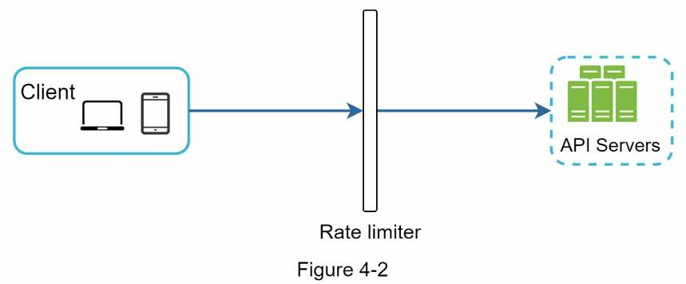

Hãy dùng ví dụ trong Hình 4-3 để minh họa cách giới hạn tốc độ hoạt động với thiết kế này. Giả sử API cho phép 2 yêu cầu mỗi giây, và máy khách gửi 3 yêu cầu đến máy chủ trong một giây. Hai yêu cầu đầu được chuyển đến máy chủ API. Tuy nhiên, middleware giới hạn yêu cầu thứ ba và trả mã trạng thái HTTP 429. Mã HTTP 429 cho biết người dùng đã gửi quá nhiều yêu cầu.

<!-- trang-pdf:054 -->

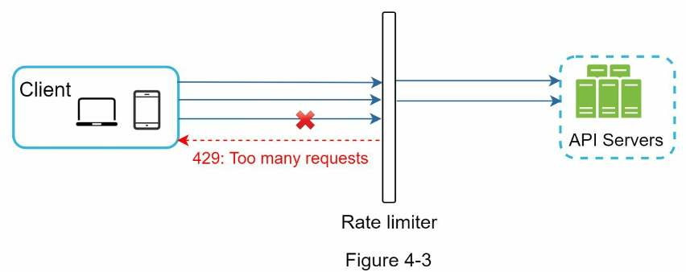

Microservice trên đám mây [4] đã trở nên rất phổ biến, và giới hạn tốc độ thường được triển khai trong thành phần gọi là API gateway. API gateway là dịch vụ được quản lý hoàn toàn, hỗ trợ giới hạn tốc độ, kết thúc kết nối SSL (SSL termination), xác thực, danh sách IP được phép, phục vụ nội dung tĩnh, v.v. Hiện tại, chỉ cần biết API gateway là một middleware hỗ trợ giới hạn tốc độ.

Khi thiết kế, câu hỏi quan trọng là: nên triển khai bộ giới hạn ở phía máy chủ hay trong gateway? Không có đáp án tuyệt đối. Điều này phụ thuộc công nghệ hiện có, nguồn lực kỹ thuật, mức ưu tiên, mục tiêu của công ty, v.v. Một số hướng dẫn chung:

- Đánh giá các công nghệ đang dùng như ngôn ngữ lập trình, dịch vụ bộ nhớ đệm, v.v. Bảo đảm ngôn ngữ hiện tại đủ hiệu quả để triển khai giới hạn tốc độ phía máy chủ.
- Xác định thuật toán phù hợp nhu cầu nghiệp vụ. Khi tự triển khai toàn bộ ở phía máy chủ, bạn kiểm soát hoàn toàn thuật toán. Nếu dùng gateway của bên thứ ba, lựa chọn có thể bị giới hạn.
- Nếu đã sử dụng kiến trúc microservice và API gateway để xác thực, kiểm tra danh sách IP được phép, v.v., bạn có thể thêm bộ giới hạn tốc độ vào gateway.
- Xây dựng dịch vụ giới hạn tốc độ riêng cần thời gian. Nếu không đủ nguồn lực kỹ thuật, API gateway thương mại là lựa chọn tốt hơn.

### Các thuật toán giới hạn tốc độ

Có thể giới hạn tốc độ bằng nhiều thuật toán, mỗi thuật toán có ưu và nhược điểm riêng. Dù chương này không tập trung vào thuật toán, hiểu chúng ở mức tổng quan giúp chọn một thuật toán hoặc kết hợp nhiều thuật toán phù hợp trường hợp sử dụng. Các thuật toán phổ biến gồm:

- Token bucket.
- Leaking bucket.
- Bộ đếm cửa sổ cố định (fixed window counter).
- Nhật ký cửa sổ trượt (sliding window log).
- Bộ đếm cửa sổ trượt (sliding window counter).

### Thuật toán token bucket

Token bucket được dùng rộng rãi để giới hạn tốc độ. Thuật toán đơn giản, đã được hiểu rõ và <!-- trang-pdf:055 --> được các công ty Internet sử dụng phổ biến. Cả Amazon [5] và Stripe [6] đều dùng nó để điều tiết yêu cầu API.

Token bucket hoạt động như sau:

- Một token bucket là thùng chứa có dung lượng định trước. Token được thêm định kỳ vào thùng với tốc độ đã đặt. Khi thùng đầy, không thêm token nữa. Trong Hình 4-4, sức chứa là 4 token. Bộ nạp thêm 2 token mỗi giây. Khi thùng đầy, token dư sẽ tràn ra ngoài.

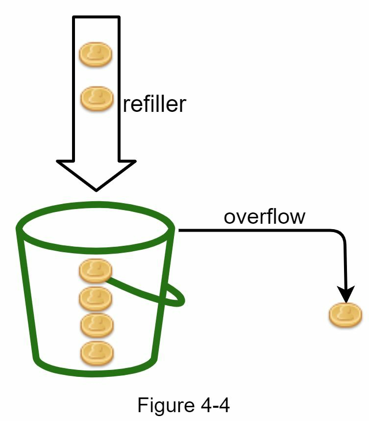

- Mỗi yêu cầu tiêu thụ một token. Khi yêu cầu đến, kiểm tra thùng có đủ token không. Hình 4-5 giải thích cách hoạt động:
  - Nếu đủ, lấy một token ra cho mỗi yêu cầu và cho yêu cầu đi qua.
  - Nếu không đủ, loại bỏ yêu cầu.

<!-- trang-pdf:056 -->

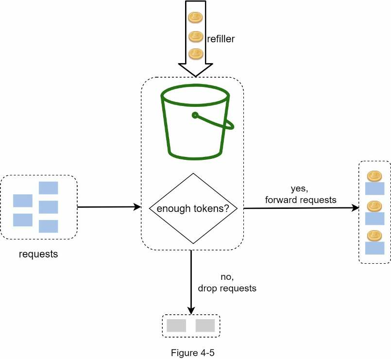

Hình 4-6 minh họa việc tiêu thụ token, nạp lại và logic giới hạn tốc độ. Trong ví dụ này, sức chứa là 4 token và tốc độ nạp lại là 4 token mỗi phút.

<!-- trang-pdf:057 -->

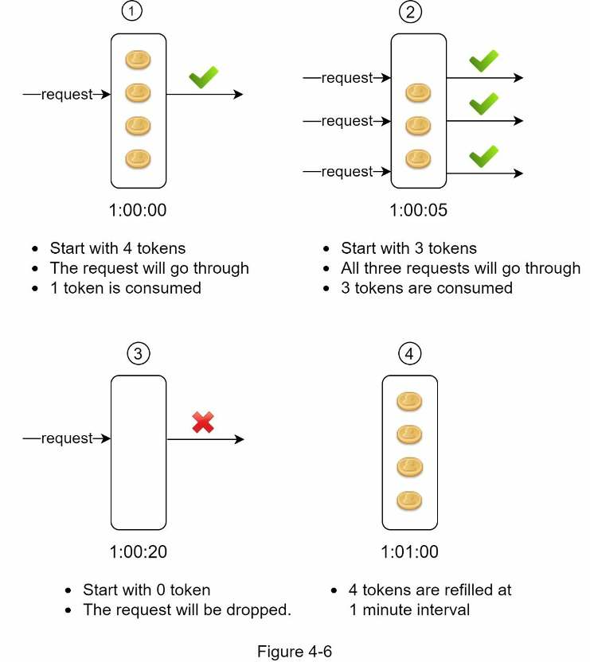

Thuật toán token bucket có hai tham số:

- **Kích thước thùng:** số token tối đa được phép có trong thùng.
- **Tốc độ nạp lại:** số token thêm vào thùng mỗi giây.

Cần bao nhiêu thùng? Con số này thay đổi tùy quy tắc giới hạn. Một vài ví dụ:

- Thường cần các thùng khác nhau cho các endpoint API khác nhau. Chẳng hạn, nếu mỗi người dùng được đăng 1 bài mỗi giây, thêm 150 bạn mỗi ngày và thích 5 bài mỗi giây, thì cần 3 thùng cho mỗi người dùng.
- Nếu giới hạn dựa trên địa chỉ IP, mỗi địa chỉ IP cần một thùng.
- Nếu hệ thống cho phép tối đa 10.000 yêu cầu mỗi giây, dùng một thùng toàn cục chung cho mọi yêu cầu là hợp lý.

**Ưu điểm:**

- Dễ triển khai.
- Sử dụng bộ nhớ hiệu quả.
- Cho phép lưu lượng bùng lên trong thời gian ngắn. Miễn còn token, yêu cầu vẫn có thể đi qua.

**Nhược điểm:**

- Hai tham số của thuật toán là kích thước thùng và tốc độ nạp token. Tuy nhiên, <!-- trang-pdf:058 --> tinh chỉnh chúng cho phù hợp có thể khó khăn.

### Thuật toán leaking bucket

Leaking bucket tương tự token bucket, nhưng xử lý yêu cầu với tốc độ cố định. Nó thường được triển khai bằng hàng đợi vào trước ra trước (FIFO). Thuật toán hoạt động như sau:

- Khi yêu cầu đến, hệ thống kiểm tra hàng đợi đã đầy chưa. Nếu chưa, thêm yêu cầu vào hàng đợi.
- Nếu đã đầy, loại bỏ yêu cầu.
- Lấy các yêu cầu khỏi hàng đợi và xử lý theo khoảng thời gian đều đặn.

Hình 4-7 giải thích cách thuật toán hoạt động.

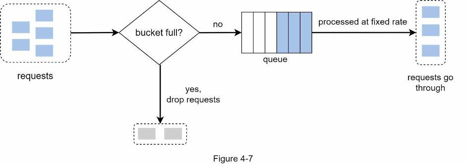

Leaking bucket có hai tham số:

- **Kích thước thùng:** bằng kích thước hàng đợi. Hàng đợi giữ các yêu cầu sẽ được xử lý với tốc độ cố định.
- **Tốc độ đầu ra:** xác định số yêu cầu có thể được xử lý theo tốc độ cố định, thường tính theo giây.

Công ty thương mại điện tử Shopify sử dụng leaky bucket để giới hạn tốc độ [7].

**Ưu điểm:**

- Sử dụng bộ nhớ hiệu quả nhờ kích thước hàng đợi có giới hạn.
- Yêu cầu được xử lý với tốc độ cố định, phù hợp các trường hợp cần tốc độ đầu ra ổn định.

**Nhược điểm:**

- Một đợt lưu lượng bùng lên có thể lấp đầy hàng đợi bằng các yêu cầu cũ. Nếu chúng không được xử lý kịp, yêu cầu mới đến sẽ bị giới hạn.
- Thuật toán có hai tham số và có thể không dễ tinh chỉnh cho phù hợp.

### Thuật toán bộ đếm cửa sổ cố định

Thuật toán bộ đếm cửa sổ cố định hoạt động như sau:

- Chia trục thời gian thành những cửa sổ có độ dài cố định và gán một bộ đếm cho mỗi cửa sổ.
- Mỗi yêu cầu tăng bộ đếm lên một.
- Khi bộ đếm đạt ngưỡng định trước, yêu cầu mới bị loại bỏ cho đến khi cửa sổ tiếp theo bắt đầu.

<!-- trang-pdf:059 -->

Hãy xem ví dụ cụ thể. Trong Hình 4-8, đơn vị thời gian là 1 giây và hệ thống cho phép tối đa 3 yêu cầu mỗi giây. Trong mỗi cửa sổ một giây, nếu nhận hơn 3 yêu cầu, các yêu cầu vượt mức bị loại bỏ như hình minh họa.

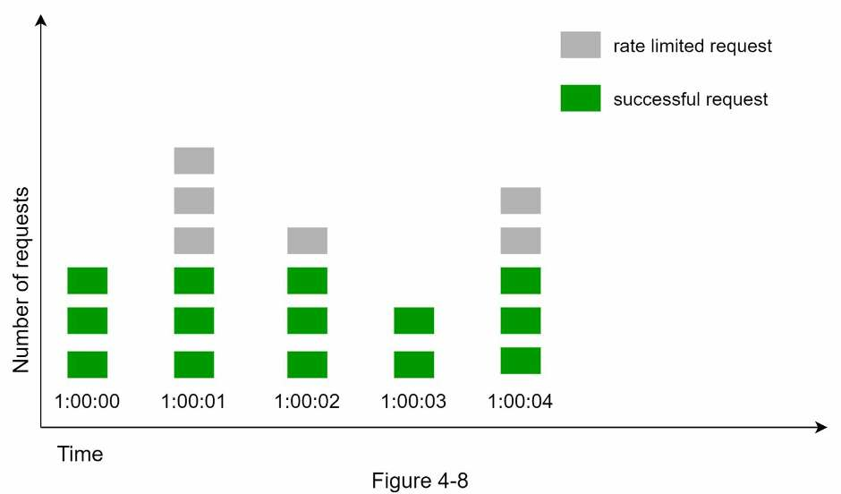

Vấn đề lớn của thuật toán là đợt lưu lượng tăng mạnh ở ranh giới các cửa sổ có thể cho phép số yêu cầu vượt hạn mức đi qua. Xét trường hợp sau:

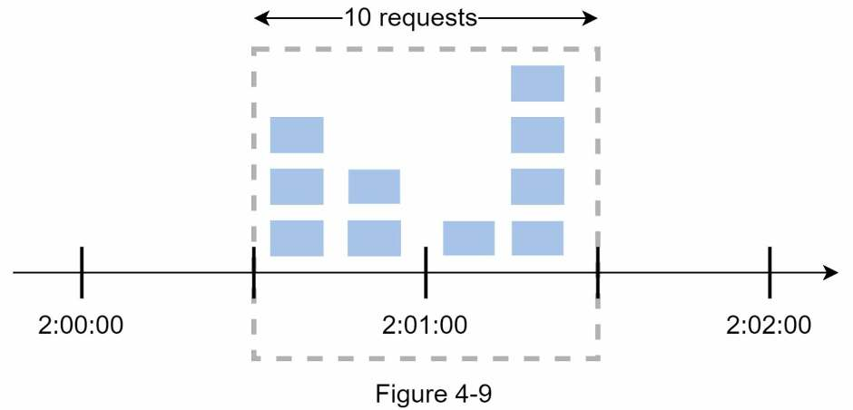

Trong Hình 4-9, hệ thống cho phép tối đa 5 yêu cầu mỗi phút; hạn mức được đặt lại ở mốc đầu phút dễ đọc với con người. Có 5 yêu cầu trong khoảng 2:00:00–2:01:00 và thêm 5 yêu cầu trong khoảng 2:01:00–2:02:00. Trong cửa sổ một phút từ 2:00:30 đến 2:01:30, có 10 yêu cầu đi qua, gấp đôi số được phép.

**Ưu điểm:**

- Sử dụng bộ nhớ hiệu quả.

<!-- trang-pdf:060 -->

- Dễ hiểu.
- Đặt lại hạn mức vào cuối mỗi đơn vị cửa sổ phù hợp với một số trường hợp sử dụng.

**Nhược điểm:**

- Lưu lượng tăng đột biến ở ranh giới cửa sổ có thể khiến số yêu cầu đi qua vượt hạn mức.

### Thuật toán nhật ký cửa sổ trượt

Như đã bàn, bộ đếm cửa sổ cố định có vấn đề lớn: cho phép nhiều yêu cầu hơn giới hạn đi qua tại ranh giới cửa sổ. Thuật toán nhật ký cửa sổ trượt khắc phục vấn đề này. Cách hoạt động:

- Theo dõi dấu thời gian (timestamp) của yêu cầu. Dữ liệu timestamp thường được lưu trong bộ nhớ đệm, chẳng hạn sorted set của Redis [8].
- Khi yêu cầu mới đến, xóa mọi timestamp đã cũ, tức timestamp sớm hơn thời điểm bắt đầu của cửa sổ hiện tại.
- Thêm timestamp của yêu cầu mới vào nhật ký.
- Nếu kích thước nhật ký bằng hoặc nhỏ hơn số lượng được phép, chấp nhận yêu cầu. Nếu không, từ chối.

Ví dụ trong Hình 4-10 giải thích thuật toán.

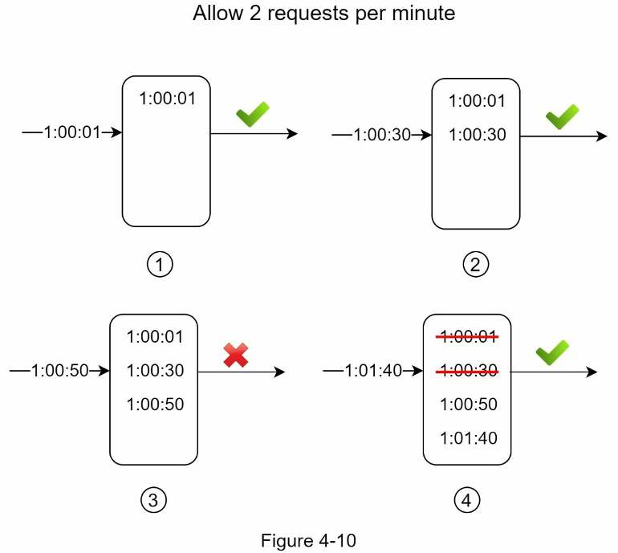

Trong ví dụ, bộ giới hạn cho phép 2 yêu cầu mỗi phút. Thông thường, nhật ký lưu timestamp Linux. Tuy nhiên, ví dụ dùng thời gian ở dạng dễ đọc để thuận tiện theo dõi.

- Nhật ký đang trống khi yêu cầu mới đến lúc 1:00:01. Do đó, yêu cầu được chấp nhận.

<!-- trang-pdf:061 -->

- Yêu cầu mới đến lúc 1:00:30; timestamp 1:00:30 được thêm vào nhật ký. Sau khi thêm, kích thước là 2, không lớn hơn giới hạn, nên yêu cầu được chấp nhận.
- Yêu cầu mới đến lúc 1:00:50; timestamp được thêm vào nhật ký. Kích thước lúc này là 3, lớn hơn giới hạn 2. Vì vậy, yêu cầu bị từ chối, dù timestamp vẫn còn trong nhật ký.
- Yêu cầu mới đến lúc 1:01:40. Các yêu cầu trong khoảng `[1:00:40, 1:01:40)` thuộc khung thời gian gần nhất, còn những yêu cầu gửi trước 1:00:40 đã cũ. Hai timestamp cũ 1:00:01 và 1:00:30 bị xóa. Sau thao tác xóa, kích thước nhật ký trở thành 2; do đó, yêu cầu được chấp nhận.

**Ưu điểm:**

- Giới hạn tốc độ rất chính xác. Trong bất kỳ cửa sổ trượt nào, số yêu cầu cũng không vượt giới hạn tốc độ.

**Nhược điểm:**

- Tốn nhiều bộ nhớ vì ngay cả khi yêu cầu bị từ chối, timestamp của nó vẫn có thể được lưu trong bộ nhớ.

### Thuật toán bộ đếm cửa sổ trượt

Bộ đếm cửa sổ trượt là cách tiếp cận lai giữa bộ đếm cửa sổ cố định và nhật ký cửa sổ trượt. Có hai cách triển khai. Phần này giải thích một cách và đưa tài liệu tham khảo cho cách còn lại ở cuối phần. Hình 4-11 minh họa cách thuật toán hoạt động.

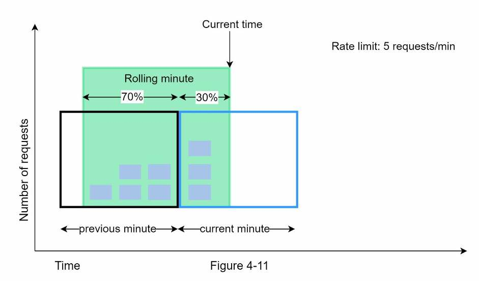

Giả sử bộ giới hạn cho phép tối đa 7 yêu cầu mỗi phút; phút trước có 5 yêu cầu, phút hiện tại có 3. Với một yêu cầu mới đến ở thời điểm đã đi qua 30% phút hiện tại, số yêu cầu trong cửa sổ trượt được tính như sau:

- Số yêu cầu trong cửa sổ hiện tại + số yêu cầu trong cửa sổ trước × tỷ lệ chồng lấn giữa cửa sổ trượt và cửa sổ trước.

<!-- trang-pdf:062 -->

- Áp dụng công thức, ta được `3 + 5 × 0,7% = 6,5` yêu cầu. Tùy trường hợp sử dụng, có thể làm tròn lên hoặc xuống. Trong ví dụ, số này được làm tròn xuống 6.

**Ghi chú bản dịch:** Bản gốc ghi `0.7%` trong phép tính trên. Với 30% phút hiện tại đã trôi qua, phần chồng lấn là 70%, tức hệ số `0,7`; phép tính ra `6,5` là `3 + 5 × 0,7`. Bản dịch giữ nguyên biểu thức gốc và chỉ rõ lỗi ký hiệu này để người đọc đối chiếu.

Vì bộ giới hạn cho phép tối đa 7 yêu cầu mỗi phút, yêu cầu hiện tại được đi qua. Tuy nhiên, giới hạn sẽ đạt tới sau khi nhận thêm một yêu cầu nữa.

Do giới hạn dung lượng, chúng ta không bàn cách triển khai còn lại ở đây. Bạn đọc quan tâm có thể xem [9]. Thuật toán này không hoàn hảo; nó có cả ưu lẫn nhược điểm.

**Ưu điểm:**

- Làm mượt các đợt tăng đột biến vì tốc độ được tính dựa trên tốc độ trung bình của cửa sổ trước.
- Sử dụng bộ nhớ hiệu quả.

**Nhược điểm:**

- Chỉ phù hợp khi cửa sổ nhìn lại không cần quá nghiêm ngặt. Đây là ước lượng tốc độ thực tế, vì giả định yêu cầu ở cửa sổ trước phân bố đều. Tuy nhiên, vấn đề có thể không nghiêm trọng như thoạt nhìn. Theo thử nghiệm của Cloudflare [10], trong 400 triệu yêu cầu, chỉ 0,003% bị cho qua hoặc giới hạn sai.

### Kiến trúc tổng quan

Ý tưởng cơ bản của các thuật toán giới hạn tốc độ khá đơn giản. Ở mức tổng quan, cần một bộ đếm theo dõi số yêu cầu từ cùng người dùng, địa chỉ IP, v.v. Nếu bộ đếm lớn hơn giới hạn, không cho phép yêu cầu.

Nên lưu bộ đếm ở đâu? Cơ sở dữ liệu không phải ý tưởng tốt vì truy cập đĩa chậm. Chúng ta chọn bộ nhớ đệm trong RAM vì nhanh và hỗ trợ chính sách hết hạn theo thời gian. Ví dụ, Redis [11] là lựa chọn phổ biến để triển khai giới hạn tốc độ. Đây là kho dữ liệu trong bộ nhớ, cung cấp hai lệnh `INCR` và `EXPIRE`:

- `INCR`: tăng bộ đếm được lưu lên 1.
- `EXPIRE`: đặt thời gian hết hạn cho bộ đếm. Khi hết thời gian, bộ đếm tự động bị xóa.

Hình 4-12 thể hiện kiến trúc tổng quan; hoạt động như sau:

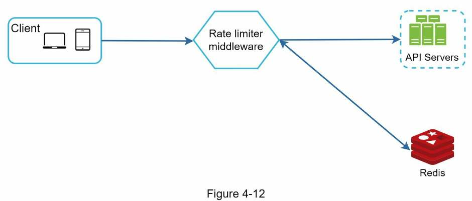

- Máy khách gửi yêu cầu đến middleware giới hạn tốc độ.
- Middleware lấy bộ đếm từ thùng tương ứng trong Redis và <!-- trang-pdf:063 --> kiểm tra xem đã đạt giới hạn chưa.
  - Nếu đã đạt, từ chối yêu cầu.
  - Nếu chưa đạt, gửi yêu cầu đến máy chủ API. Đồng thời, hệ thống tăng bộ đếm và lưu lại vào Redis.

<!-- trang-pdf:064 -->

## Bước 3 — Đi sâu vào thiết kế

Thiết kế tổng quan trong Hình 4-12 chưa trả lời các câu hỏi:

- Các quy tắc giới hạn tốc độ được tạo ra như thế nào? Chúng được lưu ở đâu?
- Xử lý các yêu cầu bị giới hạn ra sao?

Trong phần này, trước hết chúng ta trả lời câu hỏi về quy tắc giới hạn, sau đó xem các chiến lược xử lý yêu cầu bị giới hạn. Cuối cùng, sẽ bàn về môi trường phân tán, thiết kế chi tiết, tối ưu hiệu năng và giám sát.

### Quy tắc giới hạn tốc độ

Lyft đã mở mã nguồn thành phần giới hạn tốc độ của mình [12]. Hãy xem bên trong thành phần này và một vài ví dụ quy tắc:

```yaml
domain: messaging
descriptors:
 - key: message_type
   Value: marketing
   rate_limit:
    unit: day
    requests_per_unit: 5
```

Trong ví dụ trên, hệ thống được cấu hình cho phép tối đa 5 thông điệp tiếp thị mỗi ngày. Một ví dụ khác:

```yaml
domain: auth
descriptors:
 - key: auth_type
   Value: login
   rate_limit:
    unit: minute
    requests_per_unit: 5
```

Quy tắc này cho thấy máy khách không được đăng nhập quá 5 lần trong một phút. Quy tắc thường được viết trong các file cấu hình và lưu trên đĩa.

### Vượt giới hạn tốc độ

Khi yêu cầu bị giới hạn, API trả mã phản hồi HTTP 429 (quá nhiều yêu cầu) cho máy khách. Tùy trường hợp sử dụng, có thể đưa các yêu cầu đó vào hàng đợi để xử lý sau. Ví dụ, nếu một số đơn hàng bị giới hạn do hệ thống quá tải, chúng ta có thể giữ lại để xử lý về sau.

### Các header của bộ giới hạn tốc độ

Làm sao máy khách biết mình đang bị giới hạn? Làm sao biết số yêu cầu còn được phép trước khi bị giới hạn? Câu trả lời nằm trong các header phản hồi HTTP. Bộ giới hạn trả các header sau cho máy khách:

- `X-Ratelimit-Remaining`: số yêu cầu còn được phép trong cửa sổ.
- `X-Ratelimit-Limit`: số lời gọi máy khách được thực hiện trong mỗi cửa sổ thời gian.
- `X-Ratelimit-Retry-After`: số giây cần chờ trước khi có thể gửi yêu cầu tiếp mà không bị giới hạn.

Khi người dùng gửi quá nhiều yêu cầu, lỗi `429 too many requests` và header <!-- trang-pdf:065 --> `X-Ratelimit-Retry-After` được trả về máy khách.

### Thiết kế chi tiết

Hình 4-13 trình bày thiết kế chi tiết của hệ thống.

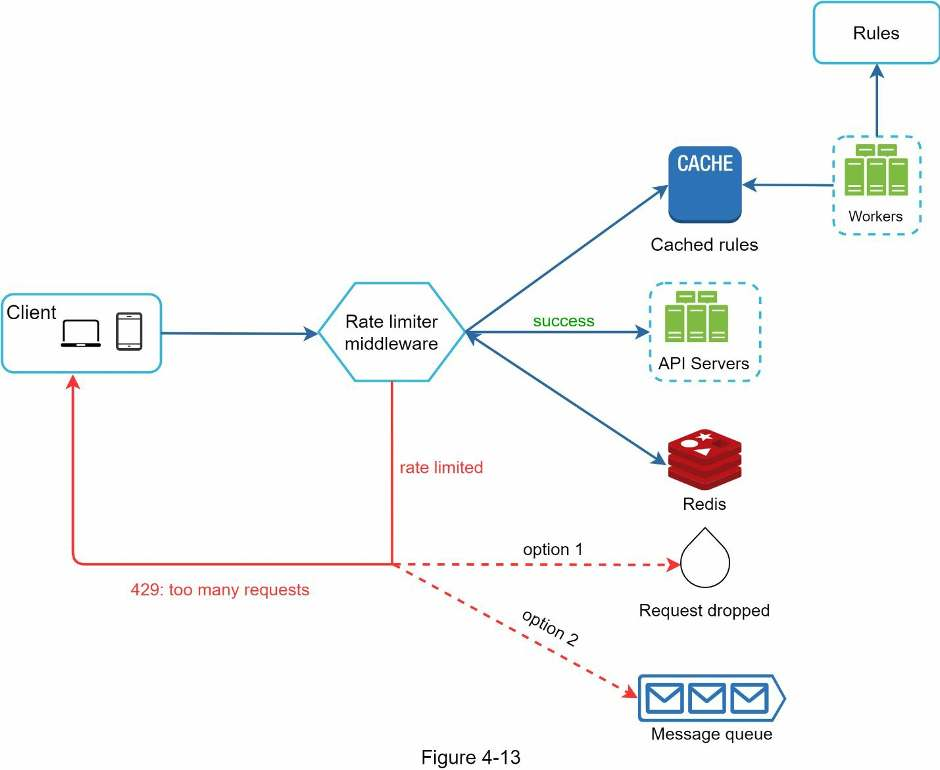

- Quy tắc được lưu trên đĩa. Các worker thường xuyên lấy quy tắc từ đĩa và lưu vào bộ nhớ đệm.
- Khi máy khách gửi yêu cầu đến máy chủ, yêu cầu trước tiên được chuyển đến middleware giới hạn tốc độ.
- Middleware tải quy tắc từ bộ nhớ đệm, lấy bộ đếm và timestamp của yêu cầu cuối cùng từ Redis. Dựa trên dữ liệu nhận được, bộ giới hạn quyết định:
  - Nếu yêu cầu không bị giới hạn, chuyển tiếp đến máy chủ API.
  - Nếu bị giới hạn, trả lỗi `429 too many requests` cho máy khách. Đồng thời, yêu cầu bị loại bỏ hoặc chuyển vào hàng đợi.

<!-- trang-pdf:066 -->

### Bộ giới hạn tốc độ trong môi trường phân tán

Xây dựng bộ giới hạn hoạt động trên một máy chủ không khó. Tuy nhiên, mở rộng để hỗ trợ nhiều máy chủ và các luồng đồng thời là câu chuyện khác. Có hai thách thức:

- Điều kiện tranh chấp (race condition).
- Vấn đề đồng bộ hóa.

#### Điều kiện tranh chấp

Như đã bàn, ở mức tổng quan bộ giới hạn hoạt động như sau:

- Đọc giá trị bộ đếm từ Redis.
- Kiểm tra xem `(counter + 1)` có vượt ngưỡng không.
- Nếu không, tăng giá trị bộ đếm trong Redis thêm 1.

Điều kiện tranh chấp có thể xuất hiện trong môi trường có mức đồng thời cao như Hình 4-14.

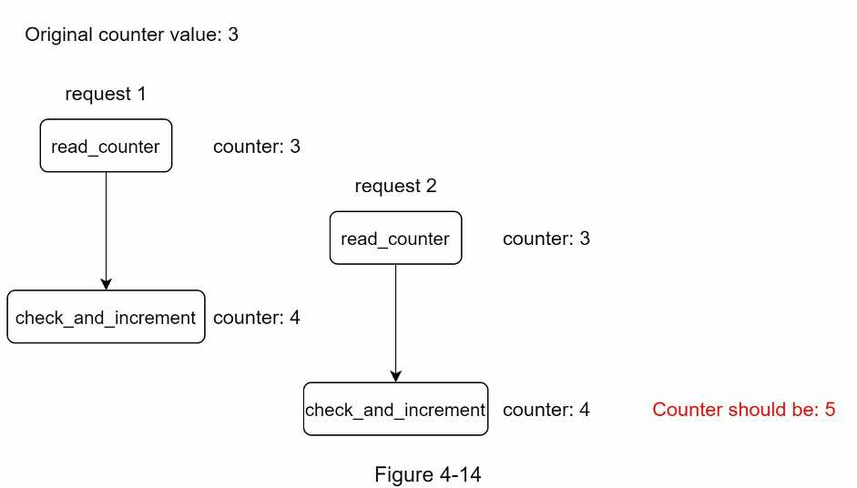

Giả sử bộ đếm trong Redis đang là 3. Nếu hai yêu cầu cùng đọc giá trị trước khi một trong hai ghi lại, mỗi yêu cầu sẽ tăng bộ đếm thêm một rồi ghi lại mà không kiểm tra luồng kia. Cả hai yêu cầu, tức hai luồng, đều tin mình có giá trị đúng là 4. Nhưng giá trị đúng phải là 5.

Khóa là giải pháp dễ thấy nhất cho điều kiện tranh chấp. Tuy nhiên, khóa làm hệ thống chậm đi đáng kể. Hai chiến lược thường dùng để giải quyết là script Lua [13] và cấu trúc dữ liệu sorted set trong Redis [8]. Bạn đọc quan tâm có thể xem các tài liệu tương ứng [8] [13].

#### Vấn đề đồng bộ hóa

Đồng bộ hóa là yếu tố quan trọng khác cần cân nhắc trong môi trường phân tán. Để hỗ trợ hàng triệu người dùng, một máy chủ giới hạn tốc độ có thể không đủ xử lý lưu lượng. Khi dùng nhiều máy chủ, cần đồng bộ hóa. Ví dụ, phía trái Hình 4-15, máy khách 1 gửi yêu cầu đến bộ giới hạn 1, còn máy khách 2 gửi yêu cầu đến <!-- trang-pdf:067 --> bộ giới hạn 2. Vì tầng web không lưu trạng thái, máy khách có thể gửi yêu cầu đến bộ giới hạn khác như phía phải Hình 4-15. Nếu không đồng bộ, bộ giới hạn 1 không chứa dữ liệu nào về máy khách 2, nên không thể hoạt động đúng.

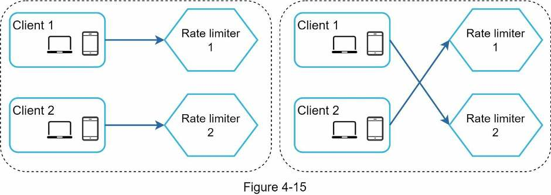

Một giải pháp là dùng sticky session để máy khách luôn gửi lưu lượng đến cùng một bộ giới hạn. Giải pháp này không được khuyến nghị vì vừa thiếu khả năng mở rộng vừa kém linh hoạt. Cách tốt hơn là dùng kho dữ liệu tập trung như Redis. Thiết kế thể hiện trong Hình 4-16.

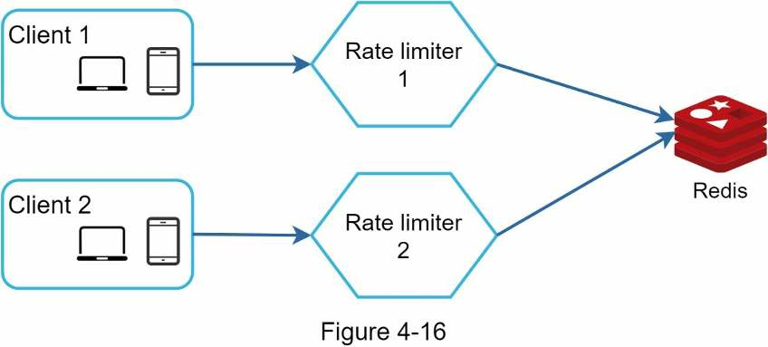

### Tối ưu hiệu năng

Tối ưu hiệu năng là chủ đề phổ biến trong phỏng vấn thiết kế hệ thống. Chúng ta xem hai hướng cải thiện.

Thứ nhất, cấu hình nhiều trung tâm dữ liệu rất quan trọng với bộ giới hạn, vì người dùng ở xa trung tâm dữ liệu chịu độ trễ cao. Phần lớn nhà cung cấp đám mây xây dựng nhiều điểm máy chủ biên (edge server) trên thế giới. Ví dụ, tính đến ngày 20/05/2020, Cloudflare có 194 máy chủ biên phân bố theo địa lý [14]. Lưu lượng được tự động định tuyến đến máy chủ biên gần nhất để giảm độ trễ.

<!-- trang-pdf:068 -->

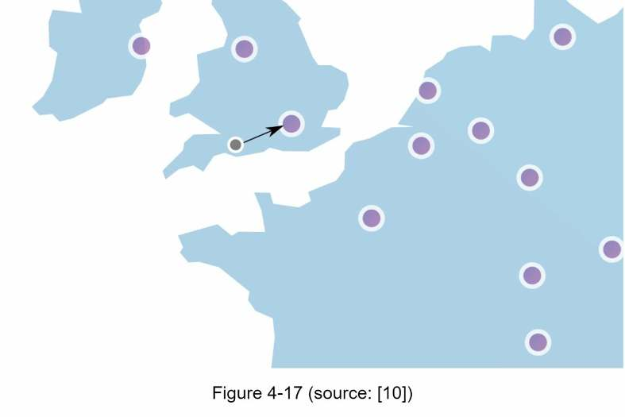

Thứ hai, đồng bộ dữ liệu theo mô hình nhất quán sau cùng (eventual consistency). Nếu chưa rõ mô hình này, hãy xem mục “Tính nhất quán” trong “Chương 6: Thiết kế kho khóa–giá trị”.

### Giám sát

Sau khi đưa bộ giới hạn vào sử dụng, cần thu thập dữ liệu phân tích để kiểm tra hiệu quả. Chủ yếu, cần bảo đảm:

- Thuật toán giới hạn tốc độ có hiệu quả.
- Các quy tắc giới hạn tốc độ có hiệu quả.

Ví dụ, nếu quy tắc quá nghiêm, nhiều yêu cầu hợp lệ bị loại bỏ. Khi đó, cần nới quy tắc một chút. Trong ví dụ khác, bộ giới hạn trở nên kém hiệu quả khi lưu lượng tăng đột ngột, chẳng hạn lúc bán hàng chớp nhoáng (flash sale). Khi đó, có thể thay thuật toán để hỗ trợ lưu lượng bùng lên; token bucket là lựa chọn phù hợp.

<!-- trang-pdf:069 -->

## Bước 4 — Tổng kết

Trong chương này, chúng ta đã thảo luận các thuật toán giới hạn tốc độ cùng ưu và nhược điểm:

- Token bucket.
- Leaking bucket.
- Cửa sổ cố định.
- Nhật ký cửa sổ trượt.
- Bộ đếm cửa sổ trượt.

Sau đó, chúng ta bàn về kiến trúc hệ thống, bộ giới hạn trong môi trường phân tán, tối ưu hiệu năng và giám sát. Tương tự các câu hỏi phỏng vấn thiết kế hệ thống khác, nếu còn thời gian, có thể đề cập thêm:

- **Giới hạn tốc độ cứng và mềm:**
  - Cứng: số yêu cầu không được vượt ngưỡng.
  - Mềm: yêu cầu có thể vượt ngưỡng trong thời gian ngắn.
- **Giới hạn ở những tầng khác nhau:** chương này chỉ bàn ở tầng ứng dụng, tức HTTP, tầng 7. Có thể giới hạn ở tầng khác. Chẳng hạn, dùng Iptables [15] để giới hạn theo địa chỉ IP, tức IP, tầng 3.

  Lưu ý: mô hình liên kết hệ thống mở (Open Systems Interconnection — OSI) có 7 tầng [16]: tầng 1 — vật lý; tầng 2 — liên kết dữ liệu; tầng 3 — mạng; tầng 4 — giao vận; tầng 5 — phiên; tầng 6 — trình diễn; tầng 7 — ứng dụng.

- **Tránh bị giới hạn:** thiết kế máy khách theo những thực hành tốt:
  - Dùng bộ nhớ đệm phía máy khách để tránh gọi API thường xuyên.
  - Hiểu giới hạn và không gửi quá nhiều yêu cầu trong thời gian ngắn.
  - Có mã bắt ngoại lệ hoặc lỗi để máy khách phục hồi một cách phù hợp.
  - Thêm thời gian chờ lùi (backoff) đủ dài vào logic thử lại.

Chúc mừng bạn đã đi đến đây! Hãy tự thưởng cho mình một lời động viên. Bạn đã làm tốt!

<!-- trang-pdf:070 -->

## Tài liệu tham khảo

[1] Rate-limiting strategies and techniques: https://cloud.google.com/solutions/rate-limiting-strategies-techniques

[2] Twitter rate limits: https://developer.twitter.com/en/docs/basics/rate-limits

[3] Google docs usage limits: https://developers.google.com/docs/api/limits

[4] IBM microservices: https://www.ibm.com/cloud/learn/microservices

[5] Throttle API requests for better throughput: https://docs.aws.amazon.com/apigateway/latest/developerguide/api-gateway-request-throttling.html

[6] Stripe rate limiters: https://stripe.com/blog/rate-limiters

[7] Shopify REST Admin API rate limits: https://help.shopify.com/en/api/reference/rest-admin-api-rate-limits

[8] Better Rate Limiting With Redis Sorted Sets: https://engineering.classdojo.com/blog/2015/02/06/rolling-rate-limiter/

[9] System Design — Rate limiter and Data modelling: https://medium.com/@saisandeepmopuri/system-design-rate-limiter-and-data-modelling-9304b0d18250

[10] How we built rate limiting capable of scaling to millions of domains: https://blog.cloudflare.com/counting-things-a-lot-of-different-things/

[11] Redis website: https://redis.io/

[12] Lyft rate limiting: https://github.com/lyft/ratelimit

[13] Scaling your API with rate limiters: https://gist.github.com/ptarjan/e38f45f2dfe601419ca3af937fff574d#request-rate-limiter

[14] What is edge computing: https://www.cloudflare.com/learning/serverless/glossary/what-is-edge-computing/

[15] Rate Limit Requests with Iptables: https://blog.programster.org/rate-limit-requests-with-iptables

[16] OSI model: https://en.wikipedia.org/wiki/OSI_model#Layer_architecture

---

[← Chương 3](chuong-03-khung-phuong-phap-cho-phong-van-thiet-ke-he-thong.md) · [Mục lục](../README.md) · [Chương 5 →](chuong-05-thiet-ke-co-che-bam-nhat-quan.md)
