# Chương 5: Thiết kế cơ chế băm nhất quán

[English](../original/chuong-05-thiet-ke-co-che-bam-nhat-quan.md) · [Mục lục](../README.md)

Tên chương gốc: **Design Consistent Hashing**. Trang PDF: **071–086**.

<!-- trang-pdf:071 -->

Để mở rộng theo chiều ngang, điều quan trọng là phân phối yêu cầu/dữ liệu hiệu quả và đồng đều giữa các máy chủ. Băm nhất quán (consistent hashing) là kỹ thuật thường dùng để đạt mục tiêu này. Nhưng trước tiên, hãy tìm hiểu kỹ bài toán.

<!-- trang-pdf:072 -->

## Bài toán băm lại

Nếu có `n` máy chủ bộ nhớ đệm, một cách cân bằng tải phổ biến là dùng phương pháp băm sau:

```text
serverIndex = hash(key) % N
```

Trong đó, `N` là số lượng máy chủ trong nhóm.

Hãy dùng một ví dụ để minh họa. Như Bảng 5-1 thể hiện, chúng ta có 4 máy chủ và 8 khóa dạng chuỗi cùng các giá trị băm tương ứng.

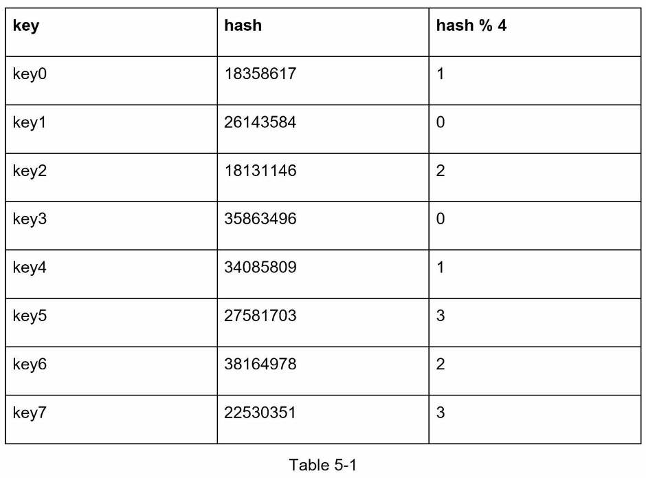

Để xác định máy chủ lưu một khóa, thực hiện phép chia lấy dư `f(key) % 4`. Ví dụ, `hash(key0) % 4 = 1` nghĩa là máy khách phải liên hệ máy chủ 1 để lấy dữ liệu đã lưu đệm. Hình 5-1 thể hiện cách phân phối khóa dựa trên Bảng 5-1.

<!-- trang-pdf:073 -->

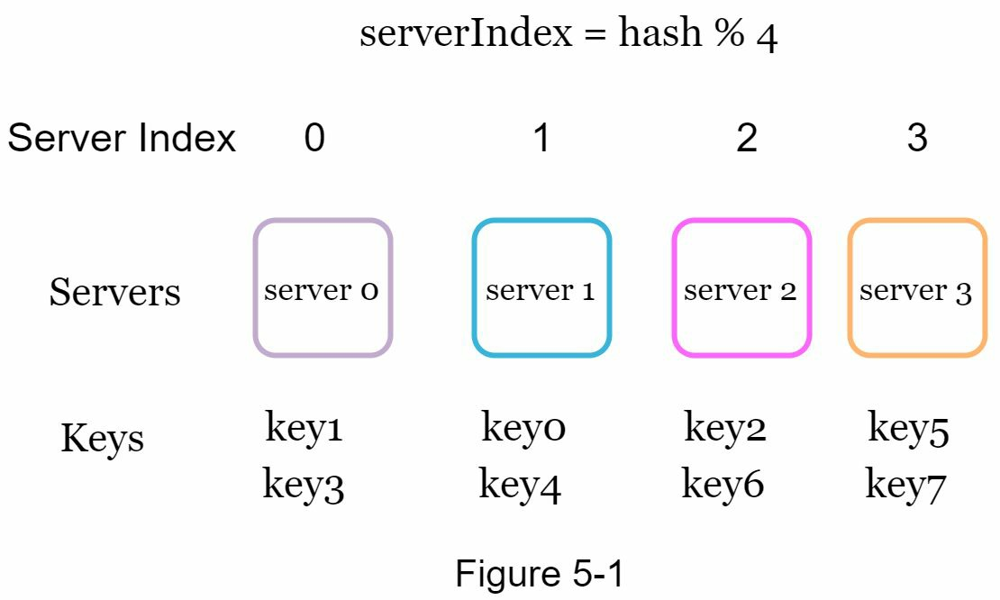

Cách này hoạt động tốt khi số máy chủ cố định và dữ liệu phân bố đều. Tuy nhiên, vấn đề xuất hiện khi thêm máy chủ mới hoặc gỡ máy chủ hiện có. Ví dụ, nếu máy chủ 1 ngừng hoạt động, nhóm còn 3 máy chủ. Dùng cùng hàm băm, một khóa vẫn cho cùng giá trị băm. Nhưng phép chia lấy dư cho chỉ số máy chủ khác, vì số máy chủ đã giảm 1. Áp dụng `hash % 3` cho kết quả trong Bảng 5-2:

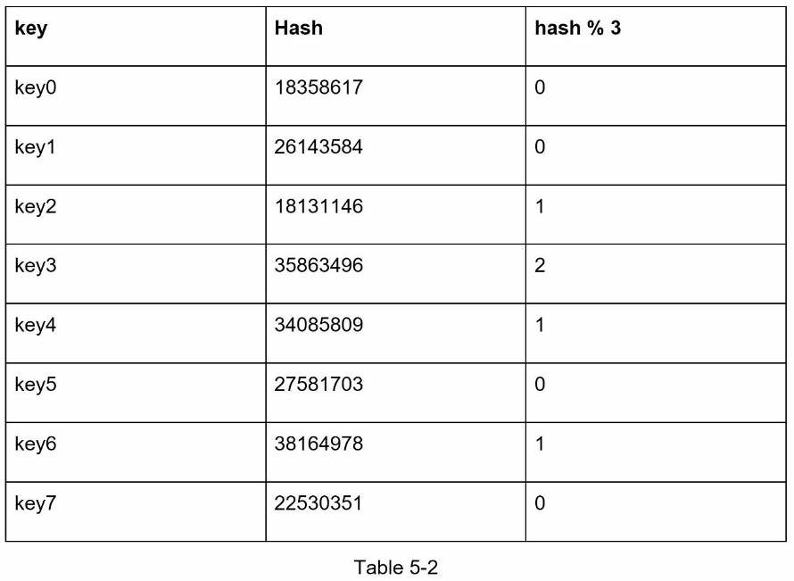

Hình 5-2 thể hiện cách phân phối khóa mới dựa trên Bảng 5-2.

<!-- trang-pdf:074 -->

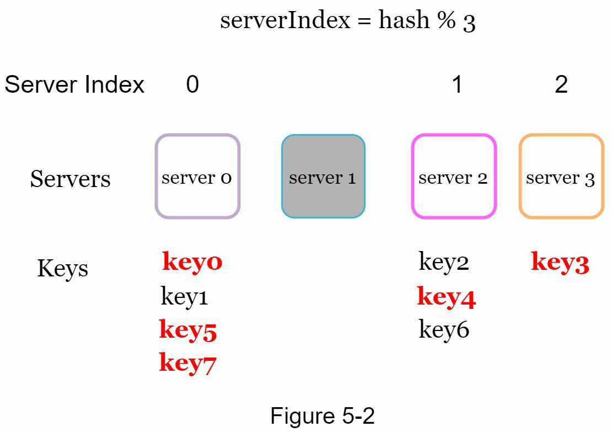

Như Hình 5-2 cho thấy, phần lớn khóa được phân phối lại, chứ không chỉ các khóa ban đầu nằm trên máy chủ đã ngừng hoạt động, tức máy chủ 1. Điều này nghĩa là khi máy chủ 1 ngừng hoạt động, phần lớn máy khách bộ nhớ đệm sẽ kết nối nhầm máy chủ để lấy dữ liệu, gây một cơn bão cache miss — không tìm thấy dữ liệu trong bộ nhớ đệm. Băm nhất quán là kỹ thuật hiệu quả để giảm nhẹ vấn đề này.

<!-- trang-pdf:075 -->

## Băm nhất quán

Theo Wikipedia: “Băm nhất quán là một dạng băm đặc biệt: khi thay đổi kích thước bảng băm có sử dụng băm nhất quán, trung bình chỉ cần ánh xạ lại `k/n` khóa, trong đó `k` là số khóa và `n` là số ô. Ngược lại, trong phần lớn bảng băm truyền thống, thay đổi số ô của mảng khiến gần như toàn bộ khóa phải được ánh xạ lại [1].”

### Không gian băm và vòng băm

Đã hiểu định nghĩa băm nhất quán, hãy tìm cách nó hoạt động. Giả sử dùng SHA-1 làm hàm băm `f`, với miền đầu ra là `x0, x1, x2, x3, …, xn`. Trong mật mã học, không gian băm SHA-1 trải từ 0 đến `2^160 − 1`. Nghĩa là `x0` tương ứng với 0, `xn` tương ứng với `2^160 − 1`, và các giá trị băm còn lại nằm giữa hai mốc đó. Hình 5-3 thể hiện không gian băm.

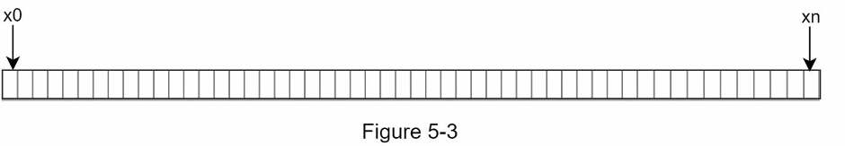

Nối hai đầu lại, chúng ta có vòng băm (hash ring) như Hình 5-4:

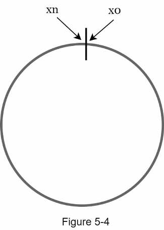

### Băm các máy chủ

Dùng cùng hàm băm `f`, chúng ta ánh xạ máy chủ lên vòng dựa trên IP hoặc tên máy chủ. Hình 5-5 thể hiện 4 máy chủ được ánh xạ lên vòng băm.

<!-- trang-pdf:076 -->

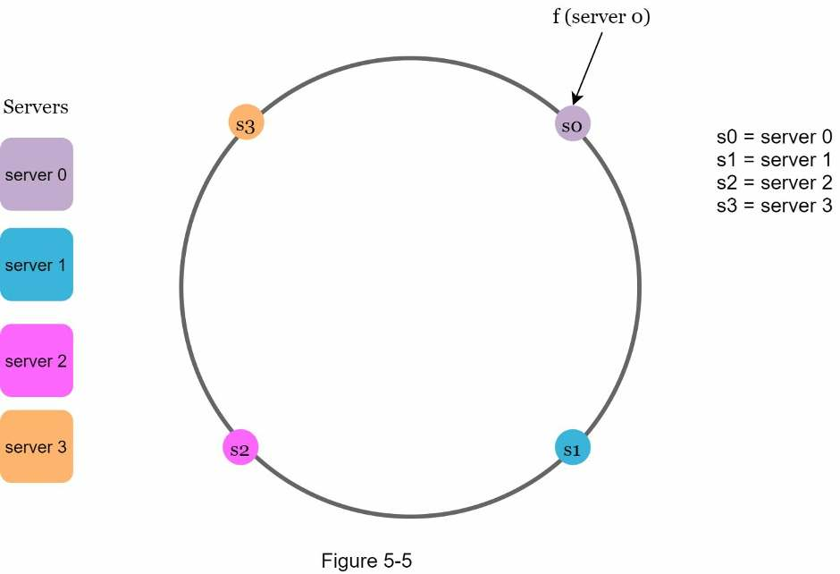

### Băm các khóa

Điểm cần lưu ý là hàm băm ở đây khác hàm trong phần “Bài toán băm lại”, và không có phép chia lấy dư. Như Hình 5-6 thể hiện, 4 khóa bộ nhớ đệm (`key0`, `key1`, `key2`, `key3`) được băm lên vòng.

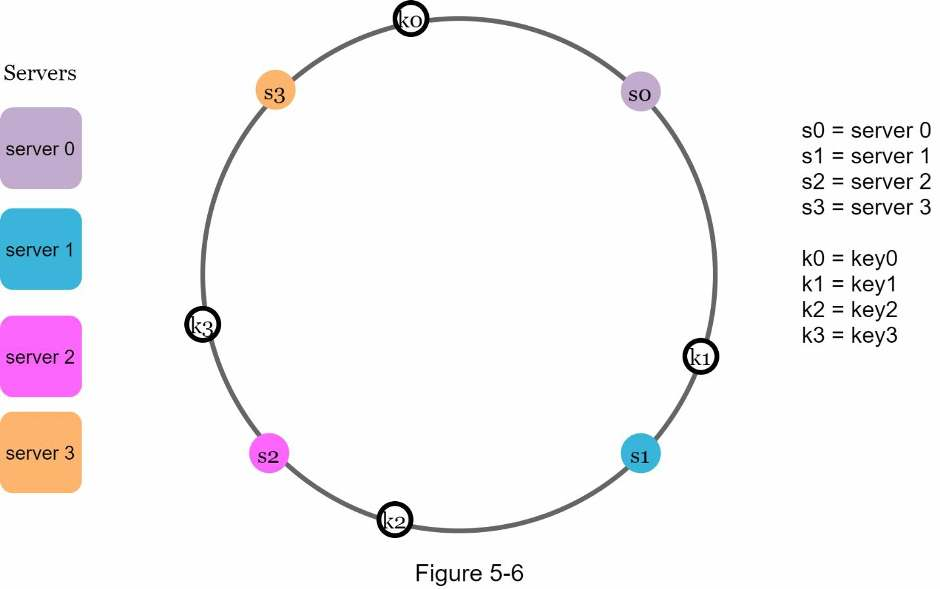

### Tra cứu máy chủ

<!-- trang-pdf:077 -->

Để xác định máy chủ lưu một khóa, đi theo chiều kim đồng hồ từ vị trí khóa trên vòng cho đến khi gặp một máy chủ. Hình 5-7 giải thích quá trình này. Theo chiều kim đồng hồ, `key0` được lưu trên máy chủ 0; `key1` trên máy chủ 1; `key2` trên máy chủ 2; và `key3` trên máy chủ 3.

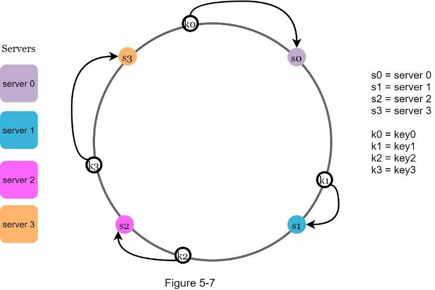

### Thêm máy chủ

Theo logic trên, khi thêm máy chủ mới, chỉ cần phân phối lại một phần khóa.

Trong Hình 5-8, sau khi thêm máy chủ 4, chỉ `key0` cần được phân phối lại. `k1`, `k2` và `k3` vẫn ở các máy chủ cũ. Hãy xem kỹ logic: trước khi thêm máy chủ 4, `key0` nằm trên máy chủ 0. Nay `key0` sẽ nằm trên máy chủ 4, vì đây là máy chủ đầu tiên gặp được khi đi theo chiều kim đồng hồ từ vị trí `key0` trên vòng. Theo thuật toán băm nhất quán, những khóa khác không bị phân phối lại.

<!-- trang-pdf:078 -->


### Gỡ máy chủ

Khi gỡ một máy chủ, băm nhất quán chỉ cần phân phối lại một phần nhỏ khóa. Trong Hình 5-9, khi máy chủ 1 bị gỡ, chỉ `key1` phải ánh xạ lại sang máy chủ 2. Các khóa còn lại không bị ảnh hưởng.

<!-- trang-pdf:079 -->

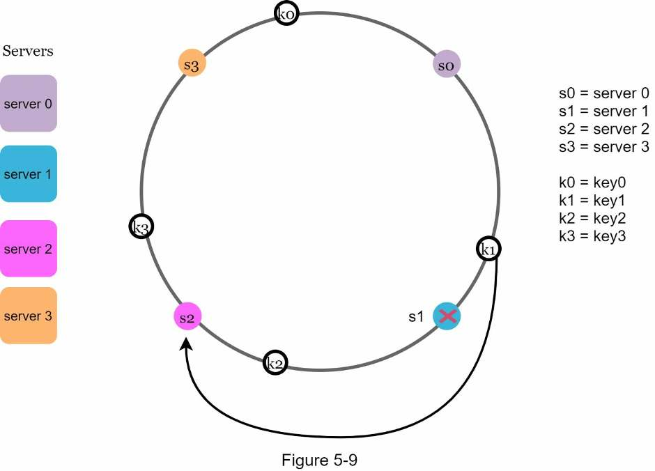

## Hai vấn đề của cách tiếp cận cơ bản

Thuật toán băm nhất quán được Karger và các cộng sự tại MIT giới thiệu [1]. Những bước cơ bản là:

- Ánh xạ máy chủ và khóa lên vòng bằng một hàm băm phân phối đều.
- Để tìm máy chủ mà một khóa được ánh xạ đến, đi theo chiều kim đồng hồ từ vị trí khóa cho tới máy chủ đầu tiên trên vòng.

Cách này có hai vấn đề. Thứ nhất, không thể giữ các phân vùng trên vòng có kích thước bằng nhau cho mọi máy chủ khi có thể thêm hoặc gỡ máy chủ. Một phân vùng là khoảng không gian băm giữa hai máy chủ liền kề. Phân vùng được gán cho mỗi máy chủ có thể rất nhỏ hoặc khá lớn. Trong Hình 5-10, nếu gỡ `s1`, phân vùng của `s2`, được đánh dấu bằng mũi tên hai đầu, lớn gấp đôi phân vùng của `s0` và `s3`.

<!-- trang-pdf:080 -->

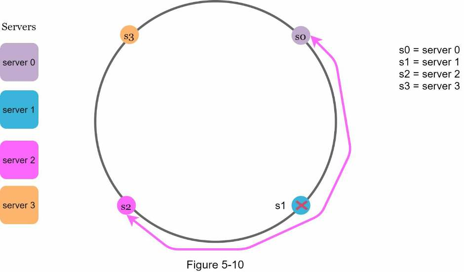

Thứ hai, khóa có thể phân bố không đều trên vòng. Ví dụ, nếu các máy chủ được ánh xạ đến những vị trí trong Hình 5-11, phần lớn khóa nằm trên máy chủ 2. Trong khi đó, máy chủ 1 và máy chủ 3 không có dữ liệu.

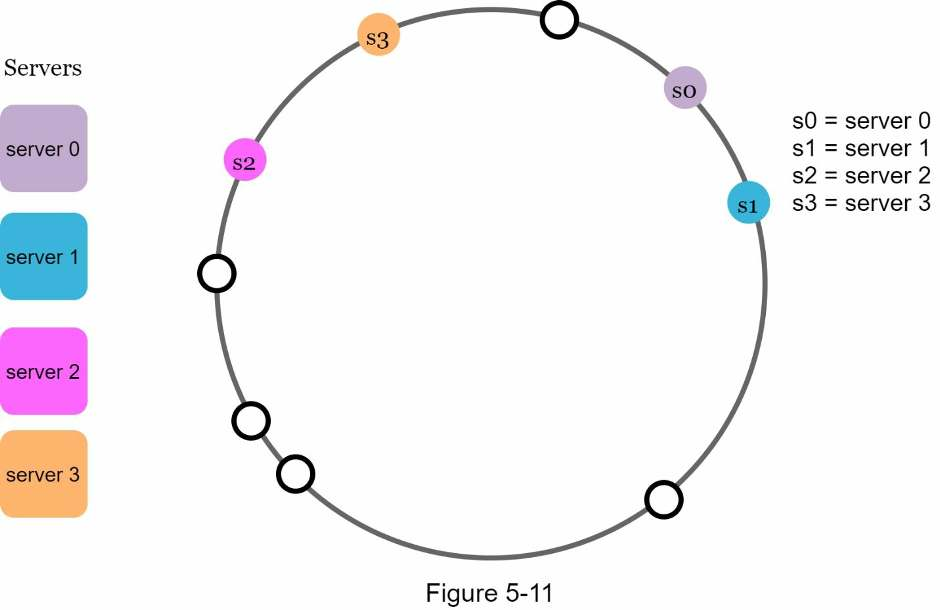

Kỹ thuật nút ảo (virtual node), còn gọi là replica, được dùng để giải quyết các vấn đề này.

## Nút ảo

Một nút ảo tham chiếu đến một nút thật, và mỗi máy chủ được biểu diễn bằng nhiều nút ảo trên vòng. Trong Hình 5-12, máy chủ 0 và máy chủ 1 đều có 3 nút ảo. Số 3 được <!-- trang-pdf:081 --> chọn tùy ý; trong hệ thống thực tế, số nút ảo lớn hơn nhiều. Thay vì dùng `s0`, chúng ta có `s0_0`, `s0_1`, `s0_2` để biểu diễn máy chủ 0 trên vòng. Tương tự, `s1_0`, `s1_1`, `s1_2` biểu diễn máy chủ 1. Với nút ảo, mỗi máy chủ chịu trách nhiệm nhiều phân vùng. Các phân vùng, tức các cung, có nhãn `s0` do máy chủ 0 quản lý; các phân vùng có nhãn `s1` do máy chủ 1 quản lý.

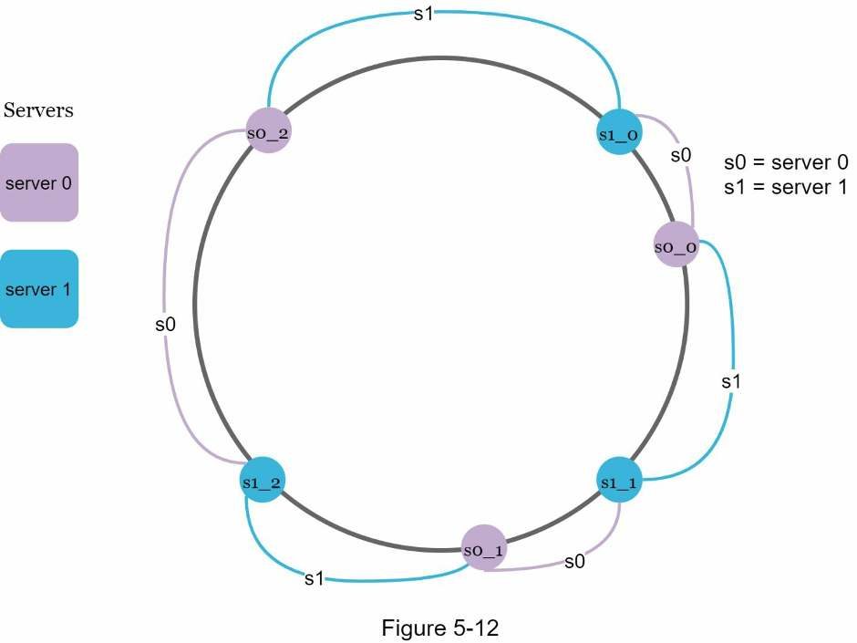

Để tìm máy chủ lưu một khóa, đi theo chiều kim đồng hồ từ vị trí khóa và tìm nút ảo đầu tiên gặp trên vòng. Trong Hình 5-13, để xác định máy chủ lưu `k0`, đi theo chiều kim đồng hồ từ `k0` và gặp nút ảo `s1_1`, tham chiếu đến máy chủ 1.

<!-- trang-pdf:082 -->

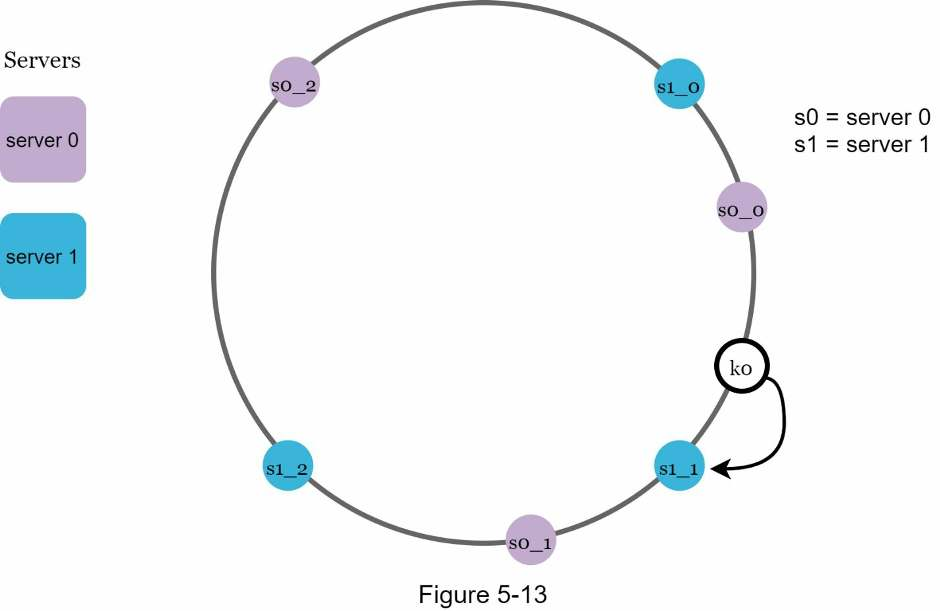

Khi số nút ảo tăng, phân bố khóa trở nên cân bằng hơn. Lý do là càng nhiều nút ảo, độ lệch chuẩn càng nhỏ, dẫn đến dữ liệu phân bố cân bằng. Độ lệch chuẩn đo mức độ phân tán của dữ liệu. Một thí nghiệm được trình bày trong nghiên cứu trực tuyến [2] cho thấy với một hoặc hai trăm nút ảo, độ lệch chuẩn nằm trong khoảng 5% giá trị trung bình khi có 200 nút, đến 10% khi có 100 nút. Tăng số nút ảo làm độ lệch chuẩn nhỏ hơn. Tuy nhiên, cần nhiều không gian hơn để lưu thông tin về các nút ảo. Đây là một sự đánh đổi, và có thể tinh chỉnh số nút ảo theo yêu cầu hệ thống.

## Tìm các khóa bị ảnh hưởng

Khi thêm hoặc gỡ máy chủ, một phần dữ liệu cần được phân phối lại. Làm sao xác định khoảng bị ảnh hưởng để phân phối lại khóa?

Trong Hình 5-14, máy chủ 4 được thêm vào vòng. Khoảng bị ảnh hưởng bắt đầu từ `s4`, tức nút mới, rồi đi ngược chiều kim đồng hồ cho đến khi gặp máy chủ `s3`. Vì vậy, các khóa nằm giữa `s3` và `s4` cần được phân phối lại sang `s4`.

<!-- trang-pdf:083 -->

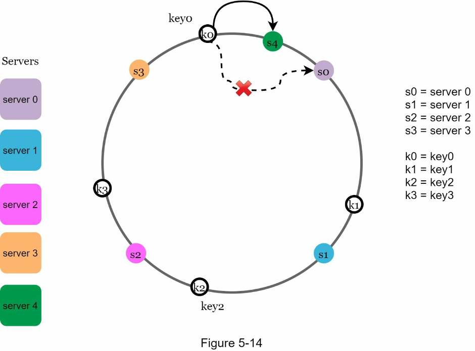

Khi gỡ máy chủ `s1` như Hình 5-15, khoảng bị ảnh hưởng bắt đầu tại `s1`, tức nút bị gỡ, rồi đi ngược chiều kim đồng hồ cho đến khi gặp máy chủ `s0`. Vì vậy, những khóa nằm giữa `s0` và `s1` phải được phân phối lại sang `s2`.

<!-- trang-pdf:084 -->

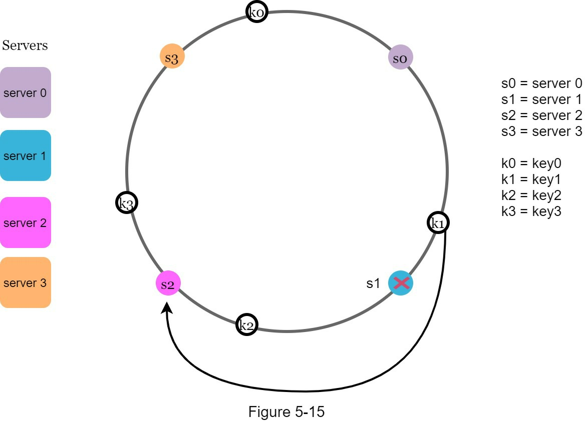

<!-- trang-pdf:085 -->

## Tổng kết

Trong chương này, chúng ta đã thảo luận sâu về băm nhất quán: vì sao cần và cách hoạt động. Những lợi ích gồm:

- Giảm thiểu số khóa cần phân phối lại khi thêm hoặc gỡ máy chủ.
- Dễ mở rộng theo chiều ngang vì dữ liệu được phân phối đồng đều hơn.
- Giảm nhẹ bài toán khóa điểm nóng. Truy cập quá mức vào một shard cụ thể có thể khiến máy chủ quá tải. Hãy tưởng tượng dữ liệu của Katy Perry, Justin Bieber và Lady Gaga đều nằm trên cùng shard. Băm nhất quán giúp giảm nhẹ vấn đề bằng cách phân phối dữ liệu đồng đều hơn.

Băm nhất quán được dùng rộng rãi trong các hệ thống thực tế, trong đó có những hệ thống đáng chú ý:

- Thành phần phân vùng của cơ sở dữ liệu Dynamo của Amazon [3].
- Phân vùng dữ liệu trong cụm Apache Cassandra [4].
- Ứng dụng chat Discord [5].
- Mạng phân phối nội dung Akamai [6].
- Bộ cân bằng tải mạng Maglev [7].

Chúc mừng bạn đã đi đến đây! Hãy tự thưởng cho mình một lời động viên. Bạn đã làm tốt!

<!-- trang-pdf:086 -->

## Tài liệu tham khảo

[1] Consistent hashing: https://en.wikipedia.org/wiki/Consistent_hashing

[2] Consistent Hashing: https://tom-e-white.com/2007/11/consistent-hashing.html

[3] Dynamo: Amazon’s Highly Available Key-value Store: https://www.allthingsdistributed.com/files/amazon-dynamo-sosp2007.pdf

[4] Cassandra - A Decentralized Structured Storage System: http://www.cs.cornell.edu/Projects/ladis2009/papers/Lakshman-ladis2009.PDF

[5] How Discord Scaled Elixir to 5,000,000 Concurrent Users: https://blog.discord.com/scaling-elixir-f9b8e1e7c29b

[6] CS168: The Modern Algorithmic Toolbox Lecture #1: Introduction and Consistent Hashing: http://theory.stanford.edu/~tim/s16/l/l1.pdf

[7] Maglev: A Fast and Reliable Software Network Load Balancer: https://static.googleusercontent.com/media/research.google.com/en//pubs/archive/44824.pdf

---

[← Chương 4](chuong-04-thiet-ke-bo-gioi-han-toc-do.md) · [Mục lục](../README.md) · [Chương 6 →](chuong-06-thiet-ke-kho-khoa-gia-tri.md)
