# Chương 6: Thiết kế kho khóa-giá trị

*Tên gốc: Design a Key-Value Store. Nguồn: trang PDF 87-109. Hình, bảng và mã nguồn dạng ảnh được giữ từ bản gốc; nhãn bên trong ảnh bằng tiếng Anh.*

<!-- trang-pdf:087 -->

Kho khóa-giá trị (key-value store), còn gọi là cơ sở dữ liệu khóa-giá trị, là một cơ sở dữ liệu phi quan hệ. Mỗi định danh duy nhất được lưu dưới dạng một khóa cùng với giá trị tương ứng. Cách ghép dữ liệu này được gọi là một cặp “khóa-giá trị”.

Trong một cặp khóa-giá trị, khóa phải là duy nhất và có thể dùng khóa để truy cập giá trị gắn với nó. Khóa có thể là văn bản thuần hoặc giá trị băm. Vì lý do hiệu năng, khóa ngắn thường hoạt động tốt hơn. Khóa trông như thế nào? Dưới đây là vài ví dụ:

- Khóa văn bản thuần: `last_logged_in_at`.
- Khóa đã băm: `253DDEC4`.

Giá trị trong một cặp khóa-giá trị có thể là chuỗi, danh sách, đối tượng, v.v. Trong những kho như Amazon Dynamo [1], Memcached [2], Redis [3], giá trị thường được coi là một đối tượng không cần biết cấu trúc bên trong.

Dưới đây là một đoạn dữ liệu trong kho khóa-giá trị:

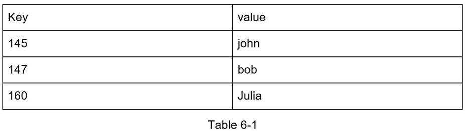

Trong chương này, bạn được yêu cầu thiết kế một kho khóa-giá trị hỗ trợ các thao tác sau:

```text
put(key, value) // chèn “value” gắn với “key”
get(key)        // lấy “value” gắn với “key”
```

<!-- trang-pdf:088 -->

## Hiểu bài toán và xác định phạm vi thiết kế

Không có thiết kế nào hoàn hảo. Mỗi thiết kế đạt một sự cân bằng nhất định giữa các đánh đổi về đọc, ghi và sử dụng bộ nhớ. Một sự đánh đổi khác cần thực hiện là giữa tính nhất quán và tính sẵn sàng. Trong chương này, chúng ta thiết kế kho khóa-giá trị với những đặc điểm sau:

- Kích thước một cặp khóa-giá trị nhỏ: dưới 10 KB.
- Có khả năng lưu trữ dữ liệu lớn.
- Tính sẵn sàng cao: hệ thống phản hồi nhanh, ngay cả khi có lỗi.
- Khả năng mở rộng cao: có thể mở rộng hệ thống để hỗ trợ tập dữ liệu lớn.
- Tự động mở rộng: việc thêm hoặc xóa máy chủ phải diễn ra tự động dựa trên lưu lượng.
- Có thể điều chỉnh mức độ nhất quán.
- Độ trễ thấp.

<!-- trang-pdf:089 -->

## Kho khóa-giá trị trên một máy chủ

Phát triển một kho khóa-giá trị nằm trên một máy chủ là việc dễ dàng. Cách tiếp cận trực quan là lưu các cặp khóa-giá trị trong một bảng băm, giữ toàn bộ dữ liệu trong bộ nhớ. Mặc dù truy cập bộ nhớ rất nhanh, việc đặt tất cả dữ liệu trong bộ nhớ có thể không khả thi do giới hạn dung lượng. Có thể thực hiện hai tối ưu để đặt được nhiều dữ liệu hơn trên một máy chủ:

- Nén dữ liệu.
- Chỉ lưu dữ liệu thường xuyên sử dụng trong bộ nhớ và lưu phần còn lại trên đĩa.

Ngay cả khi có những tối ưu này, một máy chủ vẫn có thể nhanh chóng chạm tới giới hạn dung lượng. Để hỗ trợ dữ liệu lớn, cần một kho khóa-giá trị phân tán.

<!-- trang-pdf:090 -->

## Kho khóa-giá trị phân tán

Kho khóa-giá trị phân tán còn được gọi là bảng băm phân tán, phân phối các cặp khóa-giá trị trên nhiều máy chủ. Khi thiết kế một hệ thống phân tán, điều quan trọng là hiểu định lý CAP: Consistency, Availability, Partition Tolerance.

### Định lý CAP

Định lý CAP phát biểu rằng một hệ thống phân tán không thể đồng thời cung cấp nhiều hơn hai trong ba bảo đảm: tính nhất quán, tính sẵn sàng và khả năng chịu phân vùng mạng. Trước hết, hãy xác định một vài khái niệm.

**Tính nhất quán (Consistency):** mọi máy khách nhìn thấy cùng dữ liệu tại cùng thời điểm, bất kể kết nối tới nút nào.

**Tính sẵn sàng (Availability):** mọi máy khách yêu cầu dữ liệu đều nhận được phản hồi, ngay cả khi một số nút ngừng hoạt động.

**Khả năng chịu phân vùng mạng (Partition Tolerance):** phân vùng là tình trạng gián đoạn liên lạc giữa hai nút. Khả năng chịu phân vùng nghĩa là hệ thống tiếp tục hoạt động bất chấp sự phân vùng mạng.

Định lý CAP phát biểu rằng phải hy sinh một trong ba thuộc tính để hỗ trợ hai thuộc tính còn lại, như Hình 6-1.

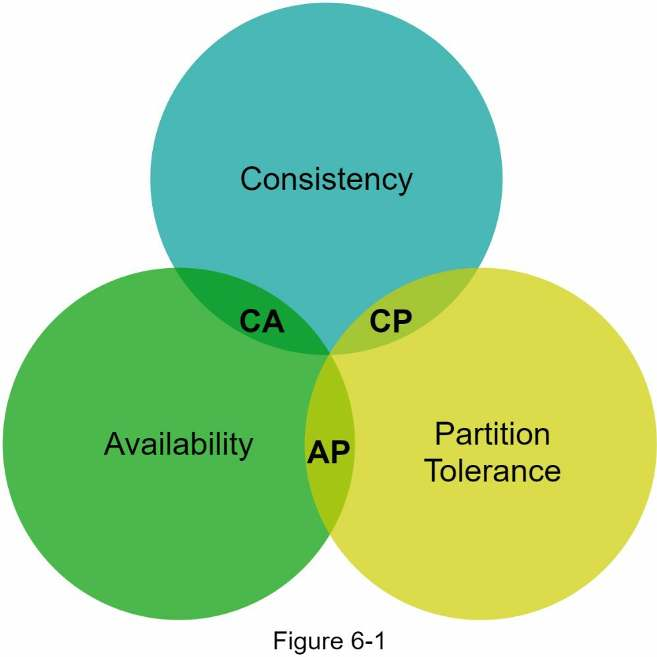

Ngày nay, các kho khóa-giá trị được phân loại dựa trên hai đặc tính CAP mà chúng hỗ trợ:

**Hệ thống CP (nhất quán và chịu phân vùng):** kho khóa-giá trị CP hỗ trợ tính nhất quán và khả năng chịu phân vùng, đồng thời hy sinh tính sẵn sàng.

**Hệ thống AP (sẵn sàng và chịu phân vùng):** kho khóa-giá trị AP hỗ trợ tính sẵn sàng và khả năng chịu phân vùng, đồng thời hy sinh tính nhất quán.

**Hệ thống CA (nhất quán và sẵn sàng):** kho khóa-giá trị CA hỗ trợ tính nhất quán và <!-- trang-pdf:091 --> tính sẵn sàng, đồng thời hy sinh khả năng chịu phân vùng. Vì lỗi mạng là điều không thể tránh khỏi, một hệ thống phân tán phải chịu được phân vùng mạng. Do đó, hệ thống CA không thể tồn tại trong các ứng dụng thực tế.

Những điều vừa đọc chủ yếu là phần định nghĩa. Để dễ hiểu hơn, hãy xem một vài ví dụ cụ thể. Trong hệ thống phân tán, dữ liệu thường được sao chép nhiều lần. Giả sử dữ liệu được sao chép trên ba nút bản sao n1, n2 và n3 như Hình 6-2.

### Tình huống lý tưởng

Trong thế giới lý tưởng, phân vùng mạng không bao giờ xảy ra. Dữ liệu được ghi vào n1 sẽ tự động được sao chép sang n2 và n3. Cả tính nhất quán và tính sẵn sàng đều được đáp ứng.

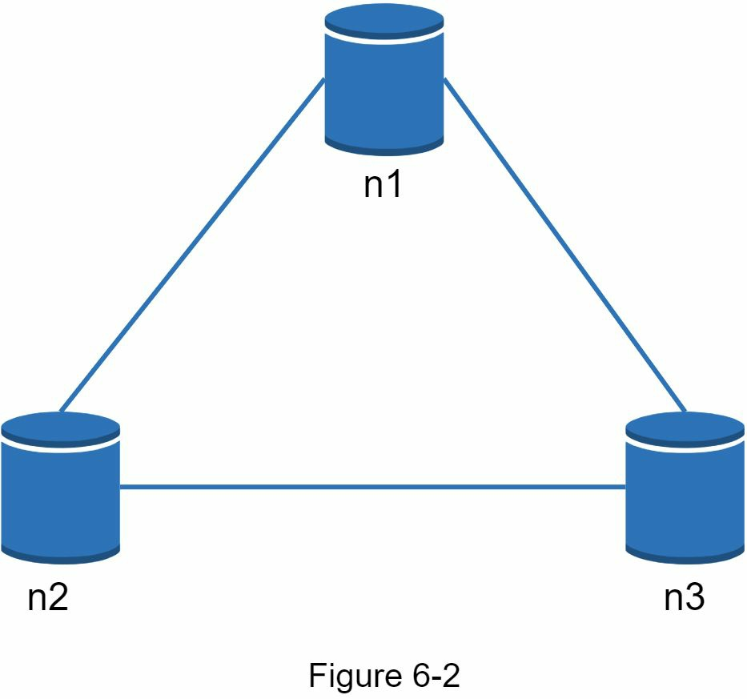

### Hệ thống phân tán trong thực tế

Trong một hệ thống phân tán, không thể tránh phân vùng; khi phân vùng xảy ra, chúng ta phải chọn giữa tính nhất quán và tính sẵn sàng. Trong Hình 6-3, n3 ngừng hoạt động và không thể liên lạc với n1, n2. Nếu máy khách ghi dữ liệu vào n1 hoặc n2, dữ liệu không thể truyền tới n3. Nếu dữ liệu được ghi vào n3 nhưng chưa truyền tới n1 và n2, n1 và n2 sẽ có dữ liệu cũ.

<!-- trang-pdf:092 -->

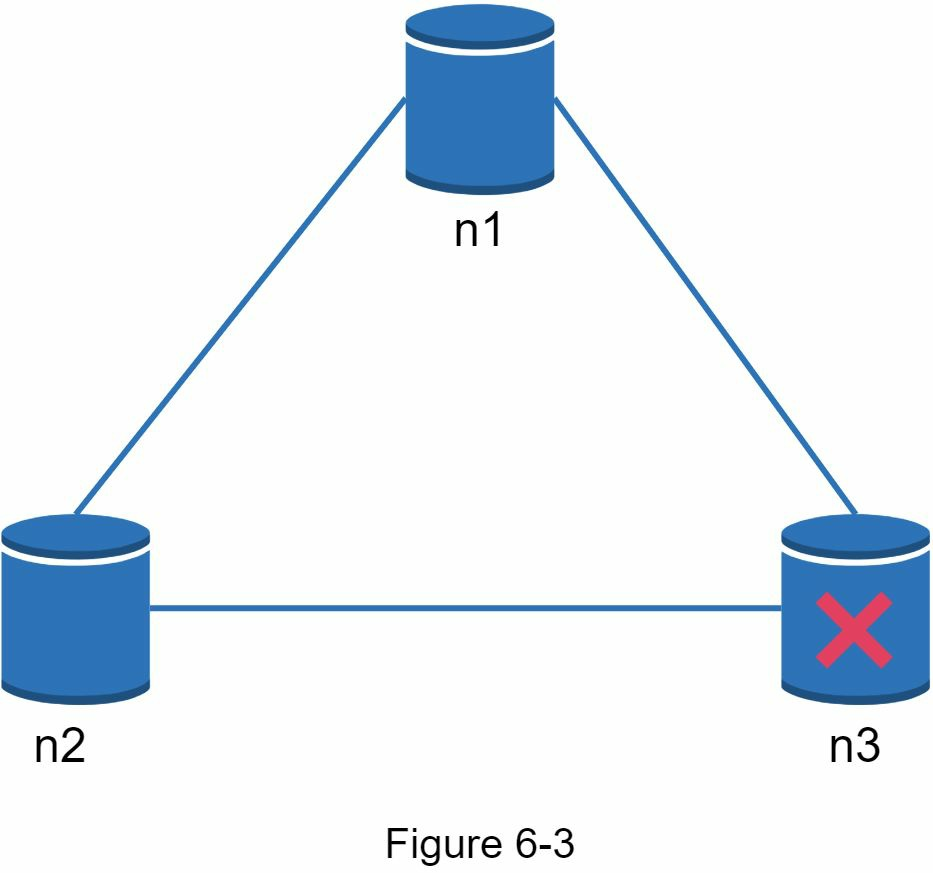

Nếu chọn tính nhất quán thay cho tính sẵn sàng, tức hệ thống CP, chúng ta phải chặn tất cả thao tác ghi vào n1 và n2 để tránh dữ liệu không nhất quán giữa ba máy chủ; điều này khiến hệ thống không sẵn sàng. Hệ thống ngân hàng thường có yêu cầu nhất quán cực kỳ cao. Ví dụ, điều cốt yếu là hệ thống phải hiển thị thông tin số dư mới nhất. Nếu sự không nhất quán xảy ra do phân vùng mạng, hệ thống ngân hàng trả về lỗi cho đến khi sự không nhất quán được giải quyết.

Tuy nhiên, nếu chọn tính sẵn sàng thay cho tính nhất quán, tức hệ thống AP, hệ thống tiếp tục chấp nhận yêu cầu đọc, dù có thể trả về dữ liệu cũ. Với thao tác ghi, n1 và n2 vẫn tiếp tục chấp nhận ghi; dữ liệu sẽ được đồng bộ sang n3 khi phân vùng mạng được khắc phục.

Chọn những bảo đảm CAP phù hợp với trường hợp sử dụng là một bước quan trọng khi xây dựng kho khóa-giá trị phân tán. Bạn có thể thảo luận điều này với người phỏng vấn và thiết kế hệ thống tương ứng.

## Các thành phần của hệ thống

Trong phần này, chúng ta sẽ thảo luận những thành phần và kỹ thuật cốt lõi sau đây dùng để xây dựng kho khóa-giá trị:

- Phân vùng dữ liệu.
- Sao chép dữ liệu.
- Tính nhất quán.
- Giải quyết sự không nhất quán.
- Xử lý sự cố.
- Sơ đồ kiến trúc hệ thống.
- Luồng ghi.
- Luồng đọc.

<!-- trang-pdf:093 -->

Nội dung bên dưới phần lớn dựa trên ba hệ thống kho khóa-giá trị phổ biến: Dynamo [4], Cassandra [5] và BigTable [6].

### Phân vùng dữ liệu

Đối với ứng dụng lớn, không khả thi nếu đặt toàn bộ tập dữ liệu trong một máy chủ. Cách đơn giản nhất là chia dữ liệu thành các phân vùng nhỏ hơn và lưu chúng trên nhiều máy chủ. Có hai thách thức khi phân vùng dữ liệu:

- Phân phối dữ liệu đồng đều trên nhiều máy chủ.
- Giảm thiểu lượng dữ liệu phải di chuyển khi thêm hoặc loại bỏ nút.

Băm nhất quán (consistent hashing), đã thảo luận trong Chương 5, là kỹ thuật rất tốt để giải quyết những vấn đề này. Hãy xem lại cơ chế hoạt động ở mức khái quát:

- Đầu tiên, đặt các máy chủ trên một vòng băm. Trong Hình 6-4, tám máy chủ được biểu diễn bằng s0, s1, ..., s7 được đặt trên vòng băm.
- Tiếp theo, băm một khóa lên cùng vòng đó và lưu nó trên máy chủ đầu tiên gặp được khi di chuyển theo chiều kim đồng hồ. Chẳng hạn, theo logic này, key0 được lưu trên s1.

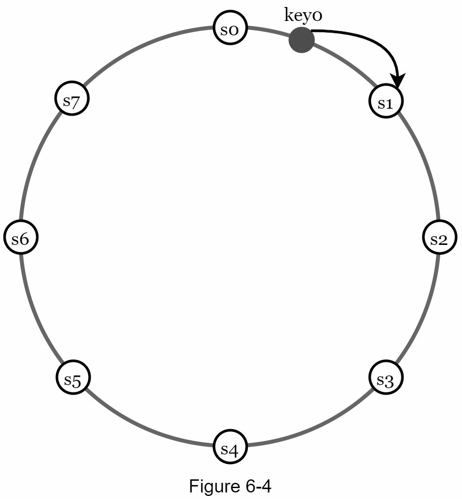

Sử dụng băm nhất quán để phân vùng dữ liệu có các ưu điểm sau:

**Tự động mở rộng:** có thể tự động thêm hoặc loại bỏ máy chủ tùy theo <!-- trang-pdf:094 --> tải.

**Tính không đồng nhất:** số nút ảo dành cho một máy chủ tỷ lệ thuận với năng lực máy chủ. Ví dụ, máy chủ có năng lực cao hơn được gán nhiều nút ảo hơn.

### Sao chép dữ liệu

Để đạt tính sẵn sàng và độ tin cậy cao, dữ liệu phải được sao chép bất đồng bộ trên N máy chủ, trong đó N là tham số có thể cấu hình. N máy chủ được chọn bằng logic sau: sau khi một khóa được ánh xạ tới một vị trí trên vòng băm, đi theo chiều kim đồng hồ từ vị trí đó và chọn N máy chủ đầu tiên trên vòng để lưu các bản sao dữ liệu. Trong Hình 6-5, với N = 3, key0 được sao chép tại s1, s2 và s3.

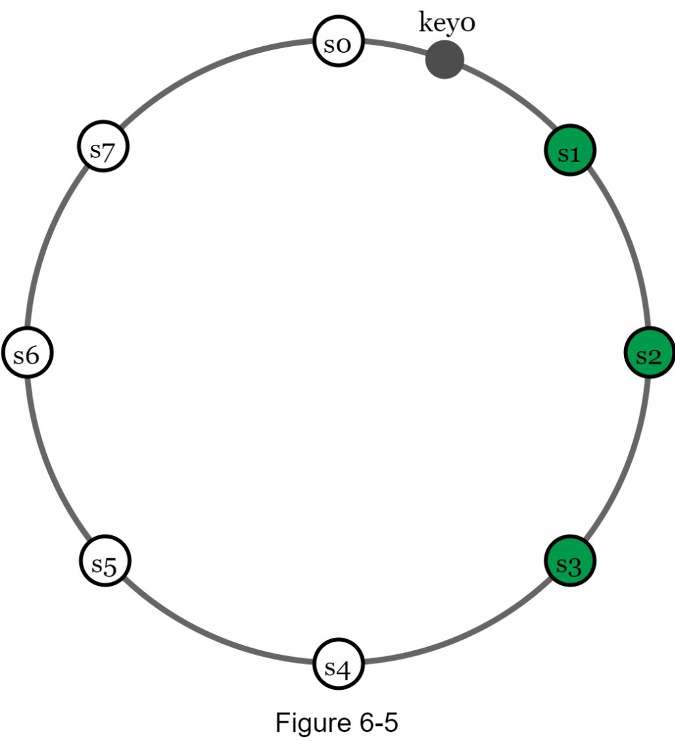

Khi dùng nút ảo, N nút đầu tiên trên vòng có thể thuộc về ít hơn N máy chủ vật lý. Để tránh vấn đề này, khi đi theo chiều kim đồng hồ, chúng ta chỉ chọn những máy chủ khác nhau.

Các nút trong cùng một trung tâm dữ liệu thường gặp sự cố cùng lúc do mất điện, vấn đề mạng, thiên tai, v.v. Để tăng độ tin cậy, các bản sao được đặt tại những trung tâm dữ liệu riêng biệt; các trung tâm dữ liệu được kết nối qua mạng tốc độ cao.

<!-- trang-pdf:095 -->

### Tính nhất quán

Vì dữ liệu được sao chép tại nhiều nút, cần đồng bộ dữ liệu giữa các bản sao. Đồng thuận theo quorum có thể bảo đảm tính nhất quán cho cả thao tác đọc và ghi. Trước tiên, hãy xác định một vài khái niệm:

- **N:** số lượng bản sao.
- **W:** quorum ghi có kích thước W. Để một thao tác ghi được coi là thành công, phải có W bản sao xác nhận thao tác đó.
- **R:** quorum đọc có kích thước R. Để một thao tác đọc được coi là thành công, nó phải chờ phản hồi từ ít nhất R bản sao.

Xét ví dụ trong Hình 6-6 với N = 3.

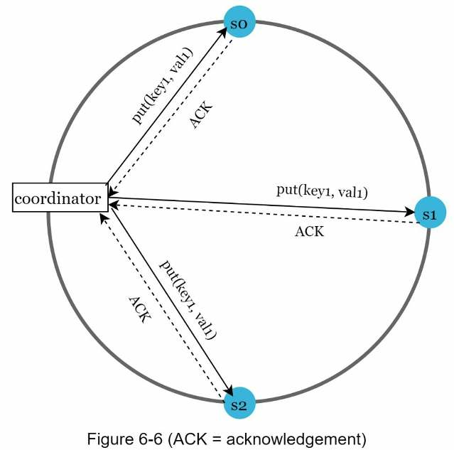

W = 1 không có nghĩa là dữ liệu được ghi trên một máy chủ. Chẳng hạn, với cấu hình trong Hình 6-6, dữ liệu được sao chép tại s0, s1 và s2. W = 1 nghĩa là bộ điều phối phải nhận ít nhất một xác nhận trước khi thao tác ghi được coi là thành công. Ví dụ, nếu nhận được xác nhận từ s1, chúng ta không còn cần chờ xác nhận từ s0 và s2. Bộ điều phối đóng vai trò proxy giữa máy khách và các nút.

Cấu hình W, R và N là một sự đánh đổi điển hình giữa độ trễ và tính nhất quán. Nếu W = 1 hoặc R = 1, thao tác trả về nhanh vì bộ điều phối chỉ cần chờ phản hồi từ bất kỳ bản sao nào. Nếu W hoặc R > 1, hệ thống cung cấp tính nhất quán tốt hơn; tuy nhiên, truy vấn chậm hơn vì bộ điều phối phải chờ phản hồi từ bản sao chậm nhất.

Nếu W + R > N, tính nhất quán mạnh được bảo đảm vì phải có ít nhất một <!-- trang-pdf:096 --> nút giao nhau có dữ liệu mới nhất để bảo đảm tính nhất quán.

Làm thế nào cấu hình N, W và R cho phù hợp với trường hợp sử dụng? Dưới đây là một số cách thiết lập có thể có:

- Nếu R = 1 và W = N, hệ thống được tối ưu để đọc nhanh.
- Nếu W = 1 và R = N, hệ thống được tối ưu để ghi nhanh.
- Nếu W + R > N, tính nhất quán mạnh được bảo đảm; thông thường N = 3, W = R = 2.
- Nếu W + R <= N, tính nhất quán mạnh không được bảo đảm.

Tùy yêu cầu, chúng ta có thể điều chỉnh W, R, N để đạt mức nhất quán mong muốn.

### Các mô hình nhất quán

Mô hình nhất quán là một yếu tố quan trọng khác cần cân nhắc khi thiết kế kho khóa-giá trị. Mô hình nhất quán xác định mức độ nhất quán của dữ liệu; có rất nhiều mô hình khả dĩ:

- **Nhất quán mạnh:** mọi thao tác đọc đều trả về giá trị tương ứng với kết quả của lần ghi mới nhất vào mục dữ liệu. Máy khách không bao giờ thấy dữ liệu lỗi thời.
- **Nhất quán yếu:** các thao tác đọc tiếp theo có thể không thấy giá trị mới nhất.
- **Nhất quán cuối cùng:** đây là một dạng cụ thể của nhất quán yếu. Sau đủ thời gian, mọi cập nhật đều được truyền đi và tất cả bản sao trở nên nhất quán.

Nhất quán mạnh thường đạt được bằng cách buộc một bản sao không nhận các yêu cầu đọc/ghi mới cho đến khi mọi bản sao đã đồng ý về lần ghi hiện tại. Cách tiếp cận này không lý tưởng với hệ thống có tính sẵn sàng cao vì có thể chặn các thao tác mới. Dynamo và Cassandra áp dụng nhất quán cuối cùng; đây cũng là mô hình chúng ta khuyến nghị cho kho khóa-giá trị của mình. Khi có các thao tác ghi đồng thời, nhất quán cuối cùng cho phép những giá trị không nhất quán đi vào hệ thống và buộc máy khách đọc các giá trị đó để hòa giải. Phần tiếp theo giải thích cách hòa giải bằng cơ chế quản lý phiên bản.

<!-- trang-pdf:097 -->

### Giải quyết sự không nhất quán: quản lý phiên bản

Sao chép dữ liệu đem lại tính sẵn sàng cao nhưng gây ra sự không nhất quán giữa các bản sao. Quản lý phiên bản và đồng hồ vector được dùng để giải quyết vấn đề này. Quản lý phiên bản nghĩa là coi mỗi lần sửa đổi dữ liệu như một phiên bản dữ liệu mới bất biến. Trước khi bàn về quản lý phiên bản, hãy dùng một ví dụ để giải thích sự không nhất quán xảy ra như thế nào.

> **Ghi chú bản dịch:** Câu đầu của bản gốc ghi “vector locks”; phần giải thích tiếp theo dùng “vector clocks”. Bản dịch dùng “đồng hồ vector” theo chính phần giải thích đó.

Như Hình 6-7, hai nút bản sao n1 và n2 đều có cùng một giá trị. Hãy gọi đó là giá trị gốc. Máy chủ 1 và máy chủ 2 nhận cùng một giá trị khi thực hiện `get("name")`.

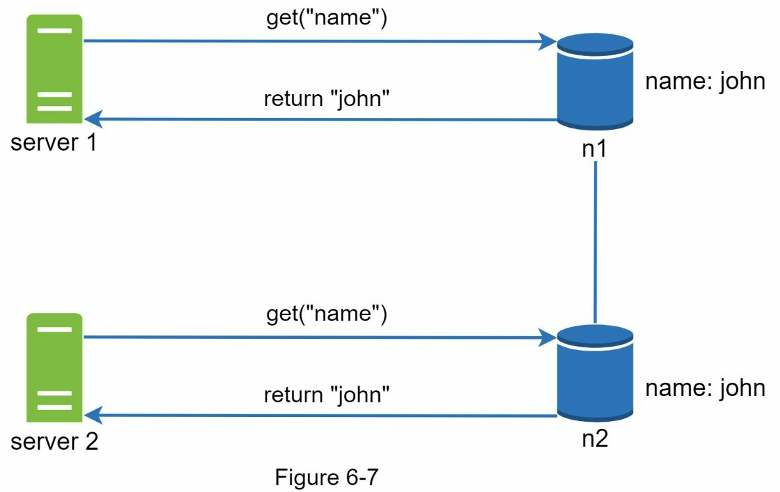

Tiếp theo, máy chủ 1 đổi tên thành `johnSanFrancisco`, còn máy chủ 2 đổi tên thành `johnNewYork`, như Hình 6-8. Hai thay đổi được thực hiện đồng thời. Lúc này có các giá trị xung đột, gọi là phiên bản v1 và v2.

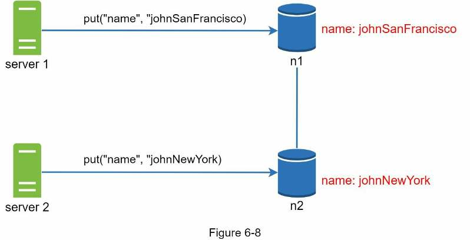

Trong ví dụ này, có thể bỏ qua giá trị gốc vì các sửa đổi đều dựa trên nó. Tuy nhiên, không có cách rõ ràng để giải quyết xung đột giữa hai phiên bản sau cùng. Để giải quyết, chúng ta cần một hệ thống quản lý phiên bản có thể phát hiện và hòa giải xung đột. Đồng hồ vector là một kỹ thuật phổ biến cho vấn đề này. Hãy xem nó hoạt động như thế nào.

<!-- trang-pdf:098 -->

Đồng hồ vector là một tập các cặp `[máy chủ, phiên bản]` gắn với một mục dữ liệu. Có thể dùng nó để kiểm tra liệu một phiên bản có đứng trước, đứng sau hay xung đột với các phiên bản khác.

Giả sử đồng hồ vector được biểu diễn bằng `D([S1, v1], [S2, v2], ..., [Sn, vn])`, trong đó D là mục dữ liệu, v1 là bộ đếm phiên bản, S1 là số hiệu máy chủ, v.v. Nếu mục dữ liệu D được ghi vào máy chủ Si, hệ thống phải thực hiện một trong những việc sau:

- Tăng vi nếu `[Si, vi]` đã tồn tại.
- Nếu chưa tồn tại, tạo mục mới `[Si, 1]`.

Logic trừu tượng trên được giải thích bằng ví dụ cụ thể trong Hình 6-9.

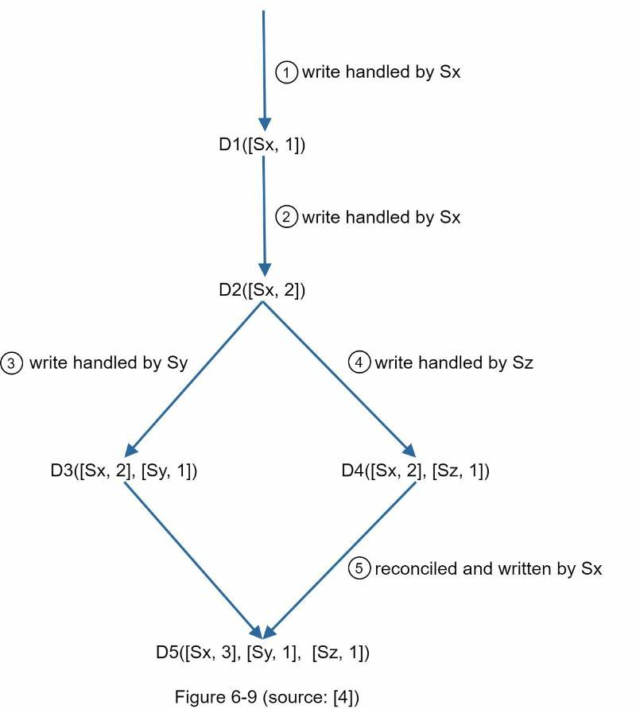

1. Một máy khách ghi mục dữ liệu D1 vào hệ thống; thao tác ghi do máy chủ Sx xử lý, và đồng hồ vector lúc này là `D1([Sx, 1])`.
2. Một máy khách khác đọc D1 mới nhất, cập nhật thành D2 rồi ghi trở lại. D2 là hậu duệ của D1 nên ghi đè D1. Giả sử thao tác ghi vẫn do Sx xử lý, đồng hồ vector lúc này là `D2([Sx, 2])`.
3. Một máy khách khác đọc D2 mới nhất, cập nhật thành D3 rồi ghi trở lại. Giả sử Sy xử lý thao tác ghi, đồng hồ vector lúc này là `D3([Sx, 2], [Sy, 1])`.
4. Một máy khách khác đọc D2 mới nhất, cập nhật thành D4 rồi ghi trở lại. Giả sử thao tác ghi <!-- trang-pdf:099 --> do Sz xử lý, đồng hồ vector lúc này là `D4([Sx, 2], [Sz, 1])`.
5. Khi một máy khách khác đọc D3 và D4, nó phát hiện xung đột do mục dữ liệu D2 bị cả Sy và Sz sửa đổi. Máy khách giải quyết xung đột, rồi gửi dữ liệu đã cập nhật tới máy chủ. Giả sử Sx xử lý thao tác ghi, lúc này có `D5([Sx, 3], [Sy, 1], [Sz, 1])`. Chúng ta sẽ sớm giải thích cách phát hiện xung đột.

Với đồng hồ vector, có thể dễ dàng xác định phiên bản X là tổ tiên của Y, tức không có xung đột, nếu bộ đếm phiên bản của mỗi thành viên trong đồng hồ vector của Y đều lớn hơn hoặc bằng bộ đếm tương ứng trong X. Ví dụ, đồng hồ vector `D([s0, 1], [s1, 1])` là tổ tiên của `D([s0, 1], [s1, 2])`. Vì vậy, không ghi nhận xung đột.

Tương tự, có thể nhận biết phiên bản X là phiên bản anh em của Y, tức có xung đột, nếu có một thành viên trong đồng hồ vector của Y mang bộ đếm nhỏ hơn bộ đếm tương ứng trong X. Ví dụ, hai đồng hồ vector sau biểu thị xung đột: `D([s0, 1], [s1, 2])` và `D([s0, 2], [s1, 1])`.

Mặc dù đồng hồ vector có thể giải quyết xung đột, có hai nhược điểm đáng chú ý. Thứ nhất, nó làm máy khách phức tạp hơn vì máy khách phải triển khai logic giải quyết xung đột.

Thứ hai, các cặp `[máy chủ: phiên bản]` trong đồng hồ vector có thể tăng nhanh. Để xử lý, chúng ta đặt ngưỡng độ dài; nếu vượt giới hạn, các cặp cũ nhất sẽ bị loại bỏ. Điều này có thể khiến việc hòa giải kém hiệu quả vì không còn xác định chính xác quan hệ hậu duệ. Tuy nhiên, theo bài báo Dynamo [4], Amazon chưa gặp vấn đề này trong môi trường production; do đó, đây có lẽ là giải pháp chấp nhận được với phần lớn công ty.

### Xử lý sự cố

Giống như mọi hệ thống lớn, sự cố không chỉ không thể tránh khỏi mà còn thường xuyên xảy ra. Xử lý các tình huống sự cố rất quan trọng. Trong phần này, trước tiên chúng ta giới thiệu các kỹ thuật phát hiện sự cố, sau đó xem xét những chiến lược giải quyết thường dùng.

### Phát hiện sự cố

Trong một hệ thống phân tán, không đủ cơ sở để tin rằng một máy chủ đã ngừng hoạt động chỉ vì máy chủ khác nói như vậy. Thông thường, cần ít nhất hai nguồn thông tin độc lập để đánh dấu một máy chủ là đã ngừng hoạt động.

Như Hình 6-10, phát đa hướng từ mọi nút tới mọi nút là giải pháp dễ hiểu. Tuy nhiên, cách này không hiệu quả khi hệ thống có nhiều máy chủ.

<!-- trang-pdf:100 -->

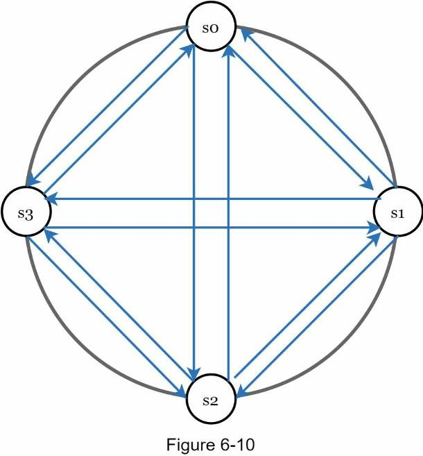

Giải pháp tốt hơn là sử dụng các phương pháp phát hiện sự cố phi tập trung, chẳng hạn giao thức gossip. Giao thức gossip hoạt động như sau:

- Mỗi nút duy trì một danh sách thành viên, chứa ID thành viên và bộ đếm heartbeat.
- Mỗi nút định kỳ tăng bộ đếm heartbeat của mình.
- Mỗi nút định kỳ gửi heartbeat tới một tập nút ngẫu nhiên; các nút này lại truyền tiếp tới một tập nút khác.
- Khi nhận được heartbeat, các nút cập nhật danh sách thành viên theo thông tin mới nhất.
- Nếu heartbeat không tăng trong một khoảng thời gian định trước, thành viên được coi là ngoại tuyến.

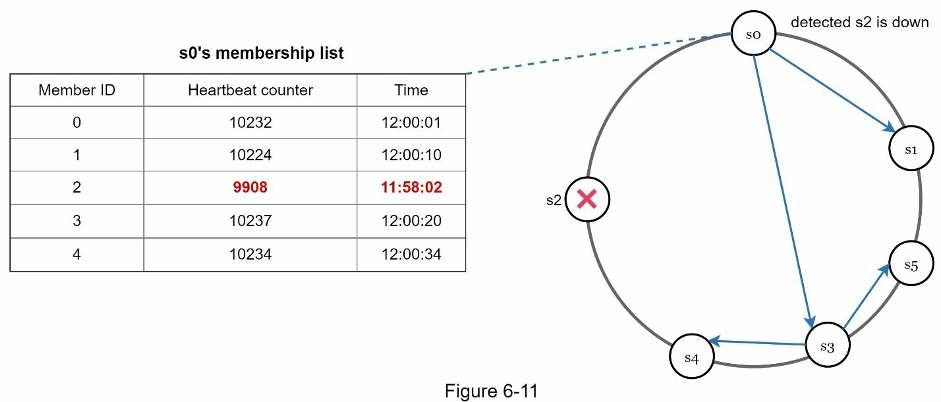

Như Hình 6-11:

<!-- trang-pdf:101 -->

- Nút s0 duy trì danh sách thành viên như bên trái hình.
- Nút s0 nhận thấy bộ đếm heartbeat của s2, có ID thành viên bằng 2, đã không tăng trong thời gian dài.
- Nút s0 gửi heartbeat chứa thông tin của s2 tới một tập nút ngẫu nhiên. Khi những nút khác xác nhận heartbeat của s2 không được cập nhật trong thời gian dài, s2 được đánh dấu là ngừng hoạt động, và thông tin này được truyền tới các nút khác.

### Xử lý sự cố tạm thời

Sau khi phát hiện sự cố qua giao thức gossip, hệ thống cần triển khai những cơ chế nhất định để bảo đảm tính sẵn sàng. Với cách tiếp cận quorum nghiêm ngặt, thao tác đọc và ghi có thể bị chặn, như đã minh họa trong phần đồng thuận quorum.

Một kỹ thuật gọi là **sloppy quorum** [4] được dùng để cải thiện tính sẵn sàng. Thay vì áp đặt yêu cầu quorum nghiêm ngặt, hệ thống chọn W máy chủ khỏe mạnh đầu tiên cho thao tác ghi và R máy chủ khỏe mạnh đầu tiên cho thao tác đọc trên vòng băm. Các máy chủ ngoại tuyến bị bỏ qua.

Nếu một máy chủ không sẵn sàng do sự cố mạng hoặc máy chủ, máy chủ khác sẽ tạm thời xử lý yêu cầu. Khi máy chủ bị ngừng hoạt động trở lại, các thay đổi được đẩy về nó để đạt tính nhất quán dữ liệu. Quy trình này gọi là **hinted handoff**. Vì s2 không sẵn sàng trong Hình 6-12, s3 tạm thời xử lý yêu cầu đọc và ghi. Khi s2 trực tuyến trở lại, s3 bàn giao dữ liệu về cho s2.

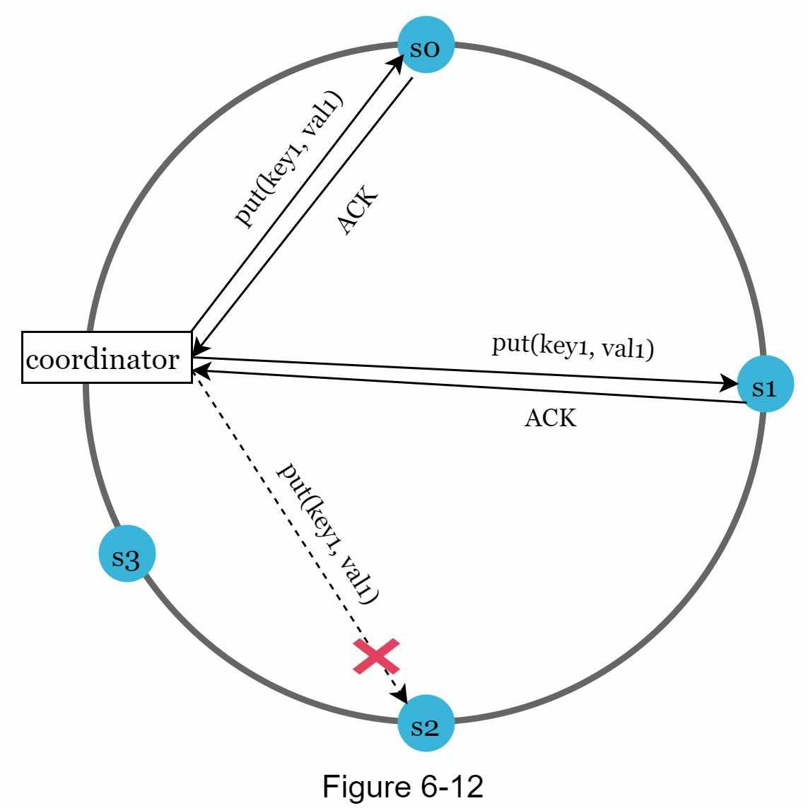

### Xử lý sự cố vĩnh viễn

<!-- trang-pdf:102 -->

Hinted handoff được dùng để xử lý sự cố tạm thời. Điều gì xảy ra nếu một bản sao vĩnh viễn không sẵn sàng? Để xử lý tình huống này, chúng ta triển khai giao thức chống sai khác, hay anti-entropy, để giữ các bản sao đồng bộ. Anti-entropy so sánh từng phần dữ liệu trên các bản sao rồi cập nhật mỗi bản sao tới phiên bản mới nhất. Cây Merkle được dùng để phát hiện sự không nhất quán và giảm thiểu lượng dữ liệu phải truyền.

Trích Wikipedia [7]: “Cây băm hay cây Merkle là một cây mà mỗi nút không phải nút lá đều được gắn nhãn bằng giá trị băm của các nhãn hoặc giá trị của những nút con, trong trường hợp nút con là nút lá. Cây băm cho phép xác minh hiệu quả và an toàn nội dung của các cấu trúc dữ liệu lớn.”

Giả sử không gian khóa từ 1 đến 12, các bước dưới đây cho thấy cách xây dựng cây Merkle. Những ô được tô nổi biểu thị sự không nhất quán.

**Bước 1:** chia không gian khóa thành các bucket, trong ví dụ là 4 bucket, như Hình 6-13. Bucket được dùng làm các nút ở mức gốc để giữ độ sâu cây có giới hạn.

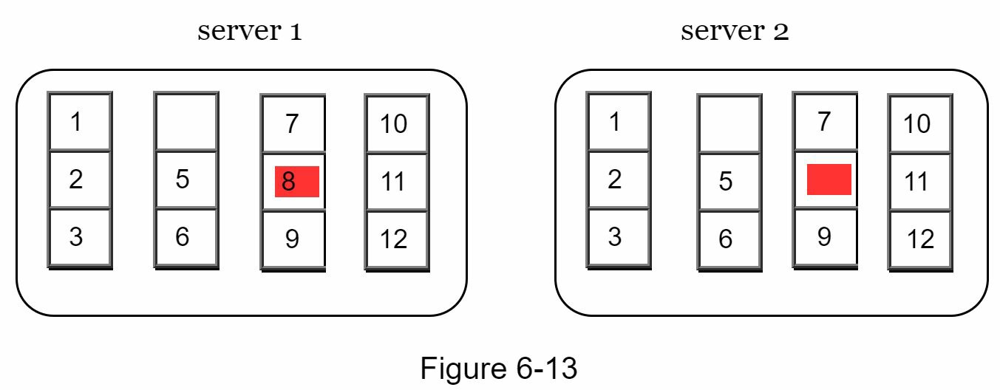

**Bước 2:** sau khi tạo bucket, băm từng khóa trong bucket bằng một phương pháp băm phân bố đều, như Hình 6-14.

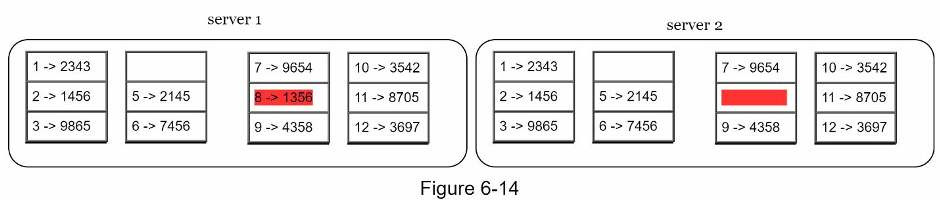

**Bước 3:** tạo một nút băm cho mỗi bucket, như Hình 6-15.

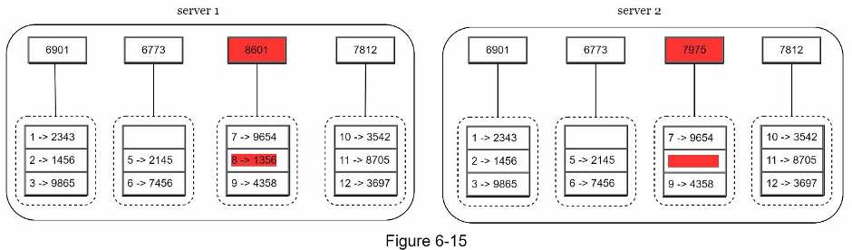

**Bước 4:** xây cây từ dưới lên tới gốc bằng cách tính giá trị băm từ các nút con, như Hình 6-16.

<!-- trang-pdf:103 -->

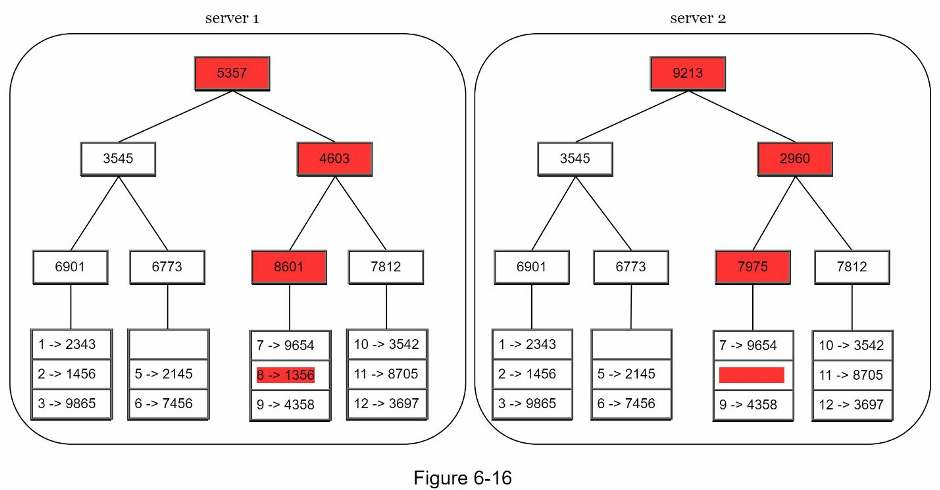

Để so sánh hai cây Merkle, bắt đầu bằng cách so sánh giá trị băm ở gốc. Nếu chúng trùng nhau, hai máy chủ có cùng dữ liệu. Nếu khác nhau, so sánh giá trị băm của nút con trái rồi tới nút con phải. Có thể duyệt cây để tìm những bucket chưa đồng bộ và chỉ đồng bộ các bucket đó.

Khi dùng cây Merkle, lượng dữ liệu cần đồng bộ tỷ lệ với sự khác biệt giữa hai bản sao, thay vì tỷ lệ với tổng lượng dữ liệu chúng chứa. Trong hệ thống thực tế, kích thước bucket khá lớn. Ví dụ, một cấu hình có thể là một triệu bucket cho một tỷ khóa, khi đó mỗi bucket chỉ chứa 1.000 khóa.

### Xử lý sự cố trung tâm dữ liệu

Trung tâm dữ liệu có thể ngừng hoạt động do mất điện, mất mạng, thiên tai, v.v. Để xây dựng hệ thống có thể xử lý sự cố này, điều quan trọng là sao chép dữ liệu qua nhiều trung tâm dữ liệu. Ngay cả khi một trung tâm hoàn toàn ngoại tuyến, người dùng vẫn truy cập được dữ liệu thông qua các trung tâm khác.

<!-- trang-pdf:104 -->

## Sơ đồ kiến trúc hệ thống

Sau khi đã thảo luận những cân nhắc kỹ thuật khi thiết kế kho khóa-giá trị, chúng ta có thể chuyển sang sơ đồ kiến trúc trong Hình 6-17.

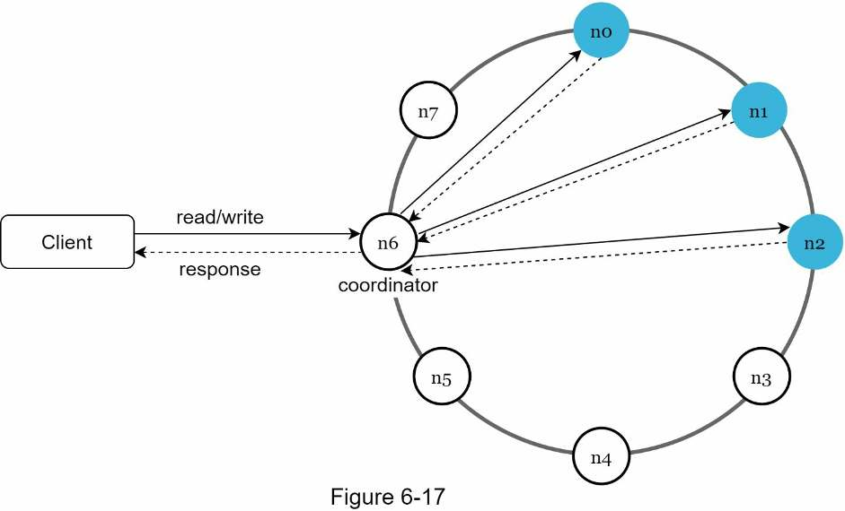

Các đặc điểm chính của kiến trúc gồm:

- Máy khách giao tiếp với kho khóa-giá trị qua các API đơn giản: `get(key)` và `put(key, value)`.
- Bộ điều phối là một nút đóng vai trò proxy giữa máy khách và kho khóa-giá trị.
- Các nút được phân bố trên vòng bằng băm nhất quán.
- Hệ thống hoàn toàn phi tập trung, vì vậy việc thêm và di chuyển nút có thể được tự động hóa.
- Dữ liệu được sao chép tại nhiều nút.
- Không có điểm lỗi đơn vì mỗi nút đều có cùng tập trách nhiệm.

Do thiết kế phi tập trung, mỗi nút thực hiện nhiều nhiệm vụ, như Hình 6-18.

<!-- trang-pdf:105 -->

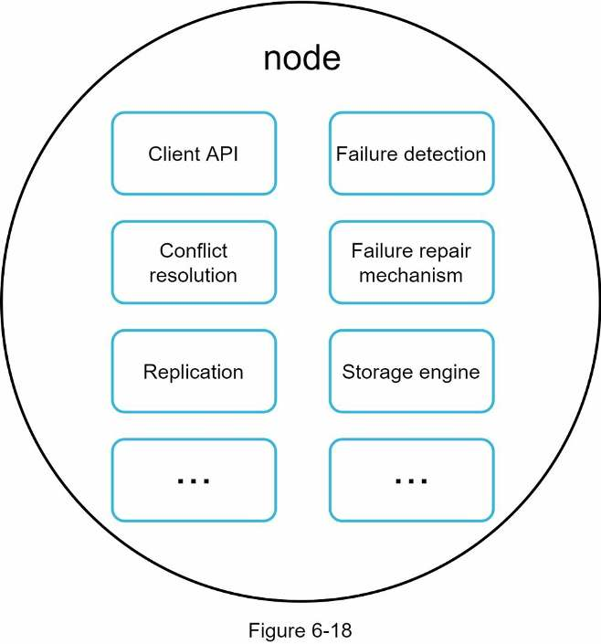

## Luồng ghi

Hình 6-19 giải thích những gì xảy ra sau khi yêu cầu ghi được chuyển tới một nút cụ thể. Lưu ý rằng thiết kế luồng ghi/đọc được đề xuất chủ yếu dựa trên kiến trúc Cassandra [8].

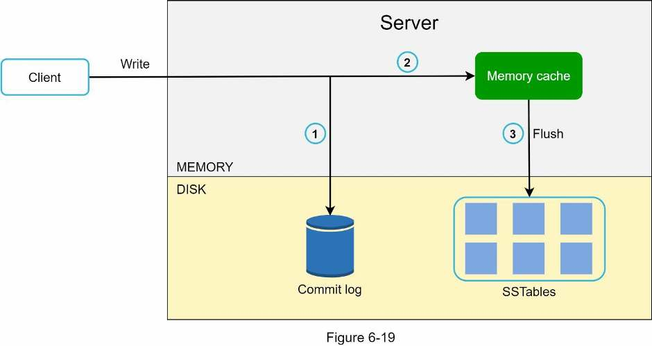

1. Yêu cầu ghi được lưu bền vững vào một file commit log.
2. Dữ liệu được lưu trong bộ nhớ đệm.

<!-- trang-pdf:106 -->

3. Khi bộ nhớ đệm đầy hoặc đạt ngưỡng định trước, dữ liệu được đẩy xuống SSTable [9] trên đĩa. Lưu ý: sorted-string table, viết tắt SSTable, là danh sách các cặp `<key, value>` đã được sắp xếp. Bạn đọc muốn tìm hiểu thêm về SSTable có thể xem tài liệu tham khảo [9].

## Luồng đọc

Sau khi yêu cầu đọc được chuyển tới một nút cụ thể, trước tiên nút kiểm tra dữ liệu có trong bộ nhớ đệm hay không. Nếu có, dữ liệu được trả về máy khách như Hình 6-20.

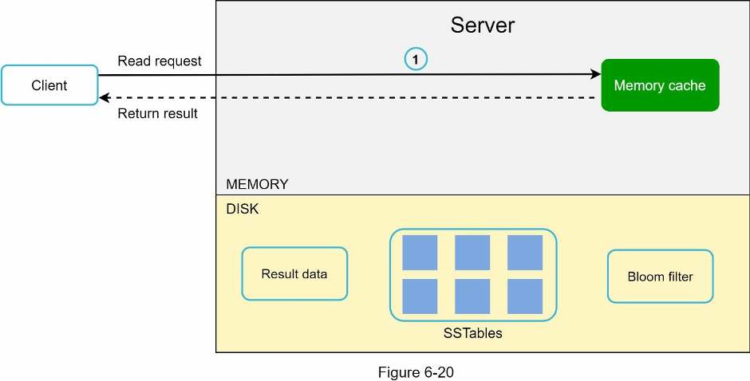

Nếu dữ liệu không có trong bộ nhớ, nó được truy xuất từ đĩa. Cần một cách hiệu quả để xác định SSTable nào chứa khóa. Bộ lọc Bloom [10] thường được dùng để giải quyết vấn đề này.

Hình 6-21 trình bày luồng đọc khi dữ liệu không nằm trong bộ nhớ.

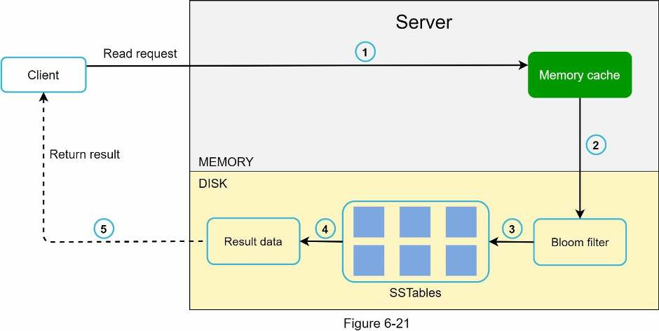

1. Trước tiên, hệ thống kiểm tra dữ liệu có trong bộ nhớ không. Nếu không, chuyển sang bước 2.
2. Nếu dữ liệu không có trong bộ nhớ, hệ thống kiểm tra bộ lọc Bloom.

<!-- trang-pdf:107 -->

3. Bộ lọc Bloom được dùng để xác định những SSTable có thể chứa khóa.
4. Các SSTable trả về kết quả của tập dữ liệu.
5. Kết quả của tập dữ liệu được trả về máy khách.

<!-- trang-pdf:108 -->

## Tổng kết

Chương này bao gồm nhiều khái niệm và kỹ thuật. Để ôn lại, bảng dưới đây tóm tắt những đặc điểm cùng kỹ thuật tương ứng được sử dụng trong kho khóa-giá trị phân tán.

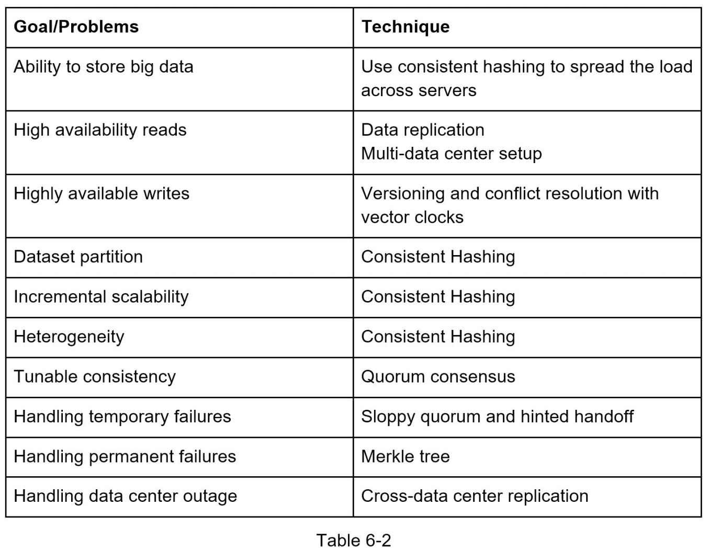

<!-- trang-pdf:109 -->

## Tài liệu tham khảo

[1] Amazon DynamoDB: https://aws.amazon.com/dynamodb/

[2] memcached: https://memcached.org/

[3] Redis: https://redis.io/

[4] Dynamo: Amazon’s Highly Available Key-value Store: https://www.allthingsdistributed.com/files/amazon-dynamo-sosp2007.pdf

[5] Cassandra: https://cassandra.apache.org/

[6] Bigtable: A Distributed Storage System for Structured Data: https://static.googleusercontent.com/media/research.google.com/en//archive/bigtable-osdi06.pdf

[7] Merkle tree: https://en.wikipedia.org/wiki/Merkle_tree

[8] Cassandra architecture: https://cassandra.apache.org/doc/latest/architecture/

[9] SStable: https://www.igvita.com/2012/02/06/sstable-and-log-structured-storage-leveldb/

[10] Bloom filter: https://en.wikipedia.org/wiki/Bloom_filter

---

[← Chương 5](chuong-05-thiet-ke-co-che-bam-nhat-quan.md) · [Mục lục](../README.md) · [Chương 7 →](chuong-07-thiet-ke-bo-sinh-id-duy-nhat-trong-he-thong-phan-tan.md)
