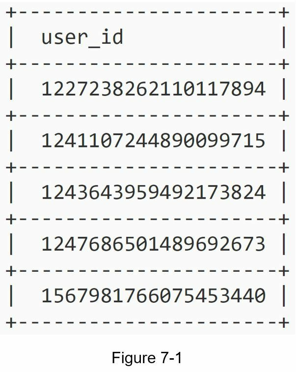
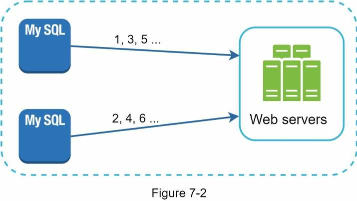
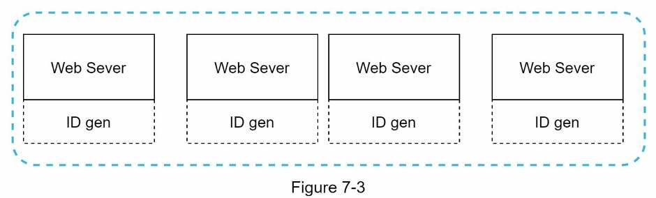
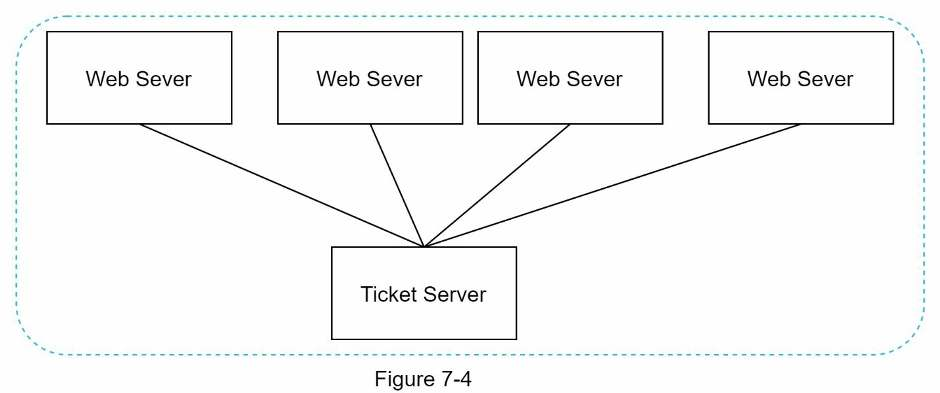
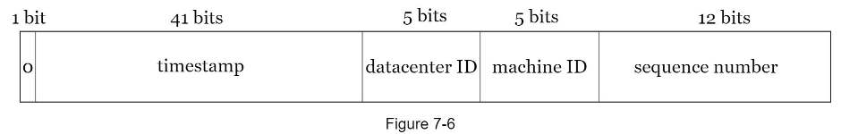
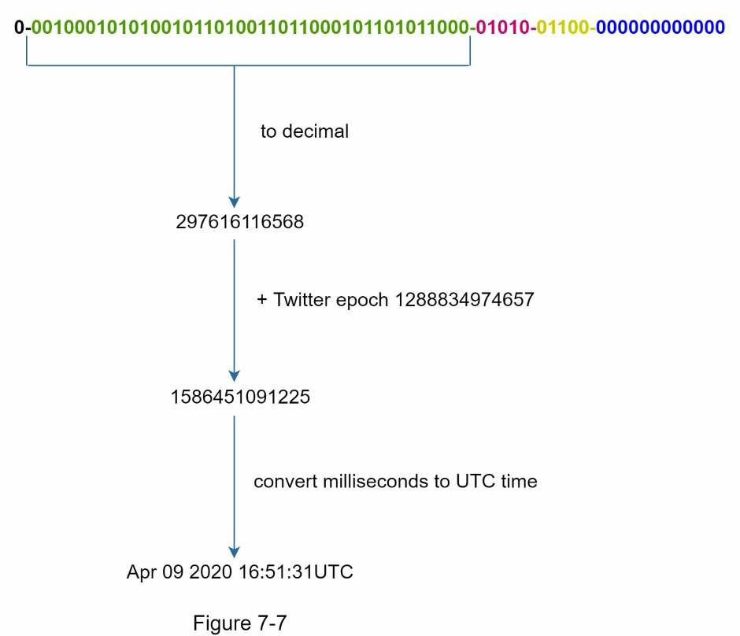

# Chương 7: Thiết kế bộ sinh ID duy nhất trong hệ thống phân tán

[English](../original/chuong-07-thiet-ke-bo-sinh-id-duy-nhat-trong-he-thong-phan-tan.md) · [Mục lục](../README.md)

*Tên gốc: Design a Unique ID Generator in Distributed Systems. Nguồn: trang PDF 110-118. Hình gốc và nhãn tiếng Anh bên trong hình được giữ nguyên.*

<!-- trang-pdf:110 -->

Trong chương này, bạn được yêu cầu thiết kế bộ sinh ID duy nhất trong các hệ thống phân tán. Ý nghĩ đầu tiên có thể là dùng khóa chính với thuộc tính `auto_increment` trong cơ sở dữ liệu truyền thống. Tuy nhiên, `auto_increment` không hoạt động trong môi trường phân tán, vì một máy chủ cơ sở dữ liệu đơn lẻ không đủ lớn; việc sinh ID duy nhất trên nhiều cơ sở dữ liệu với độ trễ tối thiểu cũng là một thách thức.

Dưới đây là vài ví dụ về ID duy nhất:



<!-- trang-pdf:111 -->

## Bước 1 - Hiểu bài toán và xác định phạm vi thiết kế

Đặt câu hỏi làm rõ là bước đầu tiên khi giải quyết bất kỳ câu hỏi phỏng vấn thiết kế hệ thống nào. Dưới đây là một ví dụ trao đổi giữa ứng viên và người phỏng vấn:

**Ứng viên:** Các ID duy nhất cần có đặc điểm gì?

**Người phỏng vấn:** ID phải duy nhất và có thể sắp xếp được.

**Ứng viên:** Với mỗi bản ghi mới, ID có tăng thêm 1 không?

**Người phỏng vấn:** ID tăng theo thời gian nhưng không nhất thiết chỉ tăng thêm 1. ID tạo vào buổi tối lớn hơn ID tạo vào buổi sáng cùng ngày.

**Ứng viên:** ID chỉ chứa các giá trị số phải không?

**Người phỏng vấn:** Đúng vậy.

**Ứng viên:** Độ dài ID có yêu cầu gì?

**Người phỏng vấn:** ID phải nằm trong 64 bit.

**Ứng viên:** Quy mô hệ thống như thế nào?

**Người phỏng vấn:** Hệ thống cần sinh được 10.000 ID mỗi giây.

Trên đây là một số câu hỏi mẫu bạn có thể đặt cho người phỏng vấn. Điều quan trọng là hiểu các yêu cầu và làm rõ những điểm mơ hồ. Với bài toán phỏng vấn này, các yêu cầu được liệt kê như sau:

- ID phải duy nhất.
- ID chỉ là giá trị số.
- ID nằm trong 64 bit.
- ID được sắp theo ngày.
- Có khả năng sinh hơn 10.000 ID duy nhất mỗi giây.

<!-- trang-pdf:112 -->

## Bước 2 - Đề xuất thiết kế cấp cao và thống nhất

Có nhiều phương án để sinh ID duy nhất trong hệ thống phân tán. Những phương án chúng ta cân nhắc gồm:

- Sao chép đa chủ, hay multi-master replication.
- Định danh duy nhất toàn cục, hay UUID.
- Ticket server.
- Cách tiếp cận Twitter Snowflake.

Hãy xem từng phương án, cơ chế hoạt động và ưu, nhược điểm của chúng.

### Sao chép đa chủ

Như Hình 7-2, cách tiếp cận đầu tiên là sao chép đa chủ.



Cách tiếp cận này dùng tính năng `auto_increment` của cơ sở dữ liệu. Thay vì tăng ID tiếp theo thêm 1, chúng ta tăng thêm k, trong đó k là số máy chủ cơ sở dữ liệu đang dùng. Như Hình 7-2, ID tiếp theo được sinh bằng ID trước trên cùng máy chủ cộng 2. Cách này giải quyết một số vấn đề mở rộng, vì khả năng sinh ID có thể tăng theo số máy chủ cơ sở dữ liệu. Tuy nhiên, chiến lược có những nhược điểm lớn:

- Khó mở rộng với nhiều trung tâm dữ liệu.
- ID trên nhiều máy chủ không tăng theo thời gian.
- Không mở rộng tốt khi thêm hoặc loại bỏ một máy chủ.

### UUID

UUID là một cách đơn giản khác để có ID duy nhất. UUID là số 128 bit dùng để định danh thông tin trong hệ thống máy tính. Xác suất UUID bị trùng rất thấp. Theo Wikipedia: “Chỉ sau khi sinh 1 tỷ UUID mỗi giây trong khoảng 100 năm, xác suất tạo ra một UUID trùng mới đạt 50%” [1].

Ví dụ UUID: `09c93e62-50b4-468d-bf8a-c07e1040bfb2`. Có thể sinh UUID độc lập mà không cần phối hợp giữa các máy chủ. Hình 7-3 trình bày thiết kế dùng UUID.

<!-- trang-pdf:113 -->



Trong thiết kế này, mỗi máy chủ web chứa một bộ sinh ID và chịu trách nhiệm sinh ID độc lập.

Ưu điểm:

- Sinh UUID đơn giản. Không cần phối hợp giữa máy chủ nên không có vấn đề đồng bộ hóa.
- Hệ thống dễ mở rộng vì mỗi máy chủ web chịu trách nhiệm sinh ID mà chính nó sử dụng. Bộ sinh ID có thể dễ dàng mở rộng cùng các máy chủ web.

Nhược điểm:

- ID dài 128 bit trong khi yêu cầu là 64 bit.
- ID không tăng theo thời gian.
- ID có thể chứa ký tự không phải số.

### Ticket server

Ticket server là một cách thú vị khác để sinh ID duy nhất. Flickr phát triển ticket server để sinh khóa chính phân tán [2]. Cơ chế hoạt động của hệ thống này đáng được nhắc tới.



Ý tưởng là dùng tính năng `auto_increment` tập trung trên một máy chủ cơ sở dữ liệu duy nhất, gọi là Ticket Server. Để tìm hiểu thêm, xem bài viết trên blog kỹ thuật của Flickr [2].

Ưu điểm:

- ID dạng số.
- Dễ triển khai và hoạt động tốt cho ứng dụng quy mô nhỏ đến trung bình.

Nhược điểm:

<!-- trang-pdf:114 -->

- Điểm lỗi đơn. Có một ticket server nghĩa là nếu máy chủ này ngừng hoạt động, tất cả hệ thống phụ thuộc vào nó đều gặp vấn đề. Để tránh điểm lỗi đơn, có thể thiết lập nhiều ticket server. Tuy nhiên, điều này tạo ra các thách thức mới như đồng bộ dữ liệu.

### Cách tiếp cận Twitter Snowflake

Những cách tiếp cận trên cho chúng ta một số ý niệm về hoạt động của các hệ thống sinh ID khác nhau. Tuy nhiên, không cách nào đáp ứng những yêu cầu cụ thể đang có; vì vậy, chúng ta cần cách khác. Hệ thống sinh ID duy nhất của Twitter, tên là “snowflake” [3], đem lại gợi ý hữu ích và có thể đáp ứng yêu cầu.

Chia để trị là phương pháp hữu dụng. Thay vì sinh trực tiếp một ID, chúng ta chia ID thành các phần khác nhau. Hình 7-5 cho thấy bố cục của ID 64 bit.


Các phần được giải thích bên dưới:

- **Bit dấu:** 1 bit, luôn bằng 0. Bit này được dành cho sử dụng trong tương lai; có thể dùng để phân biệt số có dấu và không dấu.
- **Dấu thời gian:** 41 bit. Số mili giây kể từ epoch hoặc một epoch tùy chọn. Chúng ta dùng epoch mặc định của Twitter Snowflake là `1288834974657`, tương ứng 01:42:54 UTC ngày 04 tháng 11 năm 2010.
- **ID trung tâm dữ liệu:** 5 bit, cho phép `2^5 = 32` trung tâm dữ liệu.
- **ID máy:** 5 bit, cho phép `2^5 = 32` máy cho mỗi trung tâm dữ liệu.
- **Số thứ tự:** 12 bit. Với mỗi ID được sinh trên máy/tiến trình đó, số thứ tự tăng thêm 1. Giá trị được đặt về 0 mỗi mili giây.

<!-- trang-pdf:115 -->

## Bước 3 - Đi sâu vào thiết kế

Trong thiết kế cấp cao, chúng ta đã thảo luận các phương án xây dựng bộ sinh ID duy nhất trong hệ thống phân tán. Chúng ta chọn cách tiếp cận dựa trên bộ sinh ID Twitter Snowflake. Hãy đi sâu vào thiết kế. Để tiện nhớ lại, sơ đồ thiết kế được trình bày bên dưới.



ID trung tâm dữ liệu và ID máy được chọn lúc khởi động, thường cố định khi hệ thống đã chạy. Mọi thay đổi đối với những ID này cần được xem xét cẩn thận, vì thay đổi vô tình có thể gây xung đột ID. Dấu thời gian và số thứ tự được sinh trong lúc bộ sinh ID hoạt động.

### Dấu thời gian

41 bit quan trọng nhất tạo thành phần dấu thời gian. Vì dấu thời gian tăng theo thời gian, ID có thể được sắp xếp theo thời gian. Hình 7-7 cho thấy ví dụ chuyển biểu diễn nhị phân thành thời gian UTC. Bạn cũng có thể chuyển UTC trở lại biểu diễn nhị phân bằng phương pháp tương tự.



<!-- trang-pdf:116 -->

Dấu thời gian lớn nhất biểu diễn được trong 41 bit là:

```text
2^41 - 1 = 2199023255551 mili giây (ms)
```

Đổi sang năm, ta có xấp xỉ 69 năm:

```text
2199023255551 / 1000 / 365 / 24 / 3600 ≈ 69 năm
```

Điều này nghĩa là bộ sinh ID sẽ hoạt động được 69 năm. Chọn epoch tùy chỉnh gần ngày hiện tại sẽ đẩy lùi thời điểm tràn. Sau 69 năm, chúng ta cần một epoch mới hoặc áp dụng các kỹ thuật khác để chuyển đổi ID.

### Số thứ tự

Số thứ tự có 12 bit, cho `2^12 = 4096` tổ hợp. Trường này bằng 0 trừ khi có hơn một ID được sinh trong cùng một mili giây trên cùng máy chủ. Về lý thuyết, một máy có thể hỗ trợ tối đa 4.096 ID mới mỗi mili giây.

<!-- trang-pdf:117 -->

## Bước 4 - Tổng kết

Trong chương này, chúng ta đã thảo luận các cách thiết kế bộ sinh ID duy nhất: sao chép đa chủ, UUID, ticket server và bộ sinh ID kiểu Twitter Snowflake. Chúng ta chọn Snowflake vì nó hỗ trợ mọi trường hợp sử dụng đặt ra và có thể mở rộng trong môi trường phân tán.

Nếu còn thời gian ở cuối buổi phỏng vấn, có thể thảo luận thêm một số điểm:

- **Đồng bộ đồng hồ.** Trong thiết kế, chúng ta giả định các máy chủ sinh ID có cùng đồng hồ. Giả định này có thể không đúng khi một máy chủ chạy trên nhiều lõi. Thách thức tương tự cũng xuất hiện trong kịch bản nhiều máy. Giải pháp đồng bộ đồng hồ nằm ngoài phạm vi cuốn sách, nhưng cần hiểu rằng vấn đề này tồn tại. Network Time Protocol là giải pháp phổ biến nhất. Bạn đọc quan tâm có thể xem tài liệu tham khảo [4].
- **Điều chỉnh độ dài từng phần.** Ví dụ, dùng ít bit số thứ tự hơn nhưng nhiều bit dấu thời gian hơn sẽ hiệu quả cho những ứng dụng có mức đồng thời thấp và vận hành lâu dài.
- **Tính sẵn sàng cao.** Vì bộ sinh ID là hệ thống tối quan trọng, nó phải có tính sẵn sàng cao.

Chúc mừng bạn đã đi tới đây! Hãy tự ghi nhận nỗ lực của mình. Bạn đã làm tốt!

<!-- trang-pdf:118 -->

## Tài liệu tham khảo

[1] Universally unique identifier: https://en.wikipedia.org/wiki/Universally_unique_identifier

[2] Ticket Servers: Distributed Unique Primary Keys on the Cheap: https://code.flickr.net/2010/02/08/ticket-servers-distributed-unique-primary-keys-on-the-cheap/

[3] Announcing Snowflake: https://blog.twitter.com/engineering/en_us/a/2010/announcing-snowflake.html

[4] Network time protocol: https://en.wikipedia.org/wiki/Network_Time_Protocol

---

[← Chương 6](chuong-06-thiet-ke-kho-khoa-gia-tri.md) · [Mục lục](../README.md) · [Chương 8 →](chuong-08-thiet-ke-dich-vu-rut-gon-url.md)
