# Chương 8: Thiết kế dịch vụ rút gọn URL

*Tên gốc: Design a URL Shortener. Nguồn: trang PDF 119-131. Hình, bảng và nhãn tiếng Anh bên trong ảnh được giữ từ bản gốc.*

<!-- trang-pdf:119 -->

Trong chương này, chúng ta sẽ giải quyết một câu hỏi phỏng vấn thiết kế hệ thống thú vị và kinh điển: thiết kế dịch vụ rút gọn URL như TinyURL.

<!-- trang-pdf:120 -->

## Bước 1 - Hiểu bài toán và xác định phạm vi thiết kế

Câu hỏi phỏng vấn thiết kế hệ thống được cố ý để mở. Để thiết kế một hệ thống tốt, việc đặt câu hỏi làm rõ là hết sức quan trọng.

**Ứng viên:** Anh/chị có thể cho ví dụ về cách dịch vụ rút gọn URL hoạt động không?

**Người phỏng vấn:** Giả sử URL gốc là `https://www.systeminterview.com/q=chatsystem&c=loggedin&v=v3&l=long`. Dịch vụ tạo một bí danh ngắn hơn: `https://tinyurl.com/y7keocwj`. Nếu nhấp vào bí danh, bạn được chuyển hướng tới URL gốc.

**Ứng viên:** Lượng lưu lượng là bao nhiêu?

**Người phỏng vấn:** 100 triệu URL được tạo mỗi ngày.

**Ứng viên:** URL rút gọn dài bao nhiêu?

**Người phỏng vấn:** Ngắn nhất có thể.

**Ứng viên:** Cho phép những ký tự nào trong URL rút gọn?

**Người phỏng vấn:** URL rút gọn có thể là tổ hợp số 0-9 và ký tự a-z, A-Z.

**Ứng viên:** Có thể xóa hoặc cập nhật URL rút gọn không?

**Người phỏng vấn:** Để đơn giản, giả sử không thể xóa hoặc cập nhật URL rút gọn.

Các trường hợp sử dụng cơ bản:

1. Rút gọn URL: nhận URL dài và trả về một URL ngắn hơn nhiều.
2. Chuyển hướng URL: nhận URL ngắn và chuyển hướng tới URL gốc.
3. Cân nhắc tính sẵn sàng cao, khả năng mở rộng và khả năng chịu lỗi.

### Ước tính sơ bộ

- Thao tác ghi: tạo 100 triệu URL mỗi ngày.
- Số thao tác ghi mỗi giây: `100 triệu / 24 / 3600 = 1160`.
- Thao tác đọc: giả sử tỷ lệ đọc/ghi là 10:1, số thao tác đọc mỗi giây là `1160 × 10 = 11.600`.
- Giả sử dịch vụ rút gọn URL hoạt động trong 10 năm, chúng ta phải hỗ trợ `100 triệu × 365 × 10 = 365 tỷ` bản ghi.
- Giả sử độ dài URL trung bình là 100.
- Nhu cầu lưu trữ trong 10 năm, theo phép tính của sách: `365 tỷ × 100 byte × 10 năm = 365 TB`.

> **Ghi chú bản dịch:** Phép tính dung lượng ở dòng cuối được giữ theo bản gốc. Số 365 tỷ bản ghi đã bao gồm 10 năm, vì vậy không cần nhân 10 lần nữa: `365 tỷ × 100 byte = 36,5 TB` theo đơn vị thập phân, chưa tính các chi phí lưu trữ bổ sung.

Điều quan trọng là trao đổi từng giả định và phép tính với người phỏng vấn để cả hai thống nhất cách hiểu.

<!-- trang-pdf:121 -->

## Bước 2 - Đề xuất thiết kế cấp cao và thống nhất

Trong phần này, chúng ta thảo luận các API endpoint, luồng chuyển hướng URL và luồng rút gọn URL.

### Các API endpoint

API endpoint hỗ trợ giao tiếp giữa máy khách và máy chủ. Chúng ta thiết kế API theo phong cách REST. Nếu chưa quen RESTful API, bạn có thể tham khảo tài liệu bên ngoài, chẳng hạn tài liệu [1]. Một dịch vụ rút gọn URL chủ yếu cần hai API endpoint.

**1. Rút gọn URL.** Để tạo URL ngắn mới, máy khách gửi yêu cầu POST chứa một tham số: URL dài gốc. API như sau:

```text
POST api/v1/data/shorten
```

- Tham số yêu cầu: `{longUrl: longURLString}`.
- Trả về `shortURL`.

**2. Chuyển hướng URL.** Để chuyển URL ngắn tới URL dài tương ứng, máy khách gửi yêu cầu GET. API như sau:

```text
GET api/v1/shortUrl
```

- Trả về `longURL` để chuyển hướng HTTP.

### Chuyển hướng URL

Hình 8-1 cho thấy điều gì xảy ra khi bạn nhập một TinyURL vào trình duyệt. Khi máy chủ nhận yêu cầu TinyURL, nó chuyển URL ngắn thành URL dài bằng chuyển hướng 301.

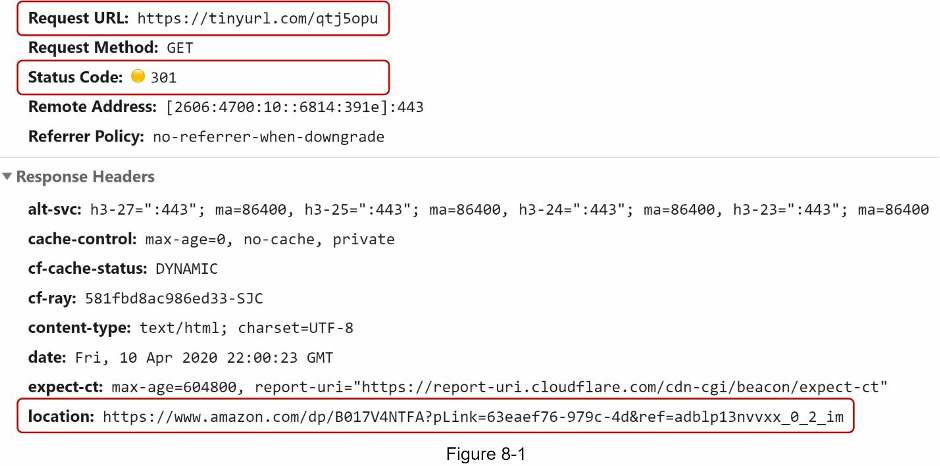

Giao tiếp chi tiết giữa máy khách và máy chủ được thể hiện trong Hình 8-2.

<!-- trang-pdf:122 -->

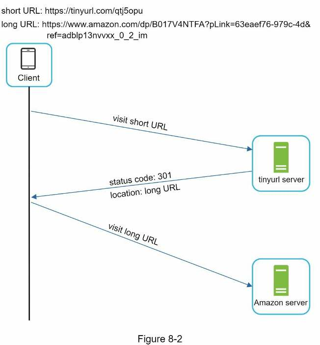

Một điểm đáng thảo luận ở đây là chuyển hướng 301 so với chuyển hướng 302.

**Chuyển hướng 301.** Chuyển hướng 301 cho biết URL được yêu cầu đã được chuyển “vĩnh viễn” tới URL dài. Vì chuyển hướng là vĩnh viễn, trình duyệt lưu phản hồi vào bộ nhớ đệm; các yêu cầu tiếp theo tới cùng URL sẽ không gửi tới dịch vụ rút gọn URL. Thay vào đó, yêu cầu được chuyển trực tiếp tới máy chủ của URL dài.

**Chuyển hướng 302.** Chuyển hướng 302 nghĩa là URL được chuyển “tạm thời” tới URL dài. Điều này có nghĩa các yêu cầu tiếp theo tới cùng URL sẽ được gửi tới dịch vụ rút gọn URL trước, rồi mới được chuyển tới máy chủ URL dài.

Mỗi phương thức chuyển hướng có ưu và nhược điểm. Nếu ưu tiên giảm tải máy chủ, dùng chuyển hướng 301 là hợp lý vì chỉ yêu cầu đầu tiên cho cùng một URL được gửi tới máy chủ rút gọn URL. Tuy nhiên, nếu việc phân tích số liệu quan trọng, chuyển hướng 302 là lựa chọn tốt hơn vì dễ theo dõi tỷ lệ nhấp và nguồn của lượt nhấp.

Cách trực quan nhất để triển khai chuyển hướng URL là dùng bảng băm. Giả sử bảng băm lưu các cặp `<shortURL, longURL>`, có thể triển khai như sau:

- Lấy `longURL`: `longURL = hashTable.get(shortURL)`.
- Sau khi có `longURL`, thực hiện chuyển hướng URL.

### Rút gọn URL

Giả sử URL ngắn có dạng `www.tinyurl.com/{hashValue}`. Để hỗ trợ trường hợp sử dụng rút gọn URL, chúng ta phải tìm hàm băm fx ánh xạ URL dài sang `hashValue`, như Hình 8-3.

<!-- trang-pdf:123 -->

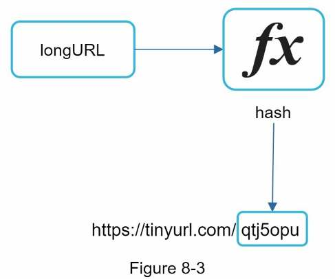

Hàm băm phải đáp ứng các yêu cầu sau:

- Mỗi `longURL` phải được băm thành một `hashValue`.
- Mỗi `hashValue` có thể được ánh xạ ngược tới `longURL`.

Thiết kế chi tiết của hàm băm được thảo luận trong phần đi sâu vào thiết kế.

<!-- trang-pdf:124 -->

## Bước 3 - Đi sâu vào thiết kế

Đến đây, chúng ta đã thảo luận thiết kế cấp cao của việc rút gọn và chuyển hướng URL. Trong phần này, chúng ta đi sâu vào mô hình dữ liệu, hàm băm, rút gọn URL và chuyển hướng URL.

### Mô hình dữ liệu

Trong thiết kế cấp cao, mọi thứ được lưu trong một bảng băm. Đây là điểm khởi đầu tốt; tuy nhiên, cách này không khả thi cho hệ thống thực tế vì tài nguyên bộ nhớ có giới hạn và đắt đỏ. Lựa chọn tốt hơn là lưu ánh xạ `<shortURL, longURL>` trong cơ sở dữ liệu quan hệ. Hình 8-4 cho thấy một thiết kế bảng cơ sở dữ liệu đơn giản. Phiên bản rút gọn của bảng có ba cột: `id`, `shortURL`, `longURL`.

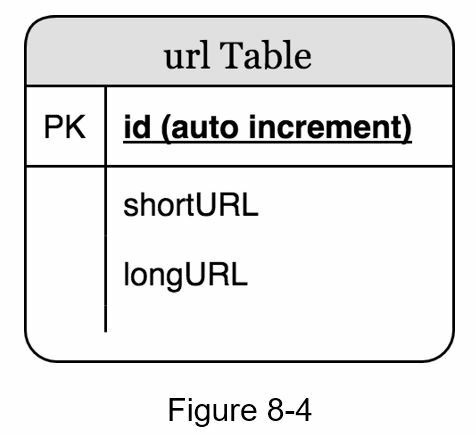

### Hàm băm

Hàm băm được dùng để băm URL dài thành URL ngắn, còn gọi là `hashValue`.

### Độ dài giá trị băm

`hashValue` gồm các ký tự trong `[0-9, a-z, A-Z]`, chứa `10 + 26 + 26 = 62` ký tự có thể dùng. Để xác định độ dài `hashValue`, tìm n nhỏ nhất sao cho `62^n ≥ 365 tỷ`. Theo ước tính sơ bộ, hệ thống phải hỗ trợ tới 365 tỷ URL. Bảng 8-1 cho biết độ dài `hashValue` và số URL tối đa tương ứng mà nó có thể hỗ trợ.

<!-- trang-pdf:125 -->

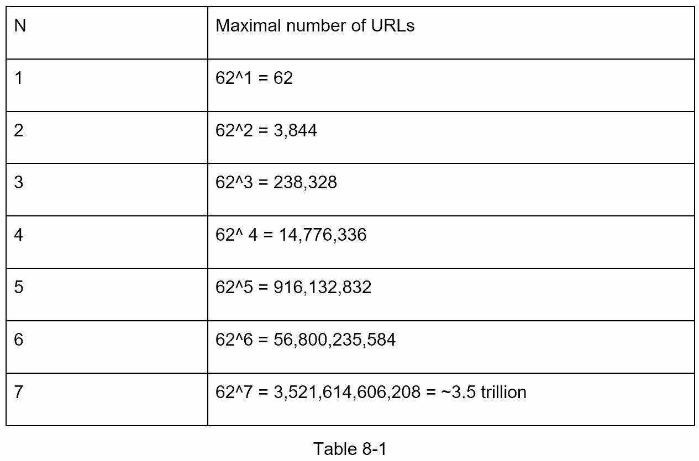

Khi n = 7, `62^n ≈ 3,5 nghìn tỷ`. Con số này dư sức chứa 365 tỷ URL, vì vậy độ dài `hashValue` là 7.

Chúng ta sẽ tìm hiểu hai loại hàm cho dịch vụ rút gọn URL. Loại đầu tiên là “băm + giải quyết va chạm”; loại thứ hai là “chuyển đổi cơ số 62”. Hãy lần lượt xem xét.

### Băm + giải quyết va chạm

Để rút gọn URL dài, chúng ta cần triển khai hàm băm biến URL dài thành chuỗi 7 ký tự. Giải pháp đơn giản là dùng các hàm băm nổi tiếng như CRC32, MD5 hoặc SHA-1. Bảng dưới đây so sánh kết quả sau khi áp dụng các hàm băm khác nhau lên URL `https://en.wikipedia.org/wiki/Systems_design`.

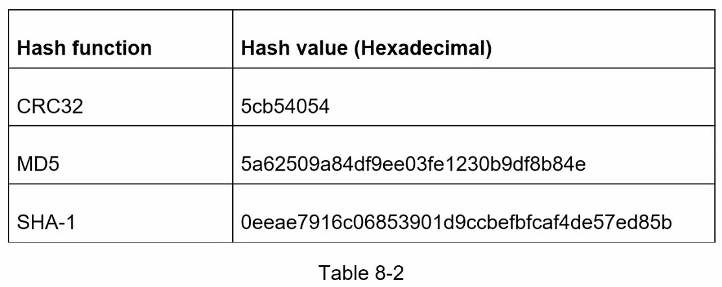

Như Bảng 8-2, ngay cả giá trị băm ngắn nhất từ CRC32 cũng quá dài, hơn 7 ký tự. Làm sao để rút ngắn nó?

Cách đầu tiên là lấy 7 ký tự đầu của giá trị băm; tuy nhiên, cách này có thể dẫn đến va chạm băm. Để giải quyết, có thể nối thêm một chuỗi mới đã xác định trước rồi lặp lại theo cách đệ quy cho tới khi không còn phát hiện va chạm. Quy trình được giải thích trong Hình 8-5. <!-- trang-pdf:126 -->

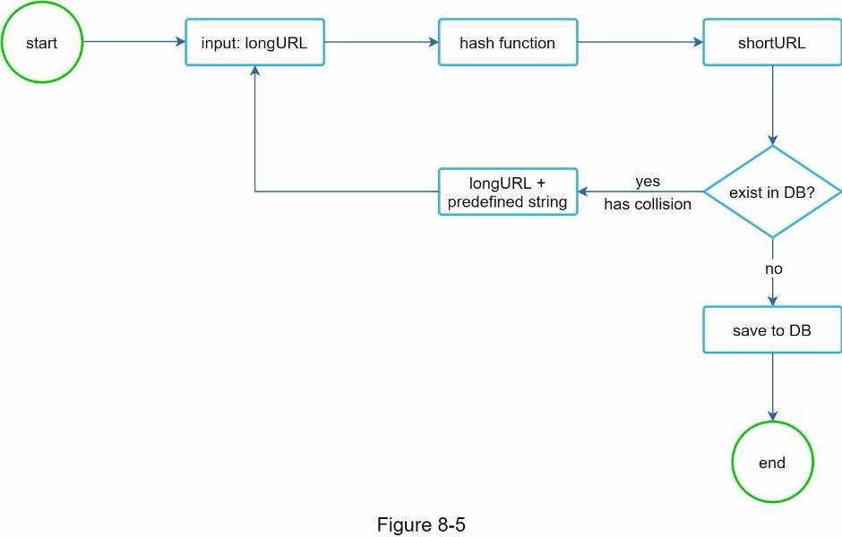

Phương pháp này có thể loại bỏ va chạm; tuy nhiên, truy vấn cơ sở dữ liệu để kiểm tra `shortURL` có tồn tại hay không với mỗi yêu cầu rất tốn kém. Một kỹ thuật gọi là bộ lọc Bloom [2] có thể cải thiện hiệu năng. Bộ lọc Bloom là kỹ thuật xác suất tiết kiệm không gian để kiểm tra một phần tử có thuộc một tập hợp hay không. Xem tài liệu [2] để biết thêm chi tiết.

### Chuyển đổi cơ số 62

Chuyển đổi cơ số là một cách tiếp cận thường dùng khác cho dịch vụ rút gọn URL. Nó giúp chuyển cùng một số giữa các hệ biểu diễn số khác nhau. Cơ số 62 được dùng vì `hashValue` có 62 ký tự khả dĩ. Hãy dùng một ví dụ để giải thích: chuyển số `11157₁₀` sang biểu diễn cơ số 62; `11157₁₀` là 11157 trong hệ cơ số 10.

- Đúng như tên gọi, cơ số 62 dùng 62 ký tự để mã hóa. Ánh xạ là: `0-0, ..., 9-9, 10-a, 11-b, ..., 35-z, 36-A, ..., 61-Z`, trong đó `a` biểu diễn 10, `Z` biểu diễn 61, v.v.
- `11157₁₀ = 2 × 62² + 55 × 62¹ + 59 × 62⁰ = [2, 55, 59] → [2, T, X]` trong biểu diễn cơ số 62. Hình 8-6 cho thấy quá trình chuyển đổi.

<!-- trang-pdf:127 -->

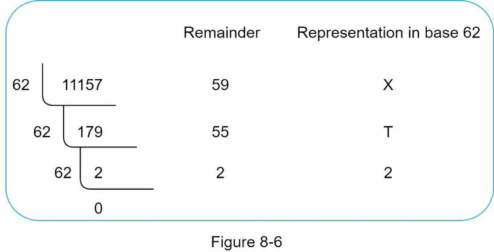

- Vì vậy, URL ngắn là `https://tinyurl.com/2TX`.

### So sánh hai cách tiếp cận

Bảng 8-3 cho thấy sự khác biệt giữa hai cách tiếp cận.

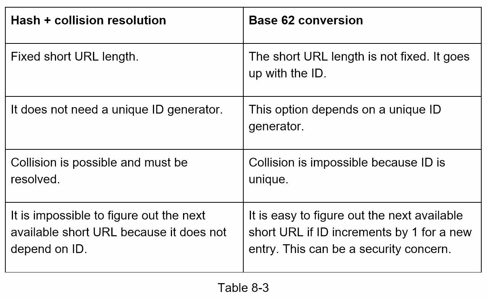

### Đi sâu vào rút gọn URL

Là một trong những phần cốt lõi của hệ thống, luồng rút gọn URL cần có logic đơn giản và hoạt động đúng. Chúng ta dùng chuyển đổi cơ số 62 trong thiết kế. Sơ đồ sau, Hình 8-7, minh họa luồng xử lý.

<!-- trang-pdf:128 -->

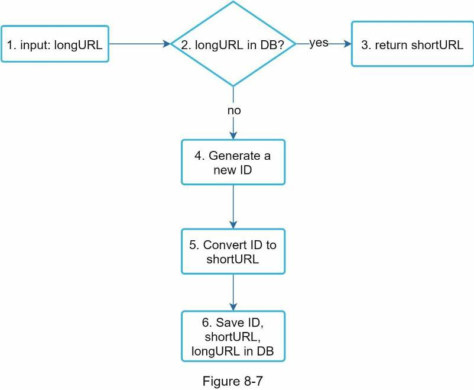

1. Đầu vào là `longURL`.
2. Hệ thống kiểm tra `longURL` có trong cơ sở dữ liệu không.
3. Nếu có, nghĩa là `longURL` đã được chuyển thành `shortURL` trước đó. Trong trường hợp này, lấy `shortURL` từ cơ sở dữ liệu và trả về máy khách.
4. Nếu chưa có, `longURL` là URL mới. Bộ sinh ID duy nhất tạo một ID mới duy nhất, dùng làm khóa chính.
5. Chuyển ID thành `shortURL` bằng chuyển đổi cơ số 62.
6. Tạo một hàng mới trong cơ sở dữ liệu với ID, `shortURL` và `longURL`.

Để dễ hiểu luồng này hơn, hãy xem một ví dụ cụ thể:

- Giả sử `longURL` đầu vào là `https://en.wikipedia.org/wiki/Systems_design`.
- Bộ sinh ID duy nhất trả về ID `2009215674938`.
- Chuyển ID thành `shortURL` bằng chuyển đổi cơ số 62. ID `2009215674938` được chuyển thành `zn9edcu`.
- Lưu ID, `shortURL` và `longURL` vào cơ sở dữ liệu như Bảng 8-4.

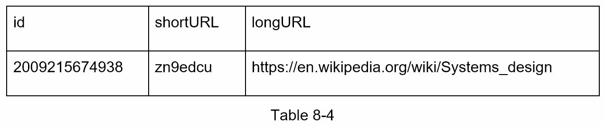

Bộ sinh ID duy nhất phân tán đáng được nhắc tới. Chức năng chính là sinh các ID duy nhất toàn cục để tạo `shortURL`. Trong môi trường phân tán cao, <!-- trang-pdf:129 --> việc triển khai bộ sinh ID duy nhất là thách thức. May mắn là chúng ta đã thảo luận một vài giải pháp trong “Chương 7: Thiết kế bộ sinh ID duy nhất trong hệ thống phân tán”. Bạn có thể xem lại để ôn tập.

### Đi sâu vào chuyển hướng URL

Hình 8-8 cho thấy thiết kế chi tiết của chuyển hướng URL. Vì số thao tác đọc nhiều hơn ghi, ánh xạ `<shortURL, longURL>` được lưu trong bộ nhớ đệm để cải thiện hiệu năng.

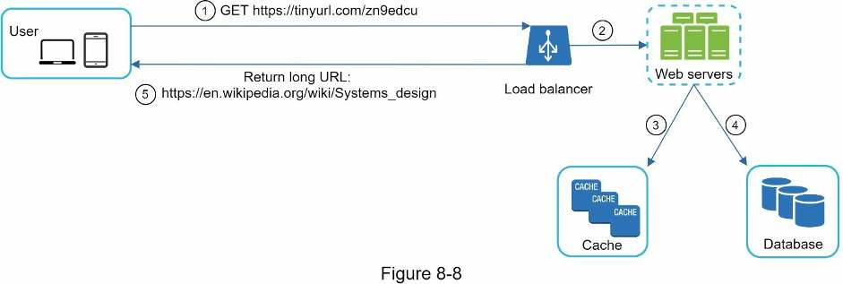

Luồng chuyển hướng được tóm tắt như sau:

1. Người dùng nhấp vào URL ngắn: `https://tinyurl.com/zn9edcu`.
2. Bộ cân bằng tải chuyển tiếp yêu cầu tới các máy chủ web.
3. Nếu `shortURL` đã có trong bộ nhớ đệm, trả về `longURL` trực tiếp.
4. Nếu `shortURL` không có trong bộ nhớ đệm, lấy `longURL` từ cơ sở dữ liệu. Nếu không có trong cơ sở dữ liệu, nhiều khả năng người dùng đã nhập `shortURL` không hợp lệ.
5. Trả về `longURL` cho người dùng.

<!-- trang-pdf:130 -->

## Bước 4 - Tổng kết

Trong chương này, chúng ta đã bàn về thiết kế API, mô hình dữ liệu, hàm băm, rút gọn URL và chuyển hướng URL.

Nếu còn thời gian ở cuối buổi phỏng vấn, có thể thảo luận thêm một số điểm:

- **Bộ giới hạn tốc độ.** Một vấn đề bảo mật có thể gặp là người dùng độc hại gửi số lượng yêu cầu rút gọn URL quá lớn. Bộ giới hạn tốc độ giúp lọc yêu cầu theo địa chỉ IP hoặc quy tắc khác. Nếu muốn ôn lại giới hạn tốc độ, xem “Chương 4: Thiết kế bộ giới hạn tốc độ”.
- **Mở rộng máy chủ web.** Vì tầng web không lưu trạng thái, có thể dễ dàng mở rộng bằng cách thêm hoặc loại bỏ máy chủ web.
- **Mở rộng cơ sở dữ liệu.** Sao chép và phân mảnh dữ liệu là những kỹ thuật phổ biến.
- **Phân tích số liệu.** Dữ liệu ngày càng quan trọng với thành công kinh doanh. Tích hợp giải pháp phân tích vào dịch vụ rút gọn URL có thể giúp trả lời những câu hỏi quan trọng, chẳng hạn có bao nhiêu người nhấp vào một liên kết, họ nhấp khi nào, v.v.
- **Tính sẵn sàng, tính nhất quán và độ tin cậy.** Đây là các khái niệm cốt lõi cho thành công của mọi hệ thống lớn. Chúng ta đã thảo luận chi tiết trong Chương 1; hãy ôn lại những chủ đề này.

Chúc mừng bạn đã đi tới đây! Hãy tự ghi nhận nỗ lực của mình. Bạn đã làm tốt!

<!-- trang-pdf:131 -->

## Tài liệu tham khảo

[1] A RESTful Tutorial: https://www.restapitutorial.com/index.html

[2] Bloom filter: https://en.wikipedia.org/wiki/Bloom_filter

---

[← Chương 7](chuong-07.md) · [Mục lục](../README.md) · [Chương 9 →](chuong-09.md)
