# Chương 9: Thiết kế trình thu thập dữ liệu web

*Tên gốc: Design a Web Crawler. Nguồn: trang PDF 132-150. Hình gốc và nhãn tiếng Anh bên trong hình được giữ nguyên.*

<!-- trang-pdf:132 -->

Trong chương này, chúng ta tập trung vào thiết kế trình thu thập dữ liệu web: một câu hỏi phỏng vấn thiết kế hệ thống thú vị và kinh điển.

Trình thu thập dữ liệu web (web crawler) còn được gọi là robot hoặc spider. Các công cụ tìm kiếm sử dụng nó rộng rãi để phát hiện nội dung mới hoặc được cập nhật trên web. Nội dung có thể là trang web, ảnh, video, file PDF, v.v. Trình thu thập bắt đầu bằng việc lấy một vài trang web, sau đó đi theo các liên kết trên những trang đó để lấy nội dung mới. Hình 9-1 minh họa quá trình thu thập.

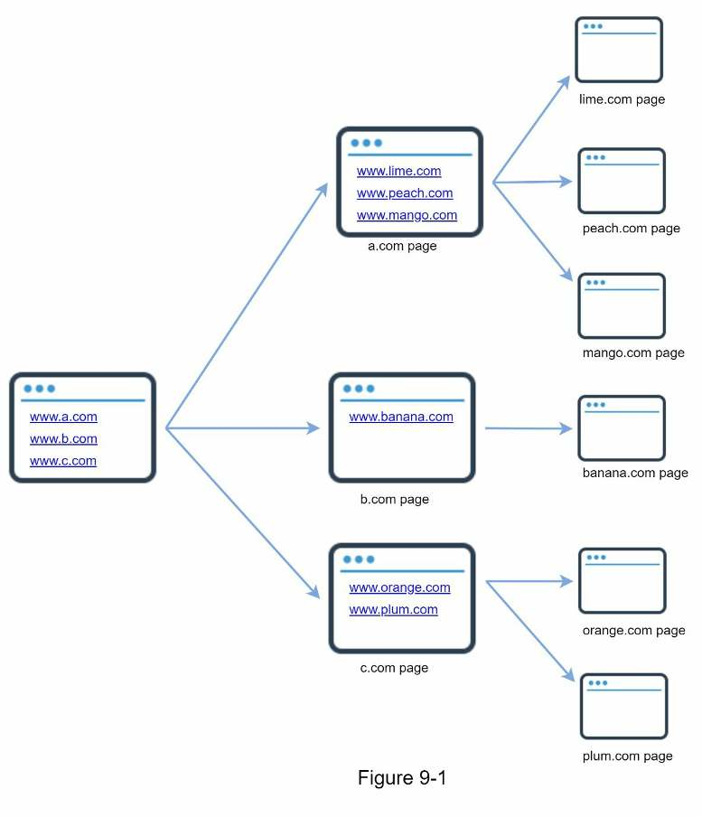

Trình thu thập được dùng cho nhiều mục đích:

- **Lập chỉ mục cho công cụ tìm kiếm:** đây là trường hợp sử dụng phổ biến nhất. Trình thu thập lấy các trang web để tạo chỉ mục cục bộ cho công cụ tìm kiếm. Ví dụ, Googlebot là trình thu thập đứng sau công cụ tìm kiếm Google.
- **Lưu trữ web:** đây là quá trình lấy thông tin từ web nhằm bảo tồn dữ liệu cho việc sử dụng trong tương lai. Chẳng hạn, nhiều thư viện quốc gia vận hành trình thu thập để lưu trữ website. Những ví dụ đáng chú ý là Thư viện Quốc hội Hoa Kỳ [1] và kho lưu trữ web của EU [2].
- **Khai phá web:** sự phát triển bùng nổ của web đem lại cơ hội chưa từng có cho <!-- trang-pdf:133 --> việc khai phá dữ liệu. Khai phá web giúp khám phá tri thức hữu ích từ internet. Ví dụ, các công ty tài chính hàng đầu dùng trình thu thập để tải nội dung họp cổ đông và báo cáo thường niên, nhằm tìm hiểu các sáng kiến quan trọng của doanh nghiệp.
- **Giám sát web:** trình thu thập giúp theo dõi việc vi phạm bản quyền và nhãn hiệu trên internet. Ví dụ, Digimarc [3] sử dụng trình thu thập để phát hiện tác phẩm vi phạm bản quyền và báo cáo chúng.

Độ phức tạp của việc phát triển trình thu thập phụ thuộc vào quy mô dự định hỗ trợ. Đó có thể là dự án nhỏ ở trường học, chỉ mất vài giờ để hoàn thành, hoặc dự án khổng lồ đòi hỏi một nhóm kỹ sư chuyên trách cải tiến liên tục. Vì vậy, bên dưới chúng ta sẽ tìm hiểu quy mô và những tính năng cần hỗ trợ.

<!-- trang-pdf:134 -->

## Bước 1 - Hiểu bài toán và xác định phạm vi thiết kế

Thuật toán cơ bản của trình thu thập web rất đơn giản:

1. Với một tập URL cho trước, tải xuống tất cả trang web mà các URL trỏ tới.
2. Trích xuất URL từ những trang web này.
3. Thêm URL mới vào danh sách URL cần tải xuống. Lặp lại ba bước này.

Trình thu thập web có thực sự hoạt động đơn giản như thuật toán cơ bản không? Không hẳn. Thiết kế trình thu thập có khả năng mở rộng rất lớn là một nhiệm vụ cực kỳ phức tạp. Khó có ai thiết kế được một trình thu thập khổng lồ trong thời lượng buổi phỏng vấn. Trước khi bắt tay vào thiết kế, chúng ta phải đặt câu hỏi để hiểu yêu cầu và xác định phạm vi:

**Ứng viên:** Mục đích chính của trình thu thập là gì? Dùng để lập chỉ mục tìm kiếm, khai phá dữ liệu hay việc khác?

**Người phỏng vấn:** Lập chỉ mục cho công cụ tìm kiếm.

**Ứng viên:** Mỗi tháng trình thu thập lấy bao nhiêu trang web?

**Người phỏng vấn:** 1 tỷ trang.

**Ứng viên:** Bao gồm những loại nội dung nào? Chỉ HTML hay cả PDF, hình ảnh và các loại khác?

**Người phỏng vấn:** Chỉ HTML.

**Ứng viên:** Chúng ta có cần xét các trang web mới được thêm hoặc chỉnh sửa không?

**Người phỏng vấn:** Có, cần xét các trang mới hoặc được chỉnh sửa.

**Ứng viên:** Có cần lưu những trang HTML đã thu thập từ web không?

**Người phỏng vấn:** Có, tối đa 5 năm.

**Ứng viên:** Xử lý các trang có nội dung trùng lặp như thế nào?

**Người phỏng vấn:** Bỏ qua trang có nội dung trùng lặp.

Trên đây là một số câu hỏi mẫu bạn có thể đặt cho người phỏng vấn. Điều quan trọng là hiểu yêu cầu và làm rõ điểm mơ hồ. Ngay cả khi được yêu cầu thiết kế một sản phẩm có vẻ đơn giản như trình thu thập web, bạn và người phỏng vấn cũng có thể có các giả định khác nhau.

Bên cạnh những chức năng cần làm rõ, cũng cần ghi lại các đặc điểm sau của một trình thu thập tốt:

- **Khả năng mở rộng:** web rất lớn, có hàng tỷ trang. Việc thu thập cần cực kỳ hiệu quả nhờ xử lý song song.
- **Độ vững chắc:** web đầy cạm bẫy. HTML lỗi, máy chủ không phản hồi, sự cố, liên kết độc hại, v.v. đều phổ biến. Trình thu thập phải xử lý mọi trường hợp biên này.
- **Tính lịch sự:** trình thu thập không nên gửi quá nhiều yêu cầu tới một website trong khoảng thời gian ngắn.
- **Khả năng mở rộng chức năng:** hệ thống phải linh hoạt để chỉ cần thay đổi tối thiểu khi hỗ trợ loại nội dung mới. Ví dụ, nếu muốn thu thập ảnh trong tương lai, chúng ta không nên phải thiết kế lại toàn bộ hệ thống.

### Ước tính sơ bộ

Những ước tính dưới đây dựa trên nhiều giả định; cần trao đổi với người phỏng vấn để thống nhất cách hiểu.

- Giả sử tải xuống 1 tỷ trang web mỗi tháng.

<!-- trang-pdf:135 -->

- QPS: `1.000.000.000 / 30 ngày / 24 giờ / 3600 giây ≈ 400 trang/giây`.
- QPS lúc cao điểm: `2 × QPS = 800`.
- Giả sử kích thước trung bình của một trang web là 500 KB.
- `1 tỷ trang × 500 KB = 500 TB` dung lượng lưu trữ mỗi tháng. Nếu chưa rõ các đơn vị lưu trữ số, hãy xem lại phần “Lũy thừa của 2” trong Chương 2.
- Giả sử lưu dữ liệu trong 5 năm: `500 TB × 12 tháng × 5 năm = 30 PB`. Cần 30 PB dung lượng để lưu nội dung trong 5 năm.

<!-- trang-pdf:136 -->

## Bước 2 - Đề xuất thiết kế cấp cao và thống nhất

Khi yêu cầu đã rõ, chúng ta chuyển sang thiết kế cấp cao. Dựa trên gợi ý từ các nghiên cứu trước về thu thập web [4] [5], chúng ta đề xuất thiết kế trong Hình 9-2.

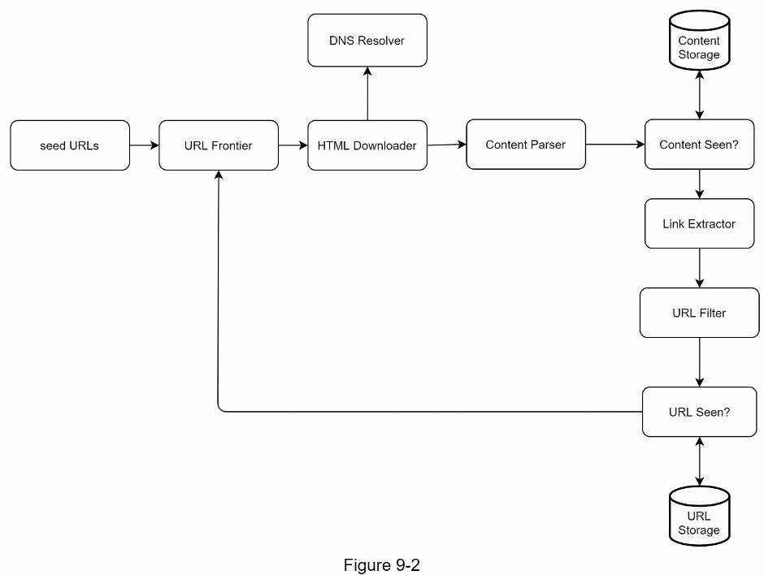

Trước tiên, chúng ta tìm hiểu từng thành phần để hiểu chức năng của nó. Sau đó, xem xét luồng công việc của trình thu thập theo từng bước.

### URL khởi đầu

Trình thu thập dùng các URL khởi đầu, hay seed URL, làm điểm bắt đầu. Ví dụ, để thu thập mọi trang trên website của một trường đại học, cách chọn URL khởi đầu trực quan là dùng tên miền của trường.

Để thu thập toàn bộ web, chúng ta phải sáng tạo khi chọn URL khởi đầu. Một URL tốt là điểm xuất phát để trình thu thập đi qua càng nhiều liên kết càng tốt. Chiến lược chung là chia toàn bộ không gian URL thành các phần nhỏ hơn. Cách đầu tiên được đề xuất dựa trên vị trí địa lý, vì các quốc gia khác nhau có thể có những website phổ biến khác nhau. Cách khác là chọn URL khởi đầu theo chủ đề, chẳng hạn chia không gian URL thành mua sắm, thể thao, chăm sóc sức khỏe, v.v. Chọn URL khởi đầu là một câu hỏi mở. Bạn không được kỳ vọng đưa ra đáp án hoàn hảo; hãy trình bày thành lời cách suy nghĩ của mình.

### URL Frontier

Phần lớn trình thu thập hiện đại chia trạng thái thu thập thành hai loại: cần tải xuống và đã tải xuống. Thành phần lưu những URL cần tải được gọi là URL Frontier. Có thể xem nó như một hàng đợi vào trước ra trước, tức FIFO. Chi tiết về URL Frontier nằm trong phần đi sâu vào thiết kế.

<!-- trang-pdf:137 -->

### Bộ tải HTML

Bộ tải HTML (HTML Downloader) tải các trang web từ internet. URL do URL Frontier cung cấp.

### Bộ phân giải DNS

Để tải trang web, phải chuyển URL thành địa chỉ IP. Bộ tải HTML gọi bộ phân giải DNS để lấy IP tương ứng. Ví dụ, tại thời điểm 3/5/2019 trong nguồn, URL `www.wikipedia.org` được chuyển thành IP `198.35.26.96`.

### Bộ phân tích nội dung

Sau khi tải trang web, cần phân tích và xác thực trang vì các trang sai cấu trúc có thể gây vấn đề và lãng phí dung lượng lưu trữ. Triển khai bộ phân tích nội dung ngay trong máy chủ thu thập sẽ làm chậm quá trình. Vì vậy, bộ phân tích nội dung được tách thành một thành phần riêng.

### Đã thấy nội dung chưa?

Nghiên cứu trực tuyến [6] cho thấy 29% trang web có nội dung trùng lặp, có thể khiến cùng một nội dung được lưu nhiều lần. Chúng ta đưa vào cấu trúc dữ liệu “Content Seen?” để loại bỏ dư thừa dữ liệu và rút ngắn thời gian xử lý. Nó giúp phát hiện nội dung mới nhận nhưng đã từng được lưu trong hệ thống. Để so sánh hai tài liệu HTML, có thể so từng ký tự. Tuy nhiên, phương pháp này chậm và tốn thời gian, nhất là với hàng tỷ trang. Cách hiệu quả hơn là so sánh giá trị băm của hai trang web [7].

### Kho lưu nội dung

Đây là hệ thống lưu trữ nội dung HTML. Việc chọn hệ thống lưu trữ phụ thuộc vào loại dữ liệu, kích thước, tần suất truy cập, thời gian tồn tại, v.v. Cả đĩa và bộ nhớ đều được sử dụng:

- Phần lớn nội dung được lưu trên đĩa vì tập dữ liệu quá lớn để chứa trong bộ nhớ.
- Nội dung phổ biến được giữ trong bộ nhớ để giảm độ trễ.

### Bộ trích xuất URL

Bộ trích xuất URL phân tích và lấy các liên kết từ trang HTML. Hình 9-3 minh họa quá trình trích xuất. Đường dẫn tương đối được chuyển thành URL tuyệt đối bằng cách thêm tiền tố `https://en.wikipedia.org`.

<!-- trang-pdf:138 -->

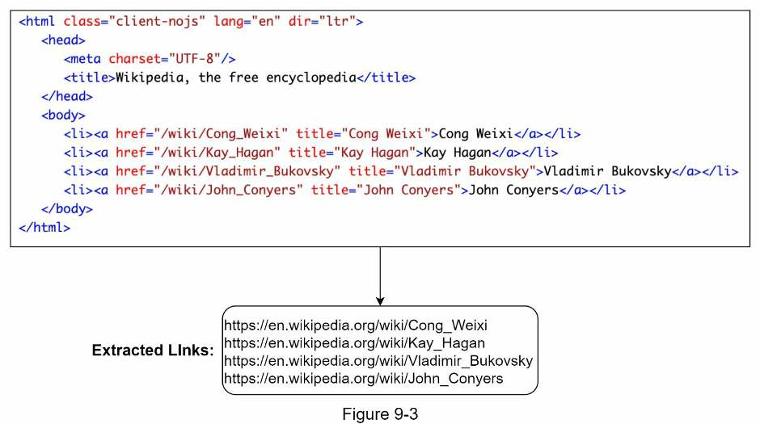

### Bộ lọc URL

Bộ lọc URL loại bỏ một số loại nội dung, phần mở rộng file, liên kết lỗi và URL thuộc các website trong danh sách chặn.

### Đã thấy URL chưa?

“URL Seen?” là cấu trúc dữ liệu theo dõi các URL đã được truy cập hoặc đã có trong Frontier. Nó giúp tránh thêm cùng URL nhiều lần, vì điều này có thể làm tăng tải máy chủ và dẫn đến vòng lặp vô hạn.

Bộ lọc Bloom và bảng băm là các kỹ thuật phổ biến để triển khai thành phần này. Chúng ta không trình bày chi tiết cách triển khai bộ lọc Bloom và bảng băm tại đây. Xem tài liệu tham khảo [4] [8] để tìm hiểu thêm.

### Kho lưu URL

Kho lưu URL (URL Storage) chứa những URL đã được truy cập.

Đến đây, chúng ta đã thảo luận mọi thành phần. Tiếp theo, hãy kết hợp chúng để giải thích luồng công việc.

### Luồng công việc của trình thu thập web

Để giải thích rõ từng bước, sơ đồ được bổ sung số thứ tự như Hình 9-4.

<!-- trang-pdf:139 -->

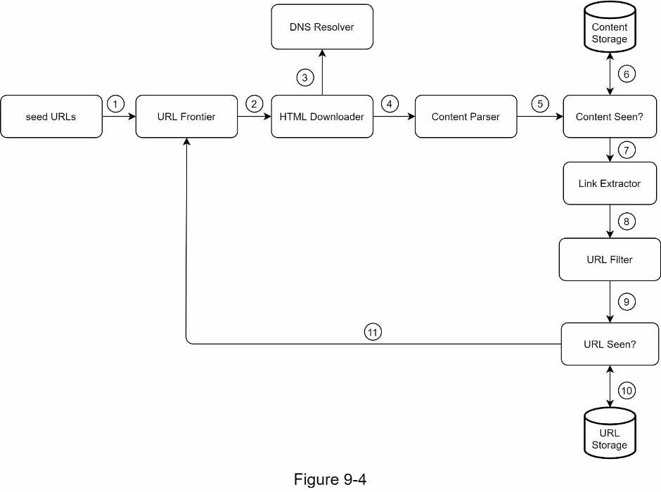

**Bước 1:** thêm URL khởi đầu vào URL Frontier.

**Bước 2:** bộ tải HTML lấy một danh sách URL từ URL Frontier.

**Bước 3:** bộ tải HTML lấy địa chỉ IP của các URL từ bộ phân giải DNS và bắt đầu tải.

**Bước 4:** bộ phân tích nội dung phân tích các trang HTML và kiểm tra xem trang có sai cấu trúc không.

**Bước 5:** sau khi nội dung được phân tích và xác thực, nó được chuyển tới thành phần “Content Seen?”.

**Bước 6:** “Content Seen?” kiểm tra trang HTML đã có trong kho lưu trữ chưa.

- Nếu đã có, nghĩa là cùng nội dung ở một URL khác đã được xử lý. Trong trường hợp này, bỏ trang HTML.
- Nếu chưa có, hệ thống chưa xử lý nội dung đó trước đây. Nội dung được chuyển tới bộ trích xuất liên kết.

**Bước 7:** bộ trích xuất liên kết lấy các liên kết từ trang HTML.

**Bước 8:** các liên kết được chuyển tới bộ lọc URL.

**Bước 9:** sau khi lọc, các liên kết được chuyển tới “URL Seen?”.

**Bước 10:** “URL Seen?” kiểm tra URL đã có trong kho lưu trữ chưa. Nếu có, URL đã được xử lý và không cần làm gì.

**Bước 11:** nếu URL chưa được xử lý, thêm nó vào URL Frontier.

<!-- trang-pdf:140 -->

## Bước 3 - Đi sâu vào thiết kế

Đến đây, chúng ta đã thảo luận thiết kế cấp cao. Tiếp theo, hãy xem kỹ những thành phần và kỹ thuật quan trọng nhất:

- Tìm kiếm theo chiều sâu (DFS) so với tìm kiếm theo chiều rộng (BFS).
- URL Frontier.
- Bộ tải HTML.
- Độ vững chắc.
- Khả năng mở rộng chức năng.
- Phát hiện và tránh nội dung có vấn đề.

### DFS so với BFS

Có thể xem web là đồ thị có hướng, trong đó trang web là nút và siêu liên kết, tức URL, là cạnh. Quá trình thu thập có thể được xem như duyệt đồ thị có hướng từ trang này sang các trang khác. Hai thuật toán duyệt đồ thị phổ biến là DFS và BFS. Tuy nhiên, DFS thường không phải lựa chọn tốt vì độ sâu có thể rất lớn.

BFS thường được các trình thu thập sử dụng và được triển khai bằng hàng đợi FIFO. Trong hàng đợi FIFO, URL được lấy ra theo thứ tự đưa vào. Tuy nhiên, cách triển khai này có hai vấn đề:

- Phần lớn liên kết từ cùng một trang web trỏ trở lại cùng máy chủ. Trong Hình 9-5, mọi liên kết trong `wikipedia.com` là liên kết nội bộ, khiến trình thu thập bận xử lý URL từ cùng một máy chủ `wikipedia.com`. Khi cố tải trang song song, các máy chủ Wikipedia sẽ bị dồn dập yêu cầu. Điều này được coi là “không lịch sự”.

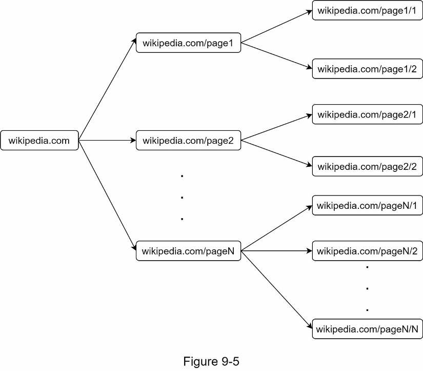

<!-- trang-pdf:141 -->

- BFS tiêu chuẩn không xét độ ưu tiên của URL. Web rất lớn; không phải trang nào cũng có chất lượng và tầm quan trọng như nhau. Vì vậy, có thể cần ưu tiên URL theo thứ hạng trang, lưu lượng website, tần suất cập nhật, v.v.

### URL Frontier

URL Frontier giúp giải quyết những vấn đề này. Đây là cấu trúc dữ liệu lưu URL cần tải xuống, đồng thời là thành phần quan trọng để bảo đảm tính lịch sự, độ ưu tiên URL và độ mới của dữ liệu. Một số bài báo đáng chú ý về URL Frontier nằm trong tài liệu tham khảo [5] [9]. Các kết quả từ những bài báo này được trình bày bên dưới.

### Tính lịch sự

Nhìn chung, trình thu thập nên tránh gửi quá nhiều yêu cầu tới cùng máy chủ trong thời gian ngắn. Gửi quá nhiều bị coi là “không lịch sự”, thậm chí có thể bị xem là tấn công từ chối dịch vụ, tức DoS. Ví dụ, nếu không có giới hạn, trình thu thập có thể gửi hàng nghìn yêu cầu mỗi giây tới cùng website, làm các máy chủ web quá tải.

Ý tưởng chung để bảo đảm tính lịch sự là chỉ tải từng trang một từ cùng máy chủ. Có thể thêm thời gian trễ giữa hai nhiệm vụ tải. Ràng buộc này được triển khai bằng cách duy trì ánh xạ từ tên máy chủ website tới các luồng tải, tức luồng worker. Mỗi luồng tải có một hàng đợi FIFO riêng và chỉ tải URL từ hàng đợi đó. Hình 9-6 cho thấy thiết kế quản lý tính lịch sự.

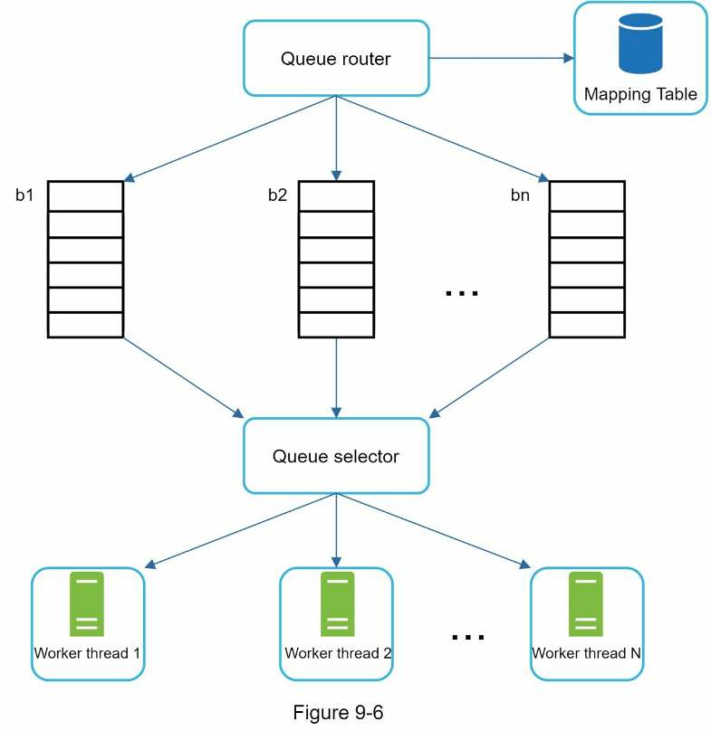

<!-- trang-pdf:142 -->

- **Bộ định tuyến hàng đợi (Queue router):** bảo đảm mỗi hàng đợi b1, b2, ..., bn chỉ chứa URL từ cùng một máy chủ.
- **Bảng ánh xạ (Mapping table):** ánh xạ mỗi máy chủ tới một hàng đợi.

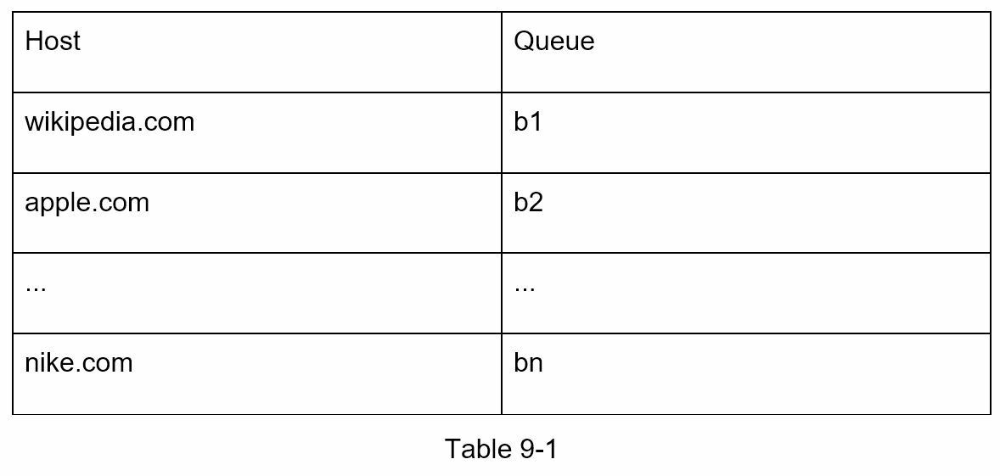

- **Các hàng đợi FIFO b1, b2 đến bn:** mỗi hàng đợi chứa URL từ cùng một máy chủ.
- **Bộ chọn hàng đợi (Queue selector):** mỗi luồng worker được ánh xạ tới một hàng đợi FIFO và chỉ tải URL từ hàng đợi đó. Logic chọn hàng đợi do bộ chọn thực hiện.
- **Các luồng worker 1 đến N:** mỗi luồng tải lần lượt từng trang từ cùng máy chủ. Có thể thêm thời gian trễ giữa hai lần tải.

### Độ ưu tiên

Một bài viết ngẫu nhiên trên diễn đàn thảo luận sản phẩm Apple có trọng lượng rất khác so với bài đăng trên trang chủ Apple. Dù cả hai đều có từ khóa “Apple”, việc trình thu thập lấy trang chủ Apple trước là hợp lý.

Chúng ta ưu tiên URL dựa trên mức hữu ích, có thể đo bằng PageRank [10], lưu lượng website, tần suất cập nhật, v.v. Thành phần “Prioritizer” xử lý việc ưu tiên URL. Xem tài liệu [5] [10] để tìm hiểu sâu hơn.

Hình 9-7 cho thấy thiết kế quản lý độ ưu tiên URL.

<!-- trang-pdf:143 -->

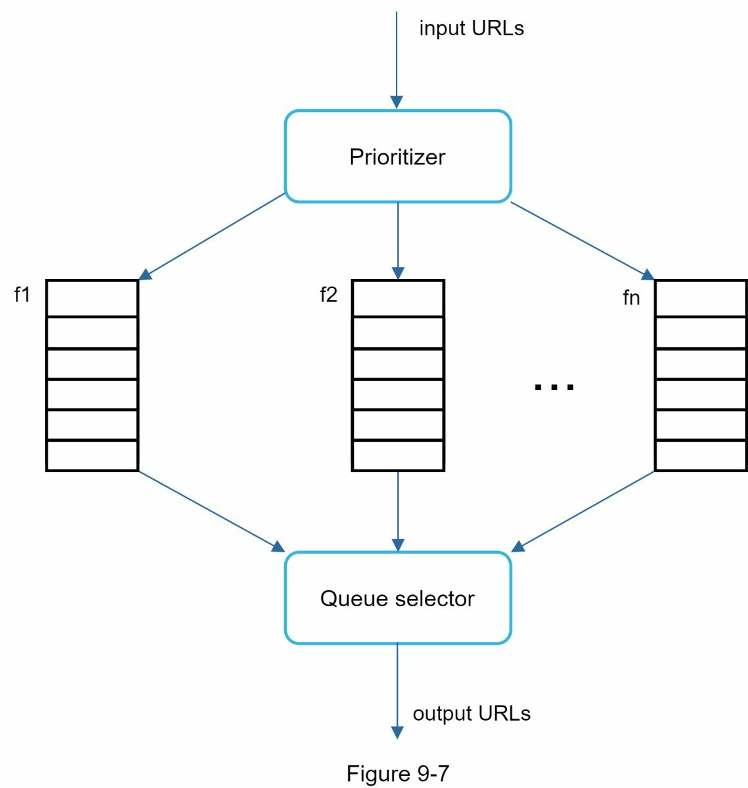

- **Bộ xác định độ ưu tiên (Prioritizer):** nhận URL đầu vào và tính độ ưu tiên.
- **Các hàng đợi f1 đến fn:** mỗi hàng đợi được gán một độ ưu tiên. Hàng đợi có độ ưu tiên cao được chọn với xác suất lớn hơn.
- **Bộ chọn hàng đợi:** chọn ngẫu nhiên một hàng đợi, nhưng thiên về các hàng đợi có độ ưu tiên cao.

Hình 9-8 trình bày thiết kế URL Frontier, gồm hai mô-đun:

- Các hàng đợi phía trước quản lý độ ưu tiên.
- Các hàng đợi phía sau quản lý tính lịch sự.

<!-- trang-pdf:144 -->

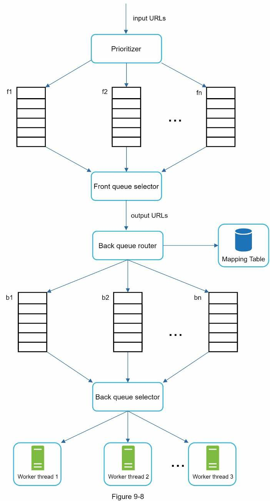

### Độ mới của dữ liệu

Các trang web liên tục được thêm, xóa và chỉnh sửa. Trình thu thập phải định kỳ thu thập lại các trang đã tải để giữ tập dữ liệu mới. Thu thập lại mọi URL tốn thời gian và tài nguyên. Một vài chiến lược tối ưu độ mới gồm:

<!-- trang-pdf:145 -->

- Thu thập lại dựa trên lịch sử cập nhật của trang.
- Ưu tiên URL, thu thập lại các trang quan trọng trước và thường xuyên hơn.

### Lưu trữ cho URL Frontier

Trong quá trình thu thập thực tế cho công cụ tìm kiếm, số URL trong Frontier có thể lên tới hàng trăm triệu [4]. Đặt mọi thứ trong bộ nhớ vừa không bền vững vừa không có khả năng mở rộng. Giữ mọi thứ trên đĩa cũng không phù hợp, vì đĩa chậm và dễ trở thành nút thắt của quá trình thu thập.

Chúng ta áp dụng cách tiếp cận kết hợp. Phần lớn URL được lưu trên đĩa, vì vậy dung lượng lưu trữ không phải vấn đề. Để giảm chi phí đọc và ghi đĩa, chúng ta duy trì các bộ đệm trong bộ nhớ cho thao tác đưa vào/lấy ra khỏi hàng đợi. Dữ liệu trong bộ đệm được ghi định kỳ xuống đĩa.

### Bộ tải HTML

Bộ tải HTML tải trang web từ internet bằng giao thức HTTP. Trước khi thảo luận thành phần này, hãy xem giao thức loại trừ robot.

### Robots.txt

Robots.txt, gọi là Robots Exclusion Protocol, là tiêu chuẩn website dùng để giao tiếp với trình thu thập. Nó quy định những trang nào được phép tải. Trước khi thu thập một website, trình thu thập cần kiểm tra file `robots.txt` tương ứng và tuân thủ các quy tắc. Để tránh tải lặp lại `robots.txt`, chúng ta lưu kết quả của file trong bộ nhớ đệm. File được tải và đưa vào bộ nhớ đệm theo định kỳ. Dưới đây là một đoạn từ `https://www.amazon.com/robots.txt`. Một số thư mục như `creatorhub` không cho phép Googlebot truy cập.

```text
User-agent: Googlebot
Disallow: /creatorhub/*
Disallow: /rss/people/*/reviews
Disallow: /gp/pdp/rss/*/reviews
Disallow: /gp/cdp/member-reviews/
Disallow: /gp/aw/cr/
```

Ngoài `robots.txt`, tối ưu hiệu năng là một khái niệm quan trọng khác chúng ta sẽ đề cập đối với bộ tải HTML.

### Tối ưu hiệu năng

Dưới đây là danh sách các tối ưu hiệu năng cho bộ tải HTML.

**1. Thu thập phân tán**

Để đạt hiệu năng cao, công việc thu thập được phân phối tới nhiều máy chủ; mỗi máy chủ chạy nhiều luồng. Không gian URL được chia thành các phần nhỏ hơn, nên mỗi bộ tải chịu trách nhiệm cho một tập con URL. Hình 9-9 minh họa thu thập phân tán.

<!-- trang-pdf:146 -->

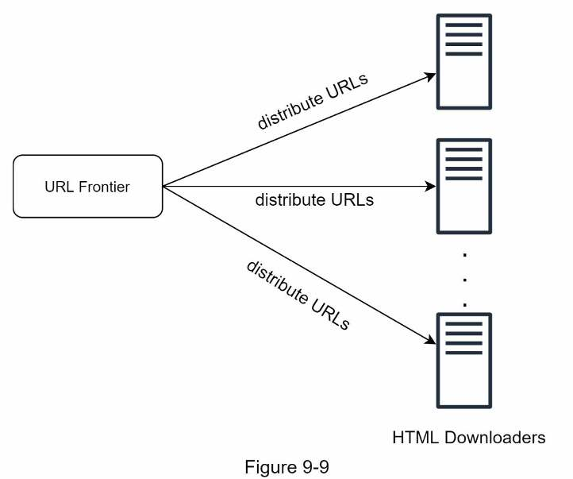

**2. Lưu đệm kết quả phân giải DNS**

Bộ phân giải DNS là nút thắt đối với trình thu thập, vì yêu cầu DNS có thể tốn thời gian do bản chất đồng bộ của nhiều giao diện DNS. Thời gian phản hồi DNS nằm trong khoảng 10 ms đến 200 ms. Khi một luồng thu thập thực hiện yêu cầu DNS, các luồng khác bị chặn đến khi yêu cầu đầu tiên hoàn tất. Duy trì bộ nhớ đệm DNS riêng để tránh gọi DNS thường xuyên là kỹ thuật tối ưu tốc độ hiệu quả. Bộ nhớ đệm lưu ánh xạ tên miền sang địa chỉ IP và được cập nhật định kỳ bằng cron job.

**3. Tính cục bộ**

Phân bố máy chủ thu thập theo địa lý. Khi ở gần máy chủ website hơn, trình thu thập tải nhanh hơn. Thiết kế theo tính cục bộ áp dụng cho phần lớn thành phần: máy chủ thu thập, bộ nhớ đệm, hàng đợi, kho lưu trữ, v.v.

**4. Thời gian chờ ngắn**

Một số máy chủ web phản hồi chậm hoặc hoàn toàn không phản hồi. Để tránh chờ lâu, cần quy định thời gian chờ tối đa. Nếu máy chủ không phản hồi trong khoảng thời gian định trước, trình thu thập dừng công việc và chuyển sang thu thập các trang khác.

### Độ vững chắc

Ngoài tối ưu hiệu năng, độ vững chắc cũng là cân nhắc quan trọng. Dưới đây là một số cách cải thiện:

- **Băm nhất quán:** giúp phân phối tải giữa các bộ tải. Có thể thêm hoặc loại bỏ máy chủ tải bằng băm nhất quán. Xem “Chương 5: Thiết kế băm nhất quán” để biết chi tiết.
- **Lưu trạng thái thu thập và dữ liệu:** để phòng ngừa sự cố, trạng thái và dữ liệu được ghi vào hệ thống lưu trữ. Quá trình bị gián đoạn có thể dễ dàng khởi động lại bằng cách nạp trạng thái và dữ liệu đã lưu.
- **Xử lý ngoại lệ:** lỗi là điều không thể tránh khỏi và thường gặp trong hệ thống quy mô lớn. <!-- trang-pdf:147 --> Trình thu thập phải xử lý ngoại lệ phù hợp mà không làm hệ thống sụp đổ.
- **Xác thực dữ liệu:** đây là biện pháp quan trọng để ngăn lỗi hệ thống.

### Khả năng mở rộng chức năng

Hầu như mọi hệ thống đều phát triển theo thời gian, nên một mục tiêu thiết kế là giữ hệ thống đủ linh hoạt để hỗ trợ loại nội dung mới. Có thể mở rộng trình thu thập bằng cách cắm thêm mô-đun mới. Hình 9-10 cho thấy cách bổ sung mô-đun.

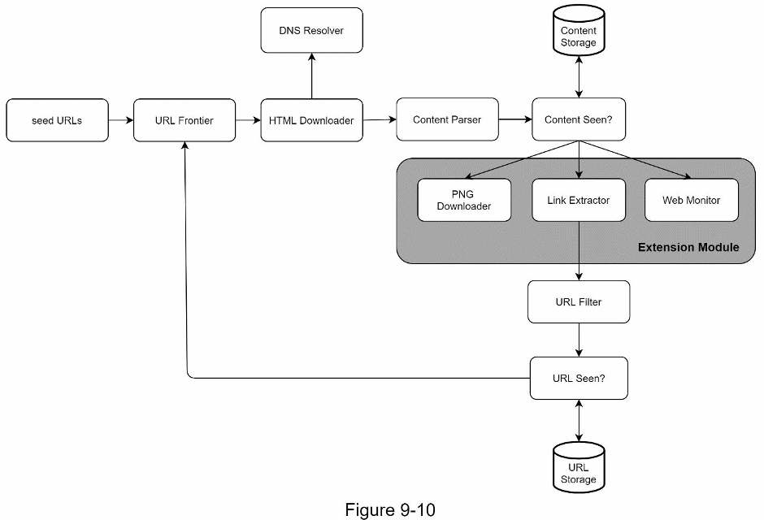

- Cắm thêm mô-đun PNG Downloader để tải file PNG.
- Thêm mô-đun Web Monitor để giám sát web và ngăn vi phạm bản quyền, nhãn hiệu.

### Phát hiện và tránh nội dung có vấn đề

Phần này thảo luận cách phát hiện, ngăn nội dung dư thừa, vô nghĩa hoặc có hại.

**1. Nội dung dư thừa**

Như đã thảo luận, gần 30% trang web là bản trùng lặp. Giá trị băm hoặc checksum giúp phát hiện trùng lặp [11].

**2. Bẫy spider**

Bẫy spider là một trang web khiến trình thu thập rơi vào vòng lặp vô hạn. Ví dụ, cấu trúc thư mục có độ sâu vô hạn như sau:

```text
www.spidertrapexample.com/foo/bar/foo/bar/foo/bar/…
```

Có thể tránh những bẫy như vậy bằng cách đặt độ dài URL tối đa. Tuy nhiên, không có giải pháp chung phù hợp cho mọi trường hợp để phát hiện bẫy spider. Website chứa bẫy dễ nhận ra vì có số trang được phát hiện lớn bất thường. Phát triển thuật toán tự động để tránh bẫy rất khó; tuy nhiên, người dùng có thể kiểm tra thủ công <!-- trang-pdf:148 --> và xác định bẫy, sau đó loại website đó khỏi trình thu thập hoặc áp dụng bộ lọc URL tùy chỉnh.

**3. Dữ liệu nhiễu**

Một số nội dung có ít hoặc không có giá trị, như quảng cáo, đoạn mã, URL spam, v.v. Những nội dung đó không hữu ích cho trình thu thập và nên được loại bỏ nếu có thể.

<!-- trang-pdf:149 -->

## Bước 4 - Tổng kết

Trong chương này, trước tiên chúng ta thảo luận các đặc điểm của trình thu thập tốt: khả năng mở rộng quy mô, tính lịch sự, khả năng mở rộng chức năng và độ vững chắc. Sau đó, chúng ta đề xuất thiết kế và bàn về những thành phần chính.

Xây dựng trình thu thập web có thể mở rộng không phải việc đơn giản, vì web vô cùng lớn và đầy cạm bẫy. Mặc dù đã đề cập nhiều chủ đề, vẫn còn nhiều điểm liên quan chưa được thảo luận:

- **Kết xuất phía máy chủ:** nhiều website dùng JavaScript, AJAX, v.v. để sinh liên kết ngay trong lúc chạy. Nếu tải và phân tích trực tiếp trang web, chúng ta không thể lấy những liên kết được sinh động này. Để giải quyết, trước tiên thực hiện kết xuất phía máy chủ, còn gọi là kết xuất động, rồi mới phân tích trang [12].
- **Lọc trang không mong muốn:** với dung lượng lưu trữ và tài nguyên thu thập có hạn, một thành phần chống spam sẽ hữu ích để lọc trang chất lượng thấp và trang spam [13] [14].
- **Sao chép và phân mảnh cơ sở dữ liệu:** những kỹ thuật như sao chép và phân mảnh được dùng để cải thiện tính sẵn sàng, khả năng mở rộng và độ tin cậy của tầng dữ liệu.
- **Mở rộng theo chiều ngang:** để thu thập quy mô lớn, cần hàng trăm, thậm chí hàng nghìn máy chủ thực hiện tải xuống. Điểm cốt yếu là giữ các máy chủ không lưu trạng thái.
- **Tính sẵn sàng, tính nhất quán và độ tin cậy:** đây là các khái niệm cốt lõi cho thành công của mọi hệ thống lớn. Chúng ta đã thảo luận chi tiết trong Chương 1. Hãy ôn lại những chủ đề này.
- **Phân tích số liệu:** thu thập và phân tích dữ liệu là phần quan trọng của mọi hệ thống, vì dữ liệu là thành phần chủ chốt để tinh chỉnh hệ thống.

Chúc mừng bạn đã đi tới đây! Hãy tự ghi nhận nỗ lực của mình. Bạn đã làm tốt!

<!-- trang-pdf:150 -->

## Tài liệu tham khảo

[1] US Library of Congress: https://www.loc.gov/websites/

[2] EU Web Archive: http://data.europa.eu/webarchive

[3] Digimarc: https://www.digimarc.com/products/digimarc-services/piracy-intelligence

[4] Heydon A., Najork M. Mercator: A scalable, extensible web crawler. World Wide Web, 2 (4) (1999), pp. 219-229.

[5] Christopher Olston, Marc Najork: Web Crawling. http://infolab.stanford.edu/~olston/publications/crawling_survey.pdf

[6] 29% Of Sites Face Duplicate Content Issues: https://tinyurl.com/y6tmh55y

[7] Rabin M.O., et al. Fingerprinting by random polynomials. Center for Research in Computing Techn., Aiken Computation Laboratory, Univ. (1981).

[8] B. H. Bloom, “Space/time trade-offs in hash coding with allowable errors,” Communications of the ACM, vol. 13, no. 7, pp. 422-426, 1970.

[9] Donald J. Patterson, Web Crawling: https://www.ics.uci.edu/~lopes/teaching/cs221W12/slides/Lecture05.pdf

[10] L. Page, S. Brin, R. Motwani, T. Winograd, “The PageRank citation ranking: Bringing order to the web,” Technical Report, Stanford University, 1998.

[11] Burton Bloom. Space/time trade-offs in hash coding with allowable errors. Communications of the ACM, 13(7), pages 422-426, July 1970.

[12] Google Dynamic Rendering: https://developers.google.com/search/docs/guides/dynamic-rendering

[13] T. Urvoy, T. Lavergne, P. Filoche, “Tracking web spam with hidden style similarity,” Proceedings of the 2nd International Workshop on Adversarial Information Retrieval on the Web, 2006.

[14] H.-T. Lee, D. Leonard, X. Wang, D. Loguinov, “IRLbot: Scaling to 6 billion pages and beyond,” Proceedings of the 17th International World Wide Web Conference, 2008.

---

[← Chương 8](chuong-08-thiet-ke-dich-vu-rut-gon-url.md) · [Mục lục](../README.md) · [Chương 10 →](chuong-10-thiet-ke-he-thong-thong-bao.md)
