# Chương 10: Thiết kế hệ thống thông báo

*Tên gốc: Design a Notification System. Nguồn: trang PDF 151-165. Hình, ví dụ mã dạng ảnh và nhãn tiếng Anh bên trong ảnh được giữ từ bản gốc.*

<!-- trang-pdf:151 -->

Trong những năm gần đây, hệ thống thông báo đã trở thành tính năng rất phổ biến của nhiều ứng dụng. Thông báo báo cho người dùng những thông tin quan trọng như tin nóng, cập nhật sản phẩm, sự kiện, ưu đãi, v.v. Nó đã trở thành phần không thể thiếu trong đời sống hằng ngày. Trong chương này, bạn được yêu cầu thiết kế hệ thống thông báo.

Thông báo không chỉ là thông báo đẩy trên thiết bị di động. Có ba định dạng: thông báo đẩy di động, tin nhắn SMS và email. Hình 10-1 đưa ra ví dụ cho từng loại.

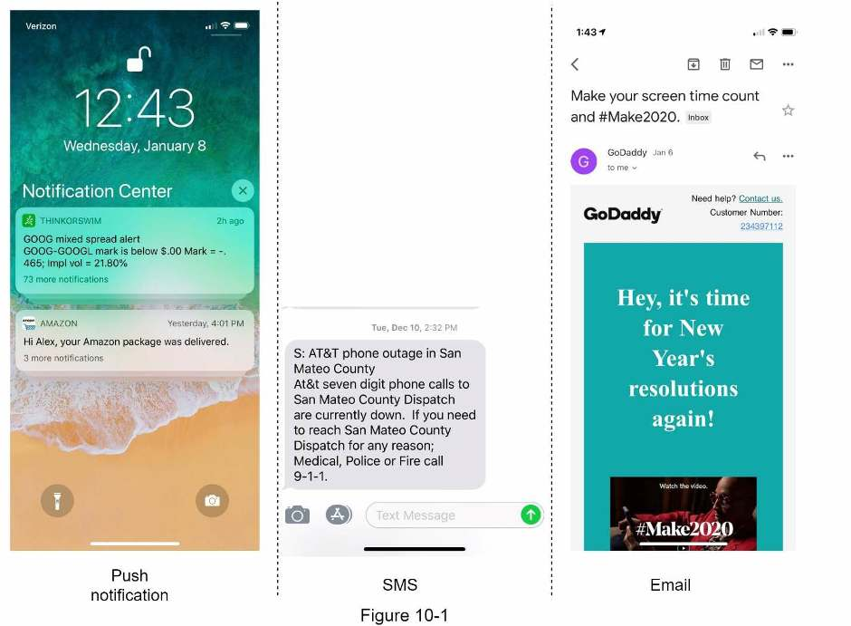

<!-- trang-pdf:152 -->

## Bước 1 - Hiểu bài toán và xác định phạm vi thiết kế

Xây dựng hệ thống có thể mở rộng để gửi hàng triệu thông báo mỗi ngày không phải việc dễ dàng. Nó đòi hỏi hiểu sâu hệ sinh thái thông báo. Câu hỏi phỏng vấn được cố ý thiết kế mở và mơ hồ; bạn có trách nhiệm đặt câu hỏi làm rõ yêu cầu.

**Ứng viên:** Hệ thống hỗ trợ loại thông báo nào?

**Người phỏng vấn:** Thông báo đẩy, SMS và email.

**Ứng viên:** Đây có phải hệ thống thời gian thực không?

**Người phỏng vấn:** Hãy coi là hệ thống thời gian thực mềm. Chúng ta muốn người dùng nhận thông báo sớm nhất có thể. Tuy nhiên, nếu hệ thống chịu tải cao, có thể chấp nhận độ trễ nhỏ.

**Ứng viên:** Hỗ trợ những thiết bị nào?

**Người phỏng vấn:** Thiết bị iOS, Android và máy tính xách tay/máy tính để bàn.

**Ứng viên:** Điều gì kích hoạt thông báo?

**Người phỏng vấn:** Ứng dụng phía máy khách có thể kích hoạt thông báo. Cũng có thể lên lịch thông báo ở phía máy chủ.

**Ứng viên:** Người dùng có thể từ chối nhận không?

**Người phỏng vấn:** Có, người dùng chọn từ chối sẽ không nhận thông báo nữa.

**Ứng viên:** Mỗi ngày gửi bao nhiêu thông báo?

**Người phỏng vấn:** 10 triệu thông báo đẩy di động, 1 triệu SMS và 5 triệu email.

<!-- trang-pdf:153 -->

## Bước 2 - Đề xuất thiết kế cấp cao và thống nhất

Phần này trình bày thiết kế cấp cao hỗ trợ các loại thông báo khác nhau: thông báo đẩy iOS, thông báo đẩy Android, SMS và email. Cấu trúc như sau:

- Các loại thông báo.
- Luồng thu thập thông tin liên hệ.
- Luồng gửi/nhận thông báo.

### Các loại thông báo

Trước tiên, hãy xem cách hoạt động ở mức khái quát của từng loại.

### Thông báo đẩy iOS

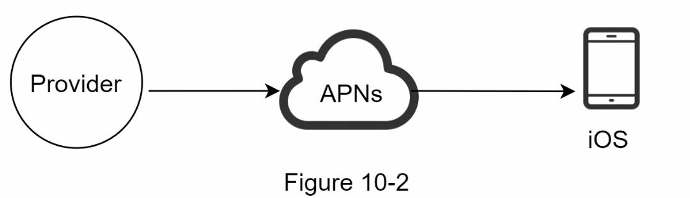

Để gửi thông báo đẩy iOS, chủ yếu cần ba thành phần:

- **Nhà cung cấp (Provider):** xây dựng và gửi yêu cầu thông báo tới Apple Push Notification Service, tức APNS. Để tạo thông báo đẩy, nhà cung cấp đưa ra những dữ liệu sau:
  - **Device token:** định danh duy nhất dùng để gửi thông báo đẩy.
  - **Payload:** một từ điển JSON chứa nội dung dữ liệu của thông báo. Dưới đây là ví dụ:

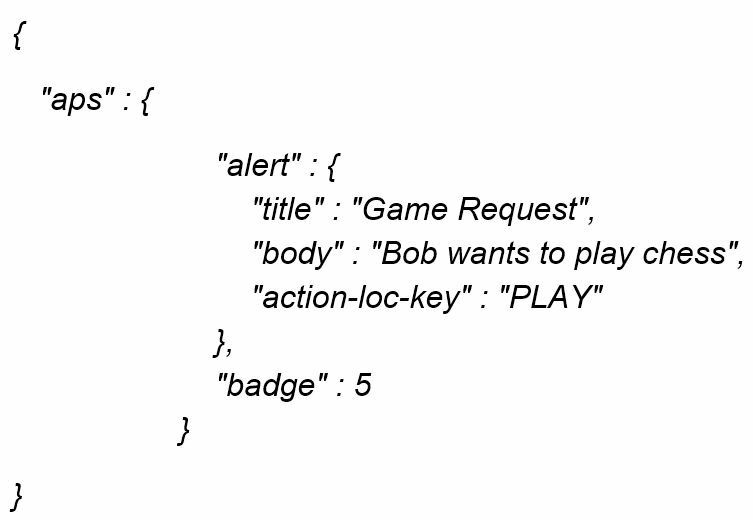

- **APNS:** dịch vụ từ xa do Apple cung cấp để truyền thông báo đẩy tới thiết bị iOS.
- **Thiết bị iOS:** máy khách cuối cùng nhận thông báo đẩy.

### Thông báo đẩy Android

Android có luồng thông báo tương tự. Thay vì APNs, Firebase Cloud Messaging, tức FCM, thường được dùng để gửi thông báo đẩy tới thiết bị Android.

<!-- trang-pdf:154 -->

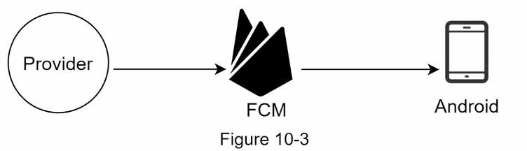

### Tin nhắn SMS

Với SMS, thường dùng dịch vụ bên thứ ba như Twilio [1], Nexmo [2] và nhiều dịch vụ khác. Phần lớn là dịch vụ thương mại.

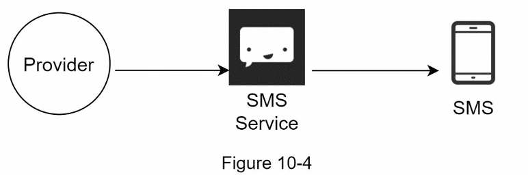

### Email

Mặc dù công ty có thể thiết lập máy chủ email riêng, nhiều công ty chọn dịch vụ email thương mại. Sendgrid [3] và Mailchimp [4] nằm trong số phổ biến nhất, cung cấp tỷ lệ gửi đến thành công và khả năng phân tích dữ liệu tốt hơn.

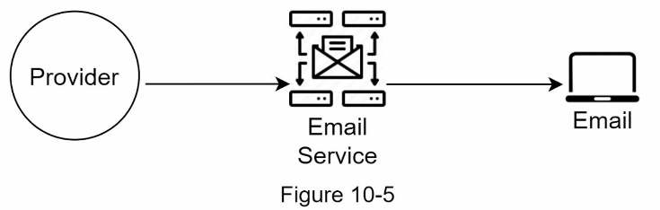

Hình 10-6 thể hiện thiết kế sau khi đưa tất cả dịch vụ bên thứ ba vào.

<!-- trang-pdf:155 -->

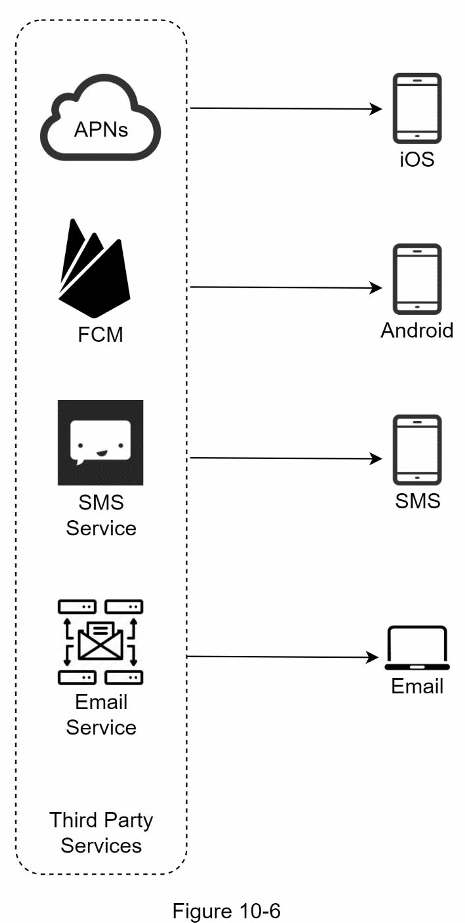

### Luồng thu thập thông tin liên hệ

Để gửi thông báo, cần thu thập device token của thiết bị di động, số điện thoại hoặc địa chỉ email. Như Hình 10-7, khi người dùng cài ứng dụng hoặc đăng ký lần đầu, các máy chủ API thu thập thông tin liên hệ và lưu vào cơ sở dữ liệu.

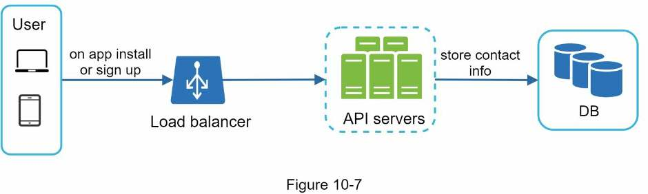

Hình 10-8 trình bày các bảng cơ sở dữ liệu đơn giản hóa để lưu thông tin liên hệ. Địa chỉ email và số điện thoại nằm trong bảng người dùng, còn device token nằm trong bảng thiết bị. Một <!-- trang-pdf:156 --> người dùng có thể có nhiều thiết bị, nghĩa là thông báo đẩy có thể được gửi tới mọi thiết bị của họ.

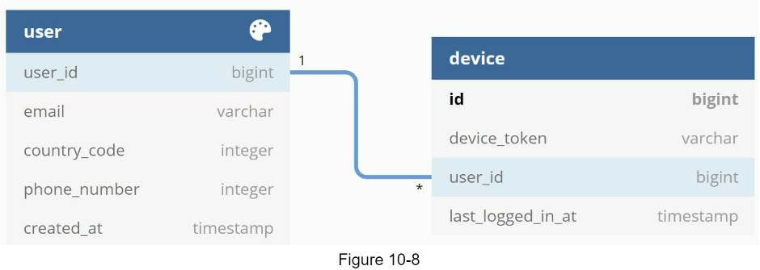

### Luồng gửi/nhận thông báo

Trước tiên, chúng ta trình bày thiết kế ban đầu, sau đó đề xuất một số tối ưu.

### Thiết kế cấp cao

Hình 10-9 cho thấy thiết kế; từng thành phần được giải thích bên dưới.

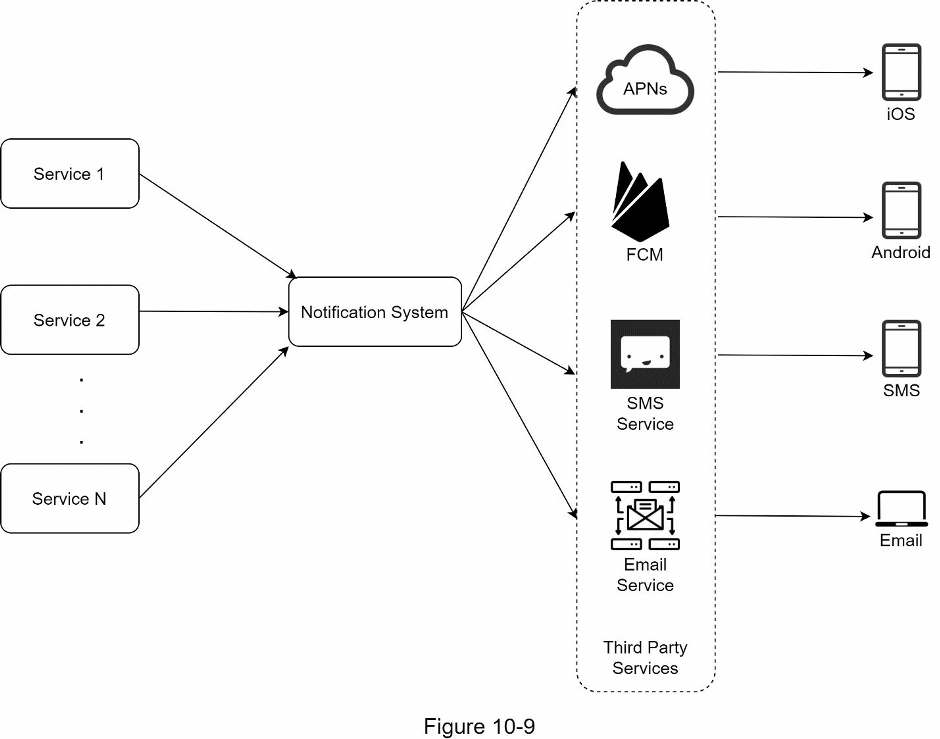

**Dịch vụ 1 đến N:** dịch vụ có thể là microservice, cron job hoặc hệ thống phân tán kích hoạt sự kiện gửi thông báo. Ví dụ, dịch vụ thanh toán gửi email nhắc khách hàng về khoản đến hạn, hoặc website mua sắm gửi SMS báo kiện hàng sẽ được giao vào ngày mai.

<!-- trang-pdf:157 -->

**Hệ thống thông báo:** đây là thành phần trung tâm của việc gửi/nhận thông báo. Bắt đầu từ thiết kế đơn giản, chúng ta chỉ dùng một máy chủ thông báo. Nó cung cấp API cho dịch vụ 1 đến N và tạo payload thông báo cho các dịch vụ bên thứ ba.

**Dịch vụ bên thứ ba:** chịu trách nhiệm chuyển thông báo tới người dùng. Khi tích hợp, cần đặc biệt chú ý khả năng mở rộng chức năng. Khả năng mở rộng tốt nghĩa là hệ thống linh hoạt, dễ dàng cắm thêm hoặc tháo bỏ dịch vụ bên thứ ba. Một cân nhắc quan trọng khác là một dịch vụ có thể không sẵn có ở thị trường mới hoặc trong tương lai. Ví dụ, FCM không khả dụng ở Trung Quốc, nên các dịch vụ thay thế như Jpush, PushY, v.v. được dùng tại đó.

**iOS, Android, SMS, Email:** người dùng nhận thông báo trên thiết bị.

Thiết kế này có ba vấn đề:

- **Điểm lỗi đơn (SPOF):** chỉ một máy chủ thông báo tạo thành điểm lỗi đơn.
- **Khó mở rộng:** hệ thống xử lý mọi việc liên quan tới thông báo đẩy trên một máy chủ. Rất khó mở rộng riêng cơ sở dữ liệu, bộ nhớ đệm và các thành phần xử lý thông báo khác nhau.
- **Nút thắt hiệu năng:** xử lý và gửi thông báo có thể tiêu tốn nhiều tài nguyên. Ví dụ, dựng trang HTML và chờ phản hồi từ dịch vụ bên thứ ba có thể mất thời gian. Xử lý tất cả trong một hệ thống có thể làm quá tải, đặc biệt vào giờ cao điểm.

### Thiết kế cấp cao cải tiến

Sau khi liệt kê các thách thức trong thiết kế ban đầu, chúng ta cải tiến như sau:

- Đưa cơ sở dữ liệu và bộ nhớ đệm ra ngoài máy chủ thông báo.
- Thêm máy chủ thông báo và thiết lập tự động mở rộng theo chiều ngang.
- Đưa hàng đợi thông điệp vào để giảm phụ thuộc giữa các thành phần.

Hình 10-10 thể hiện thiết kế cấp cao đã cải tiến.

<!-- trang-pdf:158 -->

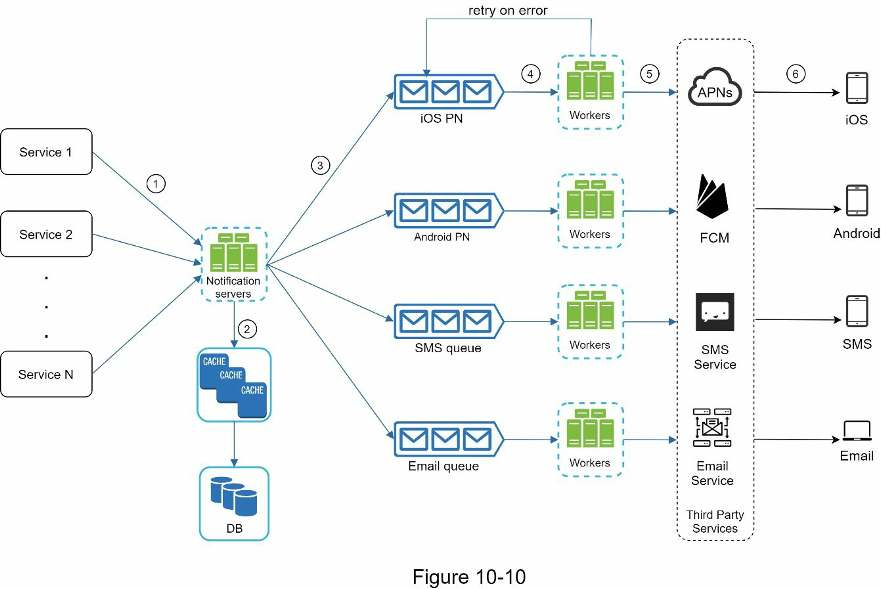

Cách tốt nhất để xem sơ đồ trên là đi từ trái sang phải:

**Dịch vụ 1 đến N:** đại diện cho các dịch vụ khác nhau gửi thông báo qua API do máy chủ thông báo cung cấp.

**Máy chủ thông báo:** cung cấp các chức năng sau:

- Cung cấp API cho dịch vụ gửi thông báo. API chỉ được truy cập nội bộ hoặc bởi máy khách đã được xác minh để ngăn spam.
- Thực hiện xác thực dữ liệu cơ bản như kiểm tra email, số điện thoại, v.v.
- Truy vấn cơ sở dữ liệu hoặc bộ nhớ đệm để lấy dữ liệu cần thiết cho việc dựng thông báo.
- Đưa dữ liệu thông báo vào hàng đợi để xử lý song song.

Dưới đây là ví dụ API gửi email theo cách giới thiệu trong nguồn:

```text
POST https://api.example.com/v/sms/send
```

Nội dung yêu cầu:

> **Ghi chú bản dịch:** Bản gốc gọi đây là ví dụ gửi email nhưng endpoint lại là `/sms/send`. Endpoint và ví dụ dữ liệu được giữ nguyên để đối chiếu với nguồn.

<!-- trang-pdf:159 -->

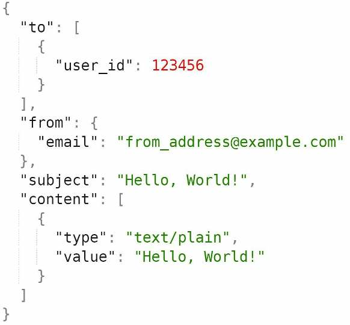

**Bộ nhớ đệm:** lưu đệm thông tin người dùng, thông tin thiết bị và mẫu thông báo.

**Cơ sở dữ liệu:** lưu dữ liệu người dùng, thông báo, cài đặt, v.v.

**Hàng đợi thông điệp:** loại bỏ sự phụ thuộc giữa các thành phần. Hàng đợi đóng vai trò bộ đệm khi cần gửi số lượng lớn thông báo. Mỗi loại thông báo được gán một hàng đợi riêng, nhờ đó sự cố của một dịch vụ bên thứ ba không ảnh hưởng tới các loại thông báo khác.

**Worker:** một tập máy chủ lấy sự kiện thông báo từ hàng đợi và gửi tới dịch vụ bên thứ ba tương ứng.

**Dịch vụ bên thứ ba:** đã được giải thích trong thiết kế ban đầu.

**iOS, Android, SMS, Email:** đã được giải thích trong thiết kế ban đầu.

Tiếp theo, hãy xem các thành phần phối hợp để gửi thông báo:

1. Một dịch vụ gọi API do máy chủ thông báo cung cấp để gửi thông báo.
2. Máy chủ thông báo lấy siêu dữ liệu như thông tin người dùng, device token và cài đặt thông báo từ bộ nhớ đệm hoặc cơ sở dữ liệu.
3. Sự kiện thông báo được gửi tới hàng đợi tương ứng để xử lý. Ví dụ, sự kiện thông báo đẩy iOS được gửi tới hàng đợi iOS PN.
4. Worker lấy sự kiện thông báo từ hàng đợi.
5. Worker gửi thông báo tới dịch vụ bên thứ ba.
6. Dịch vụ bên thứ ba gửi thông báo tới thiết bị người dùng.

<!-- trang-pdf:160 -->

## Bước 3 - Đi sâu vào thiết kế

Trong thiết kế cấp cao, chúng ta đã thảo luận các loại thông báo, luồng thu thập thông tin liên hệ và luồng gửi/nhận. Phần này sẽ tìm hiểu sâu:

- Độ tin cậy.
- Các thành phần và cân nhắc bổ sung: mẫu thông báo, cài đặt thông báo, giới hạn tốc độ, cơ chế thử lại, bảo mật thông báo đẩy, giám sát thông báo đang nằm trong hàng đợi và theo dõi sự kiện.
- Thiết kế được cập nhật.

### Độ tin cậy

Khi thiết kế hệ thống thông báo trong môi trường phân tán, phải trả lời một vài câu hỏi quan trọng về độ tin cậy.

### Làm sao ngăn mất dữ liệu?

Một yêu cầu quan trọng nhất của hệ thống thông báo là không được mất dữ liệu. Thông báo thường có thể bị trễ hoặc thay đổi thứ tự, nhưng không được mất. Để đáp ứng, hệ thống lưu bền vững dữ liệu thông báo trong cơ sở dữ liệu và triển khai cơ chế thử lại. Cơ sở dữ liệu nhật ký thông báo được đưa vào để lưu bền vững dữ liệu, như Hình 10-11.

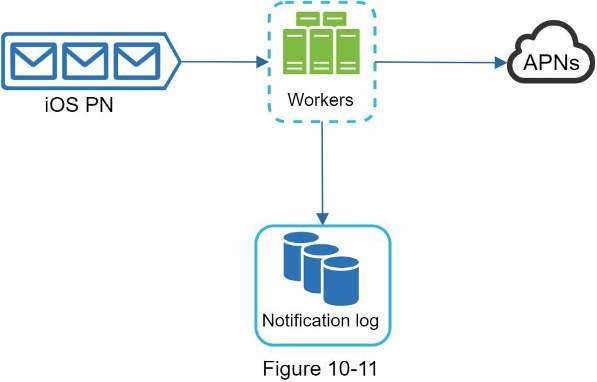

### Người nhận có nhận thông báo đúng một lần không?

Câu trả lời ngắn là không. Mặc dù phần lớn thông báo được chuyển đúng một lần, bản chất phân tán có thể tạo ra thông báo trùng. Để giảm khả năng trùng lặp, chúng ta bổ sung cơ chế loại trùng và xử lý cẩn thận từng trường hợp lỗi. Logic đơn giản như sau:

Khi sự kiện thông báo tới lần đầu, kiểm tra ID sự kiện để biết đã từng thấy chưa. Nếu đã thấy, bỏ sự kiện. Nếu chưa, gửi thông báo. Bạn đọc muốn tìm hiểu vì sao không thể có bảo đảm chuyển đúng một lần có thể xem tài liệu tham khảo [5].

### Các thành phần và cân nhắc bổ sung

Chúng ta đã thảo luận cách thu thập thông tin liên hệ, gửi và nhận thông báo. Tuy nhiên, hệ thống thông báo còn nhiều phần hơn thế. Tại đây, chúng ta bàn về những thành phần bổ sung, gồm tái sử dụng mẫu, cài đặt thông báo, theo dõi sự kiện, giám sát hệ thống, giới hạn tốc độ, v.v.

### Mẫu thông báo

<!-- trang-pdf:161 -->

Một hệ thống thông báo lớn gửi hàng triệu thông báo mỗi ngày, và nhiều thông báo có định dạng tương tự. Mẫu thông báo được đưa vào để tránh xây dựng từng thông báo từ đầu. Đây là thông báo được định dạng sẵn, từ đó tạo thông báo riêng bằng cách tùy chỉnh tham số, kiểu trình bày, liên kết theo dõi, v.v. Dưới đây là ví dụ mẫu thông báo đẩy:

```text
NỘI DUNG:
Bạn đã mơ về điều đó. Chúng tôi đã dám thực hiện.
[TÊN SẢN PHẨM] đã trở lại - chỉ đến [NGÀY].

LỜI KÊU GỌI HÀNH ĐỘNG:
Đặt hàng ngay. Hoặc, giữ [TÊN SẢN PHẨM] cho tôi.
```

Lợi ích của mẫu thông báo gồm duy trì định dạng nhất quán, giảm sai sót và tiết kiệm thời gian.

### Cài đặt thông báo

Người dùng thường nhận quá nhiều thông báo mỗi ngày và dễ cảm thấy quá tải. Vì vậy, nhiều website và ứng dụng cho phép điều chỉnh cài đặt thông báo một cách chi tiết. Thông tin được lưu trong bảng cài đặt thông báo với các trường:

```text
user_id  bigInt
channel  varchar  # thông báo đẩy, email hoặc SMS
opt_in   boolean  # đồng ý nhận thông báo
```

Trước khi gửi bất kỳ thông báo nào, đầu tiên chúng ta kiểm tra người dùng có đồng ý nhận loại thông báo đó không.

### Giới hạn tốc độ

Để tránh làm người dùng quá tải vì quá nhiều thông báo, có thể giới hạn số thông báo mà một người nhận được. Điều này quan trọng, vì nếu gửi quá thường xuyên, người nhận có thể tắt hoàn toàn thông báo.

### Cơ chế thử lại

Khi dịch vụ bên thứ ba không gửi được thông báo, thông báo được thêm vào hàng đợi để thử lại. Nếu vấn đề tiếp diễn, cảnh báo được gửi tới nhà phát triển.

### Bảo mật thông báo đẩy

Đối với ứng dụng iOS hoặc Android, `appKey` và `appSecret` được dùng để bảo vệ API thông báo đẩy [6]. Chỉ máy khách đã được xác thực hoặc xác minh mới được gửi thông báo đẩy bằng API của chúng ta. Bạn đọc quan tâm nên xem tài liệu [6].

### Giám sát thông báo đang nằm trong hàng đợi

Một chỉ số chủ chốt cần giám sát là tổng số thông báo đang nằm trong hàng đợi. Nếu số lượng lớn, các worker chưa xử lý sự kiện đủ nhanh. Để tránh việc chuyển thông báo bị trễ, cần thêm worker. Hình 10-12, ghi công nguồn [7], minh họa số thông điệp đang chờ xử lý.

<!-- trang-pdf:162 -->

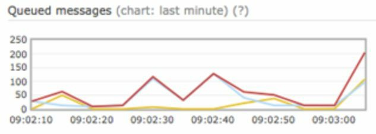

### Theo dõi sự kiện

Những chỉ số thông báo như tỷ lệ mở, tỷ lệ nhấp và mức tương tác rất quan trọng để hiểu hành vi khách hàng. Dịch vụ phân tích triển khai việc theo dõi sự kiện. Thông thường, cần tích hợp hệ thống thông báo với dịch vụ phân tích. Hình 10-13 cho thấy ví dụ về các sự kiện có thể được theo dõi để phân tích.

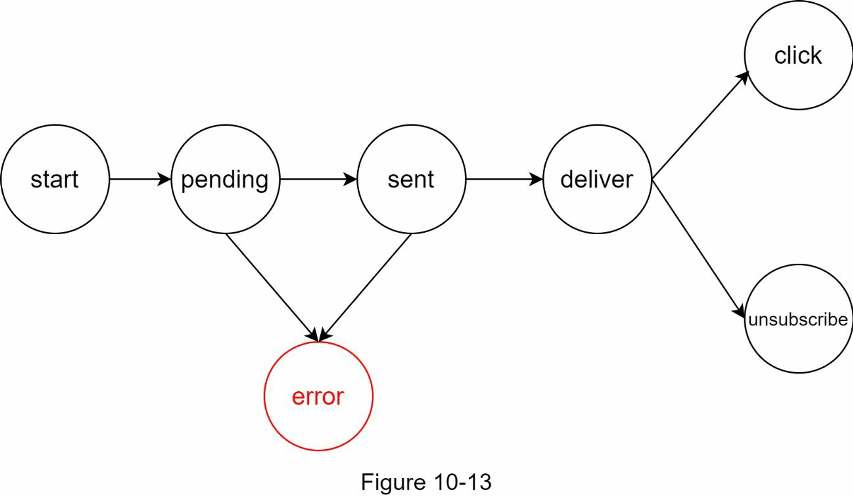

### Thiết kế được cập nhật

Kết hợp tất cả lại, Hình 10-14 thể hiện thiết kế hệ thống thông báo sau cập nhật.

<!-- trang-pdf:163 -->

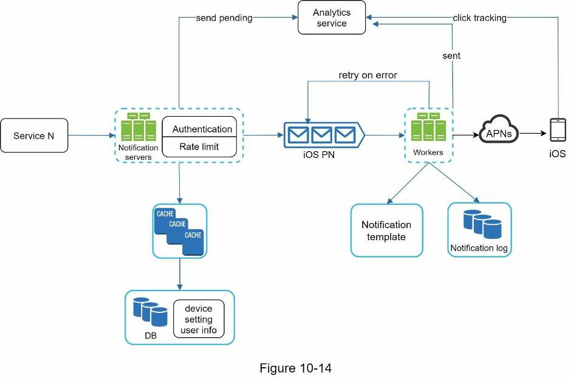

Trong thiết kế này, nhiều thành phần mới được thêm so với trước:

- Máy chủ thông báo được trang bị thêm hai tính năng trọng yếu: xác thực và giới hạn tốc độ.
- Chúng ta cũng thêm cơ chế thử lại để xử lý lỗi gửi thông báo. Nếu hệ thống không gửi được, thông báo được đưa trở lại hàng đợi và worker sẽ thử lại một số lần định trước.
- Ngoài ra, các mẫu thông báo tạo ra quy trình xây dựng thông báo nhất quán và hiệu quả.
- Cuối cùng, hệ thống giám sát và theo dõi được thêm để kiểm tra sức khỏe hệ thống và hỗ trợ cải tiến sau này.

<!-- trang-pdf:164 -->

## Bước 4 - Tổng kết

Thông báo không thể thiếu vì chúng giúp chúng ta cập nhật thông tin quan trọng. Đó có thể là thông báo đẩy về bộ phim yêu thích trên Netflix, email giảm giá sản phẩm mới hoặc tin nhắn xác nhận thanh toán mua sắm trực tuyến.

Trong chương này, chúng ta đã mô tả thiết kế hệ thống thông báo có khả năng mở rộng, hỗ trợ nhiều định dạng: thông báo đẩy, SMS và email. Chúng ta dùng hàng đợi thông điệp để giảm phụ thuộc giữa các thành phần.

Bên cạnh thiết kế cấp cao, chúng ta đi sâu vào những thành phần và tối ưu khác:

- **Độ tin cậy:** đề xuất cơ chế thử lại vững chắc để giảm thiểu tỷ lệ lỗi.
- **Bảo mật:** cặp AppKey/appSecret được dùng để bảo đảm chỉ máy khách được xác minh mới có thể gửi thông báo.
- **Theo dõi và giám sát:** triển khai ở bất kỳ giai đoạn nào trong luồng thông báo để ghi nhận số liệu quan trọng.
- **Tôn trọng cài đặt người dùng:** người dùng có thể từ chối nhận thông báo. Hệ thống kiểm tra cài đặt của họ trước khi gửi.
- **Giới hạn tốc độ:** người dùng sẽ đánh giá cao việc giới hạn tần suất thông báo nhận được.

Chúc mừng bạn đã đi tới đây! Hãy tự ghi nhận nỗ lực của mình. Bạn đã làm tốt!

<!-- trang-pdf:165 -->

## Tài liệu tham khảo

[1] Twilio SMS: https://www.twilio.com/sms

[2] Nexmo SMS: https://www.nexmo.com/products/sms

[3] Sendgrid: https://sendgrid.com/

[4] Mailchimp: https://mailchimp.com/

[5] You Cannot Have Exactly-Once Delivery: https://bravenewgeek.com/you-cannot-have-exactly-once-delivery/

[6] Security in Push Notifications: https://cloud.ibm.com/docs/services/mobilepush?topic=mobile-pushnotification-security-in-push-notifications

[7] RadditMQ, tên ghi trong nguồn: https://bit.ly/2sotIa6

---

[← Chương 9](chuong-09-thiet-ke-trinh-thu-thap-du-lieu-web.md) · [Mục lục](../README.md) · [Chương 11 →](chuong-11-thiet-ke-he-thong-bang-tin.md)
