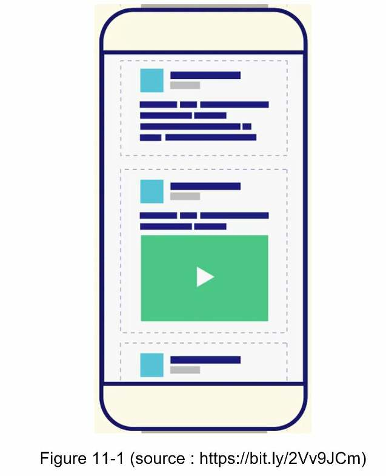
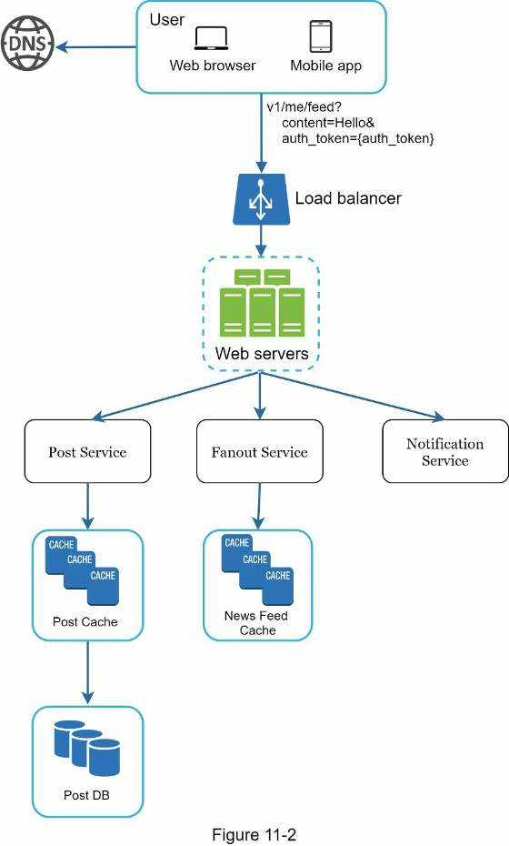
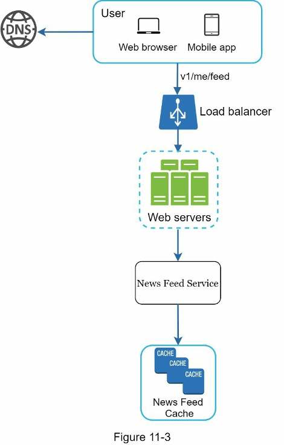
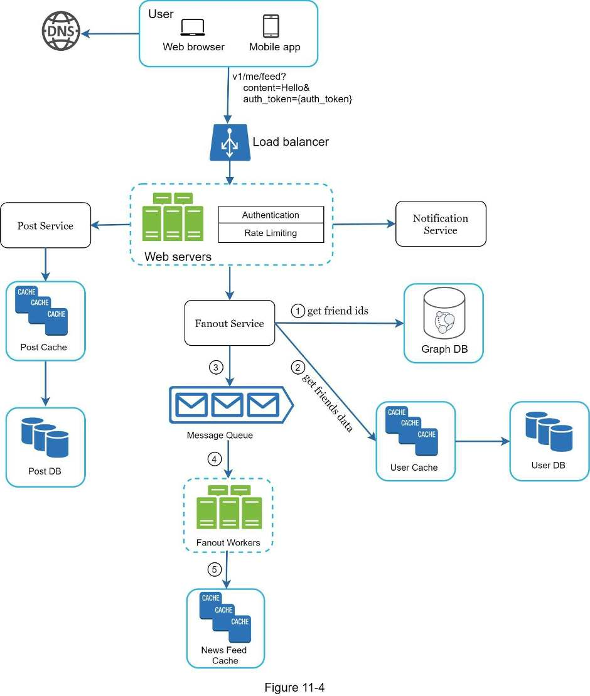
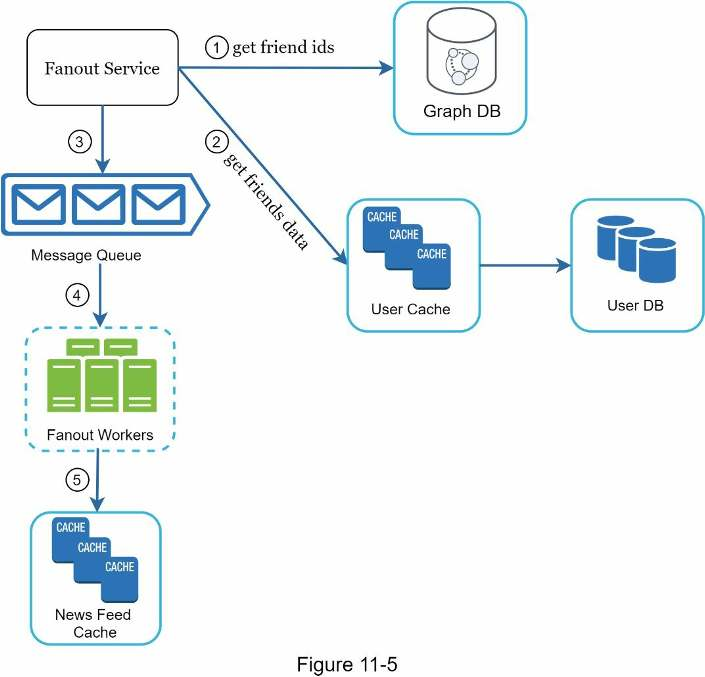
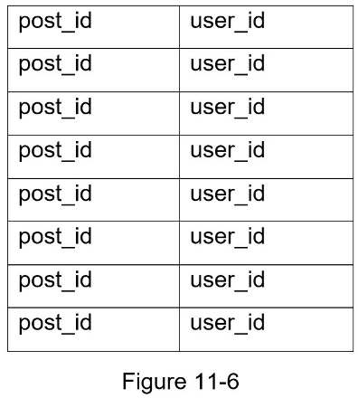
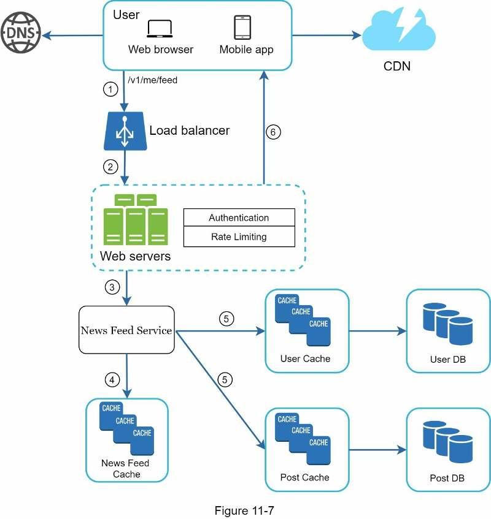
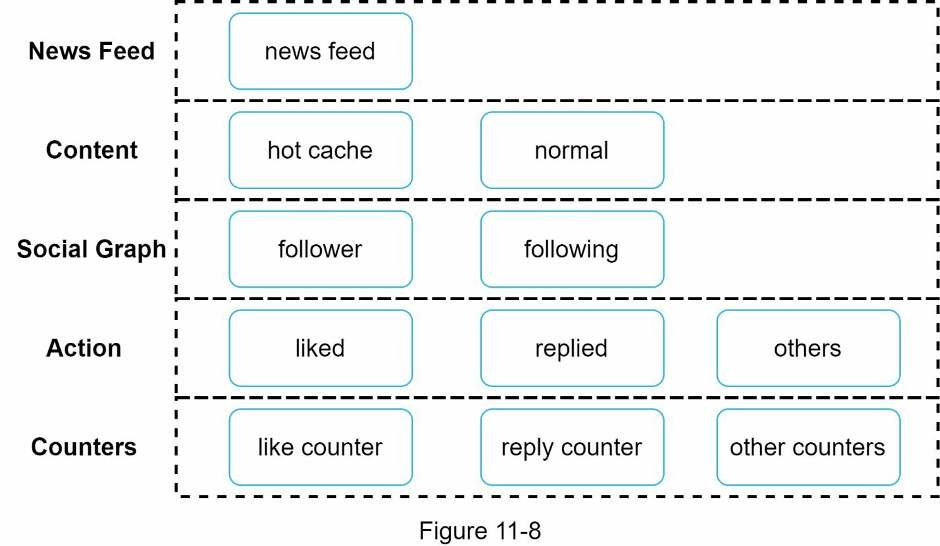

# Chương 11: Thiết kế hệ thống bảng tin

*Tên gốc: Design a News Feed System. Nguồn: trang PDF 166-177. Hình gốc và nhãn tiếng Anh bên trong hình được giữ nguyên.*

<!-- trang-pdf:166 -->

Trong chương này, bạn được yêu cầu thiết kế hệ thống bảng tin. Bảng tin là gì? Theo trang trợ giúp Facebook: “Bảng tin là danh sách các câu chuyện được cập nhật liên tục ở giữa trang chủ. Bảng tin bao gồm cập nhật trạng thái, ảnh, video, liên kết, hoạt động ứng dụng và lượt thích từ những người, trang và nhóm mà bạn theo dõi trên Facebook” [1]. Đây là câu hỏi phỏng vấn phổ biến. Những câu tương tự thường được hỏi là thiết kế bảng tin Facebook, bảng tin Instagram, dòng thời gian Twitter, v.v.



<!-- trang-pdf:167 -->

## Bước 1 - Hiểu bài toán và xác định phạm vi thiết kế

Nhóm câu hỏi làm rõ đầu tiên nhằm hiểu người phỏng vấn hình dung điều gì khi yêu cầu thiết kế hệ thống bảng tin. Ít nhất, bạn cần xác định phải hỗ trợ tính năng nào. Dưới đây là ví dụ trao đổi:

**Ứng viên:** Đây là ứng dụng di động, ứng dụng web hay cả hai?

**Người phỏng vấn:** Cả hai.

**Ứng viên:** Những tính năng quan trọng là gì?

**Người phỏng vấn:** Người dùng có thể đăng bài và xem bài của bạn bè trên trang bảng tin.

**Ứng viên:** Bảng tin được sắp theo thời gian đảo ngược hay thứ tự cụ thể khác, như điểm chủ đề? Chẳng hạn bài từ bạn thân có điểm cao hơn.

**Người phỏng vấn:** Để đơn giản, giả sử bảng tin được sắp theo thời gian đảo ngược.

**Ứng viên:** Mỗi người dùng có thể có bao nhiêu bạn?

**Người phỏng vấn:** 5.000.

**Ứng viên:** Lượng lưu lượng là bao nhiêu?

**Người phỏng vấn:** 10 triệu người dùng hoạt động hằng ngày, tức DAU.

**Ứng viên:** Bảng tin có thể chứa ảnh, video hay chỉ văn bản?

**Người phỏng vấn:** Có thể chứa file đa phương tiện, gồm cả ảnh và video.

Sau khi đã thu thập yêu cầu, chúng ta tập trung thiết kế hệ thống.

<!-- trang-pdf:168 -->

## Bước 2 - Đề xuất thiết kế cấp cao và thống nhất

Thiết kế được chia thành hai luồng: xuất bản bài lên bảng tin và xây dựng bảng tin.

- **Xuất bản bài:** khi người dùng đăng bài, dữ liệu tương ứng được ghi vào bộ nhớ đệm và cơ sở dữ liệu. Bài đăng được đưa tới bảng tin của bạn bè họ.
- **Xây dựng bảng tin:** để đơn giản, giả sử bảng tin được tạo bằng cách tổng hợp bài đăng của bạn bè theo thứ tự thời gian đảo ngược.

### API bảng tin

API bảng tin là phương thức chính để máy khách giao tiếp với máy chủ. Các API dựa trên HTTP, cho phép máy khách thực hiện những hành động như đăng trạng thái, lấy bảng tin, thêm bạn, v.v. Chúng ta bàn về hai API quan trọng nhất: API xuất bản bài và API lấy bảng tin.

### API xuất bản bài

Để đăng bài, gửi yêu cầu HTTP POST tới máy chủ. API như sau:

```text
POST /v1/me/feed
```

Tham số:

- `content`: phần văn bản của bài đăng.
- `auth_token`: được dùng để xác thực yêu cầu API.

### API lấy bảng tin

API lấy bảng tin như sau:

```text
GET /v1/me/feed
```

Tham số:

- `auth_token`: được dùng để xác thực yêu cầu API.

### Xuất bản bài lên bảng tin

Hình 11-2 trình bày thiết kế cấp cao của luồng xuất bản bài.

<!-- trang-pdf:169 -->



- **Người dùng:** có thể xem bảng tin trên trình duyệt hoặc ứng dụng di động. Người dùng tạo bài có nội dung “Hello” thông qua API:

  ```text
  /v1/me/feed?content=Hello&auth_token={auth_token}
  ```

- **Bộ cân bằng tải:** phân phối lưu lượng tới các máy chủ web.
- **Máy chủ web:** chuyển lưu lượng tới các dịch vụ nội bộ khác nhau.
- **Dịch vụ bài đăng (Post service):** lưu bền vững bài đăng trong cơ sở dữ liệu và bộ nhớ đệm.
- **Dịch vụ fanout:** đẩy nội dung mới tới bảng tin của bạn bè. Dữ liệu bảng tin được lưu trong bộ nhớ đệm để truy xuất nhanh.
- **Dịch vụ thông báo:** báo cho bạn bè biết có nội dung mới và gửi thông báo đẩy.

### Xây dựng bảng tin

Trong phần này, chúng ta thảo luận cách bảng tin được xây dựng ở phía sau. Hình 11-3 cho thấy thiết kế cấp cao.

<!-- trang-pdf:170 -->



- **Người dùng:** gửi yêu cầu lấy bảng tin. Yêu cầu có dạng `/v1/me/feed`.
- **Bộ cân bằng tải:** chuyển lưu lượng tới máy chủ web.
- **Máy chủ web:** định tuyến yêu cầu tới dịch vụ bảng tin.
- **Dịch vụ bảng tin:** lấy bảng tin từ bộ nhớ đệm.
- **Bộ nhớ đệm bảng tin:** lưu những ID bảng tin cần thiết để dựng bảng tin.

<!-- trang-pdf:171 -->

## Bước 3 - Đi sâu vào thiết kế

Thiết kế cấp cao đã đề cập sơ lược hai luồng: xuất bản bài và xây dựng bảng tin. Tại đây, chúng ta thảo luận sâu hơn.

### Đi sâu vào xuất bản bài

Hình 11-4 phác thảo thiết kế chi tiết của xuất bản bài. Chúng ta đã bàn về phần lớn thành phần ở thiết kế cấp cao; tại đây sẽ tập trung vào hai thành phần: máy chủ web và dịch vụ fanout.



### Máy chủ web

Bên cạnh giao tiếp với máy khách, máy chủ web thực hiện xác thực và giới hạn tốc độ.

<!-- trang-pdf:172 -->

Chỉ người dùng đã đăng nhập với `auth_token` hợp lệ mới được đăng bài. Hệ thống giới hạn số bài một người có thể tạo trong một khoảng thời gian nhất định, điều rất quan trọng để ngăn spam và nội dung lạm dụng.

### Dịch vụ fanout

Fanout là quá trình chuyển một bài đăng tới tất cả bạn bè. Có hai mô hình: fanout khi ghi, còn gọi là mô hình đẩy, và fanout khi đọc, còn gọi là mô hình kéo. Cả hai đều có ưu và nhược điểm. Chúng ta giải thích luồng hoạt động rồi tìm cách tốt nhất để hỗ trợ hệ thống.

**Fanout khi ghi.** Theo cách này, bảng tin được tính toán trước tại thời điểm ghi. Bài đăng mới được chuyển tới bộ nhớ đệm của bạn bè ngay sau khi xuất bản.

Ưu điểm:

- Bảng tin được tạo theo thời gian thực và có thể đẩy ngay tới bạn bè.
- Lấy bảng tin nhanh vì nó đã được tính sẵn lúc ghi.

Nhược điểm:

- Nếu một người có nhiều bạn, lấy danh sách bạn bè và tạo bảng tin cho tất cả sẽ chậm và tốn thời gian. Đây gọi là vấn đề khóa nóng, hay hotkey.
- Với người dùng không hoạt động hoặc hiếm khi đăng nhập, tính sẵn bảng tin gây lãng phí tài nguyên tính toán.

**Fanout khi đọc.** Bảng tin được tạo tại thời điểm đọc. Đây là mô hình theo yêu cầu. Những bài đăng gần đây được kéo về khi người dùng tải trang chủ.

Ưu điểm:

- Với người dùng không hoạt động hoặc hiếm khi đăng nhập, fanout khi đọc tốt hơn vì không lãng phí tài nguyên tính toán cho họ.
- Dữ liệu không được đẩy tới bạn bè nên không có vấn đề hotkey.

Nhược điểm:

- Lấy bảng tin chậm vì bảng tin chưa được tính trước.

Chúng ta áp dụng cách kết hợp để hưởng lợi từ cả hai và tránh những bất lợi. Vì lấy bảng tin nhanh là yêu cầu cốt yếu, chúng ta dùng mô hình đẩy cho phần lớn người dùng. Với người nổi tiếng hoặc người có nhiều bạn/người theo dõi, để người theo dõi kéo nội dung theo yêu cầu nhằm tránh quá tải hệ thống. Băm nhất quán là kỹ thuật hữu ích để giảm vấn đề hotkey vì nó giúp phân phối yêu cầu/dữ liệu đồng đều hơn.

Hãy xem kỹ dịch vụ fanout trong Hình 11-5.

<!-- trang-pdf:173 -->



Dịch vụ hoạt động như sau:

1. Lấy ID bạn bè từ cơ sở dữ liệu đồ thị. Cơ sở dữ liệu đồ thị phù hợp để quản lý quan hệ bạn bè và gợi ý kết bạn. Bạn đọc muốn tìm hiểu thêm nên xem tài liệu [2].
2. Lấy thông tin bạn bè từ bộ nhớ đệm người dùng. Hệ thống sau đó lọc bạn bè theo cài đặt. Ví dụ, nếu bạn tắt hiển thị một người, bài của họ sẽ không xuất hiện trên bảng tin dù vẫn là bạn bè. Một lý do khác khiến bài không xuất hiện là người dùng có thể chỉ chia sẻ thông tin với một số bạn cụ thể hoặc ẩn khỏi những người khác.
3. Gửi danh sách bạn bè và ID bài đăng mới tới hàng đợi thông điệp.
4. Các worker fanout lấy dữ liệu từ hàng đợi và lưu dữ liệu bảng tin vào bộ nhớ đệm bảng tin. Có thể xem bộ nhớ đệm này như bảng ánh xạ `<post_id, user_id>`. Mỗi khi có bài mới, nó được thêm vào bảng bảng tin như Hình 11-6. Mức dùng bộ nhớ có thể rất lớn nếu lưu toàn bộ đối tượng người dùng và bài đăng trong bộ nhớ đệm; vì vậy chỉ lưu ID. Để giữ dung lượng bộ nhớ nhỏ, chúng ta đặt giới hạn có thể cấu hình. Khả năng người dùng cuộn qua hàng nghìn bài trong bảng tin rất thấp. Phần lớn chỉ quan tâm nội dung mới nhất nên tỷ lệ không tìm thấy dữ liệu trong bộ nhớ đệm thấp.
5. Lưu `<post_id, user_id>` trong bộ nhớ đệm bảng tin. Hình 11-6 cho ví dụ về hình dạng bảng tin trong bộ nhớ đệm.

<!-- trang-pdf:174 -->



### Đi sâu vào lấy bảng tin

Hình 11-7 minh họa thiết kế chi tiết của việc lấy bảng tin.



Như Hình 11-7, nội dung đa phương tiện như ảnh, video, v.v. được lưu trong CDN để truy xuất nhanh. Hãy xem máy khách lấy bảng tin như thế nào.

<!-- trang-pdf:175 -->

1. Người dùng gửi yêu cầu lấy bảng tin, có dạng `/v1/me/feed`.
2. Bộ cân bằng tải phân phối lại yêu cầu tới các máy chủ web.
3. Máy chủ web gọi dịch vụ bảng tin để lấy bảng tin.
4. Dịch vụ bảng tin lấy danh sách ID bài đăng từ bộ nhớ đệm bảng tin.
5. Bảng tin của người dùng không chỉ là một danh sách ID. Nó chứa tên người dùng, ảnh đại diện, nội dung bài đăng, ảnh bài đăng, v.v. Vì vậy, dịch vụ lấy các đối tượng người dùng và bài đăng đầy đủ từ bộ nhớ đệm tương ứng để xây dựng bảng tin đã được bổ sung đủ dữ liệu.
6. Bảng tin đầy đủ được trả về máy khách ở định dạng JSON để hiển thị.

### Kiến trúc bộ nhớ đệm

Bộ nhớ đệm cực kỳ quan trọng đối với hệ thống bảng tin. Chúng ta chia tầng bộ nhớ đệm thành 5 lớp như Hình 11-8.



- **Bảng tin (News Feed):** lưu các ID của bảng tin.
- **Nội dung (Content):** lưu dữ liệu của từng bài đăng. Nội dung phổ biến được giữ trong bộ nhớ đệm nóng.
- **Đồ thị xã hội (Social Graph):** lưu dữ liệu quan hệ người dùng.
- **Hành động (Action):** lưu thông tin người dùng đã thích, trả lời hay thực hiện hành động khác trên bài đăng.
- **Bộ đếm (Counters):** lưu các bộ đếm lượt thích, trả lời, người theo dõi, đang theo dõi, v.v.

<!-- trang-pdf:176 -->

## Bước 4 - Tổng kết

Trong chương này, chúng ta đã thiết kế hệ thống bảng tin. Thiết kế có hai luồng: xuất bản bài và lấy bảng tin.

Giống mọi câu hỏi phỏng vấn thiết kế hệ thống, không có cách hoàn hảo để thiết kế một hệ thống. Mỗi công ty có ràng buộc riêng; bạn phải thiết kế phù hợp với các ràng buộc đó. Hiểu những đánh đổi trong thiết kế và lựa chọn công nghệ rất quan trọng. Nếu còn vài phút, bạn có thể nói về các vấn đề khả năng mở rộng. Để tránh lặp lại, dưới đây chỉ liệt kê các điểm thảo luận cấp cao.

Mở rộng cơ sở dữ liệu:

- Mở rộng theo chiều dọc so với chiều ngang.
- SQL so với NoSQL.
- Sao chép chủ-tớ.
- Bản sao đọc.
- Các mô hình nhất quán.
- Phân mảnh cơ sở dữ liệu.

Những điểm thảo luận khác:

- Giữ tầng web không lưu trạng thái.
- Lưu đệm dữ liệu nhiều nhất có thể.
- Hỗ trợ nhiều trung tâm dữ liệu.
- Giảm liên kết chặt giữa các thành phần bằng hàng đợi thông điệp.
- Giám sát những chỉ số chủ chốt. Chẳng hạn, QPS giờ cao điểm và độ trễ khi người dùng làm mới bảng tin là những chỉ số đáng theo dõi.

Chúc mừng bạn đã đi tới đây! Hãy tự ghi nhận nỗ lực của mình. Bạn đã làm tốt!

<!-- trang-pdf:177 -->

## Tài liệu tham khảo

[1] How News Feed Works: https://www.facebook.com/help/327131014036297/

[2] Friend of Friend recommendations Neo4j and SQL Sever, tên theo nguồn: http://geekswithblogs.net/brendonpage/archive/2015/10/26/friend-of-friend-recommendations-with-neo4j.aspx

---

[← Chương 10](chuong-10-thiet-ke-he-thong-thong-bao.md) · [Mục lục](../README.md) · [Chương 12 →](chuong-12-thiet-ke-he-thong-tro-chuyen.md)
