# Chương 12: Thiết kế hệ thống trò chuyện

*Tên gốc: Design a Chat System. Nguồn: trang PDF 178-199. Hình và nhãn bên trong hình được giữ nguyên từ PDF.*

<!-- trang-pdf:178 -->

Trong chương này, chúng ta tìm hiểu cách thiết kế một hệ thống trò chuyện (chat). Hầu như ai cũng sử dụng một ứng dụng chat. Hình 12-1 minh họa một số ứng dụng phổ biến nhất trên thị trường.

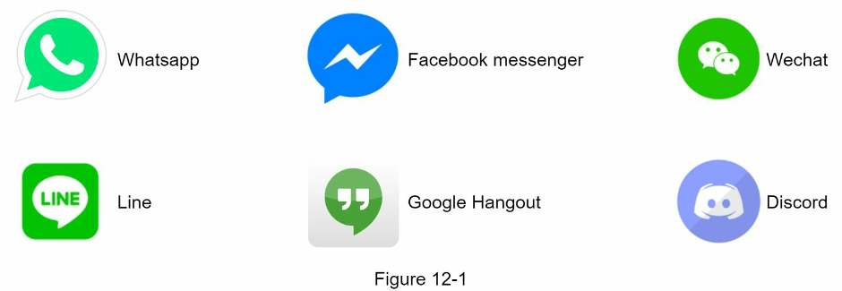

Ứng dụng chat phục vụ những chức năng khác nhau cho những nhóm người dùng khác nhau. Xác định chính xác yêu cầu là điều vô cùng quan trọng. Chẳng hạn, bạn không muốn thiết kế một hệ thống tập trung vào chat nhóm trong khi người phỏng vấn đang nghĩ đến chat một-một. Vì vậy, cần tìm hiểu rõ các yêu cầu về tính năng.

<!-- trang-pdf:179 -->

## Bước 1 - Hiểu bài toán và xác định phạm vi thiết kế

Cần thống nhất loại ứng dụng chat sẽ thiết kế. Trên thị trường có các ứng dụng chat một-một như Facebook Messenger, WeChat và WhatsApp; các ứng dụng chat trong công việc tập trung vào chat nhóm như Slack; và các ứng dụng chat cho game như Discord, tập trung vào tương tác trong nhóm lớn và độ trễ thấp khi trò chuyện bằng giọng nói.

Nhóm câu hỏi làm rõ đầu tiên cần xác định chính xác người phỏng vấn hình dung điều gì khi yêu cầu thiết kế một hệ thống chat. Ít nhất, hãy xác định nên tập trung vào ứng dụng chat một-một hay chat nhóm. Dưới đây là một số câu hỏi có thể đặt ra:

**Ứng viên:** Chúng ta sẽ thiết kế loại ứng dụng chat nào? Chat một-một hay chat nhóm?

**Người phỏng vấn:** Cần hỗ trợ cả hai.

**Ứng viên:** Đây là ứng dụng di động, ứng dụng web hay cả hai?

**Người phỏng vấn:** Cả hai.

**Ứng viên:** Quy mô của ứng dụng là bao nhiêu? Một ứng dụng khởi nghiệp hay quy mô rất lớn?

**Người phỏng vấn:** Cần hỗ trợ 50 triệu người dùng hoạt động hằng ngày (DAU).

**Ứng viên:** Với chat nhóm, số thành viên tối đa là bao nhiêu?

**Người phỏng vấn:** Tối đa 100 người.

**Ứng viên:** Những tính năng nào quan trọng? Có cần hỗ trợ tệp đính kèm không?

**Người phỏng vấn:** Chat một-một, chat nhóm và chỉ báo trực tuyến. Hệ thống chỉ hỗ trợ tin nhắn văn bản.

**Ứng viên:** Có giới hạn kích thước tin nhắn không?

**Người phỏng vấn:** Có, độ dài văn bản phải dưới 100.000 ký tự.

**Ứng viên:** Có yêu cầu mã hóa đầu cuối không?

**Người phỏng vấn:** Hiện tại chưa cần, nhưng có thể thảo luận nếu còn thời gian.

**Ứng viên:** Lịch sử trò chuyện cần được lưu trong bao lâu?

**Người phỏng vấn:** Vĩnh viễn.

Trong chương này, chúng ta tập trung thiết kế một ứng dụng giống Facebook Messenger, nhấn mạnh các tính năng sau:

- Chat một-một với độ trễ chuyển tin thấp.
- Chat nhóm nhỏ, tối đa 100 người.
- Hiển thị trạng thái trực tuyến.
- Hỗ trợ nhiều thiết bị: cùng một tài khoản có thể đăng nhập đồng thời trên nhiều thiết bị.
- Thông báo đẩy.

**Ghi chú bản dịch:** Câu tương ứng trong nguồn ghi “the same account can be logged in to multiple accounts”; theo ngữ cảnh hỗ trợ nhiều thiết bị và phần đồng bộ bên dưới, câu này được hiểu là đăng nhập trên nhiều thiết bị.

Cũng cần thống nhất quy mô thiết kế. Chúng ta sẽ thiết kế hệ thống hỗ trợ 50 triệu DAU.

<!-- trang-pdf:180 -->

## Bước 2 - Đề xuất thiết kế cấp cao và thống nhất phương án

Để xây dựng một thiết kế chất lượng, cần có kiến thức cơ bản về cách client và server giao tiếp. Trong hệ thống chat, client có thể là ứng dụng di động hoặc ứng dụng web. Các client không giao tiếp trực tiếp với nhau. Thay vào đó, mỗi client kết nối tới dịch vụ chat, nơi hỗ trợ toàn bộ tính năng đã nêu. Trước hết, hãy tập trung vào những thao tác cơ bản. Dịch vụ chat phải hỗ trợ:

- Nhận tin nhắn từ các client khác.
- Tìm đúng người nhận cho từng tin nhắn và chuyển tiếp tin đến những người đó.
- Nếu người nhận chưa trực tuyến, giữ tin nhắn trên server cho đến khi người nhận trực tuyến.

Hình 12-2 thể hiện quan hệ giữa các client, gồm bên gửi và bên nhận, với dịch vụ chat.

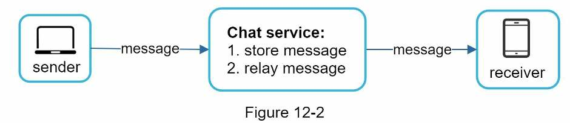

Khi muốn bắt đầu trò chuyện, client kết nối với dịch vụ chat thông qua một hoặc nhiều giao thức mạng. Lựa chọn giao thức là quyết định quan trọng đối với dịch vụ chat. Hãy trao đổi điều này với người phỏng vấn.

Trong đa số ứng dụng client/server, client là bên khởi tạo yêu cầu. Điều đó cũng đúng với phía gửi của ứng dụng chat. Trong Hình 12-2, khi bên gửi chuyển tin đến bên nhận thông qua dịch vụ chat, nó sử dụng HTTP, một giao thức đã được kiểm chứng qua thời gian và là giao thức web phổ biến nhất. Trong tình huống này, client mở kết nối HTTP với dịch vụ chat rồi gửi tin nhắn, yêu cầu dịch vụ chuyển tin cho người nhận. Cơ chế keep-alive phù hợp ở đây vì header keep-alive cho phép client duy trì kết nối lâu dài với dịch vụ chat, đồng thời giảm số lần bắt tay TCP. HTTP là một lựa chọn tốt ở phía gửi; nhiều ứng dụng chat phổ biến, chẳng hạn Facebook [1], ban đầu dùng HTTP để gửi tin nhắn.

Tuy nhiên, phía nhận phức tạp hơn đôi chút. Vì HTTP do client khởi tạo, việc gửi tin nhắn từ server không đơn giản. Qua nhiều năm, người ta đã dùng nhiều kỹ thuật để mô phỏng kết nối do server khởi tạo: polling, long polling và WebSocket. Đây là các kỹ thuật quan trọng, thường gặp trong phỏng vấn thiết kế hệ thống, nên chúng ta sẽ xem xét từng kỹ thuật.

### Polling

Như Hình 12-3 minh họa, polling là kỹ thuật trong đó client định kỳ hỏi server xem có tin nhắn hay không. Tùy tần suất thăm dò, polling có thể tốn kém. Nó có thể tiêu hao tài nguyên server quý giá chỉ để trả lời một câu hỏi mà phần lớn thời gian câu trả lời là “không”.

<!-- trang-pdf:181 -->

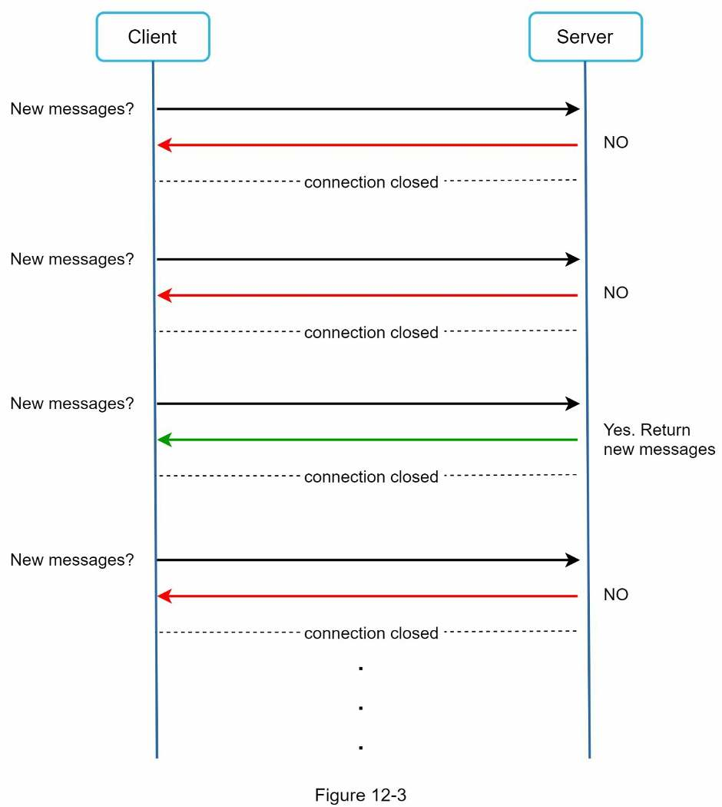

### Long polling

Vì polling có thể kém hiệu quả, bước cải tiến tiếp theo là long polling, được thể hiện trong Hình 12-4.

<!-- trang-pdf:182 -->

Trong long polling, client giữ kết nối mở cho đến khi thực sự có tin nhắn mới hoặc đạt ngưỡng hết thời gian chờ. Ngay khi nhận được tin nhắn mới, client lập tức gửi một yêu cầu khác đến server, khởi động lại quá trình. Long polling có một số hạn chế:

- Bên gửi và bên nhận có thể không kết nối tới cùng một chat server. Các server dựa trên HTTP thường không lưu trạng thái. Nếu cân bằng tải bằng round robin, server nhận tin nhắn có thể không giữ kết nối long polling với client nhận tin.
- Server không có cách tốt để xác định client đã ngắt kết nối hay chưa.
- Cách này không hiệu quả: dù người dùng ít trò chuyện, long polling vẫn tạo kết nối định kỳ sau mỗi lần hết thời gian chờ.

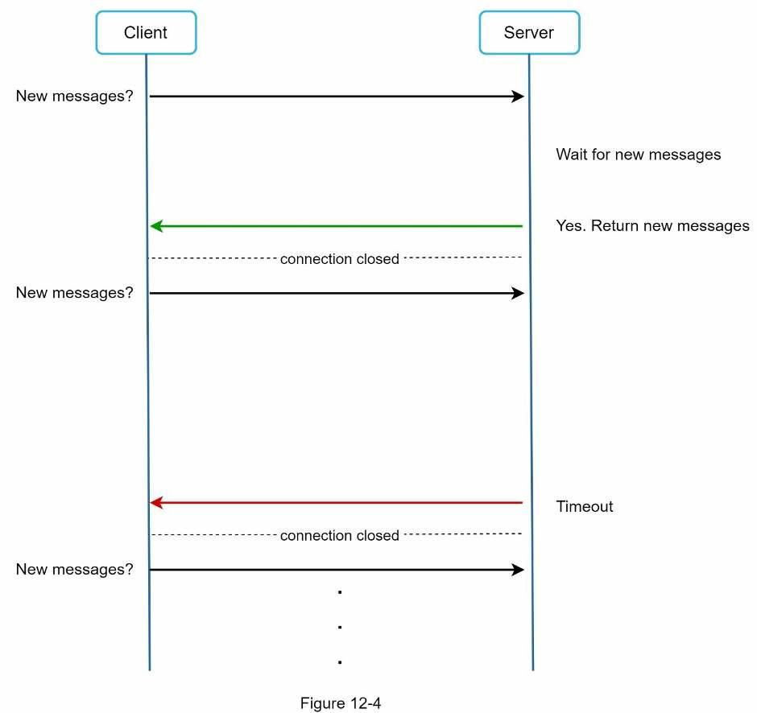

### WebSocket

WebSocket là giải pháp phổ biến nhất để gửi các cập nhật bất đồng bộ từ server tới client. Hình 12-5 thể hiện cách hoạt động.

<!-- trang-pdf:183 -->

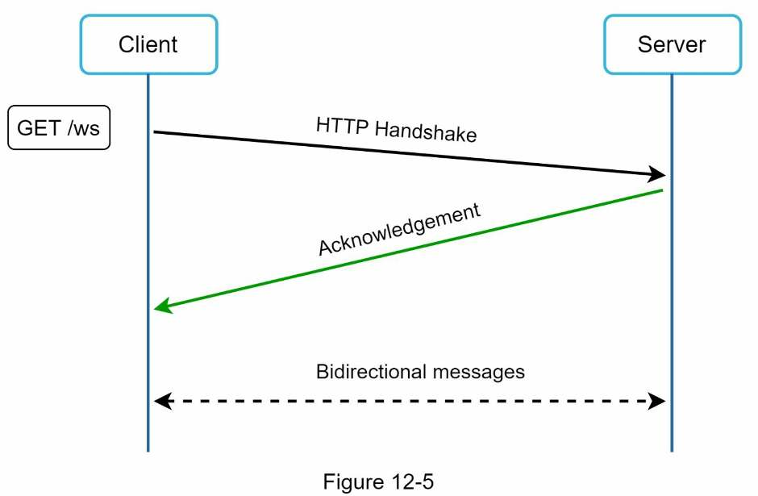

Kết nối WebSocket do client khởi tạo, có tính hai chiều và được duy trì liên tục. Ban đầu nó là kết nối HTTP, sau đó có thể được “nâng cấp” thành kết nối WebSocket thông qua một quy trình bắt tay được quy định rõ ràng. Qua kết nối liên tục này, server có thể gửi cập nhật tới client. Kết nối WebSocket thường hoạt động được ngay cả khi có tường lửa, vì nó sử dụng cổng 80 hoặc 443, cũng là các cổng dùng cho HTTP/HTTPS.

Ở trên, chúng ta đã nói HTTP phù hợp cho phía gửi. Nhưng do WebSocket là giao thức hai chiều, không có lý do kỹ thuật đủ mạnh để không dùng nó cho cả việc gửi. Hình 12-6 cho thấy cách dùng WebSocket (`ws`) ở cả bên gửi và bên nhận.

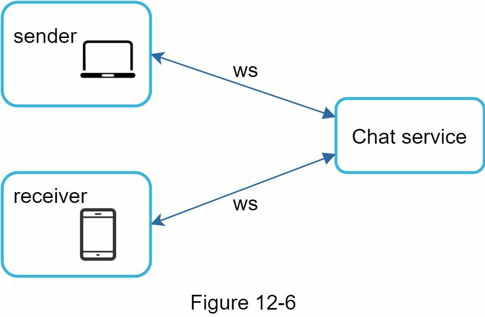

Dùng WebSocket cho cả hai chiều giúp đơn giản hóa thiết kế và làm cho việc triển khai ở cả client lẫn server dễ dàng hơn. Do kết nối WebSocket tồn tại liên tục, quản lý kết nối hiệu quả ở phía server là điều then chốt.

<!-- trang-pdf:184 -->

### Thiết kế cấp cao

Chúng ta vừa chọn WebSocket làm giao thức giao tiếp chính giữa client và server vì khả năng trao đổi hai chiều. Tuy nhiên, không phải mọi thứ đều phải dùng WebSocket. Thực tế, phần lớn tính năng của ứng dụng chat, như đăng ký, đăng nhập và hồ sơ người dùng, có thể sử dụng mô hình yêu cầu/phản hồi truyền thống qua HTTP. Hãy đi sâu hơn một chút và xem các thành phần cấp cao của hệ thống.

Như Hình 12-7, hệ thống chat được chia thành ba nhóm chính: dịch vụ không lưu trạng thái, dịch vụ có lưu trạng thái và tích hợp bên thứ ba.

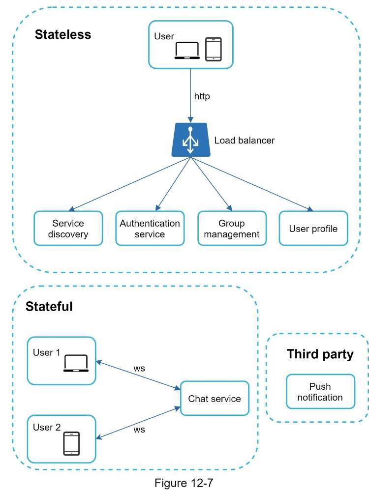

#### Dịch vụ không lưu trạng thái

Các dịch vụ không lưu trạng thái (stateless services) là những dịch vụ yêu cầu/phản hồi truyền thống mà client bên ngoài truy cập, dùng để quản lý đăng nhập, đăng ký, hồ sơ người dùng, v.v. Đây là những tính năng chung của nhiều website và ứng dụng. Các dịch vụ này nằm sau bộ cân bằng tải, có nhiệm vụ định tuyến yêu cầu đến đúng dịch vụ dựa trên đường dẫn yêu cầu. Chúng có thể được triển khai dưới dạng một ứng dụng nguyên khối hoặc các <!-- trang-pdf:185 --> microservice riêng biệt. Chúng ta không cần tự xây dựng quá nhiều dịch vụ không lưu trạng thái vì thị trường đã có những dịch vụ dễ tích hợp. Một dịch vụ sẽ được phân tích kỹ hơn ở phần thiết kế chi tiết là khám phá dịch vụ (service discovery). Nhiệm vụ chính của nó là cung cấp cho client danh sách tên máy DNS của các chat server mà client có thể kết nối tới.

#### Dịch vụ có lưu trạng thái

Dịch vụ có lưu trạng thái duy nhất là dịch vụ chat. Nó có trạng thái vì mỗi client duy trì một kết nối mạng liên tục tới một chat server. Thông thường, client không chuyển sang chat server khác chừng nào server hiện tại vẫn hoạt động. Dịch vụ khám phá phối hợp chặt chẽ với dịch vụ chat để tránh làm server quá tải. Chúng ta sẽ xem chi tiết ở phần thiết kế chuyên sâu.

#### Tích hợp bên thứ ba

Với ứng dụng chat, thông báo đẩy là tích hợp bên thứ ba quan trọng nhất. Nó thông báo cho người dùng khi có tin nhắn mới, ngay cả khi ứng dụng không chạy. Tích hợp thông báo đẩy đúng cách là việc thiết yếu. Xem thêm Chương 10, Thiết kế hệ thống thông báo.

#### Khả năng mở rộng

Ở quy mô nhỏ, tất cả dịch vụ trên có thể đặt trong một server. Ngay cả ở quy mô chúng ta đang thiết kế, về lý thuyết vẫn có thể đặt toàn bộ kết nối người dùng trên một server đám mây hiện đại. Yếu tố giới hạn nhiều khả năng là số kết nối đồng thời server có thể xử lý. Trong tình huống của chúng ta, với 1 triệu người dùng đồng thời, nếu mỗi kết nối cần 10 KB bộ nhớ trên server, tổng cộng chỉ cần khoảng 10 GB bộ nhớ để giữ mọi kết nối trên một máy. Đây là con số ước lượng rất sơ bộ và phụ thuộc nhiều vào ngôn ngữ lập trình được chọn.

Nếu đề xuất một thiết kế đặt mọi thứ trên một server, bạn có thể khiến người phỏng vấn hết sức lo ngại. Không một người làm kỹ thuật nào lại thiết kế hệ thống ở quy mô đó chỉ trên một server. Thiết kế một server không thể chấp nhận được vì nhiều yếu tố, trong đó lớn nhất là điểm lỗi đơn (single point of failure).

Tuy vậy, bắt đầu từ thiết kế một server là hoàn toàn hợp lý. Chỉ cần bảo đảm người phỏng vấn hiểu đó là điểm xuất phát. Kết hợp tất cả nội dung đã nói, Hình 12-8 thể hiện thiết kế cấp cao sau khi điều chỉnh.

<!-- trang-pdf:186 -->

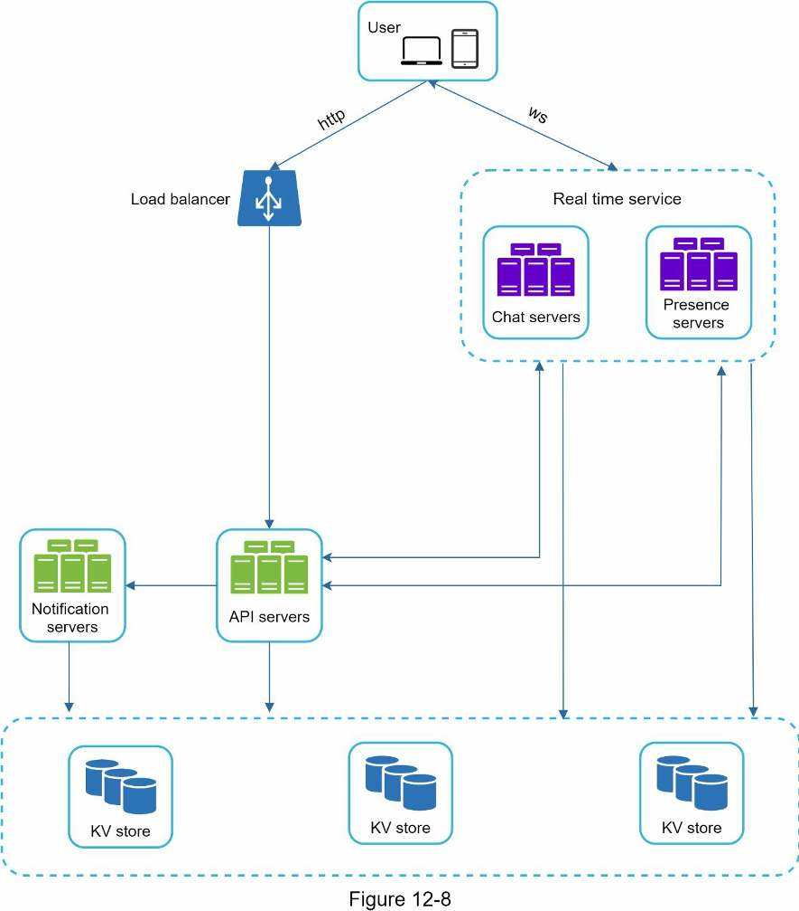

Trong Hình 12-8, client duy trì kết nối WebSocket liên tục tới một chat server để nhắn tin theo thời gian thực.

- Chat server hỗ trợ gửi và nhận tin nhắn.
- Presence server quản lý trạng thái trực tuyến/ngoại tuyến.
- API server xử lý các chức năng như đăng nhập, đăng ký, thay đổi hồ sơ, v.v.
- Notification server gửi thông báo đẩy.
- Cuối cùng, kho khóa-giá trị lưu lịch sử trò chuyện. Khi một người dùng đang ngoại tuyến quay lại trực tuyến, họ sẽ thấy toàn bộ lịch sử trước đó.

### Lưu trữ

Đến đây, các server đã sẵn sàng, các dịch vụ đã hoạt động và việc tích hợp bên thứ ba đã hoàn tất. Nằm sâu trong ngăn xếp kỹ thuật là tầng dữ liệu. Thường cần bỏ công sức để thiết kế tầng này cho đúng. Một quyết định quan trọng là chọn loại cơ sở dữ liệu phù hợp: cơ sở dữ liệu quan hệ hay NoSQL? Để đưa ra quyết định có cơ sở, chúng ta <!-- trang-pdf:187 --> sẽ xem xét các loại dữ liệu cùng mô hình đọc/ghi.

Một hệ thống chat điển hình có hai loại dữ liệu. Loại thứ nhất là dữ liệu chung như hồ sơ, thiết lập và danh sách bạn bè của người dùng. Những dữ liệu này được lưu trong các cơ sở dữ liệu quan hệ vững chắc, đáng tin cậy. Sao chép và phân mảnh là các kỹ thuật thường dùng để đáp ứng yêu cầu về tính sẵn sàng và khả năng mở rộng.

Loại thứ hai mang tính đặc thù của hệ thống chat: dữ liệu lịch sử trò chuyện. Cần hiểu rõ mô hình đọc/ghi của loại dữ liệu này.

- Lượng dữ liệu của hệ thống chat rất lớn. Một nghiên cứu trước đây [2] cho thấy Facebook Messenger và WhatsApp xử lý 60 tỷ tin nhắn mỗi ngày.
- Chỉ các cuộc trò chuyện gần đây được truy cập thường xuyên. Người dùng thường không tra cứu các cuộc trò chuyện cũ.
- Mặc dù trong đa số trường hợp người dùng chỉ xem lịch sử rất gần đây, họ có thể dùng những tính năng cần truy cập dữ liệu ngẫu nhiên, chẳng hạn tìm kiếm, xem các lượt nhắc đến mình, nhảy tới một tin nhắn cụ thể, v.v. Tầng truy cập dữ liệu phải hỗ trợ các trường hợp này.
- Tỷ lệ đọc/ghi của ứng dụng chat một-một vào khoảng 1:1.

Chọn hệ thống lưu trữ phù hợp, hỗ trợ được tất cả trường hợp sử dụng, là việc thiết yếu. Chúng tôi đề xuất kho khóa-giá trị (key-value store) vì những lý do sau:

- Kho khóa-giá trị dễ mở rộng theo chiều ngang.
- Kho khóa-giá trị cho phép truy cập dữ liệu với độ trễ rất thấp.
- Cơ sở dữ liệu quan hệ xử lý phần “đuôi dài” (long tail) [3] của dữ liệu không tốt. Khi chỉ mục tăng lớn, truy cập ngẫu nhiên trở nên tốn kém.
- Nhiều ứng dụng chat đã chứng minh được độ tin cậy cũng sử dụng kho khóa-giá trị. Chẳng hạn, Facebook Messenger và Discord đều dùng loại kho này: Facebook Messenger dùng HBase [4], còn Discord dùng Cassandra [5].

### Mô hình dữ liệu

Chúng ta vừa nói về việc dùng kho khóa-giá trị làm tầng lưu trữ. Dữ liệu quan trọng nhất là tin nhắn. Hãy xem xét kỹ hơn.

#### Bảng tin nhắn cho chat một-một

Hình 12-9 minh họa bảng tin nhắn cho chat một-một. Khóa chính là `message_id`, giúp xác định thứ tự tin nhắn. Không thể dựa vào `created_at` để quyết định thứ tự vì hai tin nhắn có thể được tạo cùng lúc.

<!-- trang-pdf:188 -->

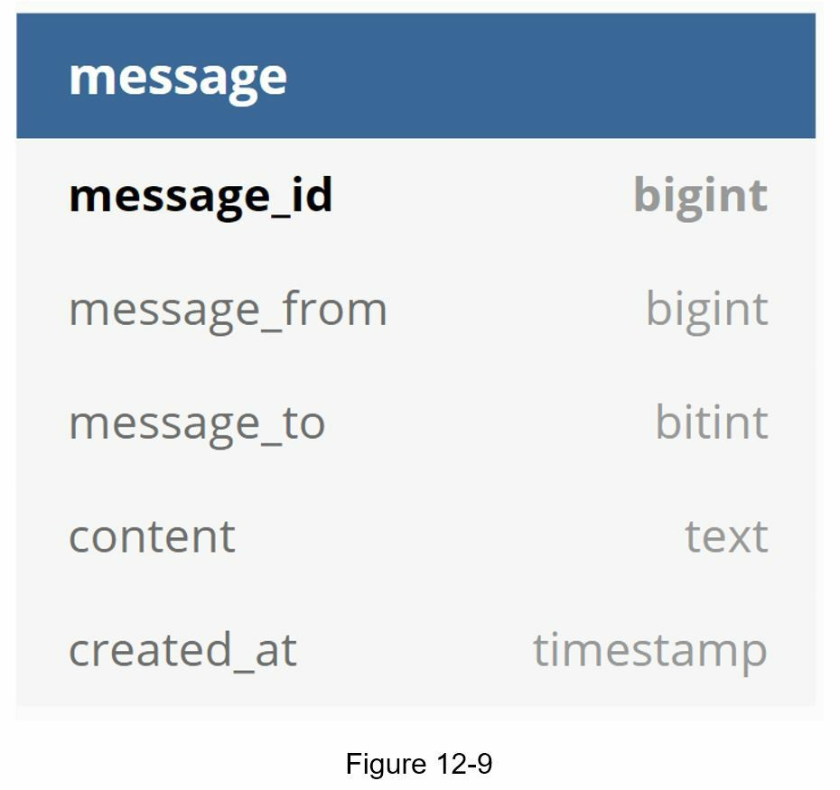

#### Bảng tin nhắn cho chat nhóm

Hình 12-10 thể hiện bảng tin nhắn cho chat nhóm. Khóa chính kết hợp là `(channel_id, message_id)`. Trong ngữ cảnh này, kênh và nhóm có cùng ý nghĩa. `channel_id` là khóa phân vùng vì mọi truy vấn trong một cuộc chat nhóm đều hoạt động trong một kênh.

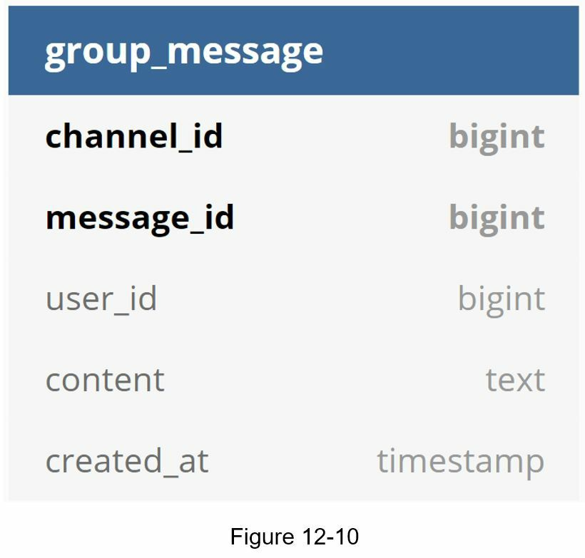

#### ID tin nhắn

<!-- trang-pdf:189 -->

Cách sinh `message_id` là một chủ đề thú vị đáng tìm hiểu. `message_id` có trách nhiệm bảo đảm thứ tự tin nhắn. Để xác định được thứ tự, nó phải đáp ứng hai yêu cầu:

- ID phải duy nhất.
- ID phải sắp xếp được theo thời gian: các hàng mới phải có ID lớn hơn những hàng cũ.

Làm thế nào để đạt được cả hai bảo đảm? Ý tưởng đầu tiên thường là từ khóa `auto_increment` trong MySQL. Tuy nhiên, các cơ sở dữ liệu NoSQL thường không cung cấp tính năng này.

Cách thứ hai là dùng bộ sinh số thứ tự 64 bit toàn cục như Snowflake [6]. Nội dung này đã được bàn trong Chương 7: Thiết kế bộ sinh ID duy nhất trong hệ thống phân tán.

Cách cuối cùng là dùng bộ sinh số thứ tự cục bộ. “Cục bộ” nghĩa là ID chỉ duy nhất trong phạm vi một nhóm. ID cục bộ có thể dùng được vì chỉ cần duy trì thứ tự tin nhắn trong từng kênh một-một hoặc từng kênh nhóm. Cách này dễ triển khai hơn so với ID toàn cục.

<!-- trang-pdf:190 -->

## Bước 3 - Thiết kế chuyên sâu

Trong phỏng vấn thiết kế hệ thống, bạn thường được kỳ vọng đi sâu vào một số thành phần của thiết kế cấp cao. Với hệ thống chat, các chủ đề đáng tìm hiểu kỹ hơn gồm khám phá dịch vụ, luồng tin nhắn và chỉ báo trực tuyến/ngoại tuyến.

### Khám phá dịch vụ

Vai trò chính của khám phá dịch vụ là đề xuất chat server phù hợp nhất cho một client, dựa trên những tiêu chí như vị trí địa lý, năng lực server, v.v. Apache ZooKeeper [7] là một giải pháp mã nguồn mở phổ biến. Nó đăng ký toàn bộ chat server hiện có và chọn server tốt nhất cho client theo các tiêu chí đã định trước.

Hình 12-11 thể hiện cách khám phá dịch vụ bằng ZooKeeper hoạt động.

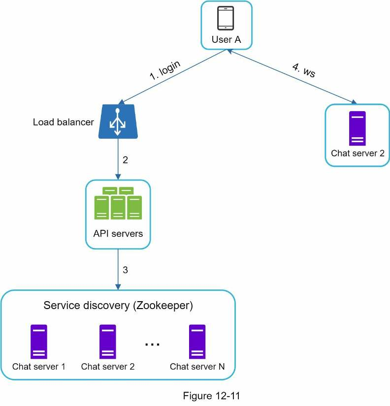

1. Người dùng A thử đăng nhập ứng dụng.
2. Bộ cân bằng tải gửi yêu cầu đăng nhập tới các API server.
3. Sau khi backend xác thực người dùng, dịch vụ khám phá tìm chat server tốt nhất cho A. Trong ví dụ này, server 2 được chọn và thông tin server được trả về cho A.
4. A kết nối tới chat server 2 qua WebSocket.

### Luồng tin nhắn

Tìm hiểu luồng đầu cuối của hệ thống chat là một việc thú vị. Trong phần này, chúng ta sẽ <!-- trang-pdf:191 --> xem xét luồng chat một-một, đồng bộ tin nhắn giữa nhiều thiết bị và luồng chat nhóm.

#### Luồng chat một-một

Hình 12-12 giải thích điều xảy ra khi người dùng A gửi tin nhắn cho B.

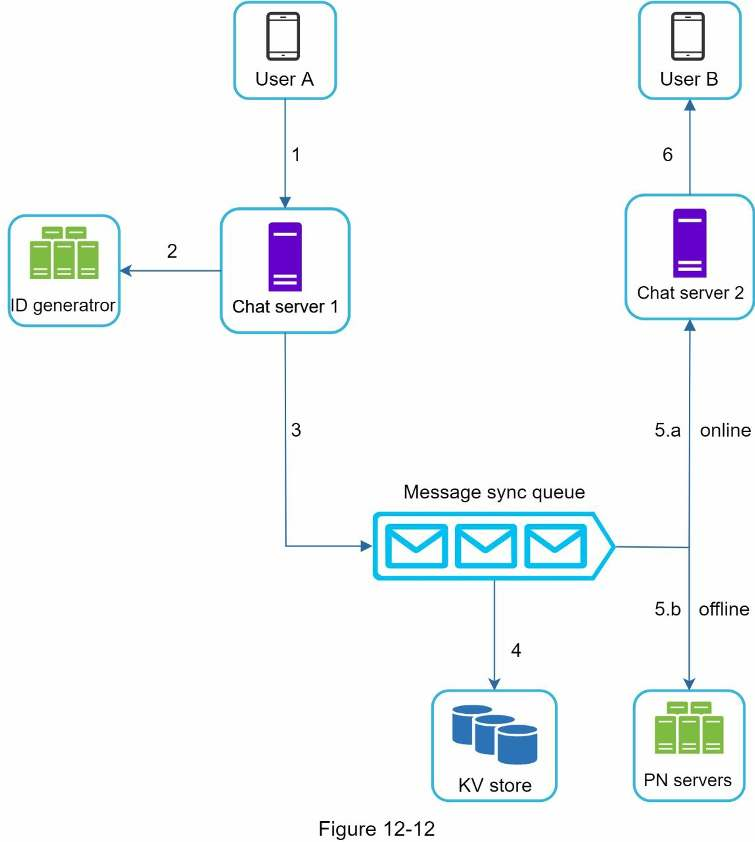

1. A gửi một tin nhắn tới Chat server 1.
2. Chat server 1 lấy ID tin nhắn từ bộ sinh ID.
3. Chat server 1 gửi tin nhắn vào hàng đợi đồng bộ tin nhắn.
4. Tin nhắn được lưu trong kho khóa-giá trị.
5. Có hai trường hợp:
   - **5.a.** Nếu B trực tuyến, tin nhắn được chuyển tiếp tới Chat server 2, nơi B đang kết nối.
   - **5.b.** Nếu B ngoại tuyến, các server thông báo đẩy (PN) gửi một thông báo đẩy.
6. Chat server 2 chuyển tin tới B. Giữa B và Chat server 2 có một kết nối WebSocket liên tục.

#### Đồng bộ tin nhắn giữa nhiều thiết bị

Nhiều người dùng sở hữu nhiều thiết bị. Chúng ta sẽ giải thích cách đồng bộ tin nhắn giữa những thiết bị đó. Hình 12-13 đưa ra một ví dụ.

<!-- trang-pdf:192 -->

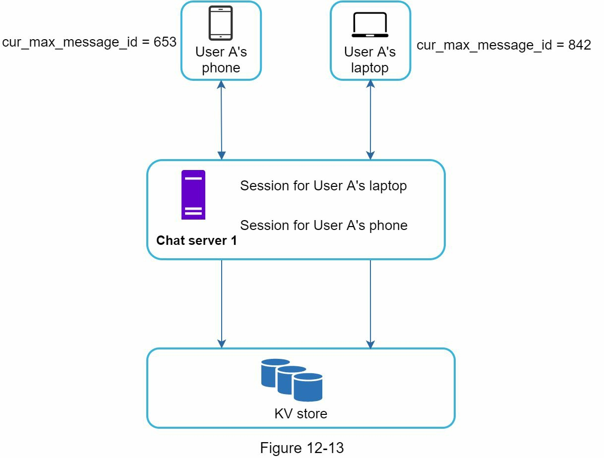

Trong Hình 12-13, A có hai thiết bị: một điện thoại và một laptop. Khi A đăng nhập ứng dụng chat trên điện thoại, thiết bị thiết lập kết nối WebSocket tới Chat server 1. Tương tự, giữa laptop và Chat server 1 cũng có một kết nối.

Mỗi thiết bị giữ một biến tên `cur_max_message_id`, dùng để theo dõi ID tin nhắn mới nhất trên thiết bị. Những tin nhắn thỏa mãn cả hai điều kiện sau được xem là tin nhắn mới:

- ID người nhận bằng ID của người dùng đang đăng nhập.
- ID tin nhắn trong kho khóa-giá trị lớn hơn `cur_max_message_id`.

Do mỗi thiết bị có giá trị `cur_max_message_id` riêng, việc đồng bộ khá dễ dàng: mỗi thiết bị có thể lấy các tin nhắn mới từ kho KV.

#### Luồng chat nhóm nhỏ

So với chat một-một, logic chat nhóm phức tạp hơn. Hình 12-14 và 12-15 giải thích luồng này.

<!-- trang-pdf:193 -->

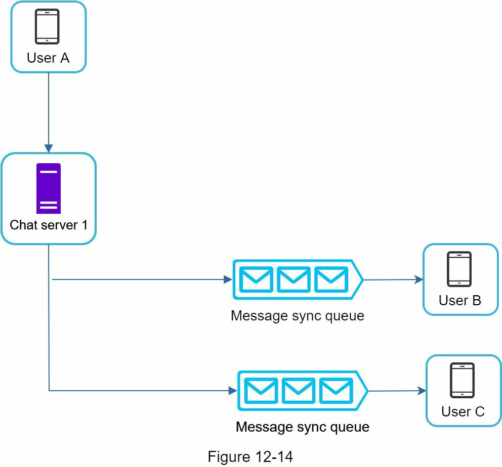

Hình 12-14 giải thích điều xảy ra khi A gửi một tin nhắn trong nhóm. Giả sử nhóm có ba thành viên: A, B và C. Đầu tiên, tin nhắn từ A được sao chép vào hàng đợi đồng bộ tin nhắn của từng thành viên còn lại: một bản cho B và một bản cho C. Có thể xem hàng đợi đồng bộ này như hộp thư đến của người nhận. Lựa chọn thiết kế này phù hợp với chat nhóm nhỏ vì:

- Nó đơn giản hóa luồng đồng bộ: mỗi client chỉ cần kiểm tra hộp thư của chính mình để nhận tin mới.
- Khi số thành viên ít, lưu một bản sao trong hộp thư của mỗi người nhận không quá tốn kém.

WeChat dùng cách tiếp cận tương tự và giới hạn mỗi nhóm ở 500 thành viên [8]. Tuy nhiên, với nhóm có rất nhiều người, việc lưu một bản sao tin nhắn cho từng thành viên là không chấp nhận được.

Ở phía nhận, một người có thể nhận tin từ nhiều người dùng. Mỗi người nhận có một hộp thư, tức hàng đợi đồng bộ tin nhắn, chứa tin từ các bên gửi khác nhau. Hình 12-15 minh họa thiết kế này.

<!-- trang-pdf:194 -->

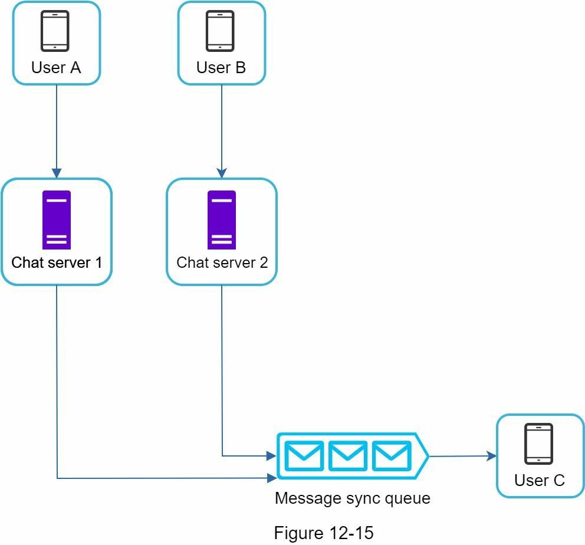

### Trạng thái trực tuyến

Chỉ báo trạng thái trực tuyến là tính năng thiết yếu của nhiều ứng dụng chat. Thường bạn sẽ thấy một chấm xanh bên cạnh ảnh đại diện hoặc tên người dùng. Phần này giải thích những gì diễn ra phía sau.

Trong thiết kế cấp cao, presence server chịu trách nhiệm quản lý trạng thái trực tuyến và giao tiếp với client qua WebSocket. Một số luồng sẽ làm thay đổi trạng thái trực tuyến. Hãy xem xét từng luồng.

#### Người dùng đăng nhập

Luồng đăng nhập đã được giải thích trong phần Khám phá dịch vụ. Sau khi thiết lập kết nối WebSocket giữa client và dịch vụ thời gian thực, trạng thái trực tuyến của A cùng dấu thời gian `last_active_at` được lưu vào kho KV. Sau khi A đăng nhập, chỉ báo hiển thị người dùng đang trực tuyến.

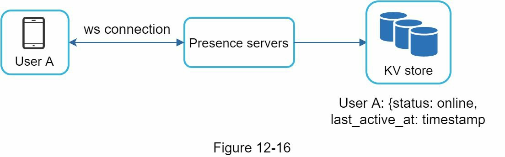

<!-- trang-pdf:195 -->

#### Người dùng đăng xuất

Khi người dùng đăng xuất, hệ thống thực hiện luồng như Hình 12-17. Trạng thái trong kho KV được đổi sang ngoại tuyến. Chỉ báo cho thấy người dùng đã ngoại tuyến.

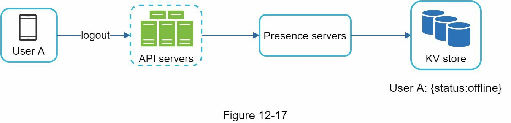

#### Người dùng mất kết nối

Ai cũng mong kết nối Internet ổn định và đáng tin cậy. Tuy nhiên, thực tế không phải lúc nào cũng vậy, nên thiết kế phải xử lý vấn đề này. Khi người dùng mất kết nối Internet, kết nối liên tục giữa client và server cũng mất. Cách đơn giản là đánh dấu người dùng ngoại tuyến khi ngắt kết nối và chuyển sang trực tuyến khi kết nối được thiết lập lại. Nhưng cách này có một nhược điểm lớn. Người dùng thường mất kết nối rồi kết nối lại nhiều lần trong một khoảng thời gian ngắn. Ví dụ, kết nối có thể chập chờn khi người dùng đi qua đường hầm. Nếu cập nhật trạng thái sau mỗi lần ngắt/kết nối lại, chỉ báo sẽ thay đổi quá thường xuyên và làm trải nghiệm kém đi.

Để giải quyết vấn đề, chúng ta đưa vào cơ chế heartbeat. Client đang trực tuyến định kỳ gửi sự kiện heartbeat tới presence server. Nếu presence server nhận được heartbeat trong một khoảng thời gian nhất định, chẳng hạn x giây, người dùng được coi là trực tuyến. Nếu không, người dùng được coi là ngoại tuyến.

Trong Hình 12-18, client gửi heartbeat đến server mỗi 5 giây. Sau ba sự kiện heartbeat, client mất kết nối và không kết nối lại trong khoảng x = 30 giây. Con số này được chọn tùy ý để minh họa logic. Trạng thái được chuyển thành ngoại tuyến.

<!-- trang-pdf:196 -->

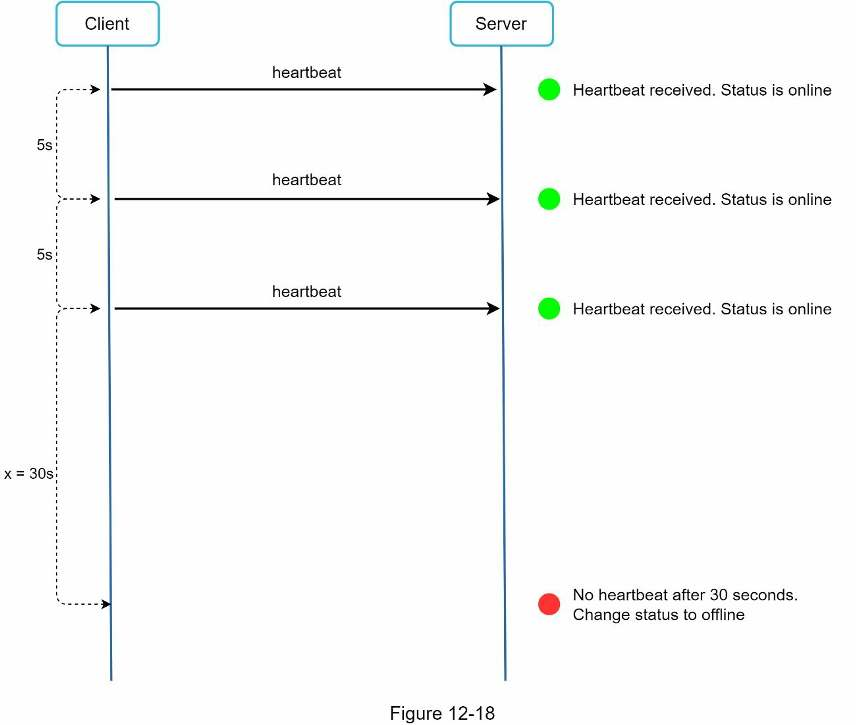

#### Phân phối cập nhật trạng thái trực tuyến

Làm sao bạn bè của A biết trạng thái đã thay đổi? Hình 12-19 giải thích cách hoạt động. Presence server dùng mô hình xuất bản-đăng ký (publish-subscribe), trong đó mỗi cặp bạn bè duy trì một kênh. Khi trạng thái của A thay đổi, hệ thống xuất bản sự kiện tới ba kênh: A-B, A-C và A-D. B, C, D lần lượt đăng ký các kênh tương ứng. Nhờ vậy, bạn bè dễ dàng nhận được cập nhật trạng thái trực tuyến. Client và server giao tiếp theo thời gian thực qua WebSocket.

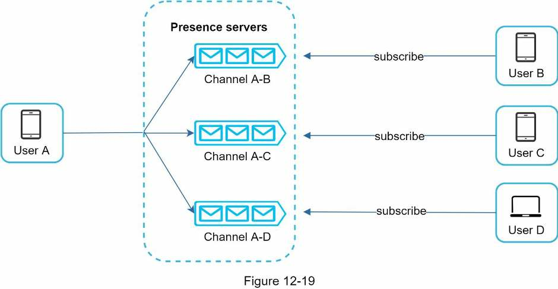

<!-- trang-pdf:197 -->

Thiết kế trên hiệu quả với nhóm người dùng nhỏ. Chẳng hạn, WeChat sử dụng cách tương tự vì giới hạn nhóm ở 500 người. Với nhóm lớn hơn, thông báo trạng thái cho tất cả thành viên vừa tốn kém vừa mất thời gian. Giả sử nhóm có 100.000 thành viên: mỗi lần trạng thái thay đổi sẽ sinh ra 100.000 sự kiện. Một giải pháp khả thi để xử lý nút thắt hiệu năng này là chỉ lấy trạng thái trực tuyến khi người dùng vào nhóm hoặc chủ động làm mới danh sách bạn bè.

<!-- trang-pdf:198 -->

## Bước 4 - Tổng kết

Trong chương này, chúng ta đã trình bày kiến trúc hệ thống chat hỗ trợ cả chat một-một và chat nhóm nhỏ. WebSocket được dùng cho giao tiếp thời gian thực giữa client và server. Hệ thống gồm: chat server phục vụ nhắn tin thời gian thực; presence server quản lý trạng thái trực tuyến; server thông báo đẩy gửi thông báo; kho khóa-giá trị lưu bền vững lịch sử trò chuyện; và API server phục vụ các chức năng khác.

Nếu cuối buổi phỏng vấn còn thời gian, có thể trao đổi thêm những chủ đề sau:

- Mở rộng ứng dụng để hỗ trợ tệp đa phương tiện như ảnh và video. Những tệp này lớn hơn văn bản rất nhiều. Nén, lưu trữ đám mây và ảnh thu nhỏ là các chủ đề thú vị để bàn luận.
- Mã hóa đầu cuối. WhatsApp hỗ trợ mã hóa đầu cuối cho tin nhắn; chỉ người gửi và người nhận đọc được. Bạn đọc quan tâm có thể xem bài viết trong tài liệu tham khảo [9].
- Lưu đệm tin nhắn ở phía client là cách hiệu quả để giảm dữ liệu truyền giữa client và server.
- Cải thiện thời gian tải. Slack xây dựng một mạng phân tán theo địa lý để lưu đệm dữ liệu người dùng, kênh, v.v., nhằm tải nhanh hơn [10].
- Xử lý lỗi:
  - **Chat server gặp lỗi:** Một chat server có thể giữ hàng trăm nghìn hoặc nhiều hơn các kết nối liên tục. Khi server ngừng hoạt động, dịch vụ khám phá ZooKeeper cung cấp một chat server mới để client thiết lập lại kết nối.
  - **Cơ chế gửi lại tin nhắn:** Thử lại và xếp hàng là những kỹ thuật thường dùng để gửi lại.

Chúc mừng bạn đã đi được đến đây! Hãy tự dành cho mình một lời khen. Làm tốt lắm!

<!-- trang-pdf:199 -->

## Tài liệu tham khảo

[1] Erlang at Facebook: https://www.erlang-factory.com/upload/presentations/31/EugeneLetuchy-ErlangatFacebook.pdf

[2] Messenger and WhatsApp process 60 billion messages a day: https://www.theverge.com/2016/4/12/11415198/facebook-messenger-whatsapp-number-messages-vs-sms-f8-2016

[3] Long tail: https://en.wikipedia.org/wiki/Long_tail

[4] The Underlying Technology of Messages: https://www.facebook.com/notes/facebook-engineering/the-underlying-technology-of-messages/454991608919/

[5] How Discord Stores Billions of Messages: https://blog.discordapp.com/how-discord-stores-billions-of-messages-7fa6ec7ee4c7

[6] Announcing Snowflake: https://blog.twitter.com/engineering/en_us/a/2010/announcing-snowflake.html

[7] Apache ZooKeeper: https://zookeeper.apache.org/

[8] From nothing: the evolution of WeChat background system (bài viết tiếng Trung): https://www.infoq.cn/article/the-road-of-the-growth-weixin-background

[9] End-to-end encryption: https://faq.whatsapp.com/en/android/28030015/

[10] Flannel: An Application-Level Edge Cache to Make Slack Scale: https://slack.engineering/flannel-an-application-level-edge-cache-to-make-slack-scale-b8a6400e2f6b

---

[← Chương 11](chuong-11.md) · [Mục lục](../README.md) · [Chương 13 →](chuong-13.md)
