# Chương 13: Thiết kế hệ thống tự động hoàn thành tìm kiếm

[English](../original/chuong-13-thiet-ke-he-thong-tu-dong-hoan-thanh-tim-kiem.md) · [Mục lục](../README.md)

*Tên gốc: Design a Search Autocomplete System. Nguồn: trang PDF 200-219. Hình và nhãn bên trong hình được giữ nguyên từ PDF.*

<!-- trang-pdf:200 -->

Khi tìm kiếm trên Google hoặc mua sắm trên Amazon, ngay trong lúc nhập vào ô tìm kiếm, bạn được hiển thị một hay nhiều kết quả khớp với cụm từ đang nhập. Tính năng này được gọi là autocomplete, typeahead, search-as-you-type hoặc incremental search. Hình 13-1 đưa ra ví dụ Google hiển thị danh sách kết quả tự động hoàn thành khi người dùng nhập “dinner”. Tự động hoàn thành tìm kiếm là tính năng quan trọng của nhiều sản phẩm. Từ đó, chúng ta có câu hỏi phỏng vấn: thiết kế một hệ thống tự động hoàn thành tìm kiếm, còn được gọi là “thiết kế top k” hoặc “thiết kế top k truy vấn được tìm kiếm nhiều nhất”.


<!-- trang-pdf:201 -->

## Bước 1 - Hiểu bài toán và xác định phạm vi thiết kế

Bước đầu tiên để giải quyết bất kỳ câu hỏi phỏng vấn thiết kế hệ thống nào là đặt đủ câu hỏi để làm rõ yêu cầu. Sau đây là một ví dụ trao đổi giữa ứng viên và người phỏng vấn:

**Ứng viên:** Chỉ cần khớp ở đầu truy vấn tìm kiếm hay cả ở giữa?

**Người phỏng vấn:** Chỉ ở đầu truy vấn.

**Ứng viên:** Hệ thống nên trả về bao nhiêu gợi ý tự động hoàn thành?

**Người phỏng vấn:** 5.

**Ứng viên:** Làm sao hệ thống biết phải trả về 5 gợi ý nào?

**Người phỏng vấn:** Dựa vào mức độ phổ biến, được xác định bằng tần suất truy vấn trong quá khứ.

**Ứng viên:** Hệ thống có hỗ trợ kiểm tra chính tả không?

**Người phỏng vấn:** Không hỗ trợ kiểm tra chính tả hoặc tự động sửa.

**Ứng viên:** Các truy vấn đều bằng tiếng Anh phải không?

**Người phỏng vấn:** Đúng. Nếu cuối buổi còn thời gian, chúng ta có thể bàn về hỗ trợ nhiều ngôn ngữ.

**Ứng viên:** Có cho phép chữ hoa và ký tự đặc biệt không?

**Người phỏng vấn:** Không. Giả sử mọi truy vấn chỉ gồm các chữ cái viết thường.

**Ứng viên:** Có bao nhiêu người sử dụng sản phẩm?

**Người phỏng vấn:** 10 triệu DAU.

### Yêu cầu

Các yêu cầu được tổng hợp như sau:

- **Phản hồi nhanh:** Khi người dùng nhập truy vấn, gợi ý phải xuất hiện đủ nhanh. Một bài viết về hệ thống autocomplete của Facebook [1] cho biết hệ thống cần trả kết quả trong vòng 100 mili giây; nếu lâu hơn sẽ gây cảm giác giật, khựng.
- **Liên quan:** Gợi ý phải liên quan đến cụm từ đang tìm.
- **Có thứ tự:** Kết quả trả về phải được sắp xếp theo mức độ phổ biến hoặc theo mô hình xếp hạng khác.
- **Có thể mở rộng:** Hệ thống xử lý được lưu lượng lớn.
- **Tính sẵn sàng cao:** Hệ thống phải tiếp tục sẵn sàng và có thể truy cập khi một phần ngừng hoạt động, chậm đi hoặc gặp lỗi mạng bất ngờ.

### Ước lượng sơ bộ

- Giả sử có 10 triệu người dùng hoạt động hằng ngày (DAU).
- Trung bình mỗi người tìm kiếm 10 lần mỗi ngày.
- Mỗi chuỗi truy vấn chiếm 20 byte:
  - Giả sử dùng mã hóa ASCII: 1 ký tự = 1 byte.
  - Một truy vấn gồm 4 từ, mỗi từ trung bình 5 ký tự.
  - Như vậy mỗi truy vấn là `4 × 5 = 20 byte`.
- Với mỗi ký tự được nhập vào ô tìm kiếm, client gửi một yêu cầu tới backend để lấy gợi ý. Trung bình mỗi truy vấn sinh ra 20 yêu cầu. Ví dụ, đến lúc nhập xong “dinner”, backend đã nhận 6 yêu cầu sau:

```text
search?q=d
```

<!-- trang-pdf:202 -->

```text
search?q=di
search?q=din
search?q=dinn
search?q=dinne
search?q=dinner
```

- Khoảng 24.000 truy vấn mỗi giây (QPS):

  `10.000.000 người dùng × 10 truy vấn/ngày × 20 ký tự / 24 giờ / 3.600 giây`.

- QPS giờ cao điểm = QPS × 2 ≈ 48.000.
- Giả sử 20% truy vấn mỗi ngày là truy vấn mới: `10 triệu × 10 truy vấn/ngày × 20 byte/truy vấn × 20% = 0,4 GB`. Nghĩa là mỗi ngày có thêm 0,4 GB dữ liệu mới cần lưu trữ.

<!-- trang-pdf:203 -->

## Bước 2 - Đề xuất thiết kế cấp cao và thống nhất phương án

Ở cấp cao, hệ thống được chia làm hai phần:

- **Dịch vụ thu thập dữ liệu:** Thu thập truy vấn người dùng nhập và tổng hợp theo thời gian thực. Xử lý thời gian thực không thực tế với tập dữ liệu lớn, nhưng đây là điểm xuất phát tốt. Chúng ta sẽ tìm hiểu giải pháp thực tế hơn ở phần thiết kế chuyên sâu.
- **Dịch vụ truy vấn:** Với một truy vấn hoặc tiền tố đầu vào, trả về 5 cụm từ được tìm kiếm nhiều nhất.

### Dịch vụ thu thập dữ liệu

Hãy dùng một ví dụ đơn giản để xem dịch vụ thu thập hoạt động thế nào. Giả sử có một bảng tần suất lưu chuỗi truy vấn và số lần xuất hiện như trong Hình 13-2. Ban đầu bảng trống. Sau đó, người dùng lần lượt nhập “twitch”, “twitter”, “twitter” và “twillo”. Hình 13-2 thể hiện cách bảng tần suất được cập nhật.

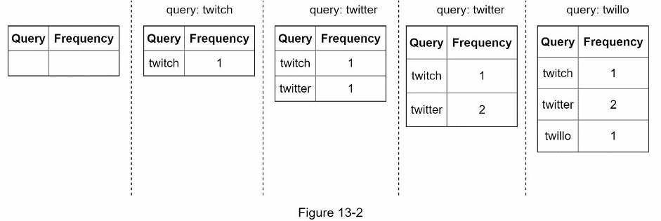

### Dịch vụ truy vấn

Giả sử bảng tần suất có dữ liệu như Bảng 13-1. Nó có hai trường:

- **Query:** Lưu chuỗi truy vấn.
- **Frequency:** Số lần truy vấn đó được tìm kiếm.

<!-- trang-pdf:204 -->

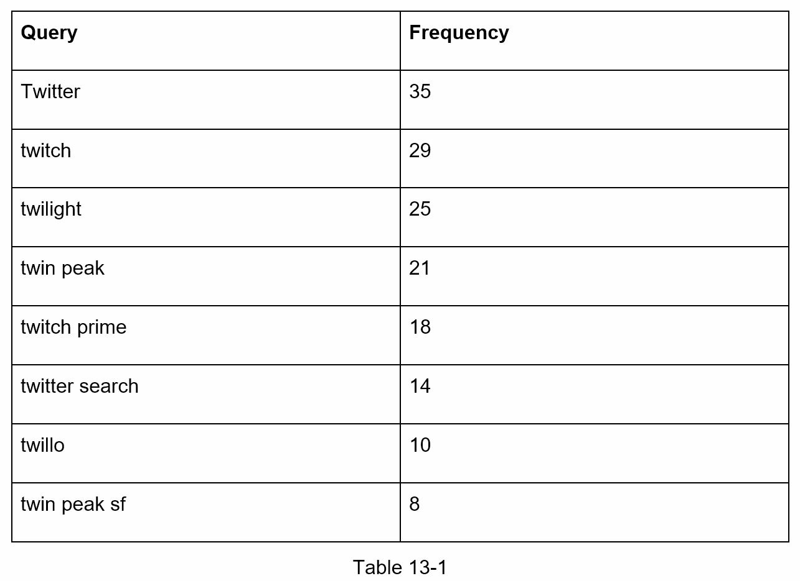

Khi người dùng nhập “tw” vào ô tìm kiếm, 5 truy vấn được tìm nhiều nhất sau đây xuất hiện như Hình 13-3, với giả định dữ liệu tần suất lấy từ Bảng 13-1.

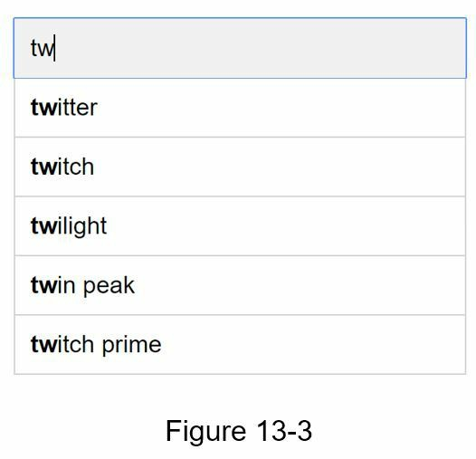

Để lấy 5 truy vấn có tần suất cao nhất, thực hiện truy vấn SQL sau:

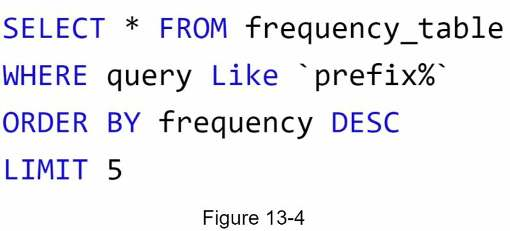

<!-- trang-pdf:205 -->

Đây là giải pháp chấp nhận được khi tập dữ liệu nhỏ. Khi dữ liệu lớn, truy cập cơ sở dữ liệu trở thành nút thắt. Chúng ta sẽ xem cách tối ưu trong phần thiết kế chuyên sâu.

<!-- trang-pdf:206 -->

## Bước 3 - Thiết kế chuyên sâu

Ở thiết kế cấp cao, chúng ta đã bàn về dịch vụ thu thập dữ liệu và dịch vụ truy vấn. Thiết kế đó chưa tối ưu nhưng là điểm khởi đầu tốt. Trong phần này, chúng ta sẽ đi sâu vào một số thành phần và các cách tối ưu sau:

- Cấu trúc dữ liệu trie.
- Dịch vụ thu thập dữ liệu.
- Dịch vụ truy vấn.
- Mở rộng tầng lưu trữ.
- Các thao tác trên trie.

### Cấu trúc dữ liệu trie

Thiết kế cấp cao dùng cơ sở dữ liệu quan hệ để lưu trữ. Tuy nhiên, lấy 5 truy vấn tìm kiếm hàng đầu từ cơ sở dữ liệu quan hệ không hiệu quả. Cấu trúc dữ liệu trie, hay cây tiền tố, giúp khắc phục vấn đề. Vì trie là thành phần then chốt của hệ thống, chúng ta sẽ dành thời gian đáng kể để thiết kế một trie tùy chỉnh. Một số ý tưởng được lấy từ các bài viết [2] và [3].

Hiểu cấu trúc trie cơ bản là điều cần thiết cho câu hỏi này. Tuy nhiên, nội dung đó thiên về cấu trúc dữ liệu hơn là thiết kế hệ thống, và trên mạng cũng có nhiều tài liệu giải thích. Do đó, chương này chỉ trình bày khái quát trie rồi tập trung tối ưu cấu trúc cơ bản để cải thiện thời gian phản hồi.

Trie, phát âm là “try”, là cấu trúc dạng cây có thể lưu chuỗi một cách gọn gàng. Tên của nó xuất phát từ từ “retrieval”, cho thấy nó được thiết kế để truy xuất chuỗi. Những ý chính gồm:

- Trie là một cấu trúc dữ liệu dạng cây.
- Nút gốc biểu diễn chuỗi rỗng.
- Mỗi nút lưu một ký tự và có 26 nút con, tương ứng 26 ký tự có thể có. Để tiết kiệm chỗ trong hình, không vẽ những liên kết rỗng.
- Mỗi nút cây biểu diễn một từ hoặc một chuỗi tiền tố.

Hình 13-5 minh họa một trie chứa các truy vấn “tree”, “try”, “true”, “toy”, “wish”, “win”. Các truy vấn hoàn chỉnh được đánh dấu bằng đường viền đậm hơn.

<!-- trang-pdf:207 -->

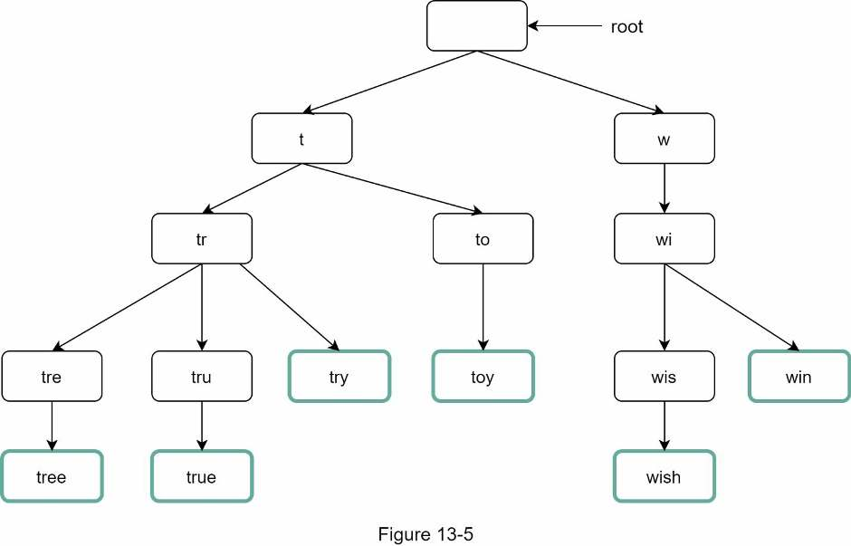

Trie cơ bản lưu các ký tự trong nút. Muốn hỗ trợ sắp xếp theo tần suất, cần bổ sung thông tin tần suất vào nút. Giả sử có bảng tần suất sau:

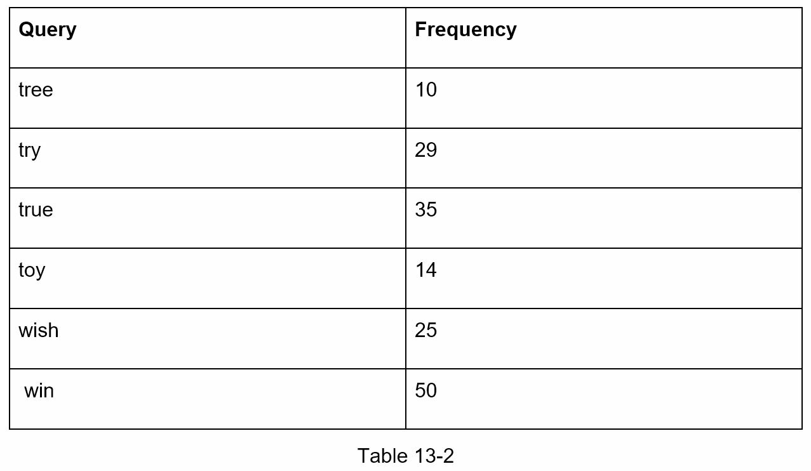

Sau khi thêm thông tin tần suất, cấu trúc trie được cập nhật như Hình 13-6.

<!-- trang-pdf:208 -->

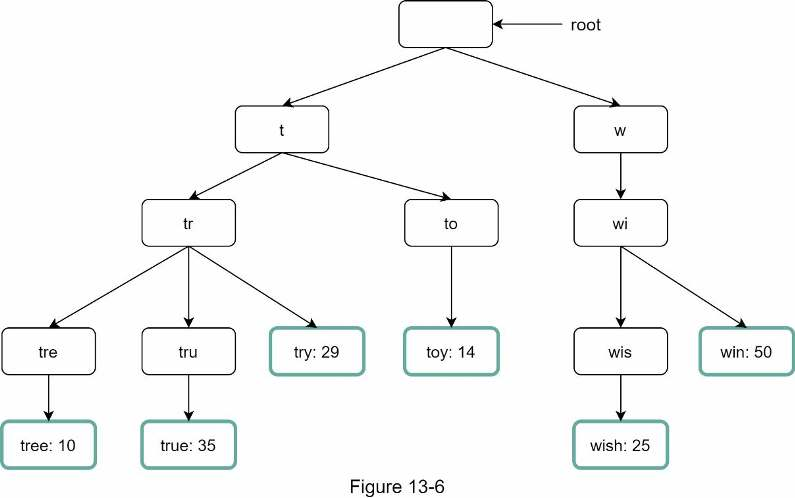

Autocomplete hoạt động với trie như thế nào? Trước khi đi vào thuật toán, hãy định nghĩa một số ký hiệu:

- `p`: Độ dài tiền tố.
- `n`: Tổng số nút trong trie.
- `c`: Số nút con của một nút cho trước.

Các bước lấy top k truy vấn được tìm kiếm nhiều nhất:

1. Tìm tiền tố. Độ phức tạp thời gian: `O(p)`.
2. Duyệt cây con bắt đầu từ nút tiền tố để lấy tất cả nút con hợp lệ. Một nút con hợp lệ nếu nó tạo thành chuỗi truy vấn hợp lệ. Độ phức tạp thời gian: `O(c)`.
3. Sắp xếp các nút con và lấy top k. Độ phức tạp thời gian: `O(c log c)`.

Dùng ví dụ Hình 13-7 để giải thích thuật toán. Giả sử `k = 2` và người dùng nhập “tr” vào ô tìm kiếm. Thuật toán chạy như sau:

- Bước 1: Tìm nút tiền tố “tr”.
- Bước 2: Duyệt cây con, lấy các nút con hợp lệ. Trong trường hợp này, các nút hợp lệ là `[tree: 10]`, `[true: 35]`, `[try: 29]`.
- Bước 3: Sắp xếp và lấy 2 kết quả đầu. `[true: 35]` và `[try: 29]` là hai truy vấn có tần suất cao nhất với tiền tố “tr”.

<!-- trang-pdf:209 -->

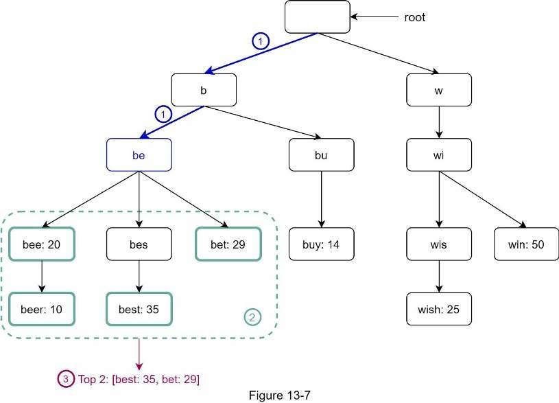

**Ghi chú bản dịch:** Đoạn ví dụ trong nguồn dùng tiền tố “tr”, còn Hình 13-7 gốc minh họa tiền tố “be”. Bản dịch giữ cả hai như nguồn để có thể đối chiếu.

Độ phức tạp thời gian của thuật toán bằng tổng thời gian của các bước vừa nêu:

`O(p) + O(c) + O(c log c)`.

Thuật toán này đơn giản, nhưng quá chậm vì trong trường hợp xấu nhất phải duyệt toàn bộ trie để lấy top k. Có hai cách tối ưu:

1. Giới hạn độ dài tối đa của tiền tố.
2. Lưu đệm các truy vấn hàng đầu tại mỗi nút.

Hãy xem xét từng cách.

#### Giới hạn độ dài tối đa của tiền tố

Người dùng hiếm khi nhập một truy vấn rất dài. Vì thế, có thể xem `p` là một số nguyên nhỏ, chẳng hạn 50. Nếu giới hạn độ dài tiền tố, độ phức tạp của bước “tìm tiền tố” giảm từ `O(p)` thành `O(hằng số nhỏ)`, tức `O(1)`.

#### Lưu đệm các truy vấn hàng đầu tại mỗi nút

Để tránh duyệt toàn bộ trie, chúng ta lưu top k truy vấn có tần suất cao nhất ở mỗi nút. Vì 5 đến 10 gợi ý đã đủ cho người dùng, k tương đối nhỏ. Trong trường hợp cụ thể này, chỉ 5 truy vấn hàng đầu được lưu đệm.

Lưu đệm tại mọi nút giúp giảm đáng kể độ phức tạp khi lấy 5 truy vấn đầu. Tuy nhiên, thiết kế cần nhiều không gian để lưu các truy vấn hàng đầu ở từng nút. Đánh đổi không gian lấy thời gian là xứng đáng vì phản hồi nhanh rất quan trọng.

Hình 13-8 thể hiện trie sau khi cập nhật. Mỗi nút lưu 5 truy vấn đầu. Ví dụ, nút tiền tố “be” lưu: `[best: 35, bet: 29, bee: 20, be: 15, beer: 10]`.

<!-- trang-pdf:210 -->

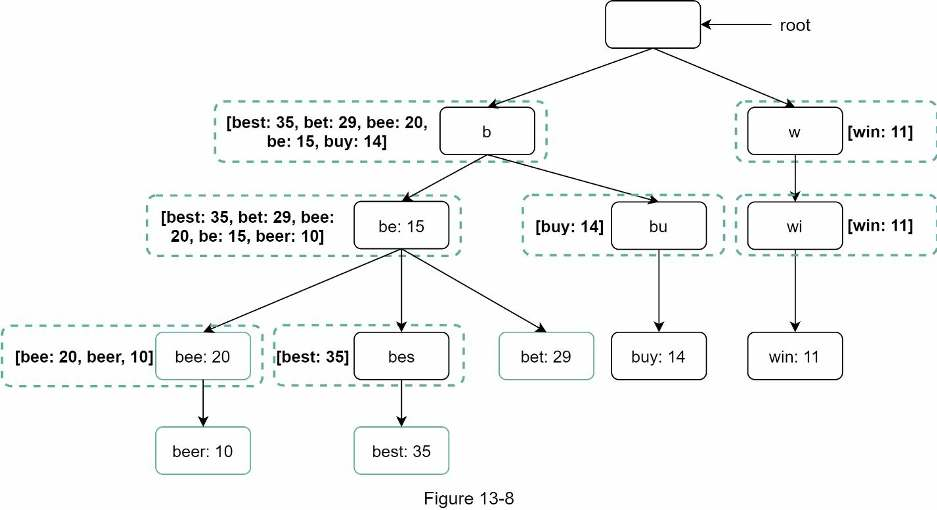

Xem lại độ phức tạp sau khi áp dụng hai tối ưu:

1. Tìm nút tiền tố: `O(1)`.
2. Trả về top k: do các truy vấn đã được lưu đệm, bước này cũng là `O(1)`.

Vì từng bước đều giảm xuống `O(1)`, toàn bộ thuật toán chỉ cần `O(1)` để lấy top k truy vấn.

### Dịch vụ thu thập dữ liệu

Trong thiết kế trước, mỗi khi người dùng nhập truy vấn, dữ liệu được cập nhật theo thời gian thực. Cách này không thực tế vì hai lý do:

- Người dùng có thể nhập hàng tỷ truy vấn mỗi ngày. Cập nhật trie sau từng truy vấn sẽ làm dịch vụ truy vấn chậm đi đáng kể.
- Các gợi ý hàng đầu có thể không thay đổi nhiều sau khi xây dựng trie. Vì thế, không cần cập nhật trie quá thường xuyên.

Để thiết kế dịch vụ thu thập có khả năng mở rộng, chúng ta xem dữ liệu đến từ đâu và được sử dụng thế nào. Các ứng dụng thời gian thực như Twitter cần gợi ý luôn cập nhật. Tuy nhiên, gợi ý cho nhiều từ khóa Google có thể thay đổi không đáng kể theo ngày.

Dù các trường hợp sử dụng khác nhau, nền tảng bên dưới của dịch vụ thu thập vẫn giống nhau vì dữ liệu dùng để xây trie thường lấy từ dịch vụ phân tích hoặc ghi log.

Hình 13-9 thể hiện dịch vụ thu thập sau khi thiết kế lại. Chúng ta sẽ lần lượt xem từng thành phần.

<!-- trang-pdf:211 -->

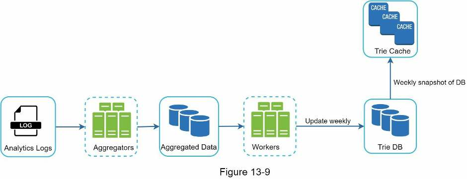

**Analytics Logs.** Lưu dữ liệu thô về các truy vấn tìm kiếm. Log chỉ được ghi nối thêm và không có chỉ mục. Bảng 13-3 đưa ra ví dụ một tệp log.

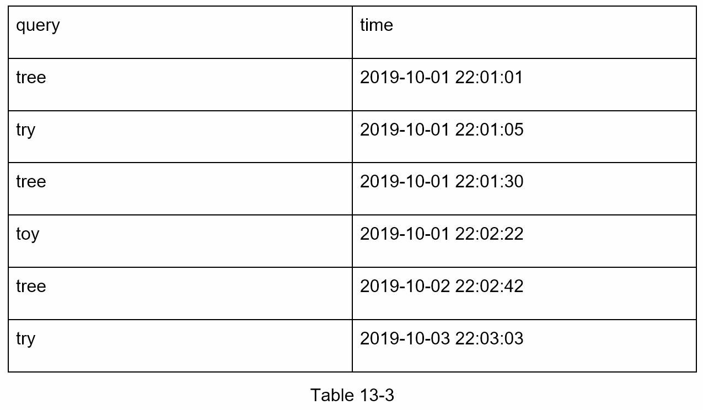

**Aggregators.** Log phân tích thường rất lớn và chưa ở đúng định dạng cần dùng. Cần tổng hợp dữ liệu để hệ thống dễ xử lý.

Tùy trường hợp sử dụng, cách tổng hợp sẽ khác nhau. Với ứng dụng thời gian thực như Twitter, khoảng tổng hợp ngắn hơn vì kết quả thời gian thực rất quan trọng. Ngược lại, tổng hợp ít thường xuyên hơn, chẳng hạn mỗi tuần một lần, có thể đã đủ tốt trong nhiều trường hợp. Khi phỏng vấn, hãy xác nhận kết quả thời gian thực có quan trọng hay không. Ở đây, giả sử trie được xây dựng lại hằng tuần.

**Aggregated Data.** Bảng 13-4 cho ví dụ dữ liệu tổng hợp theo tuần. Trường `time` biểu diễn thời điểm bắt đầu tuần. Trường `frequency` là tổng số lần truy vấn tương ứng xuất hiện trong tuần đó.

<!-- trang-pdf:212 -->

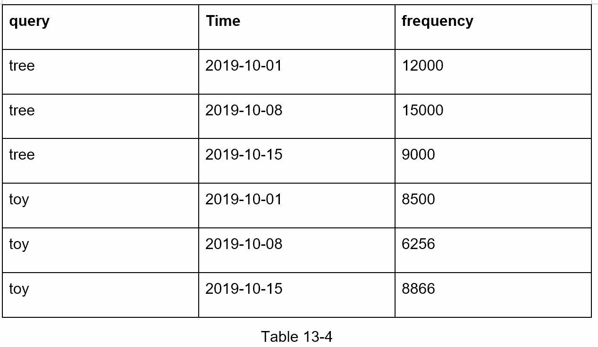

**Workers.** Một nhóm server thực hiện công việc bất đồng bộ theo chu kỳ. Chúng xây cấu trúc trie rồi lưu vào Trie DB.

**Trie Cache.** Hệ thống bộ nhớ đệm phân tán giữ trie trong bộ nhớ để đọc nhanh. Nó lấy ảnh chụp dữ liệu DB hằng tuần.

**Trie DB.** Nơi lưu trữ bền vững. Có hai lựa chọn:

1. **Kho tài liệu:** Vì mỗi tuần xây một trie mới, chúng ta có thể định kỳ chụp trạng thái trie, tuần tự hóa rồi lưu dữ liệu đã tuần tự hóa vào cơ sở dữ liệu. Kho tài liệu như MongoDB [4] phù hợp với dữ liệu dạng này.
2. **Kho khóa-giá trị:** Có thể biểu diễn trie dưới dạng bảng băm [4] bằng logic sau:
   - Mỗi tiền tố trong trie được ánh xạ tới một khóa trong bảng băm.
   - Dữ liệu trên mỗi nút trie được ánh xạ tới một giá trị trong bảng băm.

Hình 13-10 thể hiện sự ánh xạ giữa trie và bảng băm.

<!-- trang-pdf:213 -->

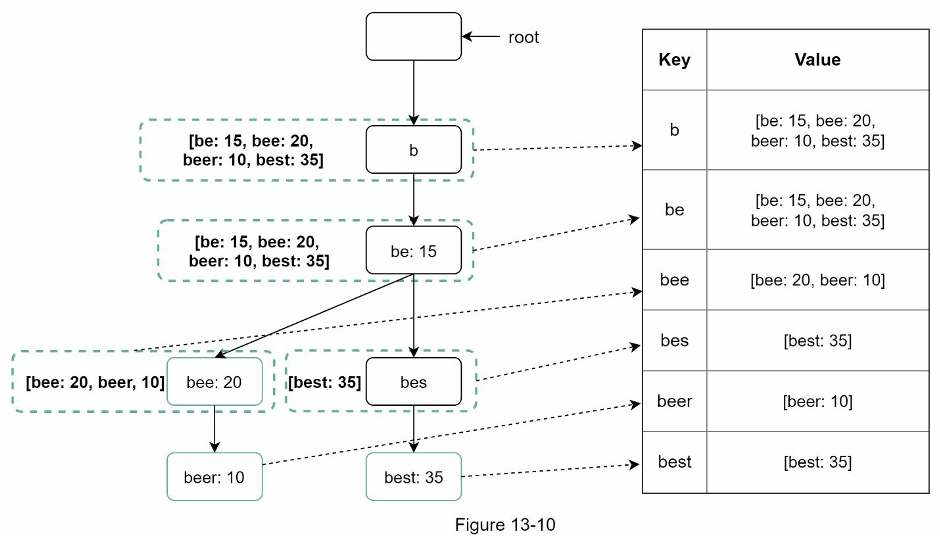

Trong Hình 13-10, mỗi nút trie bên trái được ánh xạ sang cặp `<key, value>` bên phải. Nếu chưa rõ kho khóa-giá trị hoạt động thế nào, xem Chương 6: Thiết kế kho khóa-giá trị.

### Dịch vụ truy vấn

Ở thiết kế cấp cao, dịch vụ truy vấn gọi trực tiếp cơ sở dữ liệu để lấy 5 kết quả đầu. Vì cách đó kém hiệu quả, Hình 13-11 thể hiện thiết kế cải tiến.

<!-- trang-pdf:214 -->

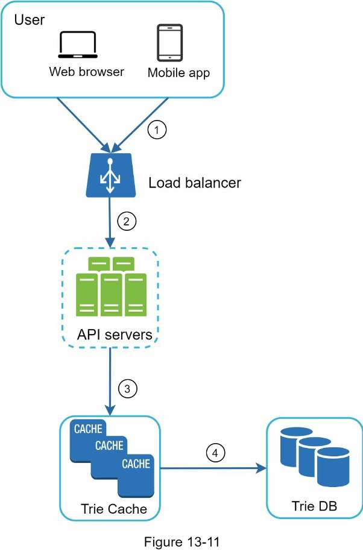

1. Một truy vấn tìm kiếm được gửi tới bộ cân bằng tải.
2. Bộ cân bằng tải định tuyến yêu cầu tới các API server.
3. API server lấy dữ liệu trie từ Trie Cache rồi tạo các gợi ý cho client.
4. Nếu dữ liệu không có trong Trie Cache, hệ thống nạp bổ sung trở lại cache. Nhờ đó, các yêu cầu tiếp theo cho cùng tiền tố đều được trả từ cache. Cache miss có thể xảy ra khi cache server hết bộ nhớ hoặc ngừng hoạt động.

Dịch vụ truy vấn đòi hỏi tốc độ cực nhanh. Chúng ta đề xuất các tối ưu sau:

- **Yêu cầu AJAX:** Với ứng dụng web, trình duyệt thường gửi yêu cầu AJAX để lấy kết quả autocomplete. Lợi ích chính là quá trình gửi/nhận yêu cầu/phản hồi không làm tải lại toàn bộ trang.
- **Bộ nhớ đệm trình duyệt:** Với nhiều ứng dụng, các gợi ý có thể không thay đổi nhiều trong khoảng thời gian ngắn. Vì vậy, có thể lưu chúng vào bộ nhớ đệm trình duyệt, cho phép các yêu cầu tiếp theo lấy trực tiếp từ cache. Google cũng dùng cơ chế này. Hình 13-12 cho thấy header phản hồi khi nhập “system design interview” trên Google. Có thể thấy Google <!-- trang-pdf:215 --> lưu kết quả trong trình duyệt trong 1 giờ. Lưu ý, `private` trong `cache-control` nghĩa là kết quả dành cho một người dùng và không được lưu trong cache dùng chung. `max-age=3600` nghĩa là cache có hiệu lực 3.600 giây, tức một giờ.

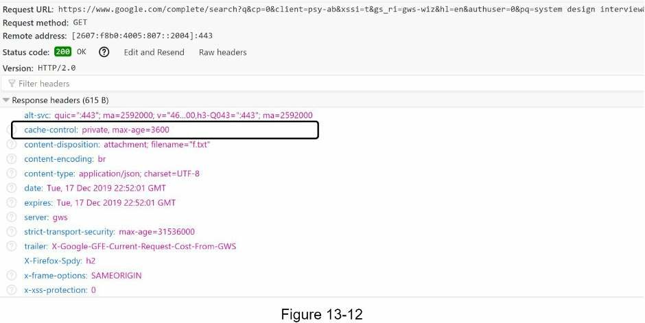

- **Lấy mẫu dữ liệu:** Với hệ thống quy mô lớn, ghi log mọi truy vấn đòi hỏi rất nhiều năng lực xử lý và lưu trữ. Lấy mẫu dữ liệu rất quan trọng. Ví dụ, hệ thống chỉ ghi log 1 trong mỗi N yêu cầu.

### Các thao tác trên trie

Trie là thành phần cốt lõi của hệ thống autocomplete. Hãy xem cách các thao tác tạo, cập nhật và xóa hoạt động.

#### Tạo

Worker tạo trie từ dữ liệu tổng hợp. Nguồn dữ liệu đến từ Analytics Log/DB.

#### Cập nhật

Có hai cách cập nhật trie.

**Lựa chọn 1:** Cập nhật hằng tuần. Sau khi xây xong một trie mới, thay thế trie cũ bằng trie mới.

**Lựa chọn 2:** Cập nhật trực tiếp từng nút trie. Chúng ta cố tránh thao tác này vì nó chậm. Tuy nhiên, nếu trie nhỏ, đây là giải pháp chấp nhận được. Khi cập nhật một nút, toàn bộ tổ tiên từ nút đó lên đến gốc cũng phải cập nhật, vì các tổ tiên lưu các truy vấn hàng đầu của các nút con. Hình 13-13 cho ví dụ: phía trái, truy vấn “beer” có giá trị ban đầu là 10; phía phải, giá trị được cập nhật thành 30. Nút đó cùng các tổ tiên đều cập nhật giá trị “beer” thành 30.

<!-- trang-pdf:216 -->

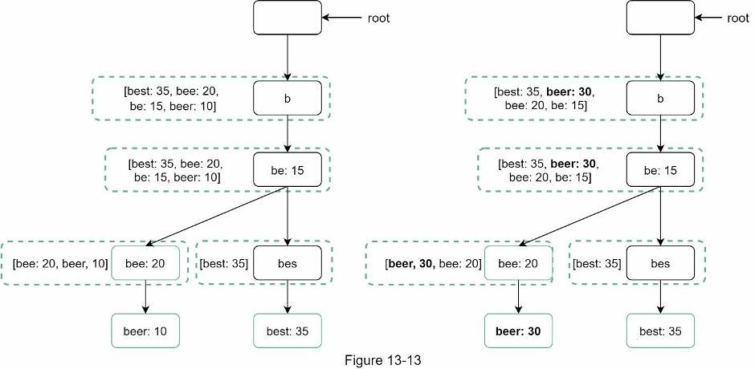

#### Xóa

Cần loại bỏ các gợi ý có nội dung thù hận, bạo lực, tình dục rõ ràng hoặc nguy hiểm. Chúng ta thêm một tầng lọc trước Trie Cache như Hình 13-14 để chặn những gợi ý không mong muốn. Tầng lọc cho phép linh hoạt loại bỏ kết quả theo các quy tắc khác nhau. Những gợi ý không mong muốn được xóa vật lý khỏi cơ sở dữ liệu theo cách bất đồng bộ, để chu kỳ cập nhật tiếp theo xây trie từ tập dữ liệu chính xác.

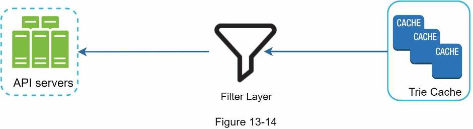

### Mở rộng tầng lưu trữ

Đến đây, chúng ta đã xây dựng hệ thống cung cấp gợi ý cho người dùng. Bây giờ cần giải quyết khả năng mở rộng khi trie lớn đến mức không thể đặt trong một server.

Vì chỉ hỗ trợ tiếng Anh, cách phân mảnh đơn giản là dựa trên ký tự đầu tiên. Ví dụ:

- Nếu cần hai server lưu trữ, có thể đặt các truy vấn bắt đầu từ `a` đến `m` trên server thứ nhất và từ `n` đến `z` trên server thứ hai.
- Nếu cần ba server, có thể chia thành `a` đến `i`, `j` đến `r` và `s` đến `z`.

Theo logic này, có thể chia truy vấn trên tối đa 26 server vì tiếng Anh có 26 chữ cái. Gọi cách phân mảnh dựa trên ký tự đầu là phân mảnh cấp một. Muốn dùng nhiều hơn 26 server, có thể phân mảnh theo cấp hai hoặc thậm chí cấp ba. Chẳng hạn, dữ liệu truy vấn bắt đầu bằng `a` có thể chia trên 4 server: `aa-ag`, `ah-an`, `ao-au` và `av-az`.

Thoạt nhìn cách này có vẻ hợp lý, cho đến khi nhận ra số từ bắt đầu bằng `c` nhiều hơn rất nhiều so với `x`. Điều đó tạo ra phân phối không đều.

<!-- trang-pdf:217 -->

Để giảm tình trạng mất cân bằng dữ liệu, chúng ta phân tích mô hình phân phối trong quá khứ rồi áp dụng logic phân mảnh thông minh hơn như Hình 13-15. Bộ quản lý bản đồ phân mảnh duy trì cơ sở dữ liệu tra cứu để xác định các hàng phải lưu ở đâu. Ví dụ, nếu số truy vấn lịch sử bắt đầu bằng `s` xấp xỉ tổng số bắt đầu bằng `u`, `v`, `w`, `x`, `y`, `z`, có thể duy trì hai phân mảnh: một cho `s` và một cho `u` đến `z`.

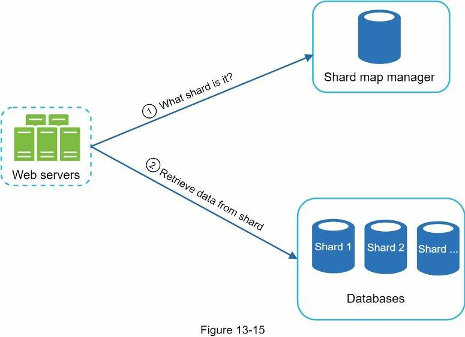

<!-- trang-pdf:218 -->

## Bước 4 - Tổng kết

Sau phần thiết kế chuyên sâu, người phỏng vấn có thể đặt một số câu hỏi tiếp nối.

**Người phỏng vấn:** Làm thế nào mở rộng thiết kế để hỗ trợ nhiều ngôn ngữ?

Để hỗ trợ truy vấn ngoài tiếng Anh, chúng ta lưu các ký tự Unicode trong các nút trie. Nếu bạn chưa quen Unicode, đây là định nghĩa: “một tiêu chuẩn mã hóa bao quát mọi ký tự thuộc mọi hệ chữ viết trên thế giới, hiện đại lẫn cổ đại” [5].

**Người phỏng vấn:** Nếu các truy vấn hàng đầu của một quốc gia khác với các quốc gia khác thì sao?

Trong trường hợp đó, có thể xây các trie khác nhau cho từng quốc gia. Để cải thiện thời gian phản hồi, có thể lưu trie trên CDN.

**Người phỏng vấn:** Làm sao hỗ trợ các truy vấn đang thịnh hành theo thời gian thực?

Giả sử một sự kiện thời sự bùng nổ, khiến một truy vấn đột nhiên trở nên phổ biến. Thiết kế ban đầu không đáp ứng được vì:

- Worker ngoại tuyến chưa được lên lịch cập nhật trie, vì công việc chỉ chạy hằng tuần.
- Ngay cả khi được lên lịch ngay, xây dựng trie vẫn mất quá lâu.

Xây hệ thống autocomplete thời gian thực là việc phức tạp, vượt phạm vi sách, nên chúng tôi chỉ đưa ra một vài ý tưởng:

- Giảm kích thước tập dữ liệu đang xử lý bằng phân mảnh.
- Đổi mô hình xếp hạng và gán trọng số cao hơn cho các truy vấn gần đây.
- Dữ liệu có thể đến dưới dạng luồng, nên không thể truy cập toàn bộ cùng lúc. Dữ liệu luồng nghĩa là dữ liệu được tạo liên tục. Xử lý luồng đòi hỏi những hệ thống khác, như Apache Hadoop MapReduce [6], Apache Spark Streaming [7], Apache Storm [8], Apache Kafka [9], v.v. Vì các chủ đề này cần kiến thức chuyên ngành riêng, chúng ta không đi vào chi tiết ở đây.

Chúc mừng bạn đã đi được đến đây! Hãy tự dành cho mình một lời khen. Làm tốt lắm!

<!-- trang-pdf:219 -->

## Tài liệu tham khảo

[1] The Life of a Typeahead Query: https://www.facebook.com/notes/facebook-engineering/the-life-of-a-typeahead-query/389105248919/

[2] How We Built Prefixy: A Scalable Prefix Search Service for Powering Autocomplete: https://medium.com/@prefixyteam/how-we-built-prefixy-a-scalable-prefix-search-service-for-powering-autocomplete-c20f98e2eff1

[3] Prefix Hash Tree An Indexing Data Structure over Distributed Hash Tables: https://people.eecs.berkeley.edu/~sylvia/papers/pht.pdf

[4] MongoDB wikipedia: https://en.wikipedia.org/wiki/MongoDB

[5] Unicode frequently asked questions: https://www.unicode.org/faq/basic_q.html

[6] Apache hadoop: https://hadoop.apache.org/

[7] Spark streaming: https://spark.apache.org/streaming/

[8] Apache storm: https://storm.apache.org/

[9] Apache kafka: https://kafka.apache.org/documentation/

---

[← Chương 12](chuong-12-thiet-ke-he-thong-tro-chuyen.md) · [Mục lục](../README.md) · [Chương 14 →](chuong-14-thiet-ke-youtube.md)
