# Chương 14: Thiết kế YouTube

*Tên gốc: Design YouTube. Nguồn: trang PDF 220-243. Hình và nhãn bên trong hình được giữ nguyên từ PDF.*

<!-- trang-pdf:220 -->

Trong chương này, bạn được yêu cầu thiết kế YouTube. Giải pháp cho bài toán này cũng có thể áp dụng cho những câu hỏi khác, như thiết kế một nền tảng chia sẻ video kiểu Netflix hoặc Hulu. Hình 14-1 thể hiện trang chủ YouTube.

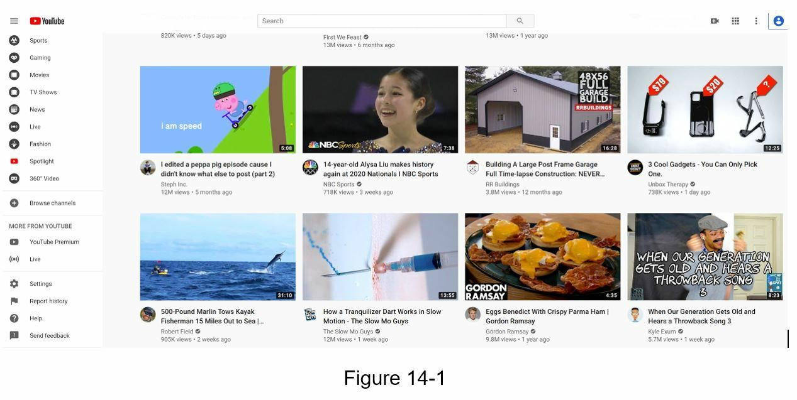

YouTube trông rất đơn giản: nhà sáng tạo tải video lên, người xem bấm phát. Có thực sự đơn giản như vậy không? Không hẳn. Đằng sau vẻ đơn giản là rất nhiều công nghệ phức tạp. Hãy xem một vài thống kê, thông tin về người dùng và dữ kiện thú vị của YouTube năm 2020 [1] [2]:

- Tổng số người dùng hoạt động hằng tháng: 2 tỷ.
- Số video được xem mỗi ngày: 5 tỷ.
- 73% người trưởng thành ở Mỹ sử dụng YouTube.
- Có 50 triệu nhà sáng tạo trên YouTube.
- Doanh thu quảng cáo cả năm 2019 đạt 15,1 tỷ USD, tăng 36% so với năm 2018.
- YouTube chiếm 37% toàn bộ lưu lượng Internet di động.
- YouTube có mặt bằng 80 ngôn ngữ khác nhau.

Từ những con số này, có thể thấy YouTube có quy mô khổng lồ, hoạt động toàn cầu và tạo ra rất nhiều doanh thu.

<!-- trang-pdf:221 -->

## Bước 1 - Hiểu bài toán và xác định phạm vi thiết kế

Như Hình 14-1 cho thấy, ngoài xem video, bạn còn có thể làm nhiều việc trên YouTube: bình luận, chia sẻ, thích video, lưu vào danh sách phát, đăng ký kênh, v.v. Không thể thiết kế tất cả trong một buổi phỏng vấn 45 hoặc 60 phút. Vì vậy, cần đặt câu hỏi để thu hẹp phạm vi.

**Ứng viên:** Những tính năng nào quan trọng?

**Người phỏng vấn:** Khả năng tải video lên và xem video.

**Ứng viên:** Cần hỗ trợ những loại client nào?

**Người phỏng vấn:** Ứng dụng di động, trình duyệt web và TV thông minh.

**Ứng viên:** Có bao nhiêu người dùng hoạt động hằng ngày?

**Người phỏng vấn:** 5 triệu.

**Ứng viên:** Trung bình mỗi ngày họ dành bao lâu cho sản phẩm?

**Người phỏng vấn:** 30 phút.

**Ứng viên:** Có cần hỗ trợ người dùng quốc tế không?

**Người phỏng vấn:** Có, tỷ lệ người dùng quốc tế rất lớn.

**Ứng viên:** Những độ phân giải video nào được hỗ trợ?

**Người phỏng vấn:** Hệ thống chấp nhận phần lớn độ phân giải và định dạng.

**Ứng viên:** Có yêu cầu mã hóa không?

**Người phỏng vấn:** Có.

**Ứng viên:** Có yêu cầu nào về kích thước tệp video không?

**Người phỏng vấn:** Nền tảng tập trung vào video nhỏ và trung bình. Kích thước tối đa là 1 GB.

**Ứng viên:** Có thể tận dụng hạ tầng đám mây hiện có của Amazon, Google hoặc Microsoft không?

**Người phỏng vấn:** Câu hỏi rất hay. Với hầu hết công ty, xây mọi thứ từ đầu là không thực tế; nên tận dụng một số dịch vụ đám mây sẵn có.

Trong chương này, chúng ta tập trung thiết kế dịch vụ phát video trực tuyến với các tính năng:

- Tải video lên nhanh.
- Phát video mượt mà.
- Có thể đổi chất lượng video.
- Chi phí hạ tầng thấp.
- Đáp ứng yêu cầu cao về tính sẵn sàng, khả năng mở rộng và độ tin cậy.
- Hỗ trợ ứng dụng di động, trình duyệt web và TV thông minh.

### Ước lượng sơ bộ

Các ước lượng sau dựa trên nhiều giả định, nên cần trao đổi để bảo đảm người phỏng vấn thống nhất với chúng ta.

- Giả sử sản phẩm có 5 triệu người dùng hoạt động hằng ngày (DAU).
- Mỗi người xem 5 video mỗi ngày.
- 10% người dùng tải lên 1 video mỗi ngày.
- Giả sử kích thước video trung bình là 300 MB.
- Tổng dung lượng lưu trữ cần thêm mỗi ngày: `5 triệu × 10% × 300 MB = 150 TB`.

<!-- trang-pdf:222 -->

- **Chi phí CDN:**
  - Khi CDN đám mây phân phối video, bạn trả tiền cho dữ liệu truyền ra khỏi CDN.
  - Dùng CloudFront của Amazon để ước tính chi phí như Hình 14-2 [3]. Giả sử 100% lưu lượng được phục vụ từ Mỹ, chi phí trung bình mỗi GB là 0,02 USD. Để đơn giản, chỉ tính chi phí phát video.
  - `5 triệu × 5 video × 0,3 GB × 0,02 USD = 150.000 USD/ngày`.

Ước lượng sơ bộ cho thấy phân phối video qua CDN rất tốn tiền. Dù nhà cung cấp đám mây sẵn sàng giảm đáng kể giá CDN cho khách hàng lớn, chi phí vẫn rất cao. Chúng ta sẽ bàn cách giảm chi phí ở phần thiết kế chuyên sâu.

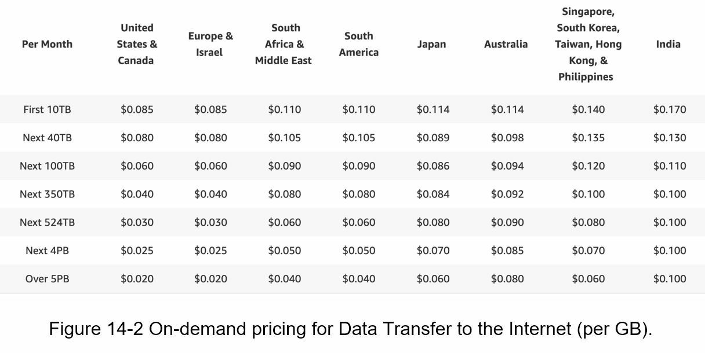

<!-- trang-pdf:223 -->

## Bước 2 - Đề xuất thiết kế cấp cao và thống nhất phương án

Như đã nói, người phỏng vấn đề nghị dùng các dịch vụ đám mây hiện có thay vì tự xây từ đầu. Chúng ta sẽ tận dụng CDN và lưu trữ blob. Một số bạn đọc có thể hỏi vì sao không tự làm tất cả. Các lý do gồm:

- Phỏng vấn thiết kế hệ thống không phải là xây mọi thứ từ đầu. Trong thời gian hạn chế, chọn đúng công nghệ để giải quyết công việc quan trọng hơn giải thích chi tiết công nghệ hoạt động ra sao. Chẳng hạn, nói dùng blob storage để lưu video nguồn là đủ. Trình bày chi tiết thiết kế blob storage có thể đi quá xa.
- Xây một hệ thống blob storage hoặc CDN có khả năng mở rộng cực kỳ phức tạp và tốn kém. Ngay cả công ty lớn như Netflix hoặc Facebook cũng không tự xây tất cả. Netflix tận dụng dịch vụ đám mây Amazon [4], còn Facebook dùng CDN Akamai [5].

Ở cấp cao, hệ thống có ba thành phần như Hình 14-3.

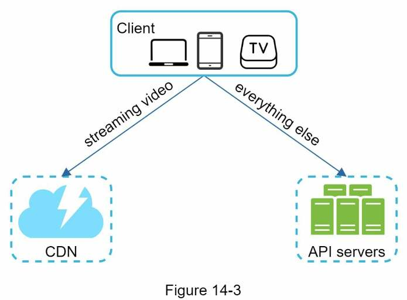

**Client:** Bạn có thể xem YouTube trên máy tính, điện thoại hoặc TV thông minh.

**CDN:** Video được lưu trong CDN. Khi bạn bấm phát, video được truyền trực tuyến từ CDN.

**API server:** Tất cả chức năng còn lại, ngoài việc truyền video, đều đi qua API server. Chúng gồm đề xuất nội dung, sinh URL tải video lên, cập nhật cơ sở dữ liệu và bộ nhớ đệm siêu dữ liệu, đăng ký người dùng, v.v.

Trong phần hỏi đáp, người phỏng vấn quan tâm tới hai luồng:

- Luồng tải video lên.
- Luồng phát video trực tuyến.

Chúng ta sẽ tìm hiểu thiết kế cấp cao của từng luồng.

### Luồng tải video lên

Hình 14-4 thể hiện thiết kế cấp cao cho việc tải video lên.

<!-- trang-pdf:224 -->

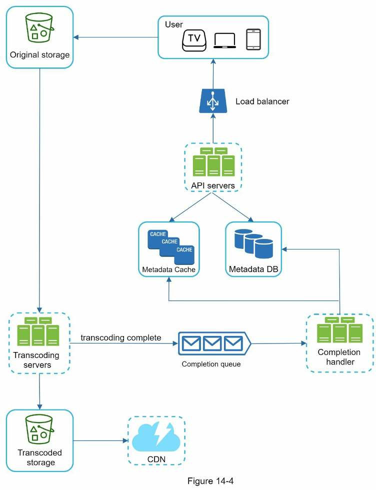

Thiết kế gồm các thành phần sau:

- **Người dùng:** Xem YouTube trên máy tính, điện thoại hoặc TV thông minh.
- **Bộ cân bằng tải:** Phân phối đều yêu cầu giữa các API server.
- **API server:** Mọi yêu cầu của người dùng, ngoại trừ truyền video, đều đi qua API server.
- **Metadata DB:** Siêu dữ liệu video được lưu tại đây. Cơ sở dữ liệu được phân mảnh và sao chép để đáp ứng yêu cầu hiệu năng và tính sẵn sàng cao.
- **Metadata cache:** Lưu đệm siêu dữ liệu video và các đối tượng người dùng để cải thiện hiệu năng.
- **Original storage:** Dùng hệ thống lưu trữ blob để lưu video gốc. Theo định nghĩa trên Wikipedia: “Binary Large Object (BLOB) là một tập hợp dữ liệu nhị phân được lưu như một thực thể duy nhất trong hệ quản trị cơ sở dữ liệu” [6].
- **Transcoding server:** Chuyển mã video còn được gọi là mã hóa video. Đây là quá trình chuyển một định dạng video sang những định dạng khác như MPEG, HLS, v.v., nhằm cung cấp luồng video phù hợp nhất cho các thiết bị và khả năng băng thông khác nhau.

<!-- trang-pdf:225 -->

- **Transcoded storage:** Kho blob lưu các tệp video đã chuyển mã.
- **CDN:** Lưu đệm video. Khi bấm phát, video được truyền từ CDN.
- **Completion queue:** Hàng đợi thông điệp lưu thông tin các sự kiện hoàn tất chuyển mã.
- **Completion handler:** Một nhóm worker lấy dữ liệu sự kiện từ completion queue, rồi cập nhật cache và cơ sở dữ liệu siêu dữ liệu.

Sau khi hiểu từng thành phần, hãy xem luồng tải video lên hoạt động ra sao. Luồng được chia thành hai tiến trình chạy song song:

- **a.** Tải lên dữ liệu video thực tế.
- **b.** Cập nhật siêu dữ liệu video. Siêu dữ liệu gồm URL, kích thước, độ phân giải, định dạng, thông tin người dùng, v.v.

#### Luồng a: Tải lên dữ liệu video thực tế

<!-- trang-pdf:226 -->

Hình 14-5 thể hiện cách tải video lên. Giải thích như sau:

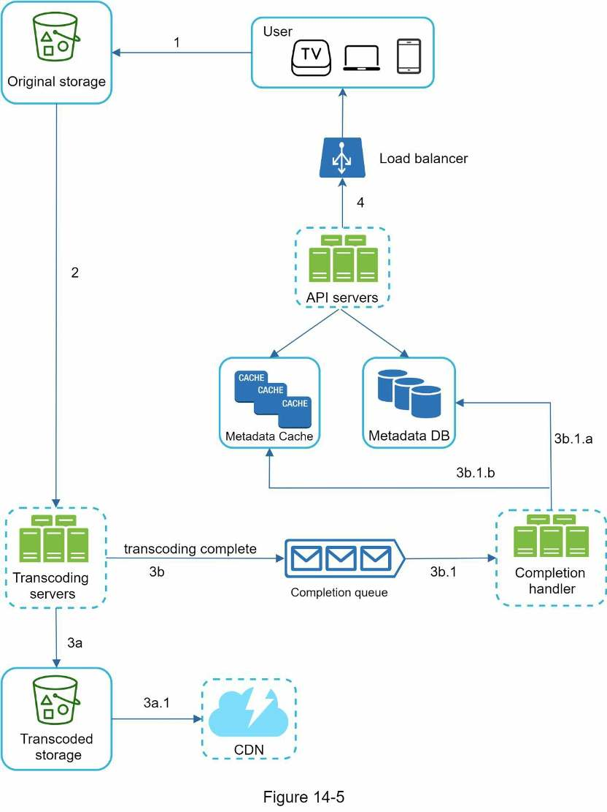

1. Video được tải lên original storage.
2. Transcoding server lấy video từ original storage và bắt đầu chuyển mã.
3. Khi chuyển mã hoàn tất, hai bước sau chạy song song:
   - **3a.** Gửi video đã chuyển mã tới transcoded storage.
   - **3b.** Đưa sự kiện hoàn tất chuyển mã vào completion queue.

**3a.1.** Video đã chuyển mã được phân phối tới CDN.

**3b.1.** Completion handler gồm nhiều worker liên tục lấy dữ liệu sự kiện từ hàng đợi.

<!-- trang-pdf:227 -->

**3b.1.a và 3b.1.b.** Completion handler cập nhật cơ sở dữ liệu và cache siêu dữ liệu khi chuyển mã hoàn tất.

**4.** API server thông báo cho client rằng video đã tải lên thành công và sẵn sàng để phát.

#### Luồng b: Cập nhật siêu dữ liệu

Trong khi tệp đang tải lên original storage, client đồng thời gửi yêu cầu cập nhật siêu dữ liệu như Hình 14-6. Yêu cầu gồm tên tệp, kích thước, định dạng, v.v. API server cập nhật cache và cơ sở dữ liệu siêu dữ liệu.

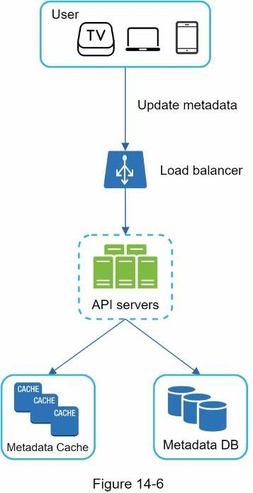

### Luồng phát video trực tuyến

Khi xem video YouTube, video thường bắt đầu phát ngay mà không cần chờ tải xong toàn bộ. Tải xuống nghĩa là sao chép toàn bộ video vào thiết bị, còn truyền trực tuyến (streaming) nghĩa là thiết bị liên tục nhận các luồng dữ liệu từ video nguồn ở xa. Client nạp từng ít dữ liệu một, nên bạn có thể xem ngay và xem liên tục.

Trước khi thảo luận luồng này, hãy xem một khái niệm quan trọng: giao thức streaming. Đây là cách chuẩn hóa việc điều khiển truyền dữ liệu để phát video trực tuyến. Các giao thức phổ biến gồm:

- **MPEG-DASH:** MPEG là viết tắt của “Moving Picture Experts Group”; DASH là “Dynamic Adaptive Streaming over HTTP”.
- **Apple HLS:** HLS là “HTTP Live Streaming”.
- **Microsoft Smooth Streaming.**
- **Adobe HTTP Dynamic Streaming (HDS).**

<!-- trang-pdf:228 -->

Bạn không cần hiểu đầy đủ hoặc thậm chí ghi nhớ tên các giao thức này, vì đây là chi tiết cấp thấp cần kiến thức chuyên ngành. Điều quan trọng là hiểu mỗi giao thức hỗ trợ các dạng mã hóa video và trình phát khác nhau. Khi thiết kế dịch vụ streaming, phải chọn giao thức phù hợp với trường hợp sử dụng. Một bài viết tốt để tìm hiểu thêm được liệt kê ở [7].

Video được truyền trực tiếp từ CDN. Edge server gần bạn nhất sẽ phân phối video, nên độ trễ rất thấp. Hình 14-7 thể hiện thiết kế cấp cao của luồng phát video.

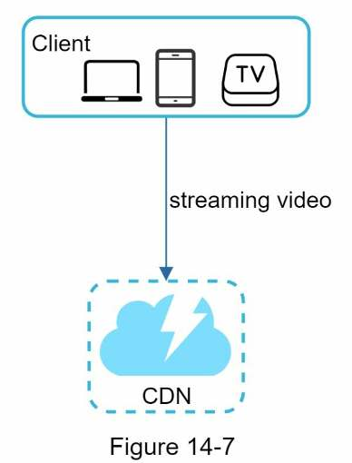

<!-- trang-pdf:229 -->

## Bước 3 - Thiết kế chuyên sâu

Trong thiết kế cấp cao, toàn bộ hệ thống được chia thành hai phần: luồng tải video lên và luồng phát video. Phần này sẽ tinh chỉnh cả hai bằng những tối ưu quan trọng và bổ sung cơ chế xử lý lỗi.

### Chuyển mã video

Khi quay video, thiết bị, thường là điện thoại hoặc máy quay, tạo tệp ở một định dạng nhất định. Muốn video phát mượt trên các thiết bị khác, cần mã hóa nó sang tốc độ bit và định dạng tương thích. Tốc độ bit (bitrate) là tốc độ xử lý các bit theo thời gian. Bitrate cao hơn thường đồng nghĩa chất lượng video cao hơn. Luồng bitrate cao cần nhiều năng lực xử lý và kết nối Internet nhanh.

Chuyển mã video quan trọng vì:

- Video thô chiếm nhiều dung lượng. Một giờ video độ nét cao quay ở 60 khung hình/giây có thể chiếm vài trăm GB.
- Nhiều thiết bị và trình duyệt chỉ hỗ trợ một số định dạng nhất định. Vì vậy, cần mã hóa sang nhiều định dạng để tương thích.
- Để người dùng vừa xem chất lượng cao vừa phát mượt, nên phân phối độ phân giải cao cho người có băng thông lớn và độ phân giải thấp cho người có băng thông nhỏ.
- Điều kiện mạng có thể thay đổi, đặc biệt trên thiết bị di động. Tự động hoặc thủ công đổi chất lượng theo tình trạng mạng là điều cần thiết để duy trì phát liên tục và trải nghiệm mượt mà.

Có nhiều định dạng mã hóa, nhưng phần lớn gồm hai thành phần:

- **Container:** Giống chiếc giỏ chứa dữ liệu video, âm thanh và siêu dữ liệu. Có thể nhận biết định dạng container qua phần mở rộng như `.avi`, `.mov`, `.mp4`.
- **Codec:** Các thuật toán nén và giải nén nhằm giảm kích thước trong khi giữ chất lượng. Các codec video được dùng nhiều nhất gồm H.264, VP9 và HEVC.

### Mô hình đồ thị có hướng không chu trình (DAG)

Chuyển mã video tốn nhiều tài nguyên tính toán và thời gian. Ngoài ra, mỗi nhà sáng tạo có thể có yêu cầu xử lý khác nhau. Chẳng hạn, người muốn chèn watermark, người tự cung cấp ảnh thu nhỏ; một số tải video độ nét cao, trong khi số khác thì không.

Để hỗ trợ nhiều pipeline xử lý và duy trì mức song song cao, cần thêm một mức trừu tượng, cho phép lập trình viên phía sử dụng định nghĩa các tác vụ cần chạy. Ví dụ, bộ máy xử lý video streaming của Facebook dùng mô hình lập trình đồ thị có hướng không chu trình (DAG), định nghĩa tác vụ theo các giai đoạn để thực hiện tuần tự hoặc song song [8]. Thiết kế của chúng ta dùng mô hình DAG tương tự để có tính linh hoạt và khả năng xử lý song song. Hình 14-8 biểu diễn DAG chuyển mã video.

<!-- trang-pdf:230 -->

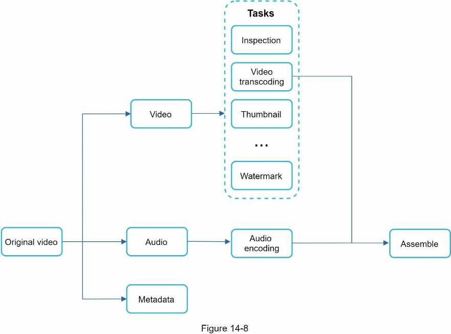

Trong Hình 14-8, video gốc được tách thành video, âm thanh và siêu dữ liệu. Một số tác vụ có thể áp dụng với tệp video:

- **Kiểm tra:** Bảo đảm video có chất lượng tốt và không sai định dạng.
- **Mã hóa video:** Chuyển đổi để hỗ trợ các độ phân giải, codec, bitrate khác nhau. Hình 14-9 đưa ra ví dụ các tệp đã mã hóa.
- **Ảnh thu nhỏ:** Người dùng có thể tải lên hoặc hệ thống tự sinh.
- **Watermark:** Một ảnh phủ lên video, chứa thông tin nhận diện video.

<!-- trang-pdf:231 -->

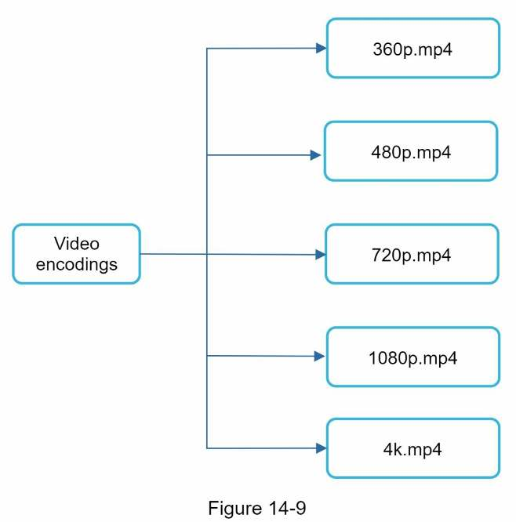

### Kiến trúc chuyển mã video

Kiến trúc được đề xuất tận dụng các dịch vụ đám mây, thể hiện ở Hình 14-10.

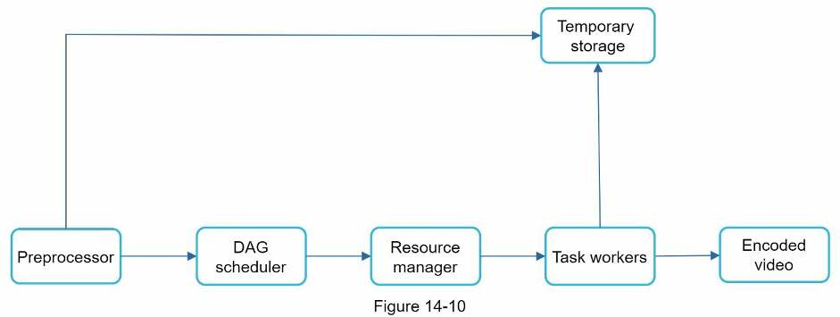

Kiến trúc có sáu thành phần chính: bộ tiền xử lý, bộ lập lịch DAG, bộ quản lý tài nguyên, các worker thực thi tác vụ, kho lưu trữ tạm thời và video đã mã hóa ở đầu ra. Hãy xem kỹ từng thành phần.

#### Bộ tiền xử lý

<!-- trang-pdf:232 -->

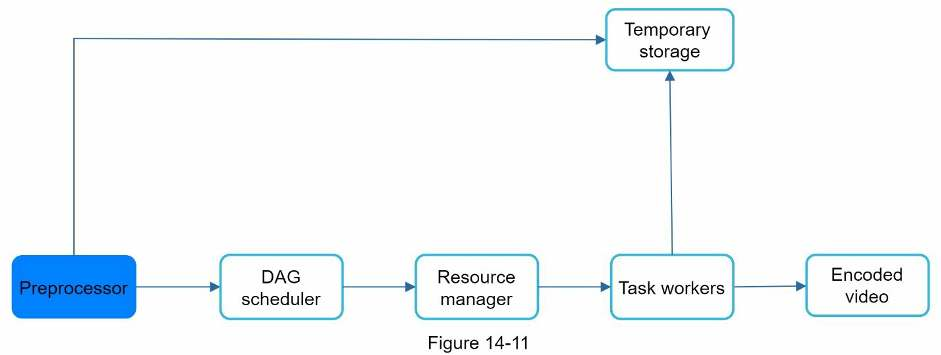

Bộ tiền xử lý có bốn trách nhiệm:

1. **Chia video:** Luồng video được chia hoặc tiếp tục chia nhỏ theo ranh giới Group of Pictures (GOP). GOP là nhóm hay khối các khung hình theo một thứ tự xác định. Mỗi khối có thể phát độc lập, thường dài vài giây.
2. Một số thiết bị di động hoặc trình duyệt cũ có thể không hỗ trợ chia video. Bộ tiền xử lý sẽ chia theo ranh giới GOP cho các client cũ.
3. **Sinh DAG:** Bộ xử lý tạo DAG dựa trên các tệp cấu hình do lập trình viên phía sử dụng viết. Hình 14-12 là DAG đơn giản gồm hai nút và một cạnh:

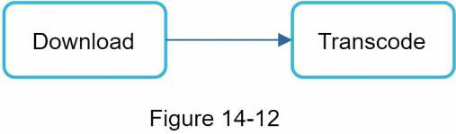

DAG này được sinh từ hai tệp cấu hình dưới đây, như Hình 14-13:

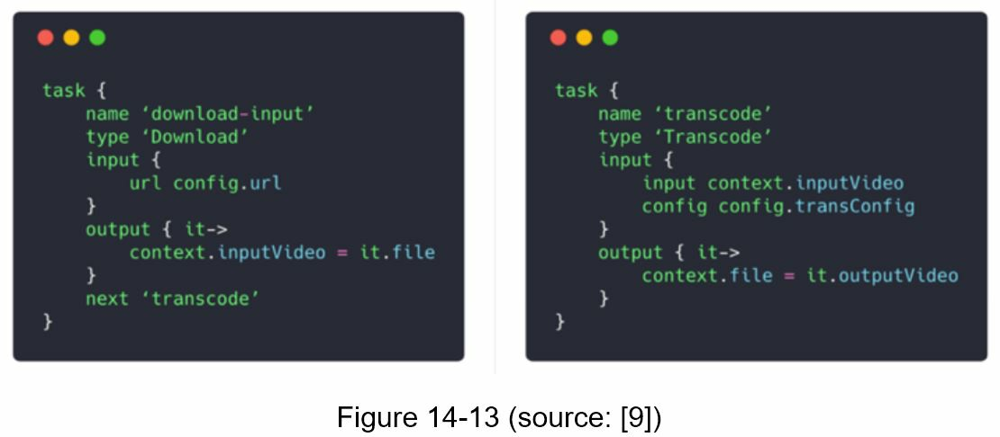

4. **Lưu đệm dữ liệu:** Bộ tiền xử lý đóng vai trò cache cho video đã phân đoạn. Để tăng độ tin cậy, nó lưu GOP và siêu dữ liệu trong kho tạm thời. Nếu mã hóa thất bại, hệ thống dùng dữ liệu đã lưu bền vững để thử lại.

#### Bộ lập lịch DAG

<!-- trang-pdf:233 -->

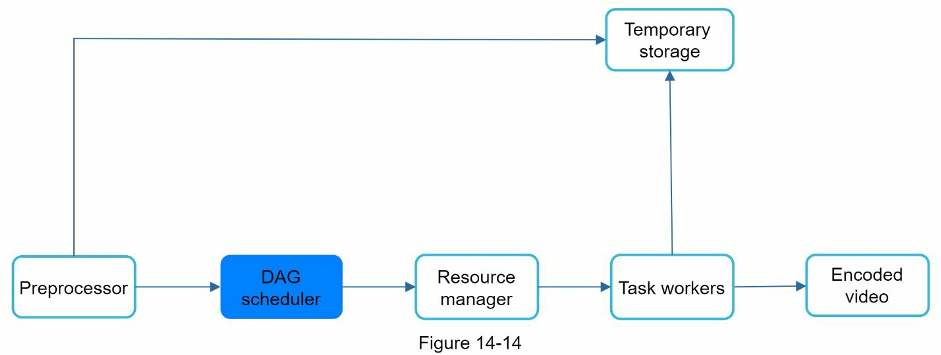

Bộ lập lịch DAG chia đồ thị thành các giai đoạn tác vụ, rồi đưa vào hàng đợi tác vụ của bộ quản lý tài nguyên. Hình 14-15 minh họa cách hoạt động.

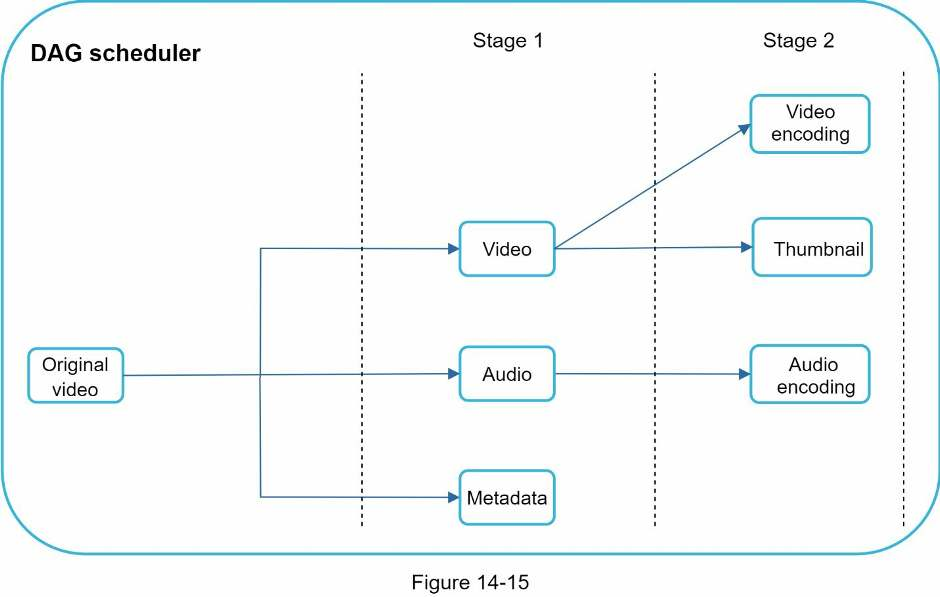

Như Hình 14-15, video gốc được chia theo ba giai đoạn. Giai đoạn 1 gồm video, âm thanh và siêu dữ liệu. Sang giai đoạn 2, tệp video được chia tiếp thành hai tác vụ: mã hóa video và tạo ảnh thu nhỏ. Tệp âm thanh cần tác vụ mã hóa âm thanh ở giai đoạn 2.

#### Bộ quản lý tài nguyên

<!-- trang-pdf:234 -->

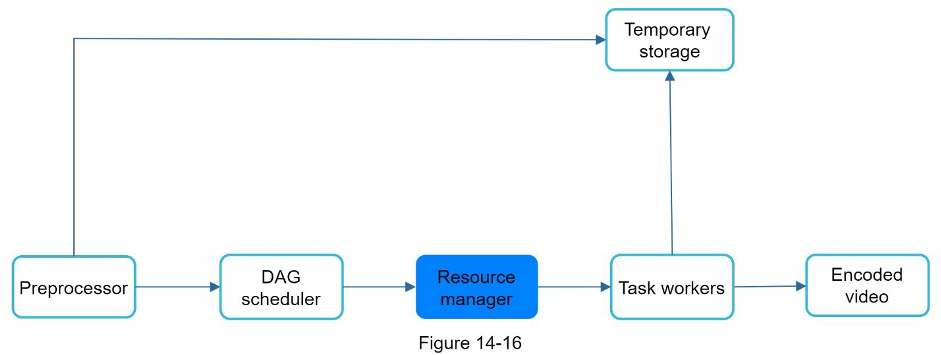

Bộ quản lý tài nguyên chịu trách nhiệm phân bổ tài nguyên hiệu quả. Nó gồm ba hàng đợi và một bộ lập lịch tác vụ như Hình 14-17:

- **Task queue:** Hàng đợi ưu tiên chứa các tác vụ cần thực hiện.
- **Worker queue:** Hàng đợi ưu tiên chứa thông tin mức sử dụng các worker.
- **Running queue:** Chứa thông tin về các tác vụ đang chạy cùng worker thực hiện chúng.
- **Task scheduler:** Chọn cặp tác vụ/worker tối ưu rồi chỉ thị worker được chọn thực thi công việc.

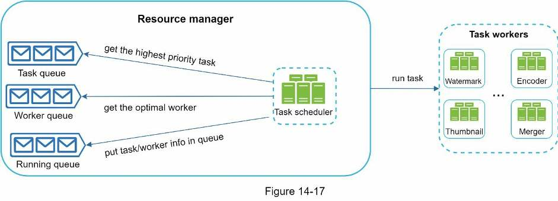

Bộ quản lý tài nguyên hoạt động như sau:

- Bộ lập lịch lấy tác vụ ưu tiên cao nhất từ task queue.
- Lấy worker phù hợp nhất để chạy tác vụ từ worker queue.
- Chỉ thị worker đã chọn thực thi tác vụ.
- Ghép thông tin tác vụ/worker rồi đưa vào running queue.
- Xóa công việc khỏi running queue khi hoàn tất.

#### Worker thực thi tác vụ

<!-- trang-pdf:235 -->

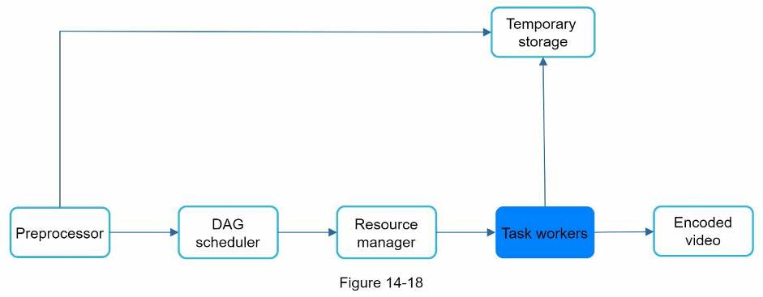

Các worker chạy những tác vụ định nghĩa trong DAG. Các worker khác nhau có thể chạy những loại tác vụ khác nhau như Hình 14-19.

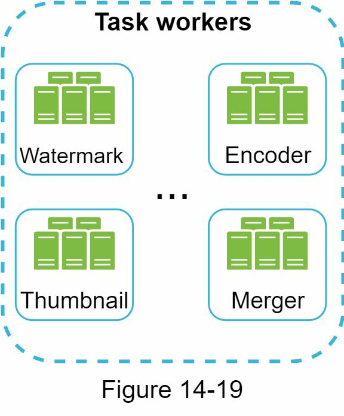

#### Lưu trữ tạm thời

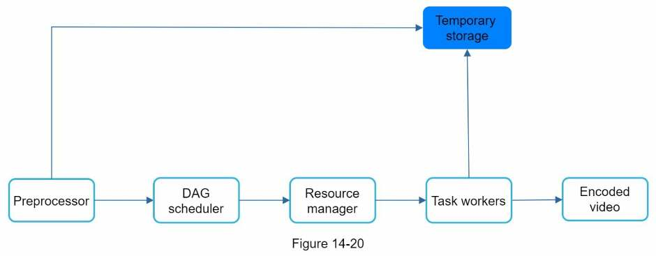

Ở đây dùng nhiều hệ thống lưu trữ. Lựa chọn phụ thuộc vào loại dữ liệu, kích thước, tần suất truy cập, thời gian tồn tại, v.v. Ví dụ, worker truy cập siêu dữ liệu thường xuyên <!-- trang-pdf:236 --> và kích thước dữ liệu thường nhỏ, nên lưu đệm siêu dữ liệu trong bộ nhớ là hợp lý. Video hoặc âm thanh được đặt trong blob storage. Dữ liệu tạm thời được giải phóng sau khi xử lý video tương ứng hoàn tất.

#### Video đã mã hóa

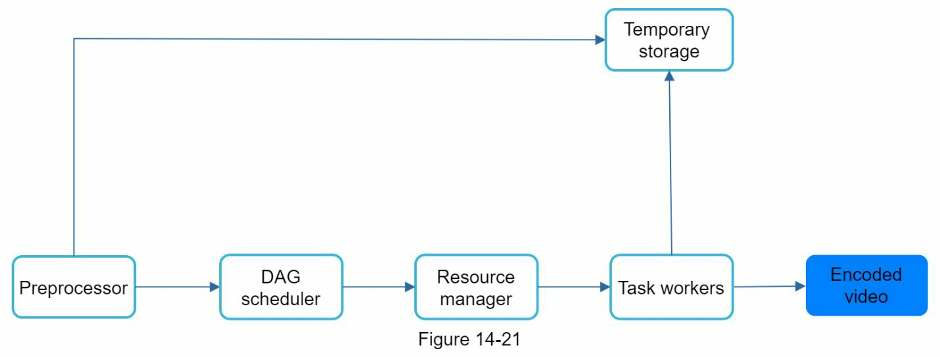

Video đã mã hóa là đầu ra cuối cùng của pipeline. Ví dụ một tệp đầu ra: `funny_720p.mp4`.

### Tối ưu hệ thống

Đến đây, bạn đã hiểu khá rõ luồng tải video lên, luồng phát video và quá trình chuyển mã. Tiếp theo, chúng ta tinh chỉnh hệ thống qua các tối ưu về tốc độ, an toàn và tiết kiệm chi phí.

#### Tối ưu tốc độ: Tải video lên song song

Tải toàn bộ video như một khối duy nhất không hiệu quả. Có thể chia thành các khối nhỏ theo ranh giới GOP như Hình 14-22.

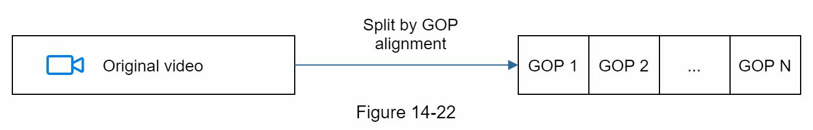

Cách này cho phép tiếp tục tải nhanh nếu lần tải trước thất bại. Việc chia tệp theo GOP có thể thực hiện ngay ở client để tăng tốc độ tải, như Hình 14-23.

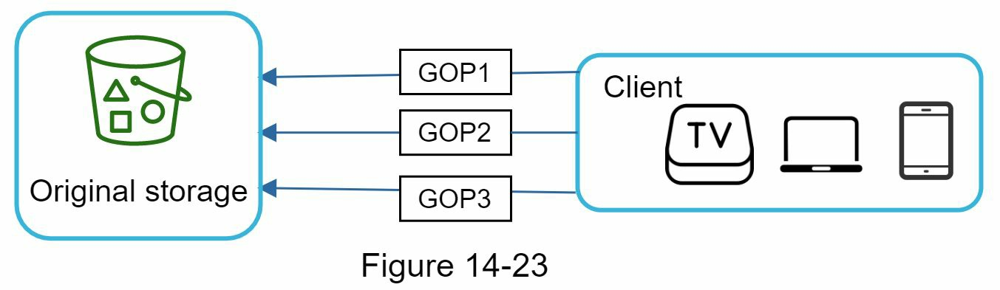

#### Tối ưu tốc độ: Đặt trung tâm tải lên gần người dùng

Một cách khác để cải thiện tốc độ là đặt nhiều trung tâm tải lên trên khắp <!-- trang-pdf:237 --> thế giới như Hình 14-24. Người ở Mỹ có thể tải video tới trung tâm Bắc Mỹ, người ở Trung Quốc có thể tải tới trung tâm châu Á. Để làm được điều này, chúng ta dùng CDN làm trung tâm tải lên.

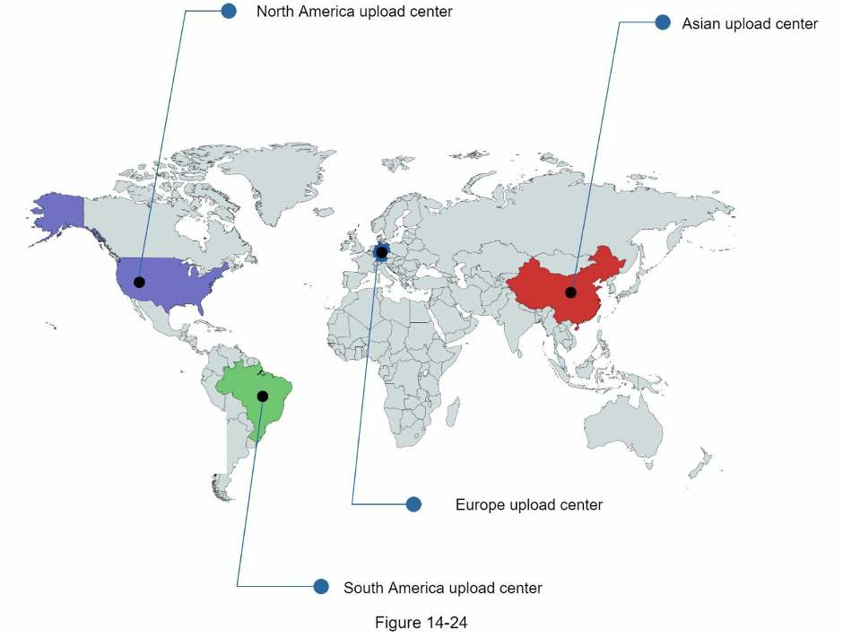

#### Tối ưu tốc độ: Xử lý song song ở mọi nơi

Đạt độ trễ thấp cần nỗ lực nghiêm túc. Một cách tối ưu khác là xây hệ thống liên kết lỏng và cho phép mức song song cao.

Thiết kế cần được điều chỉnh để đạt mục tiêu này. Hãy nhìn kỹ luồng chuyển video từ original storage tới CDN trong Hình 14-25. Đầu ra phụ thuộc vào đầu vào từ bước trước, và sự phụ thuộc này làm việc xử lý song song trở nên khó khăn.

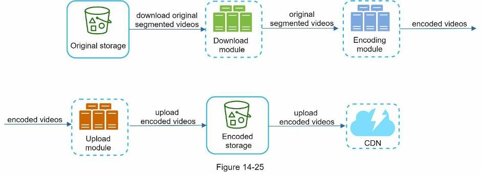

Để các thành phần liên kết lỏng hơn, chúng ta đưa vào hàng đợi thông điệp như Hình <!-- trang-pdf:238 --> 14-26. Ví dụ sau giải thích hàng đợi làm giảm mức phụ thuộc giữa các thành phần như thế nào:

- Trước khi có hàng đợi, module mã hóa phải chờ đầu ra của module tải xuống.
- Sau khi có hàng đợi, module mã hóa không còn phải chờ trực tiếp đầu ra module tải xuống. Nếu hàng đợi có sự kiện, module mã hóa có thể thực hiện các công việc đó song song.

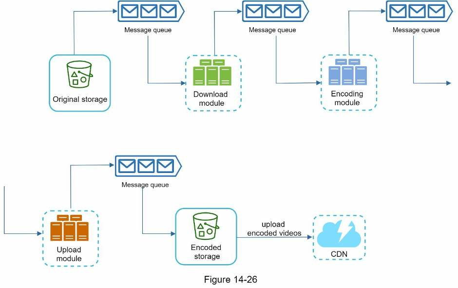

#### Tối ưu an toàn: URL tải lên được ký sẵn

An toàn là một trong những khía cạnh quan trọng nhất của mọi sản phẩm. Để bảo đảm chỉ người dùng được cấp quyền mới tải video lên đúng vị trí, chúng ta sử dụng URL được ký sẵn (pre-signed URL), như Hình 14-27.

<!-- trang-pdf:239 -->

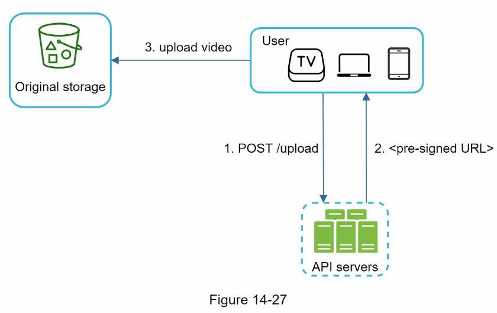

Luồng tải lên được cập nhật như sau:

1. Client gửi yêu cầu HTTP tới API server để lấy URL được ký sẵn. URL cấp quyền truy cập tới đối tượng được xác định trong đó. Thuật ngữ pre-signed URL được dùng khi tải tệp lên Amazon S3; nhà cung cấp khác có thể dùng tên khác. Chẳng hạn, Azure Blob Storage hỗ trợ tính năng tương tự nhưng gọi là “Shared Access Signature” [10].
2. API server trả về URL được ký sẵn.
3. Khi nhận phản hồi, client dùng URL đó để tải video lên.

#### Tối ưu an toàn: Bảo vệ video

Nhiều nhà sáng tạo ngần ngại đăng video vì lo video gốc bị đánh cắp. Để bảo vệ video có bản quyền, có thể áp dụng một trong ba lựa chọn sau:

- **Hệ thống quản lý quyền kỹ thuật số (DRM):** Ba hệ thống lớn là Apple FairPlay, Google Widevine và Microsoft PlayReady.
- **Mã hóa AES:** Mã hóa video và cấu hình chính sách cấp quyền. Video được giải mã khi phát. Nhờ vậy, chỉ người dùng được cấp quyền mới xem được.
- **Watermark trực quan:** Một ảnh phủ lên video chứa thông tin nhận diện, chẳng hạn logo hoặc tên công ty.

#### Tối ưu tiết kiệm chi phí

CDN là thành phần thiết yếu, bảo đảm phân phối video nhanh trên toàn cầu. Tuy nhiên, từ ước lượng sơ bộ, ta biết CDN rất tốn kém, nhất là khi dữ liệu lớn. Có thể giảm chi phí bằng cách nào?

Nghiên cứu trước đây cho thấy lượt xem video YouTube tuân theo phân phối đuôi dài [11] [12]: một số ít video phổ biến được truy cập thường xuyên, còn nhiều video khác có ít hoặc không có người xem. Dựa trên quan sát đó, chúng ta áp dụng các tối ưu:

1. Chỉ phục vụ video phổ biến nhất từ CDN; những video khác được phục vụ từ các video server có dung lượng lưu trữ lớn <!-- trang-pdf:240 --> của chúng ta, như Hình 14-28.

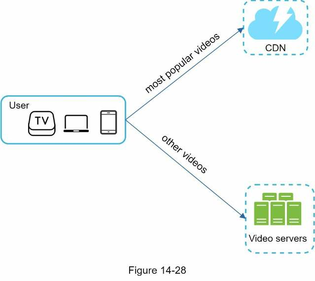

2. Với nội dung ít phổ biến, có thể không cần lưu nhiều phiên bản đã mã hóa. Video ngắn có thể được mã hóa theo yêu cầu.
3. Một số video chỉ phổ biến ở một số khu vực. Không cần phân phối chúng tới các khu vực khác.
4. Tự xây CDN như Netflix và hợp tác với nhà cung cấp dịch vụ Internet (ISP). Đây là một dự án rất lớn, nhưng có thể hợp lý với các công ty streaming lớn. ISP có thể là Comcast, AT&T, Verizon hoặc nhà cung cấp khác. ISP có mặt khắp thế giới và gần người dùng; hợp tác với họ giúp cải thiện trải nghiệm xem và giảm phí băng thông.

Tất cả tối ưu này dựa trên mức độ phổ biến của nội dung, mô hình truy cập, kích thước video, v.v. Cần phân tích mô hình xem trong quá khứ trước khi tối ưu. Các bài viết thú vị về chủ đề này được liệt kê ở [12] [13].

### Xử lý lỗi

Với hệ thống lớn, lỗi là điều không tránh khỏi. Muốn có khả năng chịu lỗi cao, phải xử lý lỗi hợp lý và phục hồi nhanh. Có hai loại lỗi:

- **Lỗi có thể phục hồi:** Ví dụ một đoạn video chuyển mã thất bại. Cách chung là thử lại thao tác vài lần. Nếu tác vụ tiếp tục lỗi và hệ thống cho rằng không thể phục hồi, trả mã lỗi phù hợp cho client.
- **Lỗi không thể phục hồi:** Ví dụ định dạng video không hợp lệ. Hệ thống dừng các tác vụ đang chạy liên quan tới video đó và trả mã lỗi phù hợp cho client.

Các lỗi điển hình của từng thành phần được xử lý theo hướng dẫn sau:

- **Lỗi tải lên:** Thử lại vài lần.

<!-- trang-pdf:241 -->

- **Lỗi chia video:** Nếu client cũ không chia được theo ranh giới GOP, gửi toàn bộ video lên server. Server thực hiện việc chia.
- **Lỗi chuyển mã:** Thử lại.
- **Lỗi bộ tiền xử lý:** Sinh lại đồ thị DAG.
- **Lỗi bộ lập lịch DAG:** Lập lịch lại tác vụ.
- **Hàng đợi của bộ quản lý tài nguyên ngừng hoạt động:** Dùng bản sao.
- **Worker ngừng hoạt động:** Thử lại tác vụ trên worker mới.
- **API server ngừng hoạt động:** Vì API server không lưu trạng thái, yêu cầu được chuyển tới API server khác.
- **Metadata cache server ngừng hoạt động:** Dữ liệu được sao chép nhiều lần. Nếu một nút ngừng hoạt động, vẫn có thể lấy từ nút khác. Khởi động cache server mới thay cho nút hỏng.
- **Metadata DB server ngừng hoạt động:**
  - Nếu master hỏng, nâng một slave lên làm master mới.
  - Nếu slave hỏng, đọc từ một slave khác và khởi động database server mới thay thế.

<!-- trang-pdf:242 -->

## Bước 4 - Tổng kết

Trong chương này, chúng ta đã trình bày kiến trúc cho các dịch vụ streaming video như YouTube. Nếu cuối buổi phỏng vấn còn thời gian, có thể trao đổi thêm:

- **Mở rộng tầng API:** Vì API server không lưu trạng thái, mở rộng theo chiều ngang khá dễ.
- **Mở rộng cơ sở dữ liệu:** Có thể bàn về sao chép và phân mảnh.
- **Phát trực tiếp:** Đây là quá trình quay và phát video theo thời gian thực. Hệ thống của chúng ta không được thiết kế riêng cho phát trực tiếp, nhưng phát trực tiếp và phát video không trực tiếp vẫn có điểm giống nhau: đều cần tải lên, mã hóa và truyền video. Các khác biệt đáng chú ý:
  - Phát trực tiếp có yêu cầu cao hơn về độ trễ, nên có thể cần giao thức streaming khác.
  - Phát trực tiếp có yêu cầu thấp hơn về mức song song vì các khối dữ liệu nhỏ đã được xử lý theo thời gian thực.
  - Phát trực tiếp cần bộ cơ chế xử lý lỗi khác. Không chấp nhận các cách xử lý lỗi mất quá nhiều thời gian.
- **Gỡ video:** Video vi phạm bản quyền, có nội dung khiêu dâm hoặc hành vi bất hợp pháp khác phải được gỡ. Một số vi phạm có thể được hệ thống phát hiện trong lúc tải lên, số khác được phát hiện qua báo cáo của người dùng.

Chúc mừng bạn đã đi được đến đây! Hãy tự dành cho mình một lời khen. Làm tốt lắm!

<!-- trang-pdf:243 -->

## Tài liệu tham khảo

[1] YouTube by the numbers: https://www.omnicoreagency.com/youtube-statistics/

[2] 2019 YouTube Demographics: https://blog.hubspot.com/marketing/youtube-demographics

[3] Cloudfront Pricing: https://aws.amazon.com/cloudfront/pricing/

[4] Netflix on AWS: https://aws.amazon.com/solutions/case-studies/netflix/

[5] Akamai homepage: https://www.akamai.com/

[6] Binary large object: https://en.wikipedia.org/wiki/Binary_large_object

[7] Here’s What You Need to Know About Streaming Protocols: https://www.dacast.com/blog/streaming-protocols/

[8] SVE: Distributed Video Processing at Facebook Scale: https://www.cs.princeton.edu/~wlloyd/papers/sve-sosp17.pdf

[9] Weibo video processing architecture (tiếng Trung): https://www.upyun.com/opentalk/399.html

[10] Delegate access with a shared access signature: https://docs.microsoft.com/en-us/rest/api/storageservices/delegate-access-with-shared-access-signature

[11] YouTube scalability talk by early YouTube employee: https://www.youtube.com/watch?v=w5WVu624fY8

[12] Understanding the characteristics of internet short video sharing: A youtube-based measurement study: https://arxiv.org/pdf/0707.3670.pdf

[13] Content Popularity for Open Connect: https://netflixtechblog.com/content-popularity-for-open-connect-b86d56f613b

---

[← Chương 13](chuong-13.md) · [Mục lục](../README.md) · [Chương 15 →](chuong-15.md)
