# Chương 15: Thiết kế Google Drive

*Tên gốc: Design Google Drive. Nguồn: trang PDF 244-263. Hình và nhãn bên trong hình được giữ nguyên từ PDF.*

<!-- trang-pdf:244 -->

Những năm gần đây, các dịch vụ lưu trữ đám mây như Google Drive, Dropbox, Microsoft OneDrive và Apple iCloud trở nên rất phổ biến. Trong chương này, bạn được yêu cầu thiết kế Google Drive.

Trước khi bắt tay vào thiết kế, hãy dành chút thời gian tìm hiểu Google Drive. Đây là dịch vụ lưu trữ và đồng bộ tệp, giúp lưu tài liệu, ảnh, video cùng các tệp khác trên đám mây. Bạn có thể truy cập tệp từ máy tính, điện thoại thông minh và máy tính bảng bất kỳ; đồng thời dễ dàng chia sẻ với bạn bè, gia đình và đồng nghiệp [1]. Hình 15-1 và 15-2 lần lượt thể hiện giao diện Google Drive trên trình duyệt và ứng dụng di động.

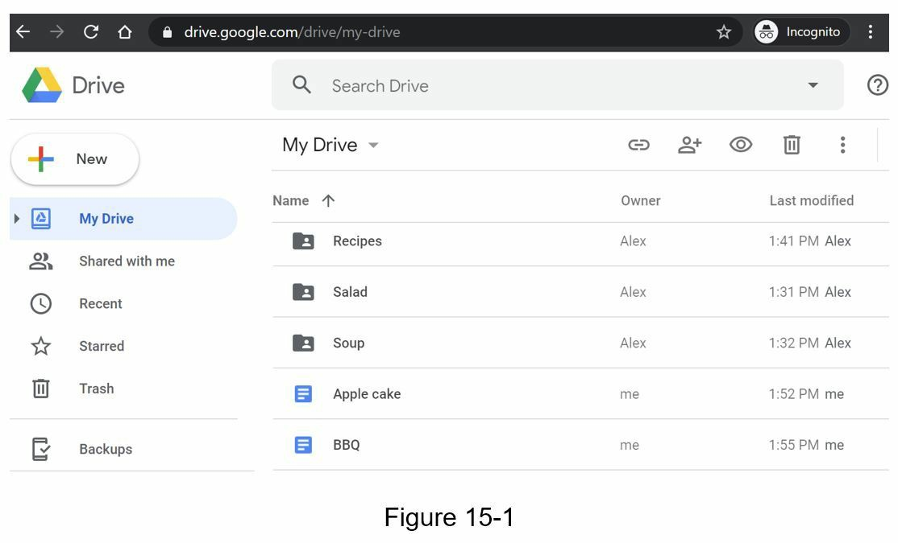

<!-- trang-pdf:245 -->

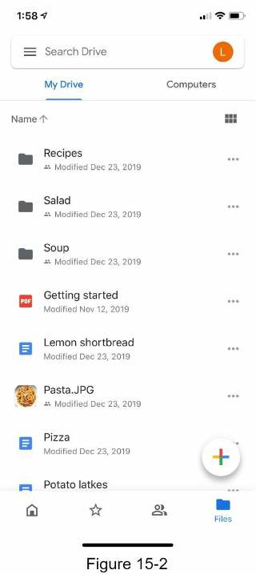

<!-- trang-pdf:246 -->

## Bước 1 - Hiểu bài toán và xác định phạm vi thiết kế

Thiết kế Google Drive là dự án lớn, nên cần đặt câu hỏi để thu hẹp phạm vi.

**Ứng viên:** Những tính năng quan trọng nhất là gì?

**Người phỏng vấn:** Tải lên và tải xuống tệp, đồng bộ tệp và thông báo.

**Ứng viên:** Đây là ứng dụng di động, ứng dụng web hay cả hai?

**Người phỏng vấn:** Cả hai.

**Ứng viên:** Hỗ trợ những định dạng tệp nào?

**Người phỏng vấn:** Mọi loại tệp.

**Ứng viên:** Có cần mã hóa tệp không?

**Người phỏng vấn:** Có, tệp trong kho lưu trữ phải được mã hóa.

**Ứng viên:** Có giới hạn kích thước tệp không?

**Người phỏng vấn:** Có, mỗi tệp không lớn hơn 10 GB.

**Ứng viên:** Sản phẩm có bao nhiêu người dùng?

**Người phỏng vấn:** 10 triệu DAU.

Chương này tập trung vào các tính năng:

- Thêm tệp. Cách dễ nhất là kéo và thả tệp vào Google Drive.
- Tải tệp xuống.
- Đồng bộ trên nhiều thiết bị. Khi thêm tệp trên một thiết bị, nó tự động đồng bộ sang những thiết bị khác.
- Xem các phiên bản chỉnh sửa.
- Chia sẻ với bạn bè, gia đình và đồng nghiệp.
- Gửi thông báo khi tệp được chỉnh sửa, xóa hoặc chia sẻ với bạn.

Các tính năng không thảo luận trong chương này:

- Chỉnh sửa và cộng tác trên Google Docs. Google Docs cho phép nhiều người đồng thời chỉnh sửa cùng một tài liệu. Tính năng này nằm ngoài phạm vi thiết kế.

Ngoài làm rõ chức năng, cần hiểu các yêu cầu phi chức năng:

- **Độ tin cậy:** Vô cùng quan trọng với hệ thống lưu trữ. Mất dữ liệu là không chấp nhận được.
- **Đồng bộ nhanh:** Nếu đồng bộ mất quá lâu, người dùng sẽ mất kiên nhẫn và bỏ sản phẩm.
- **Sử dụng băng thông:** Tiêu hao nhiều băng thông không cần thiết khiến người dùng không hài lòng, nhất là khi dùng gói dữ liệu di động.
- **Khả năng mở rộng:** Hệ thống phải xử lý được lưu lượng lớn.
- **Tính sẵn sàng cao:** Người dùng vẫn sử dụng được khi một số server ngừng hoạt động, chậm đi hoặc gặp lỗi mạng bất ngờ.

### Ước lượng sơ bộ

- Giả sử ứng dụng có 50 triệu người dùng đăng ký và 10 triệu DAU.
- Mỗi người được 10 GB miễn phí.
- Giả sử mỗi người tải lên 2 tệp/ngày, kích thước trung bình 500 KB.
- Tỷ lệ đọc/ghi là 1:1.

<!-- trang-pdf:247 -->

- Tổng dung lượng phân bổ: `50 triệu × 10 GB = 500 petabyte`.
- QPS của API tải lên: `10 triệu × 2 lượt tải / 24 giờ / 3.600 giây ≈ 240`.
- QPS cao điểm = QPS × 2 = 480.

<!-- trang-pdf:248 -->

## Bước 2 - Đề xuất thiết kế cấp cao và thống nhất phương án

Thay vì đưa sơ đồ cấp cao ngay từ đầu, chúng ta dùng cách tiếp cận hơi khác: bắt đầu từ việc đơn giản là xây mọi thứ trên một server, sau đó dần mở rộng để phục vụ hàng triệu người dùng. Bài tập này giúp ôn lại một số chủ đề quan trọng trong sách.

Cấu hình một server ban đầu gồm:

- Web server để tải tệp lên và xuống.
- Cơ sở dữ liệu theo dõi siêu dữ liệu như dữ liệu người dùng, thông tin đăng nhập, thông tin tệp, v.v.
- Hệ thống lưu tệp, được phân bổ 1 TB dung lượng.

Chúng ta dành vài giờ thiết lập Apache, MySQL và một thư mục `drive/` làm thư mục gốc lưu tệp tải lên. Bên dưới `drive/` là danh sách thư mục gọi là các không gian tên (namespace). Mỗi namespace chứa toàn bộ tệp một người dùng đã tải lên. Tên tệp trên server giữ nguyên như tên gốc. Mỗi tệp hoặc thư mục được xác định duy nhất bằng cách ghép namespace với đường dẫn tương đối.

Hình 15-3 thể hiện ví dụ thư mục `/drive` ở bên trái và cấu trúc mở rộng ở bên phải.

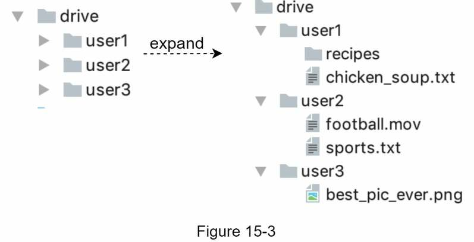

### API

Các API sẽ như thế nào? Chủ yếu cần ba API: tải lên, tải xuống và lấy các phiên bản chỉnh sửa của tệp.

#### 1. Tải tệp lên Google Drive

Hỗ trợ hai kiểu:

- **Tải đơn giản:** Dùng khi tệp nhỏ.
- **Tải có thể tiếp tục:** Dùng khi tệp lớn và có khả năng cao bị gián đoạn mạng.

Ví dụ API tải có thể tiếp tục:

```text
https://api.example.com/files/upload?uploadType=resumable
```

Tham số:

- `uploadType=resumable`.
- `data`: Tệp cục bộ cần tải lên.

<!-- trang-pdf:249 -->

Tải có thể tiếp tục được thực hiện qua ba bước [2]:

- Gửi yêu cầu khởi tạo để lấy URL tải có thể tiếp tục.
- Tải dữ liệu và theo dõi trạng thái.
- Nếu bị gián đoạn, tiếp tục tải.

#### 2. Tải tệp xuống từ Google Drive

API ví dụ: `https://api.example.com/files/download`.

Tham số:

- `path`: Đường dẫn tệp cần tải xuống.

Ví dụ:

```json
{
  "path": "/recipes/soup/best_soup.txt"
}
```

#### 3. Lấy các phiên bản chỉnh sửa

API ví dụ: `https://api.example.com/files/list_revisions`.

Tham số:

- `path`: Đường dẫn tệp muốn lấy lịch sử phiên bản.
- `limit`: Số phiên bản tối đa trả về.

Ví dụ:

```json
{
  "path": "/recipes/soup/best_soup.txt",
  "limit": 20
}
```

Mọi API đều yêu cầu xác thực người dùng và sử dụng HTTPS. Secure Sockets Layer (SSL) bảo vệ dữ liệu truyền giữa client và các backend server.

### Rời khỏi thiết kế một server

Khi ngày càng nhiều tệp được tải lên, cuối cùng bạn sẽ gặp cảnh báo hết dung lượng như Hình 15-4.

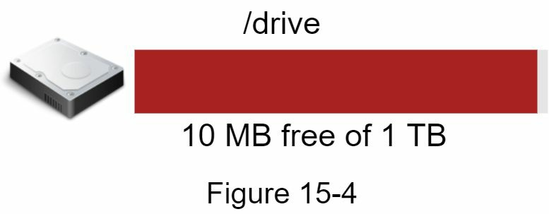

Chỉ còn 10 MB! Đây là tình huống khẩn cấp vì người dùng không thể tải thêm tệp. Giải pháp đầu tiên nghĩ đến là phân mảnh dữ liệu để lưu trên nhiều storage server. Hình 15-5 minh họa phân mảnh theo `user_id`.

<!-- trang-pdf:250 -->

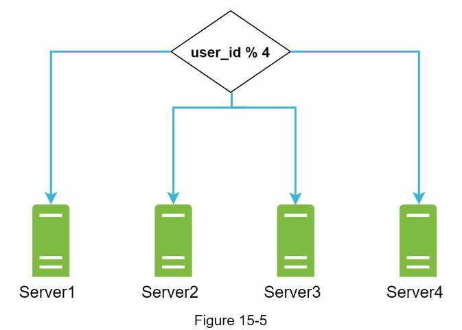

Bạn thức trắng đêm thiết lập phân mảnh cơ sở dữ liệu và theo dõi sát sao. Mọi thứ lại chạy trơn tru. Đám cháy đã được dập, nhưng bạn vẫn lo mất dữ liệu nếu storage server ngừng hoạt động. Bạn hỏi xung quanh, và Frank, người bạn rất giỏi backend, cho biết nhiều công ty hàng đầu như Netflix và Airbnb dùng Amazon S3. “Amazon Simple Storage Service (Amazon S3) là dịch vụ lưu trữ đối tượng cung cấp khả năng mở rộng, tính sẵn sàng dữ liệu, bảo mật và hiệu năng hàng đầu ngành” [3]. Bạn quyết định tìm hiểu xem nó có phù hợp hay không.

Sau khi đọc nhiều tài liệu, bạn hiểu khá rõ S3 và quyết định lưu tệp ở đó. Amazon S3 hỗ trợ sao chép trong cùng vùng và giữa các vùng. Vùng (region) là khu vực địa lý nơi AWS có các trung tâm dữ liệu. Như Hình 15-6, dữ liệu có thể được sao chép trong cùng vùng ở bên trái và khác vùng ở bên phải. Các bản sao dự phòng nằm ở nhiều vùng giúp chống mất dữ liệu và bảo đảm tính sẵn sàng. Bucket tương tự thư mục trong hệ thống tệp.

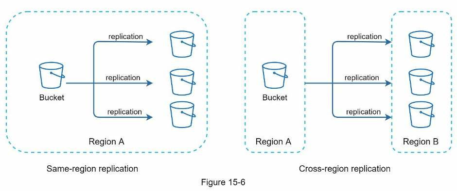

Sau khi đưa tệp lên S3, cuối cùng bạn có thể ngủ ngon mà không lo mất dữ liệu. Để ngăn vấn đề tương tự lặp lại, bạn tiếp tục nghiên cứu những chỗ có thể cải thiện và tìm được:

- **Bộ cân bằng tải:** Thêm bộ cân bằng tải để phân phối lưu lượng mạng. Nó bảo đảm <!-- trang-pdf:251 --> lưu lượng được chia đều và phân phối lại khi một web server ngừng hoạt động.
- **Web server:** Sau khi có bộ cân bằng tải, dễ dàng thêm hoặc bớt web server tùy lưu lượng.
- **Cơ sở dữ liệu siêu dữ liệu:** Đưa cơ sở dữ liệu ra khỏi server ban đầu để tránh điểm lỗi đơn. Đồng thời thiết lập sao chép và phân mảnh, đáp ứng yêu cầu sẵn sàng và mở rộng.
- **Lưu trữ tệp:** Dùng Amazon S3. Để bảo đảm tính sẵn sàng và độ bền dữ liệu, sao chép tệp sang hai vùng địa lý riêng biệt.

Sau các cải tiến này, web server, cơ sở dữ liệu siêu dữ liệu và kho lưu tệp đã được tách khỏi một server duy nhất. Hình 15-7 thể hiện thiết kế mới.

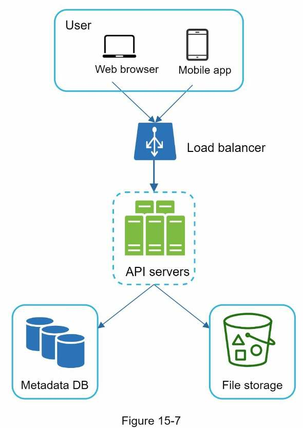

### Xung đột đồng bộ

Với hệ thống lưu trữ lớn như Google Drive, xung đột đồng bộ thỉnh thoảng xảy ra. Khi hai người sửa cùng tệp hoặc thư mục một lúc, sẽ có xung đột. Giải quyết thế nào? Chiến lược ở đây là phiên bản được xử lý trước thắng; phiên bản được xử lý sau nhận thông báo xung đột. Hình 15-8 minh họa một trường hợp.

<!-- trang-pdf:252 -->

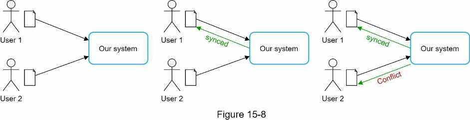

Trong Hình 15-8, người dùng 1 và 2 cùng cập nhật một tệp, nhưng hệ thống xử lý tệp của người 1 trước. Cập nhật của người 1 thành công, còn người 2 gặp xung đột đồng bộ. Giải quyết cho người 2 thế nào? Hệ thống hiển thị cả hai bản: bản cục bộ của người 2 và phiên bản mới nhất từ server, như Hình 15-9. Người 2 có thể hợp nhất hai tệp hoặc dùng một phiên bản ghi đè phiên bản còn lại.

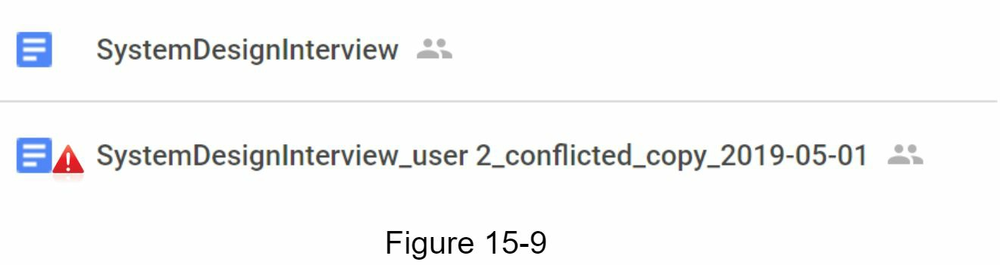

Giữ tài liệu đồng bộ khi nhiều người cùng sửa là việc khó. Bạn đọc quan tâm có thể tham khảo [4] [5].

### Thiết kế cấp cao

Hình 15-10 minh họa thiết kế được đề xuất. Hãy xem từng thành phần.

<!-- trang-pdf:253 -->

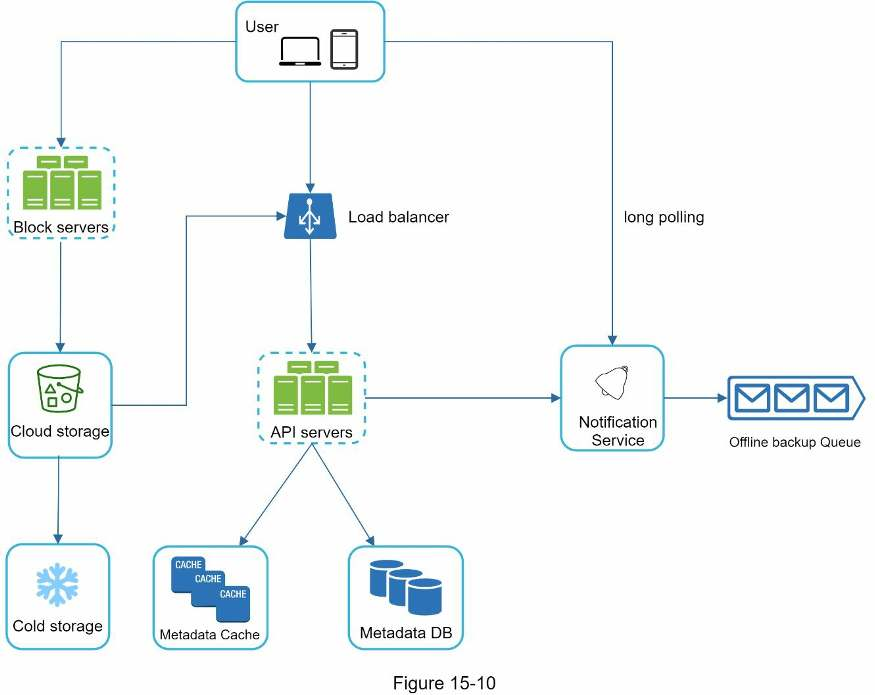

**Người dùng:** Dùng ứng dụng qua trình duyệt hoặc ứng dụng di động.

**Block server:** Tải các khối dữ liệu lên kho đám mây. Lưu trữ khối, còn gọi là block-level storage, là công nghệ lưu tệp trong môi trường đám mây. Một tệp được chia thành nhiều khối, mỗi khối có giá trị băm duy nhất lưu trong cơ sở dữ liệu siêu dữ liệu. Mỗi khối được coi là đối tượng độc lập và lưu trong hệ thống lưu trữ S3. Muốn dựng lại tệp, nối các khối theo đúng thứ tự. Về kích thước khối, chúng ta tham khảo Dropbox: kích thước tối đa 4 MB [6].

**Kho đám mây:** Tệp được chia thành các khối nhỏ rồi lưu tại đây.

**Kho lạnh:** Hệ thống được thiết kế để lưu dữ liệu ít hoạt động, tức các tệp lâu không truy cập.

**Bộ cân bằng tải:** Phân phối đều yêu cầu giữa các API server.

**API server:** Chịu trách nhiệm gần như mọi chức năng ngoài luồng tải dữ liệu lên, như xác thực, quản lý hồ sơ, cập nhật siêu dữ liệu tệp, v.v.

**Cơ sở dữ liệu siêu dữ liệu:** Lưu siêu dữ liệu của người dùng, tệp, khối, phiên bản, v.v. Lưu ý tệp nằm trên đám mây; cơ sở dữ liệu này chỉ chứa siêu dữ liệu.

**Metadata cache:** Một phần siêu dữ liệu được lưu đệm để truy xuất nhanh.

**Dịch vụ thông báo:** Hệ thống xuất bản/đăng ký cho phép truyền dữ liệu từ dịch vụ tới client khi sự kiện xảy ra. Trong trường hợp này, nó thông báo cho các client liên quan khi tệp được thêm/sửa/xóa ở nơi khác, để client lấy thay đổi mới nhất.

**Hàng đợi dự phòng ngoại tuyến:** Nếu client ngoại tuyến và không thể lấy thay đổi mới nhất, hàng đợi <!-- trang-pdf:254 --> lưu thông tin đó để đồng bộ khi client trực tuyến trở lại.

Chúng ta đã bàn thiết kế Google Drive ở cấp cao. Một số thành phần phức tạp và đáng xem xét cẩn thận; phần thiết kế chuyên sâu sẽ trình bày chi tiết.

<!-- trang-pdf:255 -->

## Bước 3 - Thiết kế chuyên sâu

Trong phần này, chúng ta xem kỹ các nội dung: block server, cơ sở dữ liệu siêu dữ liệu, luồng tải lên, luồng tải xuống, dịch vụ thông báo, tiết kiệm dung lượng và xử lý sự cố.

### Block server

Với tệp lớn được cập nhật thường xuyên, gửi lại toàn bộ tệp sau mỗi lần sửa tiêu tốn nhiều băng thông. Có hai tối ưu để giảm lưu lượng phải truyền:

- **Đồng bộ phần thay đổi (delta sync):** Khi tệp được sửa, dùng thuật toán đồng bộ [7] [8] để chỉ đồng bộ những khối đã thay đổi, thay vì toàn bộ tệp.
- **Nén:** Nén các khối có thể giảm đáng kể kích thước. Thuật toán được chọn tùy loại tệp. Ví dụ, gzip và bzip2 dùng cho văn bản; ảnh và video cần thuật toán khác.

Trong hệ thống của chúng ta, block server gánh phần việc nặng của quá trình tải lên. Nó xử lý tệp từ client bằng cách chia thành các khối, nén từng khối rồi mã hóa. Thay vì tải toàn bộ tệp lên hệ thống lưu trữ, chỉ những khối sửa đổi được truyền.

Hình 15-11 thể hiện hoạt động khi thêm tệp mới.

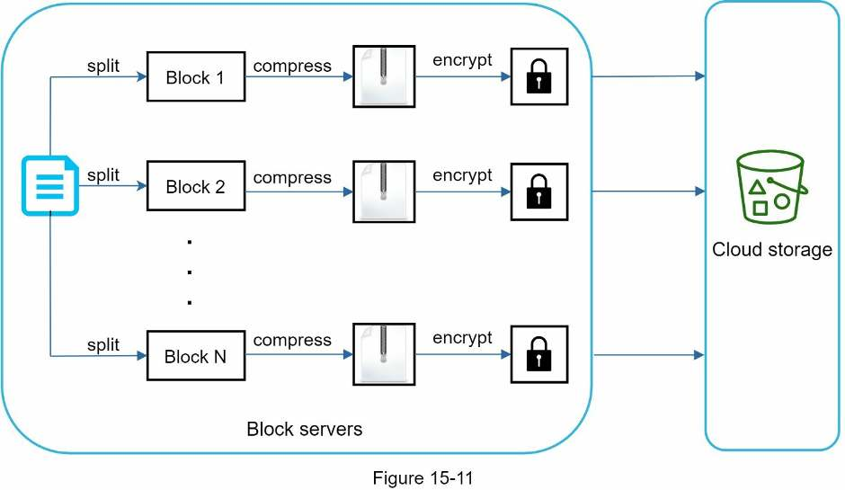

- Chia tệp thành các khối nhỏ.
- Nén mỗi khối bằng thuật toán nén.
- Để bảo đảm bảo mật, mã hóa từng khối trước khi gửi lên đám mây.
- Tải các khối lên kho đám mây.

Hình 15-12 minh họa delta sync: chỉ truyền những khối thay đổi. Hai khối được tô nổi, “block 2” và “block 5”, là các khối đã sửa. Với delta sync, chỉ hai khối này được tải lên.

<!-- trang-pdf:256 -->

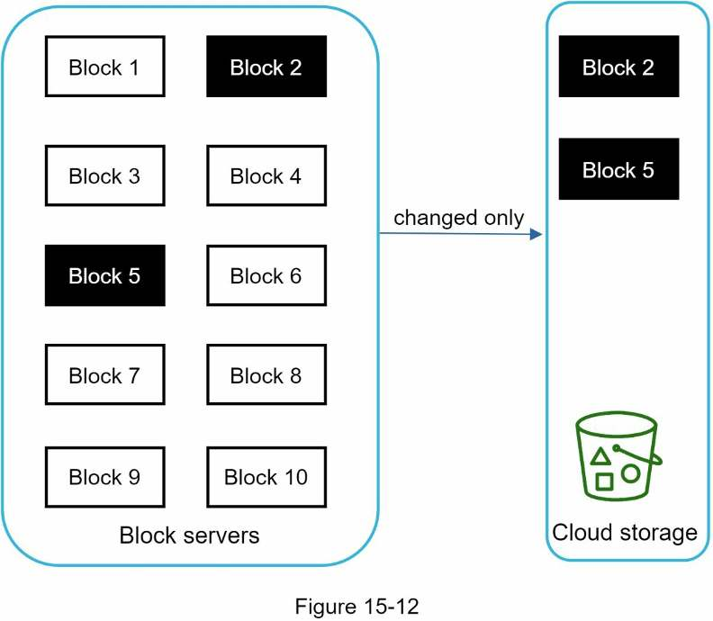

Block server giúp tiết kiệm lưu lượng mạng bằng delta sync và nén.

### Yêu cầu nhất quán cao

Mặc định, hệ thống yêu cầu tính nhất quán mạnh. Không chấp nhận việc cùng một thời điểm mà các client hiển thị các bản tệp khác nhau. Cần bảo đảm nhất quán mạnh ở tầng cache và cơ sở dữ liệu siêu dữ liệu.

Cache trong bộ nhớ mặc định dùng mô hình nhất quán cuối cùng, nghĩa là các bản sao khác nhau có thể giữ dữ liệu khác nhau. Muốn có nhất quán mạnh, phải bảo đảm:

- Dữ liệu giữa các bản sao cache và master nhất quán.
- Vô hiệu hóa cache khi ghi cơ sở dữ liệu, để cache và cơ sở dữ liệu giữ cùng giá trị.

Đạt nhất quán mạnh trong cơ sở dữ liệu quan hệ tương đối dễ vì nó duy trì các thuộc tính ACID: tính nguyên tử, nhất quán, cô lập và bền vững [9]. Ngược lại, cơ sở dữ liệu NoSQL mặc định không hỗ trợ các thuộc tính ACID; phải bổ sung bằng lập trình vào logic đồng bộ. Trong thiết kế này, chúng ta chọn cơ sở dữ liệu quan hệ vì nó hỗ trợ ACID sẵn.

### Cơ sở dữ liệu siêu dữ liệu

Hình 15-13 thể hiện thiết kế lược đồ. Đây là phiên bản được đơn giản hóa rất nhiều, chỉ gồm các bảng quan trọng nhất và những trường đáng chú ý.

<!-- trang-pdf:257 -->

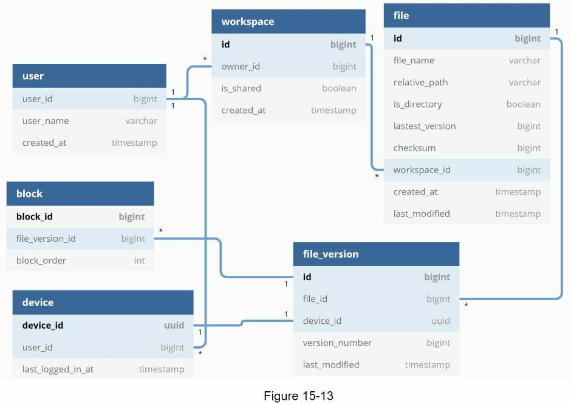

**User:** Bảng chứa thông tin cơ bản như tên người dùng, email, ảnh đại diện, v.v.

**Device:** Lưu thông tin thiết bị. `push_id` dùng để gửi và nhận thông báo đẩy trên di động. Một người dùng có thể có nhiều thiết bị.

**Namespace:** Thư mục gốc của một người dùng.

**File:** Lưu mọi thông tin liên quan tới phiên bản tệp mới nhất.

**File_version:** Lưu lịch sử phiên bản tệp. Các hàng đã tồn tại là chỉ đọc để giữ toàn vẹn lịch sử chỉnh sửa.

**Block:** Lưu mọi thông tin về một khối tệp. Bất kỳ phiên bản tệp nào cũng có thể được dựng lại bằng cách nối mọi khối theo đúng thứ tự.

### Luồng tải lên

Điều gì xảy ra khi client tải tệp lên? Để hiểu rõ hơn, chúng ta vẽ biểu đồ trình tự như Hình 15-14.

<!-- trang-pdf:258 -->

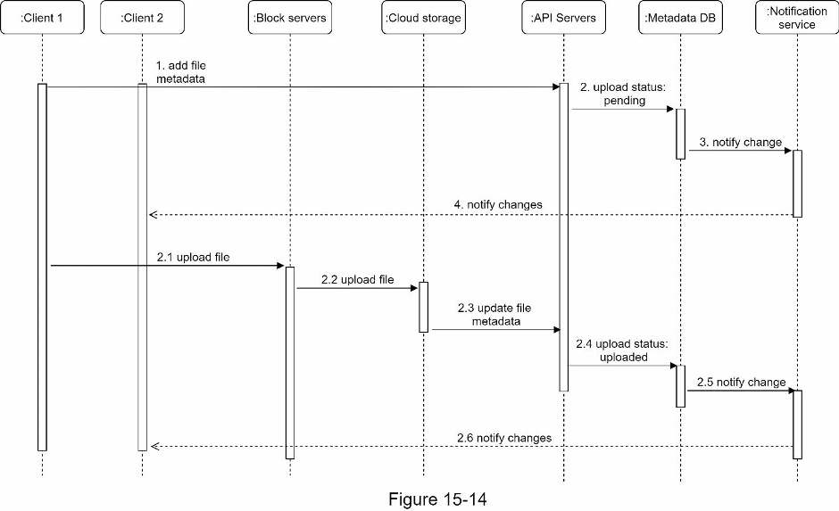

Trong Hình 15-14, hai yêu cầu được gửi song song từ client 1: thêm siêu dữ liệu và tải tệp lên đám mây.

**Thêm siêu dữ liệu tệp:**

1. Client 1 gửi yêu cầu thêm siêu dữ liệu của tệp mới.
2. Lưu siêu dữ liệu vào Metadata DB và chuyển trạng thái tải lên thành `pending`.
3. Báo cho dịch vụ thông báo rằng đang thêm một tệp mới.
4. Dịch vụ thông báo báo cho client liên quan, ở đây là client 2, rằng một tệp đang được tải lên.

**Tải tệp lên kho đám mây:**

- **2.1.** Client 1 tải nội dung tới block server.
- **2.2.** Block server chia tệp thành khối, nén, mã hóa rồi tải lên kho đám mây.
- **2.3.** Sau khi tải xong, kho đám mây kích hoạt callback hoàn tất. Yêu cầu được gửi tới API server.
- **2.4.** Trạng thái tệp trong Metadata DB chuyển thành `uploaded`.
- **2.5.** Báo cho dịch vụ thông báo rằng trạng thái đã đổi thành `uploaded`.
- **2.6.** Dịch vụ thông báo báo cho client 2 rằng tệp đã tải lên đầy đủ.

Khi chỉnh sửa tệp, luồng tương tự nên không lặp lại ở đây.

### Luồng tải xuống

Luồng tải xuống được kích hoạt khi tệp được thêm hoặc sửa ở nơi khác. Làm sao một client biết client khác vừa thêm hoặc sửa tệp? Có hai cách:

- Nếu A trực tuyến khi client khác thay đổi tệp, dịch vụ thông báo báo cho A biết có thay đổi để A lấy dữ liệu mới nhất.

<!-- trang-pdf:259 -->

- Nếu A ngoại tuyến khi client khác thay đổi, dữ liệu được lưu trong cache. Khi A trực tuyến trở lại, nó lấy những thay đổi mới nhất.

Khi biết tệp đã thay đổi, client trước tiên yêu cầu siêu dữ liệu qua API server, sau đó tải các khối để dựng lại tệp. Hình 15-15 mô tả chi tiết. Do giới hạn không gian, sơ đồ chỉ thể hiện các thành phần quan trọng nhất.

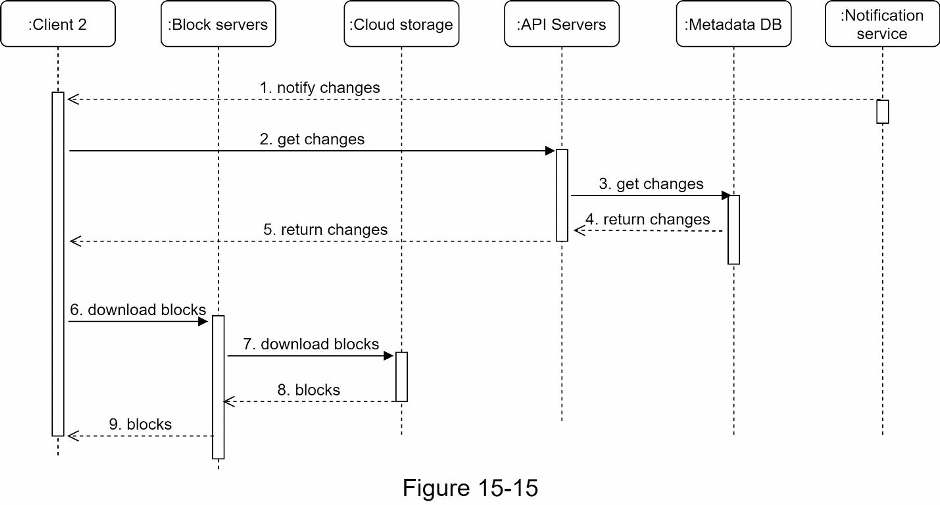

1. Dịch vụ thông báo báo cho client 2 rằng tệp đã thay đổi ở nơi khác.
2. Khi biết có cập nhật, client 2 gửi yêu cầu lấy siêu dữ liệu.
3. API server gọi Metadata DB để lấy siêu dữ liệu thay đổi.
4. Siêu dữ liệu được trả về API server.
5. Client 2 nhận siêu dữ liệu.
6. Sau khi nhận, client gửi yêu cầu tới block server để tải các khối.
7. Block server trước tiên tải khối từ kho đám mây.
8. Kho đám mây trả các khối về block server.
9. Client 2 tải mọi khối mới để dựng lại tệp.

### Dịch vụ thông báo

Để giữ tệp nhất quán, mọi thay đổi thực hiện cục bộ phải được thông báo cho các client khác nhằm giảm xung đột. Dịch vụ thông báo được xây cho mục đích đó. Ở cấp cao, nó truyền dữ liệu đến client khi sự kiện xảy ra. Một số lựa chọn:

- **Long polling:** Dropbox dùng long polling [10].
- **WebSocket:** Cung cấp kết nối liên tục giữa client và server, hỗ trợ giao tiếp hai chiều.

Dù cả hai đều hoạt động tốt, chúng ta chọn long polling vì hai lý do:

- Giao tiếp của dịch vụ thông báo không phải hai chiều. Server gửi thông tin thay đổi tệp tới client, nhưng không có chiều ngược lại.
- WebSocket phù hợp với giao tiếp hai chiều thời gian thực, như ứng dụng chat. Với <!-- trang-pdf:260 --> Google Drive, thông báo được gửi không thường xuyên và không tạo ra các đợt dữ liệu dồn dập.

Với long polling, mỗi client thiết lập một kết nối long poll tới dịch vụ thông báo. Khi phát hiện thay đổi tệp, client đóng kết nối đó. Việc đóng kết nối có nghĩa client phải kết nối tới metadata server để tải thay đổi mới nhất. Sau khi nhận phản hồi hoặc kết nối hết thời gian chờ, client lập tức gửi yêu cầu mới để duy trì kết nối mở.

### Tiết kiệm dung lượng lưu trữ

Để hỗ trợ lịch sử phiên bản và bảo đảm độ tin cậy, nhiều phiên bản của cùng một tệp được lưu trên nhiều trung tâm dữ liệu. Sao lưu thường xuyên mọi phiên bản có thể nhanh chóng lấp đầy dung lượng. Ba kỹ thuật giúp giảm chi phí:

- **Loại bỏ khối trùng lặp:** Loại khối dư thừa ở cấp tài khoản là cách đơn giản để tiết kiệm dung lượng. Hai khối được coi là giống nhau nếu có cùng giá trị băm.
- **Chiến lược sao lưu thông minh:** Có thể áp dụng hai tối ưu:
  - **Đặt giới hạn:** Giới hạn số phiên bản lưu. Khi đạt giới hạn, thay phiên bản cũ nhất bằng phiên bản mới.
  - **Chỉ giữ phiên bản có giá trị:** Một số tệp được sửa liên tục. Ví dụ, nếu lưu mọi lần chỉnh sửa một tài liệu thay đổi nhiều, có thể lưu hơn 1.000 lần trong thời gian ngắn. Để tránh các bản sao không cần thiết, giới hạn số phiên bản lưu và ưu tiên những phiên bản gần đây. Thử nghiệm giúp tìm số lượng tối ưu.
- **Đưa dữ liệu ít dùng sang kho lạnh:** Dữ liệu lạnh là dữ liệu không hoạt động trong nhiều tháng hoặc nhiều năm. Kho lạnh như Amazon S3 Glacier [11] rẻ hơn S3 rất nhiều.

### Xử lý sự cố

Hệ thống lớn có thể gặp sự cố và thiết kế phải có chiến lược ứng phó. Người phỏng vấn có thể muốn biết cách bạn xử lý các trường hợp sau:

- **Bộ cân bằng tải hỏng:** Bộ dự phòng trở thành bộ hoạt động và tiếp nhận lưu lượng. Các bộ cân bằng tải thường giám sát nhau bằng heartbeat, một tín hiệu gửi định kỳ. Một bộ được coi là hỏng nếu không gửi heartbeat trong một khoảng thời gian.
- **Block server hỏng:** Server khác tiếp nhận công việc chưa xong hoặc đang chờ.
- **Kho đám mây hỏng:** Các bucket S3 được sao chép nhiều lần giữa các vùng. Nếu tệp không sẵn ở vùng này, lấy từ vùng khác.
- **API server hỏng:** Đây là dịch vụ không lưu trạng thái. Bộ cân bằng tải chuyển lưu lượng sang API server khác.
- **Metadata cache hỏng:** Các cache server được sao chép nhiều lần. Nếu một nút hỏng, lấy dữ liệu từ nút khác và khởi động cache server mới thay thế.
- **Metadata DB hỏng:**
  - **Master hỏng:** Nâng một slave lên làm master mới, đồng thời tạo slave mới.
  - **Slave hỏng:** Dùng một slave khác cho việc đọc và <!-- trang-pdf:261 --> khởi động database server mới thay nút hỏng.
- **Dịch vụ thông báo hỏng:** Mỗi người dùng trực tuyến giữ một kết nối long poll tới notification server, nên mỗi server kết nối với nhiều người. Theo bài trình bày Dropbox năm 2012 [6], mỗi máy có hơn 1 triệu kết nối mở. Nếu server hỏng, mọi kết nối long poll đều mất, client phải kết nối tới server khác. Dù một server giữ được nhiều kết nối, nó không thể tái lập tất cả cùng lúc. Kết nối lại với toàn bộ client bị mất kết nối là quá trình tương đối chậm.
- **Hàng đợi dự phòng ngoại tuyến hỏng:** Hàng đợi được sao chép nhiều lần. Nếu một hàng đợi hỏng, các consumer có thể cần đăng ký lại với hàng đợi dự phòng.

<!-- trang-pdf:262 -->

## Bước 4 - Tổng kết

Chương này đề xuất một thiết kế hỗ trợ Google Drive. Sự kết hợp giữa nhất quán mạnh, sử dụng ít băng thông và đồng bộ nhanh khiến bài toán thú vị. Thiết kế có hai luồng: quản lý siêu dữ liệu và đồng bộ tệp. Dịch vụ thông báo là một thành phần quan trọng khác, dùng long polling để giúp client cập nhật các thay đổi.

Như mọi câu hỏi thiết kế hệ thống, không có giải pháp hoàn hảo. Mỗi công ty có ràng buộc riêng, và hệ thống phải phù hợp với những ràng buộc đó. Hiểu sự đánh đổi của thiết kế và lựa chọn công nghệ là điều quan trọng. Nếu còn vài phút, bạn có thể bàn về các lựa chọn khác.

Ví dụ, thay vì đi qua block server, client có thể tải tệp trực tiếp lên kho đám mây. Ưu điểm là tải nhanh hơn vì tệp chỉ truyền một lần tới kho. Trong thiết kế của chúng ta, tệp được truyền tới block server trước rồi mới đến đám mây. Tuy nhiên, cách mới có một số nhược điểm:

- Thứ nhất, cùng một logic chia khối, nén và mã hóa phải được triển khai trên nhiều nền tảng iOS, Android và web. Điều này dễ lỗi và cần nhiều công sức kỹ thuật. Trong thiết kế hiện tại, toàn bộ logic được triển khai tập trung tại block server.
- Thứ hai, client dễ bị xâm nhập hoặc can thiệp, nên triển khai mã hóa ở phía client không phải lựa chọn lý tưởng.

Một hướng phát triển thú vị khác là tách logic trực tuyến/ngoại tuyến thành dịch vụ riêng, gọi là presence service. Tách khỏi notification server sẽ giúp các dịch vụ khác dễ tích hợp chức năng trạng thái.

Chúc mừng bạn đã đi được đến đây! Hãy tự dành cho mình một lời khen. Làm tốt lắm!

<!-- trang-pdf:263 -->

## Tài liệu tham khảo

[1] Google Drive: https://www.google.com/drive/

[2] Upload file data: https://developers.google.com/drive/api/v2/manage-uploads

[3] Amazon S3: https://aws.amazon.com/s3

[4] Differential Synchronization: https://neil.fraser.name/writing/sync/

[5] Differential Synchronization youtube talk: https://www.youtube.com/watch?v=S2Hp_1jqpY8

[6] How We’ve Scaled Dropbox: https://youtu.be/PE4gwstWhmc

[7] Tridgell, A., & Mackerras, P. (1996). The rsync algorithm.

[8] Librsync. (n.d.). Truy cập ngày 18 tháng 4 năm 2015, tại https://github.com/librsync/librsync

[9] ACID: https://en.wikipedia.org/wiki/ACID

[10] Dropbox security white paper: https://www.dropbox.com/static/business/resources/Security_Whitepaper.pdf

[11] Amazon S3 Glacier: https://aws.amazon.com/glacier/faqs/

---

[← Chương 14](chuong-14.md) · [Mục lục](../README.md) · [Chương 16 →](chuong-16.md)
